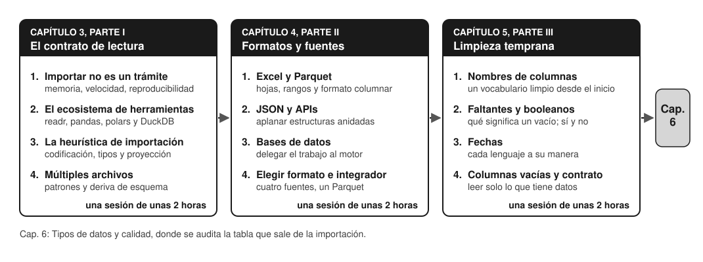
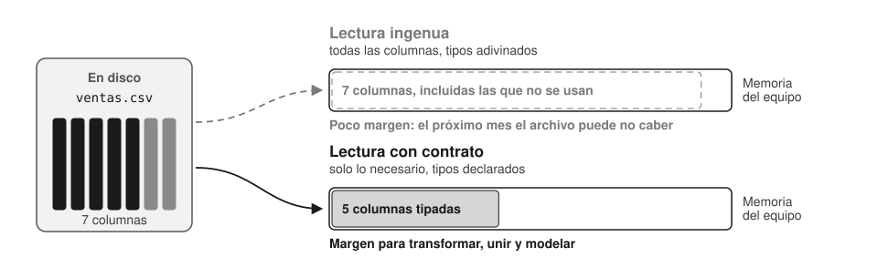
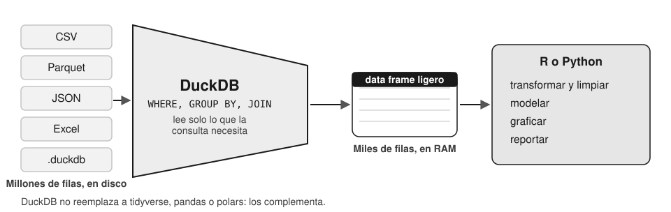
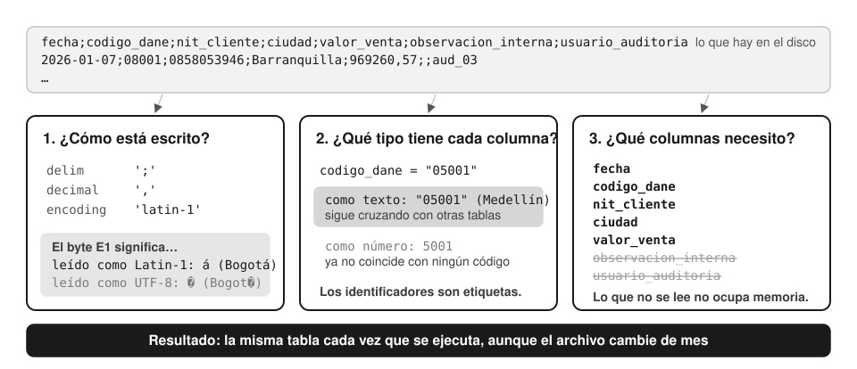
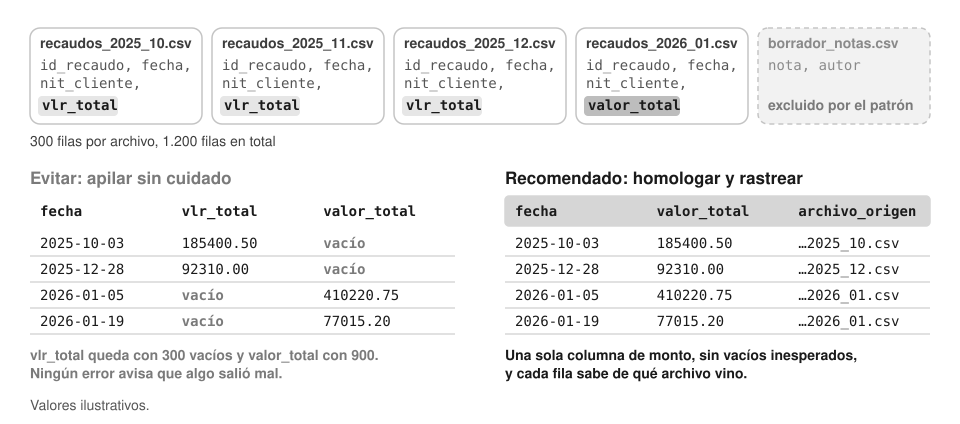

# Importación de datos I: el contrato de lectura {#sec-importacion}


Hasta aquí preparamos el entorno. Ahora empezamos a trabajar con datos reales, y el primer paso de cualquier análisis es el más subestimado: traerlos al entorno de trabajo. La forma en que importamos condiciona todo lo que viene después. Una importación descuidada produce tildes dañadas, identificadores sin ceros iniciales, memoria agotada y resultados que cambian de un mes a otro sin que nadie sepa por qué.

La importación ocupa tres capítulos (@fig-mapa-importacion). En este construimos el método: por qué importar exige criterio, qué herramientas usar y cómo definir un **contrato de lectura** que funcione igual con un archivo que con cien. En el siguiente (@sec-importacion-fuentes) aplicamos ese mismo método a Excel, Parquet, JSON, APIs y bases de datos. En el tercero (@sec-limpieza-temprana) completamos el contrato con la limpieza temprana: nombres de columnas, valores faltantes, booleanos, fechas y columnas vacías.

{#fig-mapa-importacion fig-alt="Tres paneles. Capítulo 3, el contrato de lectura: importar no es un trámite, el ecosistema de herramientas, la heurística de importación y múltiples archivos. Capítulo 4, formatos y fuentes: Excel y Parquet, JSON y APIs, bases de datos, y elegir formato con un proyecto integrador. Capítulo 5, limpieza temprana: nombres de columnas, faltantes y booleanos, fechas, y columnas vacías con el contrato completo. Una flecha final apunta al capítulo 6, Tipos de datos y calidad."}

Todos los ejemplos giran en torno a un mismo caso: las **operaciones comerciales y los recaudos de una red regional de distribución en Colombia, entre 2024 y 2026**. Los archivos de este capítulo están en la carpeta `datos/cap03/` del [repositorio de materiales](https://github.com/romu545/codigo-datos-criterio-material); los de los dos siguientes, en `datos/cap04/` y `datos/cap05/`.

::: {.callout-tip}
## Antes de empezar

1. Abre la carpeta de materiales en Positron (**File → Open Folder…**) para que las rutas relativas `datos/cap03/...` funcionen.
2. Comprueba que instalaste los paquetes de R y Python de la @sec-instalar-paquetes. En la importación usamos sobre todo `readr`, `readxl`, `arrow`, `DBI` y `duckdb` en R, y `pandas`, `polars`, `pyarrow` y `duckdb` en Python.
:::

## Importar no es un trámite: criterio, memoria y fluidez {#sec-criterio-importacion}

Importar parece una operación mecánica, se apunta a un archivo y se obtiene una tabla. Sin embargo, de esa operación dependen tres propiedades de todo el análisis:

- **Velocidad.** Leer lo que no vamos a usar desperdicia tiempo en cada ejecución del código.
- **Estabilidad.** Un archivo que cabe en la memoria hoy puede no caber el próximo mes.
- **Reproducibilidad.** Si la lectura depende de lo que el programa "adivina", el resultado puede cambiar cuando cambian los datos, aunque el código sea el mismo.

El cuello de botella real casi nunca es el disco, es la memoria RAM. Cuando leemos columnas y filas que no necesitamos, ocupamos memoria con datos inútiles y arriesgamos que el equipo se bloquee. Además, un *data frame* en memoria suele ocupar más espacio que el archivo plano del que proviene, porque el texto y los tipos de dato se representan de forma menos compacta. Un archivo de 400 MB puede ocupar en memoria mucho más que eso (@fig-memoria-ram).

{#fig-memoria-ram fig-alt="Un archivo CSV de siete columnas en disco. La lectura ingenua carga las siete columnas y llena casi toda la barra de memoria del equipo. La lectura con contrato carga cinco columnas tipadas y ocupa menos de la mitad."}

Por eso adoptaremos desde el inicio una idea de ingeniería de datos: **la importación se diseña, no se improvisa**. En lugar de dejar que la herramienta infiera todo, definiremos qué leer, cómo interpretarlo y cuánto traer a memoria.


## El ecosistema de herramientas: estándares, rendimiento y bajas dependencias {#sec-ecosistema-importacion}

Al elegir herramientas de importación hay una tensión legítima. Por un lado, la buena práctica pide **minimizar las dependencias externas**; cada paquete adicional es algo que puede cambiar, dejar de mantenerse o fallar en otro equipo. Por otro lado, apoyarse en los **estándares consolidados** del mercado facilita encontrar ayuda, compartir código y formar personas.

Nuestro criterio será usar los estándares para las tareas cotidianas y justificar con claridad cualquier alternativa. La @tbl-herramientas resume el panorama.

| Herramienta | Lenguaje | Fortaleza principal | Cuándo considerarla |
|---|---|---|---|
| [readr](https://readr.tidyverse.org/) y [readxl](https://readxl.tidyverse.org/) | R | Estándar del `tidyverse`; mensajes claros y control de tipos | Tareas cotidianas de importación en R |
| [data.table](https://rdatatable.gitlab.io/data.table/) (`fread`) | R | Lectura muy rápida y pocas dependencias | Archivos grandes que caben en memoria |
| [pandas](https://pandas.pydata.org/) | Python | Estándar histórico y omnipresente | Tareas cotidianas en Python |
| [polars](https://pola.rs/) | Python | Alto rendimiento y menor consumo de memoria | Volúmenes que ponen a prueba a pandas |
| [duckplyr](https://duckplyr.tidyverse.org/) | R | Verbos de `dplyr` ejecutados por DuckDB | Quien ya trabaja con `dplyr` y necesita más volumen sin escribir SQL |
| [DuckDB](https://duckdb.org/) | SQL, R, Python y terminal | Consulta archivos y bases sin cargarlos completos | Filtrar y resumir grandes volúmenes en disco |

: Herramientas de importación y consulta de datos {#tbl-herramientas}

### El estándar en R

En R, `readr` es la puerta de entrada para archivos de texto delimitado y `readxl` para Excel. Desde la versión 2.0, `readr` utiliza por debajo el motor de [vroom](https://vroom.r-lib.org/), que indexa el archivo y lee en paralelo, lo que lo hace rápido sin sacrificar claridad. Para la mayoría de los casos de este libro, `readr` y `readxl` son suficientes.

Las alternativas se justifican por razones concretas. `data.table` ofrece `fread()`, una lectura muy veloz que además reduce dependencias, útil con archivos grandes que aún caben en memoria.

### El estándar en Python

En Python, `pandas` es el estándar histórico, casi cualquier tutorial, pregunta o ejemplo lo usa. `polars` es una alternativa moderna que suele ser más rápida y consumir menos memoria, y lo usaremos en el experimento de rendimiento de este capítulo. Entre `tidyverse` y `pandas` se cubre la gran mayoría de las tareas cotidianas de importación.

### DuckDB como motor transversal

[DuckDB](https://duckdb.org/) es una base de datos analítica (OLAP) **embebida** que no requiere un servidor, puede correr en memoria o guardar su información de forma persistente en un archivo, y se usa desde la terminal, desde R y desde Python con el mismo lenguaje SQL.

Su gran ventaja para este capítulo es que puede **leer y consultar directamente archivos CSV, JSON, Excel y Parquet sin cargarlos por completo en la memoria**. Podemos escribir una consulta que filtra y resume un archivo grande, y solo el resultado llega a R o Python.

Esto plantea una pregunta natural: *¿conviene abandonar `tidyverse` o `pandas` y hacerlo todo con DuckDB?* No. SQL es excelente para filtrar, agregar y combinar tablas, pero la manipulación compleja, el modelado estadístico y la visualización se hacen mejor en R o Python. Lo recomendable es un **flujo híbrido** (@fig-flujo-hibrido):

1. Usar DuckDB para **filtrar, agregar y reducir** los grandes volúmenes directamente en disco.
2. Traer a R o Python un *data frame* ligero con lo que realmente se necesita.
3. Hacer en R o Python la manipulación compleja, el modelado y la visualización.

{#fig-flujo-hibrido fig-alt="Cinco tipos de archivo en disco (CSV, Parquet, JSON, Excel y .duckdb) entran a un embudo llamado DuckDB que aplica WHERE, GROUP BY y JOIN. Sale un data frame ligero que pasa a R o Python para transformar, modelar, graficar y reportar."}

Verás este flujo en acción en los ejemplos de este capítulo y del siguiente.

::: {.callout-note}
## DuckDB desde la terminal, R o Python

El motor y el lenguaje SQL son los mismos en los tres entornos; solo cambia la forma de enviar la consulta. En la terminal se escribe directamente en el programa `duckdb`. En R se abre una conexión con `dbConnect(duckdb())` y se consulta con `dbGetQuery(con, r"(...)")`, con el SQL escrito como texto crudo (lo explicamos en la píldora que sigue). En Python basta con `duckdb.sql("...").df()`. En todo el libro las pestañas de DuckDB usan R, el lenguaje principal, para que sus resultados aparezcan junto a los demás. Si prefieres Python, copia el texto SQL tal cual dentro de `duckdb.sql()`.
:::

::: {.callout-note}
## Píldora de curiosidades: texto crudo

En todo el libro, las consultas de SQL que enviamos desde R van entre `r"(` y `)"`. Es un **texto crudo** (*raw string*), disponible desde R 4.0: todo lo que está dentro se toma tal cual, sin interpretar barras invertidas ni comillas. Así el SQL se escribe igual que en la terminal de DuckDB. Sin él, cada comilla doble dentro de la consulta habría que escribirla como `\"` y cada barra invertida como `\\`.

```{r}
#| label: texto-crudo
cat("Ruta: C:\\datos\\cap03 y una columna \"N° Factura\"") # texto normal
cat(r"(Ruta: C:\datos\cap03 y una columna "N° Factura")") # texto crudo
```

En R, los delimitadores pueden ser paréntesis, corchetes o llaves: `r"(...)"`, `r"[...]"` o `r"{...}"`. Si el texto contiene `)"`, se agregan guiones a ambos lados: `r"-(...)-"`.

Los otros lenguajes tienen lo suyo:

- **Python** tiene `r"..."`, que no interpreta las barras invertidas. Es la forma habitual de escribir expresiones regulares (`r"\d{10}"`) y rutas de Windows. Para varias líneas con comillas adentro están las comillas triples, `"""..."""`, y las dos cosas se combinan: `r"""..."""`. Una curiosidad: un texto crudo de Python no puede terminar en una barra invertida impar, así que `r"C:\datos\"` es un error.
- **DuckDB** acepta textos entre signos de dólar, `$$...$$`, heredados de PostgreSQL. Adentro, la comilla simple no se escapa: `SELECT $$Calle 5 'B'$$` devuelve `Calle 5 'B'`, mientras que con comillas normales habría que escribir `'Calle 5 ''B'''`.
:::

::: {.callout-tip}
## ¿Y si prefiero `dplyr` en lugar de SQL? `duckplyr`

El `tidyverse` tiene un puente directo hacia DuckDB: [duckplyr](https://duckplyr.tidyverse.org/). Permite escribir los mismos verbos de `dplyr` (`filter()`, `summarise()`, `count()`) y que los ejecute DuckDB. A diferencia de `dbplyr`, no genera texto SQL: traduce los verbos directamente a la interfaz relacional de DuckDB. Sus funciones de lectura (`read_csv_duckdb()`, `read_parquet_duckdb()` y `read_json_duckdb()`) aceptan rutas, patrones *glob* y URLs, y no cargan los datos en la memoria de R.

La tabla resultante es perezosa: el trabajo ocurre en DuckDB y el resultado llega a R cuando lo pides con `collect()`. Un ajuste llamado *prudence* controla cuánto se materializa de forma automática; en las funciones de lectura el valor por defecto es `"thrifty"`, que protege la memoria con archivos grandes. Si usas un verbo que `duckplyr` aún no traduce, recurre a `dplyr` de forma transparente.

```{r}
#| label: duckplyr-ejemplo
#| eval: false
recaudos_2025 <- duckplyr::read_csv_duckdb(
  "datos/cap03/lotes_mensuales/recaudos_2025_*.csv"
)

recaudos_2025 |>
  dplyr::summarise(n = dplyr::n(), total = sum(vlr_total)) |>
  dplyr::collect()
```

En el libro las pestañas de DuckDB usan SQL porque es el mismo lenguaje en R, Python y la terminal. Pero si trabajas solo en R y ya piensas en `dplyr`, `duckplyr` es la forma más natural de aplicar el flujo híbrido.
:::

La documentación oficial de cada herramienta está enlazada en la @tbl-herramientas.

## La heurística de importación: definir el contrato desde el inicio {#sec-heuristica-importacion}

Pasar una ruta o una URL a una función es la parte trivial. Lo que distingue un trabajo profesional es definir el **contrato de lectura** desde el primer momento: qué archivo esperamos, cómo está escrito, qué columnas necesitamos y de qué tipo es cada una. Confiar en la inferencia automática funciona hasta que los datos cambian. Tres decisiones forman el contrato, y la @fig-contrato-lectura las resume con el archivo del primer ejemplo.

{#fig-contrato-lectura fig-alt="Arriba, las primeras líneas del archivo separadas por punto y coma. Debajo, tres tarjetas. Uno: cómo está escrito, con delimitador punto y coma, decimal coma y codificación latin-1; el byte E1 es á en Latin-1 y un símbolo de reemplazo en UTF-8. Dos: qué tipo tiene cada columna; 05001 como texto conserva el cero y como número se vuelve 5001. Tres: qué columnas se necesitan; cinco marcadas y dos tachadas."}

### Delimitadores y codificación

Los archivos de texto no dicen cómo están escritos. Debemos indicar el **delimitador** (en español es frecuente el punto y coma, porque la coma es el separador decimal), el **separador decimal** y la **codificación**.

La codificación es el problema clásico en español. Un archivo generado en Windows con Excel suele estar en `Latin-1` (también llamada `ISO-8859-1` o `Windows-1252`), mientras que las herramientas modernas esperan `UTF-8`. Si se leen con la codificación equivocada, las tildes y las eñes se corrompen (`Bogotá` se convierte en `Bogot\xe1` o en `Bogot�`) o la lectura falla con un error.

### Gestión de tipos de columna

Los programas infieren el tipo de cada columna mirando los valores. Es cómodo, pero peligroso con los **identificadores que parecen números** como son las cédulas, NIT, códigos de municipios, consecutivos. Un código como `05001` (Medellín) no es una cantidad, es una etiqueta, y su cero inicial es parte de su identidad. Si se lee como número, se convierte en `5001` y deja de coincidir con cualquier otra tabla.

Hay dos estrategias válidas:

- **Especificar el esquema columna por columna** cuando conocemos bien el archivo.
- **Importar todas las columnas como texto** (`character` en R, `str` en Python, `VARCHAR` en DuckDB) como medida defensiva, y convertir después los tipos que sí son numéricos o de fecha. Así nada se pierde antes de validarlo en el @sec-tipos-calidad.

::: {.callout-warning}
## La inferencia depende del contenido

La inferencia automática no siempre falla, y eso la hace engañosa. En el archivo de este capítulo, `readr` y DuckDB detectan los ceros iniciales y conservan el código como texto, mientras que `pandas` lo convierte en número. Pero si un mes ningún código empezara en cero, `readr` y DuckDB también lo leerían como número. El mismo código, con archivos distintos, produce tipos distintos. Por eso el tipo se declara; no se deja a la suerte.
:::

### Proyección temprana

La tercera decisión es leer **solo las columnas necesarias**, desde el momento de la lectura. Si un archivo tiene diez columnas y usaremos cinco, las otras cinco solo ocupan memoria y tiempo. Con formatos columnares como Parquet, además, las columnas no seleccionadas ni siquiera se leen del disco (lo veremos en el siguiente capítulo, en la @sec-excel-parquet).

Las tres herramientas permiten elegir columnas al leer, pero cada una lo expresa a su manera (@tbl-seleccion-columnas).

| Herramienta | Dónde se eligen | Cómo se nombran las columnas |
|---|---|---|
| `readr` (R) | Argumento `col_select` | Con *tidyselect*, el mismo sistema de `dplyr::select()`: nombres sin comillas (`c(fecha, ciudad)`), rangos (`fecha:ciudad`), funciones auxiliares como `starts_with("nit")` o `any_of()`, y exclusiones con el signo menos (`-observacion_interna`). |
| `pandas` (Python) | Argumento `usecols` | Una lista de nombres o de posiciones, o una función que recibe el nombre de cada columna y devuelve `True` si se conserva, por ejemplo `lambda col: not col.startswith("obs")`. |
| DuckDB (SQL) | Cláusula `SELECT` | Nombres separados por comas, `SELECT * EXCLUDE (observacion_interna, usuario_auditoria)` para quitar columnas, o `SELECT COLUMNS('^nit')` para elegirlas con una expresión regular. |

: Cómo se seleccionan columnas al leer {#tbl-seleccion-columnas}

`tidyselect` no es exclusivo de `readr`: es el mismo lenguaje de selección que usan `dplyr`, `tidyr` y otros paquetes del `tidyverse`, así que lo que aprendas aquí te servirá en la transformación de datos. `pandas` y DuckDB no lo comparten, pero ofrecen ideas equivalentes: listas de nombres, funciones que deciden columna por columna y expresiones regulares.

En un CSV, las tres herramientas tienen que recorrer cada línea completa para saber dónde empieza cada campo, así que el ahorro principal es de memoria: las columnas descartadas no se convierten ni se guardan. DuckDB lleva la selección hasta el motor de lectura (lo que se conoce como *projection pushdown*), y con Parquet, como veremos, el ahorro también es de lectura en disco.

### Ejemplo guiado 3.1: de la lectura ingenua a la lectura controlada

Trabajamos con `ventas_2026_01.csv`, un archivo de unas 5.000 filas con punto y coma como delimitador, coma decimal y codificación `Latin-1`. Incluye `codigo_dane` y `nit_cliente` (con ceros a la izquierda), `fecha`, `ciudad`, `valor_venta` y dos columnas que no necesitamos: `observacion_interna` y `usuario_auditoria`.

**Las funciones de R del capítulo.** En R declaramos al principio, en un solo bloque, todas las funciones que usaremos. Así las dependencias quedan a la vista y evitamos un detalle de `use()` que explica el recuadro siguiente. También abrimos una conexión a DuckDB en memoria, que usaremos en las pestañas de DuckDB.

```{r}
#| label: paquetes-cap03
#| message: false
use(
  "readr",
  c(
    "read_csv",
    "read_csv2",
    "read_delim",
    "locale",
    "problems",
    "cols",
    "col_character",
    "col_date",
    "col_double"
  )
)
use("dplyr", c("glimpse", "rename", "mutate", "count", "bind_rows", "any_of"))
use("purrr", c("map", "list_rbind"))
use("DBI", c("dbConnect", "dbGetQuery", "dbDisconnect"))
use("duckdb", "duckdb")

con <- dbConnect(duckdb())
```

::: {.callout-note}
## ¿Qué hace `use()`?

`use()` es un envoltorio sencillo de `library()`. Sirve para cargar un paquete incluyendo **solo las funciones que indicamos**. Estas dos líneas son equivalentes:

```r
use("readr", c("read_csv", "read_csv2"))
library("readr", include.only = c("read_csv", "read_csv2"))
```

Con cualquiera de las dos queda claro de qué paquete viene cada función, y evitamos conflictos de nombres con funciones que no necesitamos. Si no indicas `include.only`, se cargan todas las funciones del paquete, como con un `library()` normal.

Hay un detalle importante: `use()` carga cada paquete **una sola vez por sesión**. Si más adelante lo llamas de nuevo para el mismo paquete con otras funciones, las nuevas no se agregan, y según la versión de R puede que ni siquiera veas una advertencia. Por eso declaramos todo en un bloque al inicio. Si necesitas una función que no declaraste, llámala con el nombre del paquete delante, como `readr::read_tsv()`, o reinicia la sesión de R y amplía la lista.

En este libro usaremos `use()` por brevedad. Requiere R 4.4 o superior; si trabajas con una versión anterior, usa la forma con `library()`, que funciona igual.
:::

**Primero, qué sale mal con la configuración por defecto.**

::: {.panel-tabset group="lenguaje"}

### R

```{r}
#| label: lectura-ingenua-csv
#| warning: false
ruta_ventas <- "datos/cap03/ventas_2026_01.csv"
read_csv(ruta_ventas)
```

`read_csv()` espera la coma como delimitador. Como nuestro archivo usa punto y coma, la función no separa nada: devuelve un `tibble` con 5.000 filas y **una sola columna** de tipo texto (`<chr>`), cuyo nombre es el encabezado completo del archivo.

`read_csv2()` resuelve el delimitador: espera punto y coma como separador de campos y coma como separador decimal. Ahora obtenemos las mismas 5.000 filas, pero con siete columnas, cada una con su tipo inferido. Fíjate en que `valor_venta` se lee como número (`<dbl>`).

```{r}
#| label: lectura-ingenua-csv2
ventas_defecto <- read_csv2(ruta_ventas)
glimpse(ventas_defecto)
```

Aun así, quedan dos problemas:

- **Tildes dañadas.** Aparecen textos como `Medell\xedn` en `ciudad` y `Pendiente revisi\xf3n contable` en `observacion_interna`. El archivo está en `Latin-1` y `readr` asume `UTF-8` por defecto. El byte `\xed` representa la `í` en `Latin-1`, pero no es válido en `UTF-8`, así que R lo muestra como un código en lugar de un carácter.
- **Columnas innecesarias.** Se cargaron `observacion_interna` y `usuario_auditoria`, que no vamos a usar.

Los ceros iniciales de `codigo_dane` y `nit_cliente` sobreviven (`"05001"`), pero, como vimos en el recuadro anterior, no es algo de lo que debamos depender.

### Python

<!-- Salidas de esta pestaña obtenidas con pandas 2.3.3 (nov. 2026). Pueden variar levemente con otras versiones. -->

```{python}
#| error: true
#| code-line-numbers: true
import pandas as pd

ruta_ventas = "datos/cap03/ventas_2026_01.csv"
ventas_defecto = pd.read_csv(ruta_ventas, sep=";", decimal=",")
```

Ya le indicamos a `pandas` el delimitador (`sep=";"`) y el separador decimal (`decimal=","`), así que esos dos ajustes son correctos. Pero `pandas` asume que el archivo está en `UTF-8` y el nuestro está en `Latin-1`, por lo que la lectura **falla** con un error de decodificación.

```text
UnicodeDecodeError: 'utf-8' codec can't decode byte 0xe1 in position 231: invalid continuation byte
```

El mensaje menciona un byte, como `0xe1` o `0xed`, que en `Latin-1` representa una letra con tilde (`á` o `í`). `UTF-8` no puede interpretarlo y por eso se detiene. Una forma de seguir leyendo es pedirle a `pandas` que reemplace los bytes inválidos:

```{python}
#| code-line-numbers: true
ventas_defecto = pd.read_csv(
    ruta_ventas, sep=";", decimal=",", encoding_errors="replace"
)
ventas_defecto.info()
print(ventas_defecto[["codigo_dane", "nit_cliente", "ciudad"]].head(3))
```

La lectura "funciona", pero mal. Estos son los problemas:

- **Tildes dañadas.** Las letras con tilde se reemplazan por `�` (por ejemplo, `Bogot�`). Esa información se pierde y no se puede recuperar después.
- **Identificadores convertidos en números.** `codigo_dane` y `nit_cliente` quedan como `int64`, así que `05001` pasa a ser `5001` y el NIT pierde sus ceros iniciales. A diferencia de `readr`, `pandas` no conserva los ceros por defecto.
- **Columnas innecesarias.** Se cargaron las siete columnas, incluidas `observacion_interna` y `usuario_auditoria`.
- **Fechas como texto.** `fecha` queda como texto (`str`), porque no le pedimos a `pandas` que la interprete como fecha.

`encoding_errors="replace"` sirve para diagnosticar, no para trabajar: oculta el error y deja los datos dañados.

### DuckDB

```{r}
#| label: duckdb-ingenua
#| error: true
dbGetQuery(
  con,
  r"(
  SELECT * FROM read_csv('datos/cap03/ventas_2026_01.csv', delim = ';')
)"
)
```

DuckDB también asume `UTF-8` por defecto. A diferencia de lo que ocurría con `readr`, que mostraba las tildes dañadas, aquí la lectura **falla** con un error que indica la línea problemática.

Fíjate en las sugerencias que ofrece el mensaje. Una propone probar `encoding='UTF-16'`, que es solo un ejemplo: nuestro archivo está en `Latin-1`. Otra propone activar `ignore_errors=true` para saltar la fila problemática. **No lo hagas aquí**: eso descartaría sin avisar todas las filas con tildes. La solución correcta es declarar la codificación.

```{r}
#| label: duckdb-describe
dbGetQuery(
  con,
  r"(
  DESCRIBE
  SELECT * FROM read_csv('datos/cap03/ventas_2026_01.csv',
                         delim = ';', encoding = 'latin-1')
)"
)[, c("column_name", "column_type")]
```

Con `encoding = 'latin-1'` la lectura funciona. DuckDB detectó bien el delimitador (siete columnas) y reconoció `fecha` como `DATE`, pero quedan dos problemas:

- **La coma decimal no se detecta.** `valor_venta` queda como texto (`VARCHAR`), porque DuckDB no reconoce la coma como separador decimal por sí solo. Hay que indicarlo con `decimal_separator = ','`.
- **Se cargan todas las columnas.** Con `SELECT *`, también entran `observacion_interna` y `usuario_auditoria`.

Los identificadores `codigo_dane` y `nit_cliente` aparecen como `VARCHAR` porque DuckDB detectó los ceros iniciales. Pero, como vimos en el recuadro anterior, esa inferencia depende del contenido del archivo y no debemos confiar en ella.

:::

**Ahora, la lectura controlada.** Declaramos la codificación, el delimitador y el separador decimal; seleccionamos solo cinco columnas y fijamos el tipo de cada una, con los identificadores como texto.

En `readr`, `read_delim()` es la función general para texto delimitado: todos sus parámetros quedan a la vista y se configuran uno por uno. `read_csv()`, `read_csv2()` y `read_tsv()` son envoltorios de ella con valores ya fijados (coma; punto y coma con coma decimal; tabulador). Son cómodas cuando el archivo sigue exactamente esa convención, pero cuando definimos un contrato conviene usar `read_delim()` y declarar cada decisión.

Los tipos se declaran con las funciones `col_*()` dentro de `cols()`: `col_character()`, `col_double()`, `col_integer()`, `col_date()`, `col_datetime()`, `col_logical()`, `col_factor()` y `col_skip()`, entre otras. Varias aceptan parámetros que precisan el contrato. Por ejemplo, `col_date(format = "%d/%m/%Y")` indica cómo está escrita la fecha y `col_factor(levels = c("Andina", "Caribe"))` fija las categorías válidas. Si un valor no cumple lo declarado, `readr` no lo adivina: lo deja vacío y registra el problema, que puedes revisar con `problems()`.

Python y DuckDB siguen la misma idea. En `pandas`, `read_csv()` es la función general (`read_table()` es su envoltorio con tabulador): `dtype` fija el tipo de cada columna y `parse_dates`, junto con `date_format`, interpreta las fechas con un formato explícito. En DuckDB, `read_csv()` también es la función general: `types` fija el tipo de algunas columnas y deja que el motor infiera el resto, `dateformat` declara el formato de las fechas, y `columns` define el esquema completo y desactiva la detección automática.

::: {.panel-tabset group="lenguaje"}

### R

```{r}
#| label: lectura-controlada
ventas <- read_delim(
  ruta_ventas,
  delim = ";",
  locale = locale(decimal_mark = ",", encoding = "latin1"),
  col_select = c(fecha, codigo_dane, nit_cliente, ciudad, valor_venta),
  col_types = cols(
    fecha = col_date(format = "%Y-%m-%d"),
    codigo_dane = col_character(),
    nit_cliente = col_character(),
    ciudad = col_character(),
    valor_venta = col_double()
  )
)

glimpse(ventas)
```

El objeto `locale()` agrupa lo que depende de la región o del idioma: el separador decimal y la codificación. Es el lugar correcto para esas decisiones, y lo reutilizaremos cuando leamos otros archivos con la misma convención.

### Python

```{python}
import pandas as pd

ventas = pd.read_csv(
    "datos/cap03/ventas_2026_01.csv",
    sep=";",
    decimal=",",
    encoding="latin-1",
    usecols=["fecha", "codigo_dane", "nit_cliente", "ciudad", "valor_venta"],
    dtype={"codigo_dane": str, "nit_cliente": str, "ciudad": str},
    parse_dates=["fecha"],
    date_format="%Y-%m-%d",
)

ventas.info()
print(ventas.head(3))
```

`usecols` evita que las columnas innecesarias lleguen a memoria, y `dtype` fija los identificadores como texto antes de que `pandas` pueda convertirlos. Las tildes se leen bien y los ceros iniciales se conservan. Compara también el uso de memoria con la lectura ingenua: 195 KB frente a 274 KB.

### DuckDB

```{r}
#| label: duckdb-controlada
ventas_duck <- dbGetQuery(
  con,
  r"(
  SELECT fecha, codigo_dane, nit_cliente, ciudad, valor_venta
  FROM read_csv(
    'datos/cap03/ventas_2026_01.csv',
    delim = ';',
    decimal_separator = ',',
    encoding = 'latin-1',
    dateformat = '%Y-%m-%d',
    types = {'codigo_dane': 'VARCHAR', 'nit_cliente': 'VARCHAR'}
  )
)"
)

glimpse(ventas_duck)
```

En DuckDB la proyección es natural: solo pedimos en `SELECT` las columnas que necesitamos y el motor evita procesar las demás. El argumento `types` fija el tipo de las dos columnas de identificadores, y deja que DuckDB infiera el resto.

:::

La documentación de referencia de cada parámetro está en [readr](https://readr.tidyverse.org/reference/read_delim.html), [pandas](https://pandas.pydata.org/docs/reference/api/pandas.read_csv.html) y [DuckDB](https://duckdb.org/docs/stable/data/csv/overview).

**La lectura de reconocimiento.** El contrato supone que ya conocemos el archivo. Cuando no es así, por ejemplo con la primera entrega de un proveedor, con un archivo heredado sin documentación o con un mes en el que la inferencia empezó a dar tipos distintos, conviene un paso previo: leer **todas las columnas como texto**. Así nada se transforma todavía. Un código conserva sus ceros, una fecha mal escrita no se convierte en vacío y un monto con separadores extraños se ve tal como llegó.

Con esa tabla de texto inspeccionamos antes de decidir: cuántos caracteres tienen los identificadores, qué valores distintos aparecen en las categorías, qué formato siguen las fechas y qué separador decimal usan los montos. Con lo que encontremos escribimos el contrato definitivo. Esta lectura no reemplaza al contrato, lo prepara: guardar números y fechas como texto ocupa más memoria y obliga a convertirlos después, así que es un paso de exploración y no la forma de trabajar todos los días. En el @sec-limpieza-temprana usaremos estas inspecciones para completar el contrato, y en el @sec-tipos-calidad las convertiremos en validaciones formales.

::: {.panel-tabset group="lenguaje"}

### R

```{r}
#| label: lectura-reconocimiento
ventas_texto <- read_delim(
  ruta_ventas,
  delim = ";",
  locale = locale(encoding = "latin1"),
  col_types = cols(.default = col_character())
)

glimpse(ventas_texto)
```

### Python

```{python}
ventas_texto = pd.read_csv(
    "datos/cap03/ventas_2026_01.csv",
    sep=";",
    encoding="latin-1",
    dtype=str,
)
ventas_texto.info()
```

### DuckDB

```{r}
#| label: duckdb-reconocimiento
dbGetQuery(
  con,
  r"(
  DESCRIBE
  SELECT * FROM read_csv('datos/cap03/ventas_2026_01.csv',
                         delim = ';', encoding = 'latin-1',
                         all_varchar = true)
)"
)[, c("column_name", "column_type")]
```

:::

::: {.callout-note}
## ¿Y `data.table::fread()`?

`fread()`, del paquete [data.table](https://rdatatable.gitlab.io/data.table/), es una alternativa conocida por su velocidad y por depender de muy pocos paquetes. Tiene además un argumento pensado para este problema: `keepLeadingZeros = TRUE` lee como texto cualquier columna numérica con ceros a la izquierda. La misma lectura controlada se escribe así:

```{r}
#| label: fread-controlada
ventas_dt <- data.table::fread(
  ruta_ventas,
  sep = ";",
  dec = ",",
  encoding = "Latin-1",
  select = c(
    fecha = "Date",
    codigo_dane = "character",
    nit_cliente = "character",
    ciudad = "character",
    valor_venta = "numeric"
  )
)

str(ventas_dt)
```

`select` admite un vector con nombres que elige las columnas y fija su tipo en un solo paso. El resultado es una `data.table`, que también es un `data.frame`. En el libro preferimos `readr` por la claridad de sus mensajes, pero `fread()` es una buena opción cuando el archivo es grande y todavía cabe en memoria.
:::


## Escalar a múltiples archivos sin perder el control {#sec-multiples-archivos}

En la práctica, los datos rara vez llegan en un solo archivo. Llegan por mes, por región o por sucursal: decenas o cientos de archivos con la misma estructura. La heurística de la sección anterior sigue siendo válida, pero ahora hay que aplicarla a todos los archivos a la vez y, además, enfrentar un problema nuevo.

### Descubrir los archivos

La primera regla es **no escribir listas de archivos a mano**. Una lista manual es frágil: si llega un archivo nuevo, hay que acordarse de agregarlo, y si se escribe mal una ruta, el análisis cambia sin aviso. En su lugar, descubrimos los archivos de forma dinámica con:

- **rutas relativas**, para que el código funcione en cualquier equipo;
- **expresiones *glob*** (como `*.csv`), que seleccionan archivos por un patrón simple;
- **patrones o expresiones regulares** (el argumento `pattern`), cuando necesitamos más precisión.

::: {.callout-tip}
## El papel de las expresiones regulares (Regex)

Las expresiones regulares son un lenguaje para describir patrones de texto. Las estudiaremos en detalle en capítulos posteriores. Aquí las usamos de forma puntual para **filtrar nombres de archivo con precisión**: por ejemplo, `^recaudos_\d{4}_\d{2}\.csv$` acepta `recaudos_2025_10.csv` pero rechaza `borrador_notas.csv`. Es más seguro que una lista manual y mantiene el análisis reproducible.
:::

### La deriva de esquemas (*schema drift*)

El problema más real al leer muchos archivos es que **representan la misma entidad, pero no son idénticos**. Un mes cambia el nombre de una columna (`vlr_total` pasa a llamarse `valor_total`), otro agrega una columna nueva, otro cambia el tipo de un campo. A esto se le llama *schema drift*, o deriva de esquema, y es una de las principales fuentes de errores silenciosos: si apilamos los archivos sin cuidado, obtenemos columnas duplicadas llenas de vacíos y cifras incompletas, sin ningún error visible.

Las estrategias para controlarlo son tres:

1. **Leer todo como texto** al principio, para que un cambio de tipo no rompa la lectura.
2. **Homologar los nombres** antes de apilar o inmediatamente después.
3. **Conservar el nombre del archivo de origen** en una columna de trazabilidad (`archivo_origen`), para poder rastrear cualquier dato hasta su fuente.

La @fig-deriva-esquema muestra el problema con los archivos del siguiente ejemplo.

{#fig-deriva-esquema fig-alt="Cinco archivos: tres de 2025 con la columna vlr_total, uno de 2026 con valor_total y borrador_notas.csv excluido por el patrón. Abajo, dos tablas. Apilar sin cuidado deja dos columnas de monto con vacíos. Leer como texto, homologar y rastrear deja una sola columna valor_total y una columna archivo_origen."}

### Ejemplo guiado 3.2: apilar los recaudos mensuales

La carpeta `datos/cap03/lotes_mensuales/` contiene los recaudos de cuatro meses: `recaudos_2025_10.csv`, `recaudos_2025_11.csv`, `recaudos_2025_12.csv` y `recaudos_2026_01.csv`. También contiene un archivo distractor, `borrador_notas.csv`, que no debe entrar al análisis. Hay además deriva de esquema: los archivos de 2025 usan `vlr_total` y el de 2026 usa `valor_total`.

**Leer varios archivos no siempre exige un ciclo.** Varias funciones de lectura aceptan directamente un vector de rutas. `read_csv()` y `read_delim()` de `readr` reciben el vector completo y apilan los archivos en una sola tabla (con el argumento `id` agregan la columna de origen), y `read_csv()` de DuckDB acepta un patrón *glob* o una lista de rutas. En esos casos no hace falta iterar. Un ciclo, con `map()` en R o con un generador en Python, se justifica cuando cada archivo necesita un tratamiento propio antes de apilarse: validarlo, renombrar columnas o registrar de dónde vino. `pandas` es la excepción, porque su `read_csv()` lee un archivo a la vez y siempre hay que combinar los resultados con `pd.concat()`.

Primero veamos qué pasa si apilamos sin cuidado.

::: {.panel-tabset group="lenguaje"}

### R

```{r}
#| label: apilar-sin-cuidado
#| error: true
archivos <- list.files(
  "datos/cap03/lotes_mensuales",
  pattern = "^recaudos_\\d{4}_\\d{2}\\.csv$",
  full.names = TRUE
)
basename(archivos)

# Apilar directamente: readr compara los encabezados de todos los archivos
read_csv(
  archivos,
  id = "archivo_origen",
  col_types = cols(.default = col_character())
)
```

`readr` es estricto y se detiene con un mensaje claro: los archivos tienen nombres de columna distintos. Es preferible un error a un resultado incompleto. Si en cambio hubiéramos leído cada archivo por separado y apilado con `bind_rows()`, no habría error: habría aparecido una columna `vlr_total` con 300 vacíos (las filas de 2026) y otra `valor_total` con 900 (las de 2025).

### Python

```{python}
import re
from pathlib import Path
import pandas as pd

carpeta = Path("datos/cap03/lotes_mensuales")
archivos = sorted(
    p
    for p in carpeta.glob("recaudos_*.csv")
    if re.fullmatch(r"recaudos_\d{4}_\d{2}\.csv", p.name)
)
print([a.name for a in archivos])

# Apilar sin homologar: pandas no avisa, solo llena de vacíos
sin_cuidado = pd.concat(
    (pd.read_csv(a, dtype=str) for a in archivos), ignore_index=True
)
print(sin_cuidado.isna().sum())
```

`pandas` no se queja: simplemente crea las dos columnas, `vlr_total` y `valor_total`, y las llena de vacíos donde no aplican. Es un error silencioso.

### DuckDB

```{r}
#| label: duckdb-sin-cuidado
dbGetQuery(
  con,
  r"(
  SELECT count(*)                      AS filas,
         count(*) - count(vlr_total)   AS vacios_vlr_total,
         count(*) - count(valor_total) AS vacios_valor_total
  FROM read_csv('datos/cap03/lotes_mensuales/recaudos_*.csv',
                union_by_name = true, all_varchar = true)
)"
)
```

El *glob* `recaudos_*.csv` ya excluye el archivo `borrador_notas.csv`. Con `union_by_name = true`, DuckDB alinea las columnas por nombre y deja ambas, `vlr_total` y `valor_total`, con vacíos donde no aplican. Sin esa opción, alinearía por posición, lo que sería peor.

:::

**Antes de corregir, diagnosticar.** Con cuatro archivos el problema salta a la vista; con cuarenta, no. Por eso conviene un paso previo que lea **solo los encabezados** de cada archivo, sin cargar sus filas, y construya un mapa de presencia: la primera columna es el nombre del archivo, las demás son todos los nombres de columna encontrados, y cada celda indica si esa columna está en ese archivo. Si hay más columnas que archivos, la tabla se lee mejor transpuesta, con una fila por columna y una columna por archivo.

El mapa responde tres preguntas: qué archivo no se parece a los demás, qué columnas faltan en algunos archivos y cuáles podrían ser la misma columna con otro nombre. Para verlo completo, lo aplicamos a todos los CSV de la carpeta, incluido el distractor.

::: {.panel-tabset group="lenguaje"}

### R

```{r}
#| label: mapa-columnas
# Lee solo la primera línea de cada archivo: los nombres de columna
leer_encabezado <- function(ruta) {
  names(read_csv(ruta, n_max = 0, col_types = cols(.default = col_character())))
}

# Una fila por archivo y una columna por nombre encontrado: TRUE si está presente
mapa_columnas <- function(rutas) {
  encabezados <- map(rutas, leer_encabezado)
  names(encabezados) <- basename(rutas)
  columnas <- unique(unlist(encabezados))
  presencia <- t(vapply(
    encabezados,
    \(enc) columnas %in% enc,
    logical(length(columnas))
  ))
  colnames(presencia) <- columnas
  data.frame(
    archivo = rownames(presencia),
    presencia,
    row.names = NULL,
    check.names = FALSE
  )
}

# Una fila por columna y una columna por archivo
transponer_mapa <- function(mapa) {
  presencia <- t(as.matrix(mapa[-1]))
  colnames(presencia) <- mapa$archivo
  data.frame(
    columna = rownames(presencia),
    presencia,
    row.names = NULL,
    check.names = FALSE
  )
}

todos <- list.files(
  "datos/cap03/lotes_mensuales",
  pattern = "\\.csv$",
  full.names = TRUE
)
mapa <- mapa_columnas(todos)

# En cuántos archivos aparece cada columna
colSums(mapa[-1])

# Si hay más columnas que archivos, se lee mejor transpuesto
if (ncol(mapa) - 1 > nrow(mapa)) {
  mapa <- transponer_mapa(mapa)
}
mapa
```

`read_csv()` con `n_max = 0` no lee ninguna fila: solo el encabezado. Por eso el diagnóstico es rápido aunque los archivos sean grandes. El mapa guarda valores lógicos (`TRUE` o `FALSE`) y no marcas de texto, para poder contar con `colSums()` o filtrar sobre él.

### Python

```{python}
from pathlib import Path
import pandas as pd


def mapa_columnas(rutas):
    """Una fila por archivo y una columna por nombre encontrado: True si está presente."""
    encabezados = {
        r.name: pd.read_csv(r, nrows=0).columns.tolist() for r in rutas
    }
    columnas = list(
        dict.fromkeys(c for enc in encabezados.values() for c in enc)
    )
    return pd.DataFrame(
        [[c in enc for c in columnas] for enc in encabezados.values()],
        index=pd.Index(list(encabezados), name="archivo"),
        columns=columnas,
    )


todos = sorted(Path("datos/cap03/lotes_mensuales").glob("*.csv"))
mapa = mapa_columnas(todos)

print(mapa.sum())  # en cuántos archivos aparece cada columna

if mapa.shape[1] > mapa.shape[0]:  # más columnas que archivos: transponer
    mapa = mapa.T
    mapa.index.name = "columna"
print(mapa.to_string())
```

`nrows=0` cumple el mismo papel que `n_max = 0` en R. En `pandas`, transponer es tan simple como `.T`.

### DuckDB

```{r}
#| label: duckdb-mapa-columnas
dbGetQuery(
  con,
  r"(
  WITH encabezados AS (
    SELECT
      parse_filename(filename) AS archivo,
      unnest(string_split(
        string_split(replace(content, chr(13), ''), chr(10))[1], ','
      )) AS columna
    FROM read_text('datos/cap03/lotes_mensuales/*.csv')
  )
  PIVOT encabezados
  ON archivo
  USING count(*)
  GROUP BY columna
  ORDER BY columna
)"
)
```

`read_text()` lee cada archivo como un solo texto. De ahí tomamos la primera línea (quitando antes los retornos de carro que dejan los archivos creados en Windows) y la partimos por comas, con lo que obtenemos una fila por cada par archivo y columna. `PIVOT` convierte esa lista en la matriz: `1` si la columna está en el archivo y `0` si no. Esta versión ya está transpuesta; para tener una fila por archivo basta con cambiar `ON archivo` por `ON columna` y `GROUP BY columna` por `GROUP BY archivo`. Ten en cuenta que la consulta supone que el delimitador es la coma y que los nombres no van entre comillas.

:::

El mapa muestra dos hallazgos. Primero, `borrador_notas.csv` no comparte ninguna columna con los demás: no pertenece al conjunto, y el patrón que usamos para descubrir los archivos ya lo deja fuera. Segundo, `vlr_total` aparece en tres archivos y `valor_total` en uno, y nunca en el mismo archivo. Dos columnas que se reparten los archivos sin coincidir son la señal típica de un cambio de nombre y, por tanto, candidatas a homologarse. El mapa sugiere; no decide. Antes de unirlas, revisa unas cuantas filas de cada una para confirmar que miden lo mismo y en la misma unidad.

Con el diagnóstico hecho, corregimos: leemos cada archivo como texto, homologamos el nombre de la columna, agregamos `archivo_origen` y solo entonces convertimos los tipos.

::: {.panel-tabset group="lenguaje"}

### R

```{r}
#| label: apilar-con-cuidado
leer_lote <- function(ruta) {
  read_csv(ruta, col_types = cols(.default = col_character())) |>
    rename(any_of(c(valor_total = "vlr_total"))) |>
    mutate(archivo_origen = basename(ruta))
}

recaudos <- archivos |>
  map(leer_lote) |>
  list_rbind() |>
  mutate(
    fecha = as.Date(fecha),
    valor_total = as.numeric(valor_total)
  )

count(recaudos, archivo_origen)
colSums(is.na(recaudos))
```

`rename(any_of(...))` renombra la columna solo si existe, así que la misma función sirve para los archivos de 2025 y de 2026. Al final verificamos los vacíos: no debe haber ninguno inesperado.

### Python

```{python}
def leer_lote(ruta):
    return (
        pd.read_csv(ruta, dtype=str)
        .rename(columns={"vlr_total": "valor_total"})
        .assign(archivo_origen=ruta.name)
    )


recaudos = pd.concat((leer_lote(a) for a in archivos), ignore_index=True)
recaudos["fecha"] = pd.to_datetime(recaudos["fecha"])
recaudos["valor_total"] = pd.to_numeric(recaudos["valor_total"])

print(recaudos["archivo_origen"].value_counts())
print(recaudos.isna().sum())
```

### DuckDB

```{r}
#| label: duckdb-con-cuidado
recaudos_duck <- dbGetQuery(
  con,
  r"(
  SELECT
    id_recaudo,
    CAST(fecha AS DATE) AS fecha,
    nit_cliente,
    CAST(COALESCE(valor_total, vlr_total) AS DOUBLE) AS valor_total,
    parse_filename(filename) AS archivo_origen
  FROM read_csv(
    'datos/cap03/lotes_mensuales/recaudos_*.csv',
    union_by_name = true,
    filename = true,
    all_varchar = true
  )
)"
)

count(recaudos_duck, archivo_origen)
```

`COALESCE` toma el primer valor no vacío, así que unifica `valor_total` y `vlr_total` en una sola columna. La opción `filename = true` agrega la ruta de origen, y `parse_filename()` deja solo el nombre.

:::

### Ejercicio 3.1: solo los archivos de 2025

Importa **únicamente** los recaudos de 2025 que están en `datos/cap03/lotes_mensuales/`, usando un patrón (no una lista manual). Estandariza los nombres de columna, agrega archivo_origen y verifica que, después de unir los archivos, no haya valores nulos inesperados. Escribe tu solución en el espacio siguiente.

::: {.panel-tabset group="lenguaje"}

### R

```{r}
#| label: ejercicio-3-1
#| eval: false
# 1. Descubrir los archivos de 2025 con un patrón
archivos_2025 <- list.files(
  "datos/cap03/lotes_mensuales",
  pattern = "...", # TODO: expresión regular para recaudos_2025_xx.csv
  full.names = TRUE
)

# 2. Leer, homologar nombres y apilar
recaudos_2025 <- ... # TODO

# 3. Verificar nulos inesperados
... # TODO
```

### Python

```{python}
#| eval: false
# 1. Descubrir los archivos de 2025 con un patrón
archivos_2025 = ...  # TODO

# 2. Leer, homologar nombres y apilar
recaudos_2025 = ...  # TODO

# 3. Verificar nulos inesperados
...  # TODO
```

### DuckDB

```{r}
#| label: ejercicio-3-1-duckdb
#| eval: false
recaudos_2025 <- dbGetQuery(
  con,
  r"(
  -- TODO: leer solo recaudos_2025_*.csv, homologar columnas
  --       y agregar archivo_origen
)"
)
```

:::

### Ejemplo guiado 3.3: cuando no hay delimitador

No todos los archivos de texto separan sus columnas con un carácter. Un chat exportado de WhatsApp, el registro (*log*) de un servidor o un reporte heredado traen una línea por evento, y cada línea sigue un patrón. Aquí `read_delim()` no sirve, porque los dos puntos o las comas también aparecen dentro de los mensajes. Lo que sí sirve es una expresión regular con **grupos con nombre**: cada grupo captura una parte de la línea y su nombre se convierte en el nombre de una columna.

El archivo `chat_soporte_sucursales.txt` simula el chat del equipo de soporte de la red de sucursales (los nombres y mensajes son ficticios). Cada mensaje tiene esta forma:

```text
5/01/26, 8:15 a. m. - Laura Gómez: Buenos días. ¿Ya cargaron los recaudos de diciembre...
```

El patrón describe esa estructura. `(?<fecha>...)` captura la fecha, `(?<hora>...)` la hora, `(?<autor>...)` todo lo que hay antes de los dos puntos y `(?<mensaje>...)` el resto de la línea. Como dijimos, las expresiones regulares se estudian a fondo más adelante; por ahora basta con reconocer que cada grupo entre paréntesis se vuelve una columna.

::: {.panel-tabset group="lenguaje"}

### R

```{r}
#| label: chat-rematch2
lineas <- readLines(
  "datos/cap03/chat_soporte_sucursales.txt",
  encoding = "UTF-8"
)

patron <- paste0(
  "^(?<fecha>\\d{1,2}/\\d{2}/\\d{2}), ",
  "(?<hora>\\d{1,2}:\\d{2} [ap]\\. m\\.) - ",
  "(?<autor>[^:]+): ",
  "(?<mensaje>.*)$"
)

chat <- rematch2::re_match(lineas, patron)
chat
sum(is.na(chat$autor))
```

`re_match()`, del paquete [rematch2](https://github.com/r-lib/rematch2), devuelve una tabla con una columna por cada grupo con nombre, más `.text` (la línea original) y `.match` (la parte que coincidió). Las líneas que no siguen el patrón quedan con vacíos.

### Python

```{python}
from pathlib import Path
import pandas as pd

lineas = (
    Path("datos/cap03/chat_soporte_sucursales.txt")
    .read_text(encoding="utf-8")
    .splitlines()
)

patron = (
    r"^(?P<fecha>\d{1,2}/\d{2}/\d{2}), "
    r"(?P<hora>\d{1,2}:\d{2} [ap]\. m\.) - "
    r"(?P<autor>[^:]+): (?P<mensaje>.*)$"
)

chat = pd.Series(lineas).str.extract(patron)
print(chat[["fecha", "hora", "autor"]].head(4))
print(chat["autor"].isna().sum())
```

En Python los grupos con nombre se escriben `(?P<nombre>...)`, con una `P`. `str.extract()` devuelve un *data frame* cuyas columnas llevan el nombre de cada grupo.

### DuckDB

```{r}
#| label: chat-duckdb
chat_duck <- dbGetQuery(
  con,
  r"(
  WITH lineas AS (
    SELECT unnest(string_split(content, chr(10))) AS linea
    FROM read_text('datos/cap03/chat_soporte_sucursales.txt')
  )
  SELECT m.fecha, m.hora, m.autor, m.mensaje
  FROM (
    SELECT regexp_extract(
      linea,
      '^(\d{1,2}/\d{2}/\d{2}), (\d{1,2}:\d{2} [ap]\. m\.) - ([^:]+): (.*)$',
      ['fecha', 'hora', 'autor', 'mensaje']
    ) AS m
    FROM lineas
  )
)"
)

head(chat_duck, 4)
sum(chat_duck$autor == "")
```

`read_text()` lee el archivo completo como un solo texto, `string_split()` lo parte en líneas y `regexp_extract()` aplica el patrón. En DuckDB los nombres de las columnas se dan en una lista aparte, en el mismo orden de los grupos. Cuando una línea no coincide, DuckDB devuelve texto vacío en lugar de un valor faltante, por eso contamos `autor == ""`. Aquí el texto crudo `r"(...)"` es indispensable: sin él habría que duplicar cada barra invertida del patrón.

:::

Las tres herramientas encuentran las mismas tres líneas sin capturar: el aviso de cifrado que WhatsApp pone al inicio, que no tiene autor, y las dos líneas de continuación del mensaje de Camila, que se escribió en varias líneas. Ninguna se pierde: quedan identificadas con vacíos, y unirlas al mensaje anterior es una tarea de limpieza que retomaremos más adelante.

::: {.callout-warning}
## El formato depende del teléfono

La forma de cada línea cambia según el sistema operativo, el idioma y la configuración regional del teléfono. Algunos exportan la fecha entre corchetes, otros usan el formato de 24 horas, y algunas versiones insertan antes de `a. m.` un espacio especial que no se distingue a simple vista. Antes de escribir el patrón, abre el archivo y mira varias líneas reales. Un patrón que no coincide no produce error, solo vacíos, así que cuenta siempre cuántas líneas quedaron sin capturar.
:::

```{r}
#| label: cerrar-conexion
#| include: false
dbDisconnect(con)
```

## Lo que llevamos y lo que sigue {#sec-cierre-importacion-i}

Con este capítulo tienes el método completo para archivos de texto. Cada vez que importes, el contrato se resume en cinco preguntas:

1. ¿Cómo está escrito el archivo? Delimitador, separador decimal y codificación.
2. ¿Qué tipo tiene cada columna? Los identificadores son texto, aunque parezcan números.
3. ¿Qué columnas necesito? Lo que no se lee no ocupa memoria.
4. ¿Cómo encuentro los archivos? Con patrones, no con listas escritas a mano.
5. ¿Qué pasa si el esquema cambia? Homologar nombres y conservar `archivo_origen`.

## Auditoría 3.1: el código que propone un asistente {#sec-auditoria-importacion}

Este libro cierra varios capítulos con una **auditoría**: un código que se ejecuta sin errores, del tipo que entrega un asistente de inteligencia artificial cuando se le pide una tarea en pocas palabras, y la pregunta de si se puede usar. No son errores inventados para el ejercicio: son los que aparecen cuando el código se escribe sin conocer los datos.

El pedido fue: *«Lee ventas_2026_01.csv, que usa punto y coma, y calcula las ventas de enero por municipio, con su código DANE, para cruzarlas con el catálogo de sucursales»*. Esta es la respuesta típica:

::: {.panel-tabset group="lenguaje"}

### R

```{r}
#| label: auditoria-3-1
ventas <- read.csv2("datos/cap03/ventas_2026_01.csv")

ventas_municipio <- aggregate(
  valor_venta ~ codigo_dane + ciudad,
  data = ventas,
  FUN = sum
)
ventas_municipio
```

### Python

```{python}
import pandas as pd

ventas = pd.read_csv(
    "datos/cap03/ventas_2026_01.csv", sep=";", decimal=",", encoding="latin-1"
)
ventas_municipio = ventas.groupby(["codigo_dane", "ciudad"], as_index=False)[
    "valor_venta"
].sum()
print(ventas_municipio)
```

:::

El código corre, los totales suman lo mismo que el archivo y la tabla tiene ocho municipios, como debe ser. Antes de abrir la solución, revísalo con las cinco preguntas anteriores. ¿Se puede cruzar esta tabla con el catálogo?

::: {.callout-tip collapse="true"}
## Solución de la auditoría 3.1

**Los códigos DANE perdieron el cero.** Las dos herramientas infieren que `codigo_dane` es un número, y `05001` se vuelve `5001`. El catálogo de sucursales guarda `05001` como texto, así que Medellín y Barranquilla no encontrarían su pareja al cruzar. Es la pregunta 2 del contrato: los identificadores son texto, aunque parezcan números. El mismo daño sufre `nit_cliente`, que no se usó aquí pero quedó cargado y dañado en `ventas`.

```{r}
#| label: auditoria-3-1-evidencia
class(ventas$codigo_dane)
table(nchar(ventas$codigo_dane))
```

Hay 1.215 filas con un código de cuatro cifras, que no existe en la codificación del DANE.

**En R, además, las tildes se dañaron.** `read.csv2()` no recibió la codificación y leyó el archivo `Latin-1` como si fuera `UTF-8`: «Medellín» quedó como `Medell\xedn`. Un cruce por nombre de ciudad también fallaría. El código de Python sí declaró `encoding="latin-1"`; un asistente acierta a veces en esto, y por eso la revisión no puede depender de que acierte.

**Lo que no se ve en el resultado.** En R, `fecha` quedó como texto, de modo que filtrar por rango de fechas daría resultados equivocados sin aviso. Y las dos versiones leen las siete columnas, cuando la tarea necesita tres (pregunta 3).

La versión corregida aplica el contrato del Ejemplo guiado 3.1: codificación declarada, identificadores como texto y solo las columnas necesarias.

::: {.panel-tabset group="lenguaje"}

### R

```{r}
#| label: auditoria-3-1-corregida
ventas <- read_csv2(
  "datos/cap03/ventas_2026_01.csv",
  locale = locale(encoding = "latin1", decimal_mark = ",", grouping_mark = "."),
  col_types = cols(.default = col_character(), valor_venta = col_double()),
  col_select = c(codigo_dane, ciudad, valor_venta)
)

aggregate(valor_venta ~ codigo_dane + ciudad, data = ventas, FUN = sum)
```

### Python

```{python}
ventas = pd.read_csv(
    "datos/cap03/ventas_2026_01.csv",
    sep=";",
    decimal=",",
    encoding="latin-1",
    dtype={"codigo_dane": "string"},
    usecols=["codigo_dane", "ciudad", "valor_venta"],
)
print(ventas.groupby(["codigo_dane", "ciudad"])["valor_venta"].sum().head(2))
```

:::

La lección general: **un código que falla con un mensaje claro es mejor que uno que entrega cifras dañadas en silencio**. Cuando un asistente te entregue código de importación, no preguntes solo si corre; pregunta qué hizo con cada columna.
:::

En el siguiente capítulo (@sec-importacion-fuentes) aplicamos el mismo contrato a fuentes que no son texto plano: hojas de cálculo, archivos Parquet, respuestas JSON de APIs y bases de datos.
