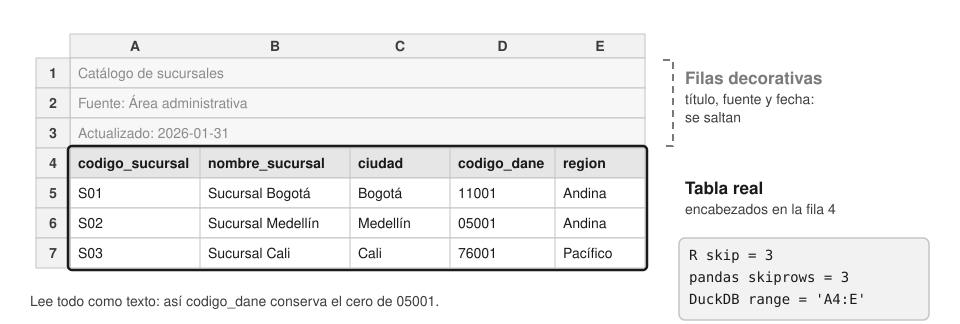
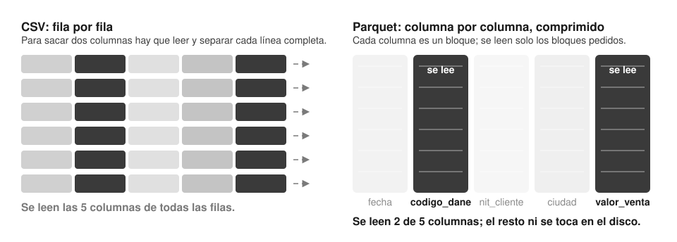
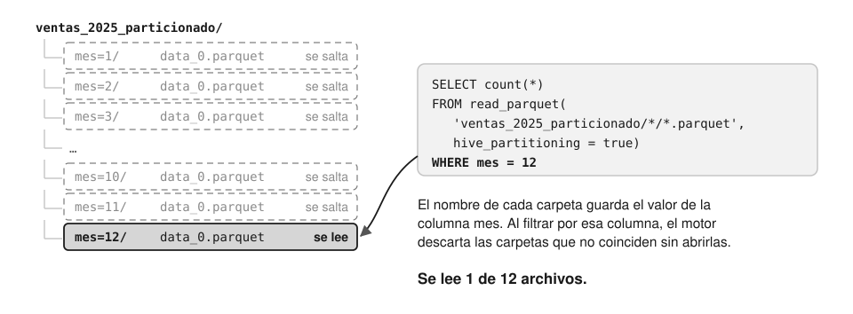
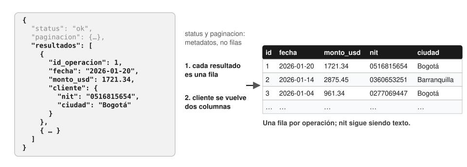
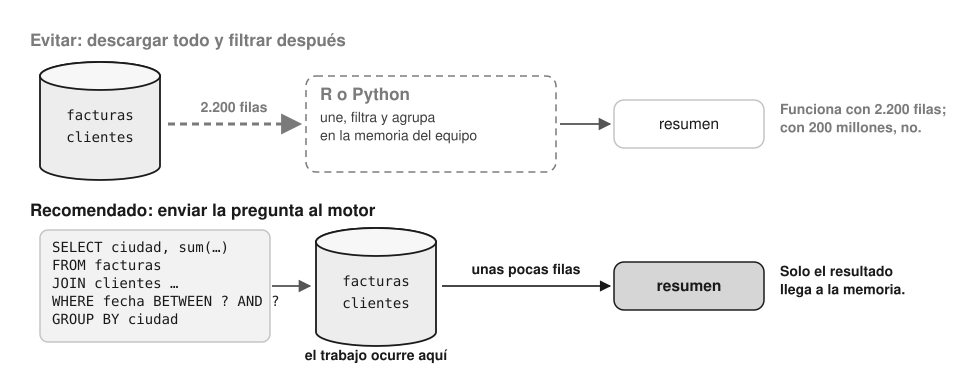
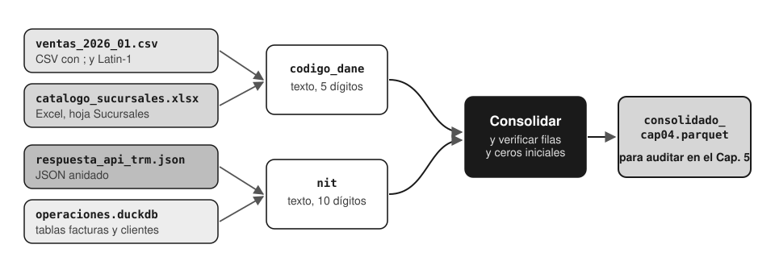

# Importación de datos II: formatos y fuentes {#sec-importacion-fuentes}

En el capítulo anterior (@sec-importacion) construimos el contrato de lectura con archivos de texto: declarar cómo está escrito el archivo, qué tipo tiene cada columna y qué columnas necesitamos. Ahora aplicamos ese mismo método a otras fuentes frecuentes: hojas de cálculo, archivos Parquet, respuestas JSON de APIs y bases de datos. Las herramientas cambian; las preguntas no.

Seguimos con el mismo caso, las operaciones comerciales y los recaudos de una red regional de distribución. Los archivos de este capítulo están en la carpeta `datos/cap04/` del repositorio de materiales; el proyecto integrador también usa `ventas_2026_01.csv`, que está en `datos/cap03/`. El capítulo cierra con una guía para elegir formato y con un proyecto integrador que reúne cuatro fuentes en un solo archivo Parquet. Está pensado para una sesión de estudio de unas dos horas.

::: {.callout-tip}
## Antes de empezar

1. Abre de nuevo la carpeta de materiales en Positron para que las rutas relativas `datos/cap04/...` y `datos/cap03/...` funcionen.
2. Los paquetes de R y de Python son los que instalaste al comienzo del capítulo anterior (@sec-importacion). No necesitas nada nuevo.
3. Para leer Excel desde DuckDB se descarga la extensión `excel` la primera vez que se usa, así que necesitarás conexión a internet en ese paso.
:::

Como en el capítulo anterior, las pestañas de DuckDB usan R, y declaramos al inicio, en un solo bloque, las funciones de R que usaremos. Es una sesión nueva de R, así que la conexión a DuckDB también se abre de nuevo.

```{r}
#| label: paquetes-cap04
#| message: false
use("readxl", c("excel_sheets", "read_excel"))
use("readr", c("read_csv", "cols", "col_character"))
use("purrr", c("map", "list_rbind"))
use("arrow", c("write_parquet", "read_parquet", "write_dataset", "open_dataset"))
use("jsonlite", "fromJSON")
use("dplyr", c("as_tibble", "rename", "count"))
use("httr2", c("request", "req_url_query", "req_perform", "resp_body_string"))
use("DBI", c("dbConnect", "dbGetQuery", "dbExecute", "dbListTables", "dbDisconnect"))
use("duckdb", "duckdb")

con <- dbConnect(duckdb())
```

## Hojas de cálculo y formatos binarios eficientes {#sec-excel-parquet}

### Excel

Idealmente no recibiríamos datos en Excel, pero con frecuencia es inevitable: las áreas administrativas y las entidades externas lo usan como formato de intercambio. Cuando toque leer un libro de Excel, hay tres cosas que revisar:

- **Los nombres de las hojas**, porque un libro puede tener varias y cada una es una tabla distinta.
- **Las filas decorativas.** Es común que el libro traiga títulos, fechas de actualización o notas antes de los encabezados reales. Hay que saltarlas.
- **El tipo de cada columna.** Excel no tiene tipos estrictos: una misma columna puede mezclar números y texto.

Recuerda también que una hoja de Excel admite como máximo 1.048.576 filas. Para el detalle sobre cuándo conviene o no usar Excel como formato, consulta la @tbl-formatos y la @tbl-escenarios en @sec-elegir-formato.

### Ejemplo guiado 4.1: la hoja `Sucursales`

El libro `catalogo_sucursales.xlsx` tiene tres hojas: `Portada`, `Sucursales` y `Metas_2026`. En la hoja `Sucursales`, las tres primeras filas son título y metadatos, y los encabezados reales empiezan en la fila 4 (@fig-excel-rango).

{#fig-excel-rango fig-alt="Cuadrícula de Excel con columnas A a E. Las filas 1 a 3 contienen título, fuente y fecha de actualización y están marcadas como filas decorativas que se saltan. Desde la fila 4 están los encabezados codigo_sucursal, nombre_sucursal, ciudad, codigo_dane y region, enmarcados como tabla real. Al lado, las opciones skip igual a 3 en R, skiprows igual a 3 en pandas y range A4:E en DuckDB."}

::: {.panel-tabset}

### R

```{r}
#| label: excel-readxl
ruta_excel <- "datos/cap04/catalogo_sucursales.xlsx"

excel_sheets(ruta_excel)

sucursales <- read_excel(
  ruta_excel,
  sheet = "Sucursales",
  skip = 3,
  col_types = "text"
)

sucursales
```

`skip = 3` salta las filas decorativas. Con `col_types = "text"` leemos todo como texto, para no perder los ceros de `codigo_dane` (como `05001`).

### Python

```python
import pandas as pd

ruta_excel = "datos/cap04/catalogo_sucursales.xlsx"

print(pd.ExcelFile(ruta_excel).sheet_names)

sucursales = pd.read_excel(
    ruta_excel,
    sheet_name="Sucursales",
    skiprows=3,
    dtype=str,
)

print(sucursales)
```

```text
['Portada', 'Sucursales', 'Metas_2026']
  codigo_sucursal        nombre_sucursal        ciudad codigo_dane    region
0             S01        Sucursal Bogotá        Bogotá       11001    Andina
1             S02      Sucursal Medellín      Medellín       05001    Andina
2             S03          Sucursal Cali          Cali       76001  Pacífico
3             S04  Sucursal Barranquilla  Barranquilla       08001    Caribe
4             S05     Sucursal Cartagena     Cartagena       13001    Caribe
5             S06        Sucursal Cúcuta        Cúcuta       54001    Andina
6             S07         Sucursal Pasto         Pasto       52001  Pacífico
7             S08   Sucursal Santa Marta   Santa Marta       47001    Caribe
```

`pandas` necesita el paquete `openpyxl` para leer archivos `.xlsx`, que instalamos al inicio del capítulo anterior.

### DuckDB

```{r}
#| label: duckdb-excel
dbExecute(con, "INSTALL excel")
dbExecute(con, "LOAD excel")

dbGetQuery(con, "
  SELECT *
  FROM read_xlsx(
    'datos/cap04/catalogo_sucursales.xlsx',
    sheet = 'Sucursales',
    range = 'A4:E12',
    all_varchar = true
  )
")
```

DuckDB lee Excel mediante su extensión `excel`, que se descarga la primera vez que se usa (requiere conexión a internet). En lugar de `skip`, indicamos el `range` de celdas que queremos leer: aquí, desde la celda `A4`. DuckDB solo lee archivos `.xlsx`, no `.xls`. Consulta la [documentación de la extensión](https://duckdb.org/docs/stable/core_extensions/excel) para ver todas las opciones.

:::

### Ejemplo guiado 4.2: varias hojas con la misma estructura

Un caso muy frecuente: el área comercial entrega las ventas de 2025 en un solo libro, con **una hoja por mes**. Todas las hojas tienen las mismas columnas, así que para el análisis queremos una sola tabla. El libro `ventas_2025_por_mes.xlsx` tiene doce hojas, de `Ventas_Ene` a `Ventas_Dic`, y una hoja `Notas` que no contiene datos.

La estrategia es la misma de los archivos múltiples del capítulo anterior (@sec-multiples-archivos), cambiando archivos por hojas: descubrir las hojas con un patrón en lugar de escribirlas a mano, leer cada una con el mismo contrato, apilarlas y conservar de qué hoja vino cada fila.

::: {.panel-tabset}

### R

```{r}
#| label: excel-varias-hojas
ruta_mensual <- "datos/cap04/ventas_2025_por_mes.xlsx"

hojas <- excel_sheets(ruta_mensual)
hojas_ventas <- hojas[grepl("^Ventas_", hojas)]
names(hojas_ventas) <- hojas_ventas

ventas_2025 <- hojas_ventas |>
  map(\(hoja) read_excel(ruta_mensual, sheet = hoja,
                         col_types = c("date", "text", "text", "numeric"))) |>
  list_rbind(names_to = "hoja")

dim(ventas_2025)
count(ventas_2025, hoja) |> head(3)
```

Nombrar el vector de hojas antes de `map()` tiene un propósito: `list_rbind(names_to = "hoja")` usa esos nombres para crear la columna de origen. Es la misma idea de `archivo_origen`, ahora para hojas.

### Python

```python
import re
import pandas as pd

ruta_mensual = "datos/cap04/ventas_2025_por_mes.xlsx"

hojas = pd.ExcelFile(ruta_mensual).sheet_names
hojas_ventas = [h for h in hojas if re.match(r"^Ventas_", h)]

por_hoja = pd.read_excel(ruta_mensual, sheet_name=hojas_ventas,
                         dtype={"codigo_dane": str, "nit_cliente": str})
ventas_2025 = (pd.concat(por_hoja, names=["hoja", None])
               .reset_index(level="hoja")
               .reset_index(drop=True))

print(ventas_2025.shape)
print(ventas_2025["hoja"].value_counts().head(3))
```

```text
(480, 5)
hoja
Ventas_Ene    40
Ventas_Feb    40
Ventas_Mar    40
Name: count, dtype: int64
```

Cuando `sheet_name` recibe una lista, `pandas` devuelve un diccionario con una tabla por hoja. `pd.concat()` las apila y usa las llaves del diccionario como columna `hoja`.

### DuckDB
<!-- siento que esto se puede replantar--> 
```{r}
#| label: duckdb-varias-hojas
consultas <- sprintf(
  "SELECT '%1$s' AS hoja, * FROM read_xlsx('%2$s', sheet = '%1$s')",
  hojas_ventas, ruta_mensual
)

dbExecute(con, paste(
  "CREATE OR REPLACE TABLE ventas_2025 AS",
  paste(consultas, collapse = "\nUNION ALL BY NAME\n")
))

dbGetQuery(con, "SELECT hoja, count(*) AS filas FROM ventas_2025
                 GROUP BY hoja ORDER BY hoja LIMIT 3")
```

`read_xlsx()` lee una hoja a la vez, así que armamos desde R una consulta por hoja y las unimos con `UNION ALL BY NAME`, que alinea las columnas por nombre. El resultado queda como una tabla de DuckDB, `ventas_2025`, que usaremos más adelante.

:::

### Ejemplo guiado 4.3: hojas con datos distintos

Otras veces las hojas no se pueden apilar porque contienen cosas distintas. El catálogo tiene la hoja `Sucursales` (con tres filas decorativas) y la hoja `Metas_2026` (una meta de ventas por sucursal). Un libro de una gerencia podría traer ventas, costos y sucursales en pestañas separadas. Cada hoja es una tabla con su propia estructura y necesita su propio contrato de lectura.

En lugar de crear una variable suelta por hoja, conviene guardarlas juntas en un **contenedor con nombres**: una lista en R o un diccionario en Python. Así el libro completo viaja como un solo objeto y cada tabla se alcanza por su nombre.

::: {.panel-tabset}

### R
<!-- se vuelve engorroso llamar las misma funcion por cada hoja. al igual que el casos anterior se puede usar map o lapply para generar una lista y nombrar cada elemento con setnames. esto implica que el tipo de datos lo determina la función o se establece como character. si no estoy mal con pandas cuando se pasan las pestañas los datos se guardan como diccioneros de df. por su parte, la solucccionde duckdb no me convence. pienso que los df se puede guardar en una colunmmna de tipo varient, si no se puede mejor decir que esta herramienta no sería eficiente para este caso. -->
```{r}
#| label: excel-lista-hojas
catalogo <- list(
  sucursales = read_excel(ruta_excel, sheet = "Sucursales", skip = 3,
                          col_types = "text"),
  metas      = read_excel(ruta_excel, sheet = "Metas_2026",
                          col_types = c("text", "numeric"))
)

names(catalogo)
catalogo$metas
```

### Python

```python
ruta_excel = "datos/cap04/catalogo_sucursales.xlsx"

catalogo = {
    "sucursales": pd.read_excel(ruta_excel, sheet_name="Sucursales",
                                skiprows=3, dtype=str),
    "metas": pd.read_excel(ruta_excel, sheet_name="Metas_2026",
                           dtype={"codigo_sucursal": str}),
}

print({nombre: tabla.shape for nombre, tabla in catalogo.items()})
print(catalogo["metas"].head(3))
```

```text
{'sucursales': (8, 5), 'metas': (8, 2)}
  codigo_sucursal  meta_ventas
0             S01    565000000
1             S02    832000000
2             S03    876000000
```

Si todas las hojas se leyeran con los mismos parámetros, bastaría con `pd.read_excel(ruta, sheet_name=None)`, que devuelve directamente un diccionario con todas las hojas.

### DuckDB

```{r}
#| label: duckdb-hojas-distintas
dbExecute(con, "
  CREATE OR REPLACE TABLE sucursales AS
  SELECT * FROM read_xlsx('datos/cap04/catalogo_sucursales.xlsx',
                          sheet = 'Sucursales', range = 'A4:E',
                          all_varchar = true)
")
dbExecute(con, "
  CREATE OR REPLACE TABLE metas AS
  SELECT * FROM read_xlsx('datos/cap04/catalogo_sucursales.xlsx',
                          sheet = 'Metas_2026')
")

dbListTables(con)
```

En DuckDB el contenedor natural es la propia base de datos: una tabla por hoja, con su nombre, lista para unirse con SQL.

:::

¿Cuál contenedor conviene? Depende de qué tan parecidas sean las tablas y de qué necesites conservar del archivo (@tbl-contenedores).

| Contenedor | Dónde | Ventajas | Desventajas |
|---|---|---|---|
| Una tabla apilada con columna de origen | R, Python, DuckDB | Lista para analizar; un solo objeto; la columna `hoja` mantiene la trazabilidad. | Solo sirve si todas las hojas tienen la misma estructura. |
| Lista con nombres | R | Cada tabla conserva sus columnas y tipos; se recorre con `map()` y se accede con `catalogo$metas`. | Todo queda en memoria; nada impide que un elemento cambie de estructura sin aviso. |
| Diccionario | Python | Las mismas ventajas de la lista; `sheet_name=None` lo devuelve en una línea. | Las mismas desventajas de la lista. |
| Objeto de libro (*workbook*) | R con `openxlsx2`, Python con `openpyxl` | Conserva el libro completo: datos, estilos, fórmulas y comentarios. Permite leerlo, modificarlo y guardarlo sin perder el formato. | Más lento y pesado; mezcla presentación con datos; atado a Excel. |
| Base de datos | DuckDB | Una tabla por hoja, consultable y combinable con SQL; puede persistir en disco. | Un paso más de carga; demasiada infraestructura para pocos datos. |

: Contenedores para varias tablas de un mismo origen {#tbl-contenedores}

La idea de la lista o el diccionario no es exclusiva de Excel. Sirve para cualquier conjunto de tablas distintas que vienen juntas: una carpeta con archivos de ventas, costos y clientes, varias respuestas de una API o varias tablas de una base de datos. Si las tablas tienen la misma estructura, se apilan; si son distintas, se guardan juntas con nombre.

::: {.callout-note}
## Cuando el formato del libro también importa: `openxlsx2`

`readxl` y `pandas` extraen tablas: el resto del archivo (colores, fórmulas, comentarios, anchos de columna) se descarta. Casi siempre eso es lo que queremos, pero hay casos en los que el libro importa tanto como los datos, por ejemplo una plantilla oficial que hay que completar y devolver con el mismo formato.

Para eso existe [openxlsx2](https://janmarvin.github.io/openxlsx2/) en R. Su función `wb_load()` devuelve un objeto `wbWorkbook` que conserva el contenido del archivo original, con datos, estilos e imágenes, y que se puede leer, modificar y volver a guardar como `.xlsx`. Desde ese objeto se trabaja cada parte del libro por separado: hojas, celdas, estilos, fórmulas, comentarios, rangos con nombre o anchos de columna, y con `wb_to_df()` se extrae una tabla.

```{r}
#| label: openxlsx2-workbook
wb <- openxlsx2::wb_load(ruta_excel)
openxlsx2::wb_get_sheet_names(wb)
openxlsx2::wb_to_df(wb, sheet = "Sucursales", start_row = 4)
```

Ten en cuenta que, según su documentación, algunos componentes como las tablas dinámicas y el formato condicional todavía no se interpretan al cargar un archivo. En Python, `openpyxl` cumple un papel parecido con `load_workbook()`. Volveremos a `openxlsx2` en el capítulo de exportación, donde su control fino del formato luce más.
:::

### Apache Parquet

Los archivos de texto (CSV) y las hojas de cálculo son cómodos de abrir, pero no están pensados para el análisis. [Apache Parquet](https://parquet.apache.org/) sí: es un formato binario **columnar** que, en lugar de guardar los datos fila por fila, los guarda columna por columna y los comprime (@fig-fila-columna). De esa arquitectura salen sus ventajas frente al CSV:

- **Pesa mucho menos**, porque las columnas con valores repetidos se comprimen muy bien.
- **Conserva los tipos de dato.** El esquema viaja dentro del archivo: un código leído como texto sigue siendo texto y una fecha sigue siendo fecha. Se acaba el problema de la inferencia que vimos en el capítulo anterior.
- **Permite leer solo las columnas necesarias**: si pedimos dos columnas, el resto no se lee del disco.
- **Permite saltar bloques de filas.** Parquet guarda, para cada bloque, estadísticas como el mínimo y el máximo de cada columna. Si filtramos por una fecha que no está en un bloque, el lector lo salta sin abrirlo.
- **Lo leen todas las herramientas del libro**: R, Python, DuckDB y también el explorador de datos de Positron.

{#fig-fila-columna fig-alt="A la izquierda, seis filas de un CSV con cinco columnas en distintos tonos de gris: para obtener dos columnas se leen todas. A la derecha, Parquet con cinco bloques verticales, uno por columna; solo codigo_dane y valor_venta están resaltados en gris oscuro y marcados como se lee."}

La adopción de Parquet hace fácil trabajar con él sin escribir código. El explorador de datos de Positron (*Data Explorer*) abre directamente archivos `.csv`, `.tsv` y `.parquet` desde el panel de archivos, usando DuckDB por debajo, y muestra la tabla con filtros, ordenamiento y estadísticas de resumen. DuckDB, a su vez, trata a Parquet como un formato de primera clase: lo consulta directamente con `SELECT * FROM 'archivo.parquet'`, lo escribe con `COPY ... (FORMAT parquet)` y lo usa como formato de referencia en su documentación de rendimiento.

Es el formato que recomendamos para guardar datos de análisis, y no los formatos nativos de cada lenguaje (`RDS`, `RData`, `pickle`). Las razones, incluidos los riesgos de seguridad, están en @sec-elegir-formato.

### Particiones: dividir los datos en carpetas

Cuando los datos crecen, un solo archivo Parquet deja de ser lo más práctico. La solución habitual es **particionar**: dividir la tabla en varios archivos organizados en carpetas según el valor de una o más columnas, por ejemplo una carpeta por mes. El esquema más usado se llama particionado *Hive*: el nombre de cada carpeta sigue la forma `columna=valor`, como `mes=12`.

{#fig-particiones-parquet fig-alt="Árbol de carpetas ventas_2025_particionado con subcarpetas mes=1 a mes=12, cada una con un archivo Parquet. Las carpetas de los meses 1 a 11 aparecen con trazo discontinuo y la etiqueta se salta; la carpeta mes=12 aparece resaltada con la etiqueta se lee. Al lado, una consulta con WHERE mes = 12 y la nota: se lee 1 de 12 archivos."}

Las particiones tienen tres ventajas (@fig-particiones-parquet):

- **Lectura selectiva por filas.** Si filtramos por la columna de partición, el lector descarta las carpetas que no coinciden sin abrirlas. Junto con la lectura por columnas, eso reduce mucho lo que llega a memoria.
- **Actualizaciones por partes.** Cuando llega un mes nuevo, se agrega su carpeta sin reescribir el resto.
- **Archivos manejables.** Cada archivo es pequeño y se puede mover, revisar o regenerar por separado.

La regla práctica es particionar por una columna que se use con frecuencia para filtrar y que tenga pocos valores distintos (año, mes, región). Particionar por una columna con miles de valores, como el NIT, produce miles de archivos diminutos y vuelve todo más lento.

### Ejemplo guiado 4.4: ventas de 2025 particionadas por mes

Guardamos las ventas consolidadas del Ejemplo 4.2 en un conjunto particionado por mes y después leemos solo diciembre.

::: {.panel-tabset}

### R

```{r}
#| label: parquet-particiones
ventas_2025$mes <- as.integer(format(ventas_2025$fecha, "%m"))

write_dataset(ventas_2025, "datos/cap04/ventas_2025_particionado",
              format = "parquet", partitioning = "mes")

list.files("datos/cap04/ventas_2025_particionado") |> head(3)

diciembre <- open_dataset("datos/cap04/ventas_2025_particionado") |>
  dplyr::filter(mes == 12) |>
  dplyr::collect()

nrow(diciembre)
```

`write_dataset()` y `open_dataset()`, del paquete `arrow`, escriben y abren conjuntos de varios archivos. El filtro se aplica antes de cargar los datos: `collect()` trae a R solo las filas de diciembre.

### Python

```python
ventas_2025["mes"] = ventas_2025["fecha"].dt.month

ventas_2025.to_parquet(
    "datos/cap04/ventas_2025_particionado",
    partition_cols=["mes"],
    index=False,
    existing_data_behavior="delete_matching",
)

diciembre = pd.read_parquet("datos/cap04/ventas_2025_particionado",
                            filters=[("mes", "==", 12)])
print(len(diciembre))
```

```text
40
```

`partition_cols` crea una carpeta por mes y `filters` lee solo las carpetas que cumplen la condición. La opción `existing_data_behavior="delete_matching"` reemplaza las particiones existentes; sin ella, cada ejecución agregaría archivos nuevos y duplicaría las filas.

### DuckDB

```{r}
#| label: duckdb-particiones
dbExecute(con, "
  COPY (SELECT *, month(fecha) AS mes FROM ventas_2025)
  TO 'datos/cap04/ventas_2025_particionado_duckdb'
  (FORMAT parquet, PARTITION_BY (mes), OVERWRITE_OR_IGNORE)
")

dbGetQuery(con, "
  SELECT count(*) AS filas_diciembre
  FROM read_parquet('datos/cap04/ventas_2025_particionado_duckdb/*/*.parquet',
                    hive_partitioning = true)
  WHERE mes = 12
")
```

`PARTITION_BY` escribe una carpeta por mes y `hive_partitioning = true` recupera la columna `mes` a partir del nombre de cada carpeta. El filtro `WHERE mes = 12` hace que DuckDB lea solo la carpeta de diciembre.

:::

### Ejercicio 4.1: el experimento práctico (CSV frente a Parquet)

Las afirmaciones sobre rendimiento se comprueban. Mide con tus propios datos y tu propio equipo cuánto cambia el peso y el tiempo de lectura al pasar de CSV a Parquet.

**Paso previo: generar el archivo.** El experimento usa `datos/cap04/ventas_historico_grande.csv`, un archivo de unos 2,5 millones de filas y alrededor de 130 MB, con las columnas `id_venta`, `fecha`, `codigo_dane`, `ciudad`, `nit_cliente` y `valor_venta`. No viene en los materiales porque es grande; se genera con el script `scripts/generar_ventas_historico_grande.R`, que hace esto:

```{r}
#| label: generar-historico
#| eval: false
dbExecute(con, "
  COPY (
    SELECT
      i + 1 AS id_venta,
      DATE '2024-01-01' + CAST(hash(i, 'fecha') % 731 AS INTEGER) AS fecha,
      s.codigo_dane,
      s.ciudad,
      lpad(CAST(hash(i, 'nit') % 5000 * 199999 AS VARCHAR), 10, '0') AS nit_cliente,
      round(50000 + (hash(i, 'valor') % 245000000) / 100, 2) AS valor_venta
    FROM range(2500000) AS r(i)
    JOIN (
      SELECT * FROM (VALUES
        (0, '11001', 'Bogotá'),    (1, '05001', 'Medellín'),
        (2, '76001', 'Cali'),      (3, '08001', 'Barranquilla'),
        (4, '13001', 'Cartagena'), (5, '54001', 'Cúcuta'),
        (6, '52001', 'Pasto'),     (7, '47001', 'Santa Marta')
      ) AS t(k, codigo_dane, ciudad)
    ) AS s ON s.k = hash(i, 'sucursal') % 8
    ORDER BY id_venta
  ) TO 'datos/cap04/ventas_historico_grande.csv' (HEADER, DELIMITER ',')
")
```

DuckDB construye los 2,5 millones de filas con `range()` y las escribe directamente al disco, sin pasar por la memoria de R; en un equipo corriente tarda unos segundos. Los valores salen de `hash()` en lugar de números aleatorios, así que con la misma versión de DuckDB el archivo es idéntico cada vez que se genera, y tus resultados se pueden comparar con los de otras personas. La misma consulta funciona en Python dentro de `duckdb.sql()`.

Con el archivo listo, conviértelo a `ventas_historico.parquet` y mide:

1. el **tamaño en disco** de ambos archivos (en MB);
2. el **tiempo de lectura completa** (todas las columnas);
3. el **tiempo de lectura de solo dos columnas** (`codigo_dane` y `valor_venta`).

Este archivo usa coma como delimitador y punto decimal, en `UTF-8`, para que la comparación se concentre en el formato y no en la codificación. Repite cada medición varias veces y quédate con la mediana: la primera ejecución suele ser más lenta porque el sistema aún no ha puesto el archivo en caché.

**¿Con qué medir en R?** `system.time()` mide una sola ejecución, así que habría que repetirla a mano. `microbenchmark` repite automáticamente, pero está pensado para expresiones muy cortas: por defecto ejecuta cada una cien veces y mide en nanosegundos. Con `times = 5` y `unit = "ms"` funciona, pero para lecturas que tardan segundos preferimos `bench::mark()`. Repite cada expresión las veces que indiquemos, elige sola la unidad de tiempo, reporta el mínimo y la mediana, y además informa `mem_alloc`, la memoria que asignó R durante la lectura, que es justo el recurso que nos preocupa en este capítulo. Una precisión: `mem_alloc` solo cuenta la memoria que administra R. `arrow` y DuckDB trabajan buena parte del tiempo con memoria propia, fuera de R, así que para ellos esa cifra se queda corta.

::: {.panel-tabset}

### R
```{r}
#| label: benchmark-r
#| eval: false
csv <- "datos/cap04/ventas_historico_grande.csv"
parquet <- "datos/cap04/ventas_historico.parquet"
tipos <- cols(codigo_dane = col_character(), nit_cliente = col_character())

# 1. Convertir a Parquet
historico <- read_csv(csv, col_types = tipos)
write_parquet(historico, parquet)
rm(historico)

# 2. Tamaño en disco (MB)
round(file.size(c(csv, parquet)) / 1024^2, 1)

# 3. Tiempos: cinco repeticiones de cada lectura
resultados <- bench::mark(
  csv_completo     = read_csv(csv, col_types = tipos),
  parquet_completo = read_parquet(parquet),
  csv_2col         = read_csv(csv, col_types = tipos,
                              col_select = c(codigo_dane, valor_venta)),
  parquet_2col     = read_parquet(parquet,
                                  col_select = c(codigo_dane, valor_venta)),
  iterations = 5,
  check = FALSE
)

resultados[, c("expression", "min", "median", "mem_alloc")]
```

`check = FALSE` le dice a `bench` que no compare los resultados entre sí: aquí son distintos a propósito, porque unas lecturas traen todas las columnas y otras solo dos.

### Python

```python
import statistics
import time
from pathlib import Path
import polars as pl

csv = "datos/cap04/ventas_historico_grande.csv"
parquet = "datos/cap04/ventas_historico.parquet"
esquema = {"codigo_dane": pl.String, "nit_cliente": pl.String}
dos_columnas = ["codigo_dane", "valor_venta"]

def medir(funcion, repeticiones=5):
    """Mediana, en segundos, de varias ejecuciones de la función."""
    tiempos = []
    for _ in range(repeticiones):
        inicio = time.perf_counter()
        funcion()
        tiempos.append(time.perf_counter() - inicio)
    return round(statistics.median(tiempos), 2)

# 1. Convertir a Parquet
pl.read_csv(csv, schema_overrides=esquema).write_parquet(parquet)

# 2. Tamaño en disco (MB)
print([round(Path(p).stat().st_size / 1024**2, 1) for p in (csv, parquet)])

# 3. Tiempos (segundos)
print("CSV completo:    ", medir(lambda: pl.read_csv(csv, schema_overrides=esquema)))
print("Parquet completo:", medir(lambda: pl.read_parquet(parquet)))
print("CSV 2 columnas:  ", medir(lambda: pl.read_csv(csv, columns=dos_columnas, schema_overrides=esquema)))
print("Parquet 2 col.:  ", medir(lambda: pl.read_parquet(parquet, columns=dos_columnas)))
```

### DuckDB

```{r}
#| label: benchmark-duckdb
#| eval: false
csv <- "datos/cap04/ventas_historico_grande.csv"
parquet <- "datos/cap04/ventas_historico.parquet"
lectura_csv <- sprintf(
  "read_csv('%s', types = {'codigo_dane': 'VARCHAR', 'nit_cliente': 'VARCHAR'})",
  csv
)

# 1. Convertir a Parquet (sin cargar todo el CSV en la memoria de R)
dbExecute(con, sprintf("COPY (SELECT * FROM %s) TO '%s' (FORMAT parquet)",
                       lectura_csv, parquet))

# 3. Tiempos: cinco repeticiones de cada consulta
bench::mark(
  csv_completo     = dbGetQuery(con, sprintf("SELECT * FROM %s", lectura_csv)),
  parquet_completo = dbGetQuery(con, sprintf("SELECT * FROM '%s'", parquet)),
  csv_2col         = dbGetQuery(con, sprintf(
    "SELECT codigo_dane, valor_venta FROM %s", lectura_csv)),
  parquet_2col     = dbGetQuery(con, sprintf(
    "SELECT codigo_dane, valor_venta FROM '%s'", parquet)),
  iterations = 5,
  check = FALSE
)[, c("expression", "min", "median")]
```

Esta versión convierte el CSV a Parquet directamente en el motor, sin pasar por la memoria de R. Para los tamaños en disco, usa el mismo `file.size()` de la pestaña de R.

:::

Registra tus resultados en la @tbl-resultados-benchmark. Los valores dependen de tu equipo, y justamente eso es lo que queremos que compruebes.

| Medición | CSV | Parquet | ¿Cuántas veces mejor? |
|---|---|---|---|
| Tamaño en disco (MB) | | | |
| Lectura completa (s) | | | |
| Lectura de 2 columnas (s) | | | |

: Resultados de tu experimento CSV frente a Parquet {#tbl-resultados-benchmark}

## Datos semiestructurados, APIs y bases de datos {#sec-json-apis-bd}

### JSON y APIs REST

Muchas fuentes de datos modernas no son tablas: son estructuras jerárquicas. El formato típico es **JSON**, y se aborda junto con las **APIs** porque la gran mayoría de las APIs web entregan sus respuestas en ese formato. Una API es un servicio al que le hacemos una solicitud mediante una dirección (URL) y que responde con datos, no con una página para leer.

Una respuesta JSON es una estructura **anidada**: contiene objetos dentro de objetos y listas dentro de objetos. Para analizarla, hay que **aplanarla** (*flattening*): convertir esa jerarquía en una tabla plana, con una fila por registro y una columna por campo (@fig-aplanar-json).

### Ejemplo guiado 4.5: una respuesta de API

El archivo `respuesta_api_trm.json` imita la respuesta típica de una API REST. Tiene un campo `status`, un objeto `paginacion` y un arreglo `resultados`. Cada elemento de `resultados` contiene `id_operacion`, `fecha`, `monto_usd` y un objeto anidado `cliente` con `nit` y `ciudad`. Queremos extraer `resultados` y aplanar `cliente` en columnas.

{#fig-aplanar-json fig-alt="A la izquierda, el JSON con status, paginacion y el arreglo resultados; dentro de cada resultado, id_operacion, fecha, monto_usd y el objeto cliente con nit y ciudad. A la derecha, la tabla aplanada con columnas id, fecha, monto_usd, nit y ciudad, y una fila por operación."}

::: {.panel-tabset}

### R

```{r}
#| label: json-jsonlite
respuesta <- fromJSON("datos/cap04/respuesta_api_trm.json", flatten = TRUE)

respuesta$status
respuesta$paginacion

operaciones <- as_tibble(respuesta$resultados) |>
  rename(nit = cliente.nit, ciudad = cliente.ciudad)

operaciones
```

`flatten = TRUE` convierte el objeto anidado `cliente` en las columnas `cliente.nit` y `cliente.ciudad`, que luego renombramos. Observa que `nit` se conserva como texto, con sus ceros.

### Python

```python
import json
import pandas as pd

with open("datos/cap04/respuesta_api_trm.json", encoding="utf-8") as f:
    respuesta = json.load(f)

print(respuesta["status"], respuesta["paginacion"])

operaciones = (
    pd.json_normalize(respuesta["resultados"], sep="_")
    .rename(columns={"cliente_nit": "nit", "cliente_ciudad": "ciudad"})
)

print(operaciones.head())
```

```text
ok {'pagina': 1, 'por_pagina': 50, 'total': 50}
   id_operacion       fecha  monto_usd         nit        ciudad
0             1  2026-01-20    1721.34  0516815654        Bogotá
1             2  2026-01-14    2875.45  0360653251  Barranquilla
2             3  2026-01-04     961.34  0277069447        Bogotá
3             4  2026-01-08     808.72  0128781621        Bogotá
4             5  2026-01-27    2287.10  0736913884     Cartagena
```

`json_normalize()` aplana el objeto anidado: el separador `sep="_"` forma los nombres `cliente_nit` y `cliente_ciudad`.

### DuckDB

```{r}
#| label: duckdb-json
operaciones_duck <- dbGetQuery(con, "
  SELECT
    r.id_operacion,
    r.fecha,
    r.monto_usd,
    r.cliente.nit    AS nit,
    r.cliente.ciudad AS ciudad
  FROM (
    SELECT unnest(resultados) AS r
    FROM read_json('datos/cap04/respuesta_api_trm.json')
  )
")

head(operaciones_duck)
```

DuckDB lee el JSON directamente y `unnest()` convierte el arreglo `resultados` en filas. Los campos del objeto anidado se alcanzan con el punto (`r.cliente.nit`).

:::

:::: {.callout-note}
## Del archivo a la API real

El flujo es el mismo cuando los datos vienen de una URL: se hace la solicitud, se obtiene el JSON, se aplana y **se guarda una copia local** antes de analizar. Esa copia hace el análisis reproducible aunque la API cambie o deje de estar disponible. El siguiente ejemplo, que no se ejecuta, usa un conjunto público de [datos.gov.co](https://www.datos.gov.co) solo para ilustrar la mecánica.

::: {.panel-tabset}

### R

```{r}
#| label: api-httr2
#| eval: false
texto <- request("https://www.datos.gov.co/resource/xdk5-pm3f.json") |>
  req_url_query(`$limit` = 5) |>
  req_perform() |>
  resp_body_string()

writeLines(texto, "datos/cap04/copia_api.json")   # copia local
```

### Python

```python
import requests
from pathlib import Path

r = requests.get(
    "https://www.datos.gov.co/resource/xdk5-pm3f.json",
    params={"$limit": 5},
    timeout=30,
)
r.raise_for_status()
Path("datos/cap04/copia_api.json").write_text(r.text, encoding="utf-8")
```

### DuckDB

```{r}
#| label: api-duckdb
#| eval: false
dbExecute(con, "
  COPY (SELECT * FROM read_json('https://www.datos.gov.co/resource/xdk5-pm3f.json?$limit=5'))
  TO 'datos/cap04/copia_api.parquet' (FORMAT parquet)
")
```

:::

Dos cuidados al consumir APIs. Primero, **nunca escribas claves o tokens en el código**: guárdalos en variables de entorno (`Sys.getenv()` en R, `os.environ` en Python); lo retomaremos en el capítulo de seguridad. Segundo, respeta los **límites de uso** del servicio y revisa el campo de paginación: muchas APIs entregan los resultados por páginas, y hay que pedirlas todas.
::::

### Bases de datos relacionales

Cuando los datos viven en una base de datos, el cambio de mentalidad es este: **no descargues tablas enteras a la memoria para filtrarlas en R o Python**. La base de datos es un motor diseñado para filtrar (`WHERE`) y combinar tablas (`JOIN`). Hay que pedirle que haga ese trabajo y traer a la memoria solo el resultado (@fig-consulta-en-motor). Es el flujo híbrido de la @sec-ecosistema-importacion en su forma más pura.

{#fig-consulta-en-motor fig-alt="Dos estrategias. Arriba, con trazo discontinuo, la opción que se debe evitar: las tablas facturas y clientes, 2.200 filas, viajan completas a R o Python, que unen, filtran y agrupan en memoria. Abajo, la opción recomendada: una consulta SQL con JOIN, WHERE y GROUP BY se ejecuta dentro de DuckDB y solo unas pocas filas de resumen llegan a la memoria."}

### Ejemplo guiado 4.6: una consulta con `JOIN`

La base `operaciones.duckdb` tiene dos tablas: `facturas` y `clientes`. Queremos el total facturado por ciudad durante enero de 2026. En lugar de leer ambas tablas completas, enviamos una consulta SQL que une las tablas, filtra por fecha y agrega, y traemos solo el resultado.

::: {.panel-tabset}

### R

```{r}
#| label: consulta-join
con_ops <- dbConnect(
  duckdb(),
  dbdir = "datos/cap04/operaciones.duckdb",
  read_only = TRUE
)

dbListTables(con_ops)

resumen <- dbGetQuery(con_ops, "
  SELECT c.ciudad,
         count(*)                       AS n_facturas,
         round(sum(f.valor_factura), 2) AS total_facturado
  FROM facturas AS f
  JOIN clientes AS c ON c.nit = f.nit_cliente
  WHERE f.fecha BETWEEN ? AND ?
  GROUP BY c.ciudad
  ORDER BY total_facturado DESC
", params = list(as.Date("2026-01-01"), as.Date("2026-01-31")))

dbDisconnect(con_ops)
resumen
```

### Python

```python
import duckdb

con = duckdb.connect("datos/cap04/operaciones.duckdb", read_only=True)

print(con.sql("SHOW TABLES").fetchall())

resumen = con.execute("""
    SELECT c.ciudad,
           count(*)                       AS n_facturas,
           round(sum(f.valor_factura), 2) AS total_facturado
    FROM facturas AS f
    JOIN clientes AS c ON c.nit = f.nit_cliente
    WHERE f.fecha BETWEEN ? AND ?
    GROUP BY c.ciudad
    ORDER BY total_facturado DESC
""", ["2026-01-01", "2026-01-31"]).df()

con.close()
print(resumen)
```

```text
[('clientes',), ('facturas',)]
         ciudad  n_facturas  total_facturado
0          Cali         161     1.617864e+08
1   Santa Marta         140     1.449221e+08
2        Cúcuta         127     1.394620e+08
3  Barranquilla         127     1.379247e+08
4        Bogotá         117     1.162478e+08
5     Cartagena         121     1.144355e+08
6      Medellín         105     1.118805e+08
7         Pasto         108     1.062495e+08
```

:::

Hay tres detalles que conviene notar. El **filtro y la unión ocurren dentro del motor**: a R o Python llega solo una tabla pequeña. Las fechas se pasan como **parámetros** (los signos `?`) y no pegadas dentro del texto de la consulta, lo que evita errores y vulnerabilidades. Y abrimos la base en modo de **solo lectura**, que es lo prudente cuando solo vamos a consultarla.

El mismo patrón sirve para otras bases (PostgreSQL, MySQL, SQL Server), cambiando solo el controlador de conexión. Las credenciales nunca van en el código. Para usar `dplyr` sobre una base de datos, existe [dbplyr](https://dbplyr.tidyverse.org/), que traduce verbos de `dplyr` a SQL. Consulta también [DBI](https://dbi.r-dbi.org/) y la [documentación de DuckDB en R](https://r.duckdb.org/).

## Cierre e integración de la tabla comparativa {#sec-cierre-importacion}

Llegamos al final con varias herramientas y una pregunta práctica: ¿qué formato conviene usar en cada situación? La respuesta combina lo que acabas de medir en el Ejercicio 4.1 (cuánto cambia el peso y el tiempo de lectura al pasar de CSV a Parquet) con las características de cada formato. La siguiente sección sintetiza esa decisión.



## Ejercicio 4.2: proyecto integrador {#sec-ejercicio-integrador}

Cierra el capítulo con un caso que integra todo lo aprendido. Debes combinar **cuatro fuentes** del repositorio (@fig-proyecto-integrador):

| Fuente | Formato | Qué aporta |
|---|---|---|
| `datos/cap03/ventas_2026_01.csv` | CSV (`;`, `Latin-1`, coma decimal) | Ventas por municipio y cliente |
| `catalogo_sucursales.xlsx` | Excel (hoja `Sucursales`) | Datos de las sucursales por municipio |
| `respuesta_api_trm.json` | JSON anidado | Operaciones con `cliente.nit` y `cliente.ciudad` |
| `operaciones.duckdb` | Base de datos | Tablas `facturas` y `clientes` |

{#fig-proyecto-integrador fig-alt="Cuatro fuentes a la izquierda: ventas_2026_01.csv y catalogo_sucursales.xlsx se unen por codigo_dane; respuesta_api_trm.json y operaciones.duckdb se unen por nit. Ambas ramas llegan a un paso de consolidar y verificar filas y ceros iniciales, que produce consolidado_cap04.parquet para la auditoría del capítulo 5."}

Antes de escribir código, completa el **contrato de lectura** de cada fuente: qué columnas necesitas, cuál es el tipo de cada una (en especial los identificadores `codigo_dane` y `nit`) y qué riesgo tiene la fuente. Luego:

1. Aplica la heurística del capítulo: selecciona solo las columnas necesarias y fija los tipos desde la lectura.
2. Combina las fuentes usando las llaves comunes: `codigo_dane` para ventas y sucursales, y `nit` para la API y los clientes.
3. Comprueba que no se perdieron ceros iniciales y que el número de filas es el esperado.
4. Exporta una **tabla consolidada en formato Parquet**, `datos/cap04/consolidado_cap04.parquet`, lista para ser auditada en el Capítulo 5 (Tipos de datos y calidad).

::: {.panel-tabset}

### R

```{r}
#| label: ejercicio-4-2
#| eval: false
# Usa las funciones declaradas al inicio del capítulo; si necesitas otras,
# llámalas con el paquete delante, por ejemplo readr::read_delim().

# 1. Ventas (CSV)
ventas <- ...          # TODO

# 2. Sucursales (Excel)
sucursales <- ...      # TODO

# 3. Operaciones (JSON)
operaciones <- ...     # TODO

# 4. Clientes (base de datos)
clientes <- ...        # TODO

# 5. Consolidar y verificar
consolidado <- ...     # TODO

# 6. Exportar
write_parquet(consolidado, "datos/cap04/consolidado_cap04.parquet")
```

### Python

```python
import json
import duckdb
import pandas as pd

# 1. Ventas (CSV)
ventas = ...           # TODO

# 2. Sucursales (Excel)
sucursales = ...       # TODO

# 3. Operaciones (JSON)
operaciones = ...      # TODO

# 4. Clientes (base de datos)
clientes = ...         # TODO

# 5. Consolidar y verificar
consolidado = ...      # TODO

# 6. Exportar
consolidado.to_parquet("datos/cap04/consolidado_cap04.parquet", index=False)
```

:::

Con el archivo Parquet consolidado ya tienes los datos importados, con tipos controlados y trazables hasta su fuente. En el Capítulo 5 aprenderemos a auditarlos: qué significa que un dato tenga el tipo correcto y cómo medir su calidad.

```{r}
#| label: cerrar-conexion-cap04
#| include: false
dbDisconnect(con)
```
