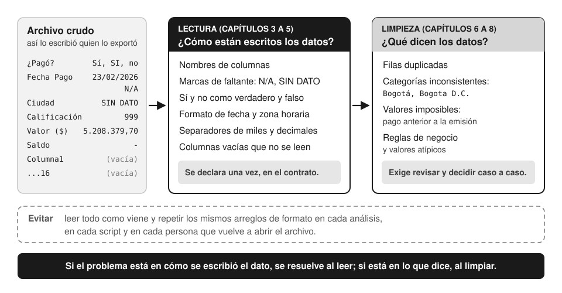
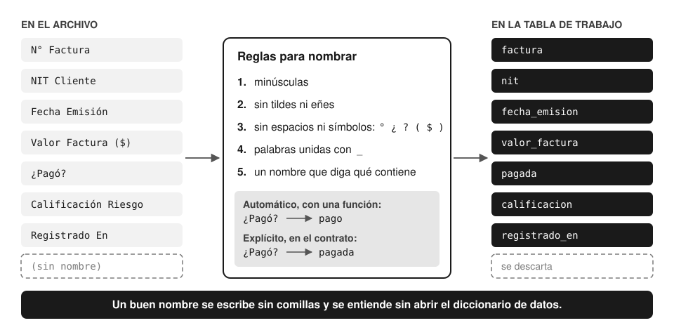
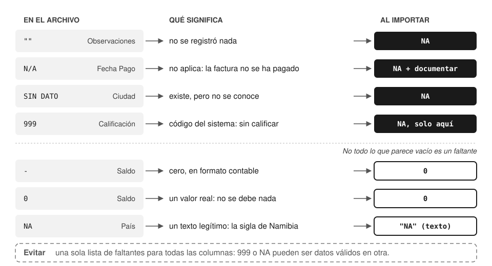
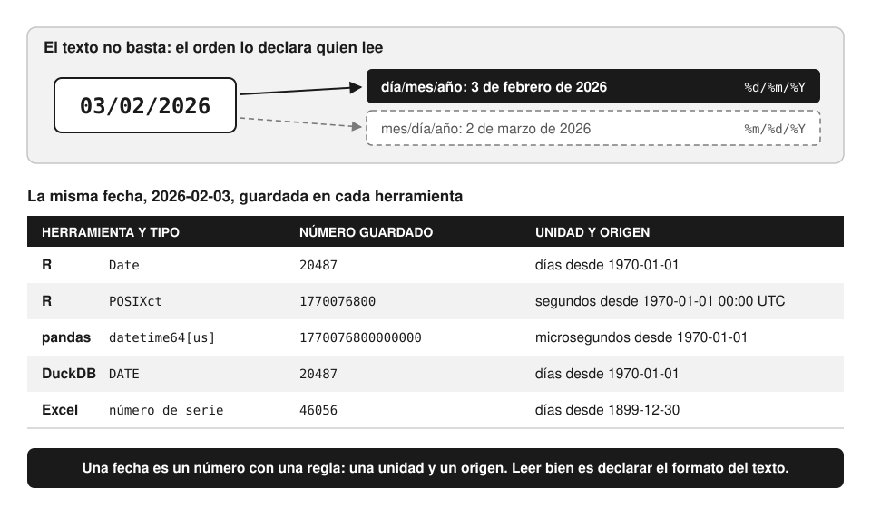
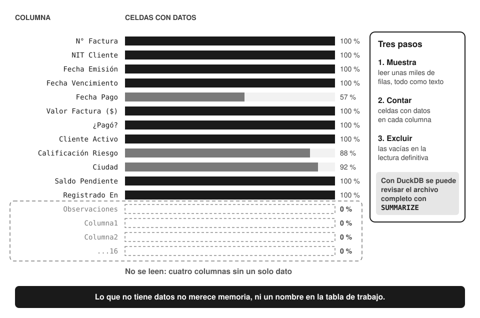

# Importación de datos III: limpieza temprana {#sec-limpieza-temprana}

En los dos capítulos anteriores aprendimos a leer datos con un contrato: declarar cómo está escrito el archivo, qué tipo tiene cada columna y qué columnas necesitamos (@sec-importacion), y aplicar ese método a Excel, Parquet, JSON, APIs y bases de datos (@sec-importacion-fuentes). Este capítulo cierra la importación y abre la parte del libro dedicada a preparar los datos.

Hay un grupo de problemas que casi siempre se dejan para "la limpieza" y que en realidad se pueden resolver en el mismo momento de leer: nombres de columnas con tildes y símbolos, marcas como `N/A` o `SIN DATO` que deberían ser faltantes, columnas de `SI` y `NO` que deberían ser verdadero y falso, fechas escritas como texto y columnas que no traen un solo dato. A resolverlos desde la lectura lo llamaremos **limpieza temprana**.

La idea es sencilla: si el problema está en **cómo se escribió** el dato, se resuelve al leer, una sola vez, dentro del contrato. Si el problema está en **lo que dice** el dato (un cliente duplicado, una ciudad escrita de tres maneras, un pago anterior a la emisión de la factura), exige revisar y decidir, y eso es la limpieza propiamente dicha, que veremos en los capítulos siguientes (@fig-frontera-limpieza).

{#fig-frontera-limpieza fig-alt="Tres cajas en fila. El archivo crudo muestra valores como Sí, SI y no; 23/02/2026 y N/A; SIN DATO; 999; 5.208.379,70; un guion y dos columnas vacías. La caja de lectura, capítulos 3 a 5, pregunta cómo están escritos los datos y lista nombres de columnas, marcas de faltante, sí y no, formato de fecha y zona horaria, separadores numéricos y columnas vacías, con la nota: se declara una vez, en el contrato. La caja de limpieza, capítulos 6 a 8, pregunta qué dicen los datos y lista filas duplicadas, categorías inconsistentes, valores imposibles y reglas de negocio. Debajo, con trazo discontinuo, Evitar: leer todo como viene y repetir los mismos arreglos en cada análisis."}

¿Por qué no dejarlo todo para después? Por tres razones. La primera es que cada análisis que parte del archivo tendría que repetir los mismos arreglos, y basta con que una persona olvide uno para que dos resultados dejen de coincidir. La segunda es que algunos errores de lectura no se pueden deshacer: una fecha leída con el orden equivocado ya es otra fecha, y nada en la tabla avisa del error. La tercera es la memoria: una columna de `TRUE` y `FALSE` ocupa menos que una de textos, y una columna vacía que no se lee no ocupa nada.

Seguimos con la misma red regional de distribución. Los archivos de este capítulo están en la carpeta `datos/cap05/` del repositorio de materiales. El capítulo está pensado, como los anteriores, para una sesión de estudio de unas dos horas.

::: {.callout-tip}
## Antes de empezar

1. Abre la carpeta de materiales en Positron para que las rutas relativas `datos/cap05/...` funcionen.
2. No necesitas paquetes nuevos: usamos los que instalaste al comienzo del @sec-importacion.
3. Si los archivos de `datos/cap05/` no están en tu copia, genéralos desde la terminal, en la carpeta de materiales, con `Rscript scripts/generar_datos_cap05.R`.
:::

Como en los capítulos anteriores, declaramos al inicio las funciones de R que usaremos y abrimos una conexión a DuckDB.

```{r}
#| label: paquetes-cap05
#| message: false
use("readr", c("read_delim", "cols", "col_character", "col_date", "col_datetime",
               "col_number", "col_integer", "locale", "spec", "parse_number"))
use("readxl", "read_excel")
use("dplyr", c("mutate", "na_if", "count", "if_else", "across"))
use("arrow", "write_parquet")
use("DBI", c("dbConnect", "dbGetQuery", "dbExecute", "dbDisconnect"))
use("duckdb", "duckdb")

con <- dbConnect(duckdb())
ruta_cartera <- "datos/cap05/cartera_clientes_2026_02.csv"
```

## El archivo del capítulo: una exportación real, con sus mañas {#sec-archivo-cartera}

El área de cartera exporta cada mes, desde una hoja de cálculo, el estado de las facturas emitidas. El archivo `cartera_clientes_2026_02.csv` tiene 60 facturas de febrero de 2026, usa punto y coma como separador y está en `UTF-8`. Estas son sus primeras líneas:

```text
N° Factura;NIT Cliente;Fecha Emisión;Fecha Vencimiento;Fecha Pago;Valor Factura ($);¿Pagó?;Cliente Activo;Calificación Riesgo;Ciudad;Saldo Pendiente;Registrado En;Observaciones;Columna1;Columna2;
FV-1001;0630538004;01/02/2026;03/03/2026;N/A;7.448.878,15;No;N;1;SIN DATO;7.448.878,15;2026-02-01T17:59:05Z;;;;
FV-1002;0275015391;01/02/2026;03/03/2026;N/A;6.126.707,51;NO;N;1;Santa Marta;6.126.707,51;2026-02-01T20:52:47Z;;;;
```

Antes de leer una sola línea con código ya se ven varias mañas típicas de una exportación hecha a mano:

- **Nombres** con espacios, tildes y símbolos (`N° Factura`, `¿Pagó?`, `Valor Factura ($)`).
- **Faltantes disfrazados**: `N/A` en la fecha de pago, `SIN DATO` en la ciudad y, aunque no se vea en estas líneas, `999` en la calificación de riesgo, el código que usa el sistema para "sin calificar".
- **Sí y no escritos de varias formas**: `SI`, `Sí`, `si`, `NO`, `No`, `no`, y `S` o `N` en otra columna.
- **Fechas** en formato día/mes/año y una marca de tiempo en UTC (la `Z` final).
- **Números** con punto de miles y coma decimal, y un guion `-` en el saldo de las facturas pagadas.
- **Columnas vacías**: `Observaciones`, `Columna1`, `Columna2` y una más sin nombre, creada por el punto y coma sobrante al final de cada línea.

Veamos qué pasa si leemos el archivo sin contrato, dejando que la herramienta adivine.

::: {.panel-tabset group="lenguaje"}

### R

```{r}
#| label: lectura-ingenua
ingenua <- read_delim(
  ruta_cartera,
  delim = ";",
  show_col_types = FALSE
  )

spec(ingenua)
```

### Python

```python
import pandas as pd

ruta_cartera = "datos/cap05/cartera_clientes_2026_02.csv"

ingenua = pd.read_csv(ruta_cartera, sep=";")
print(ingenua.dtypes)
```

```text
N° Factura                 str
NIT Cliente              int64
Fecha Emisión              str
Fecha Vencimiento          str
Fecha Pago                 str
Valor Factura ($)          str
¿Pagó?                     str
Cliente Activo             str
Calificación Riesgo      int64
Ciudad                     str
Saldo Pendiente            str
Registrado En              str
Observaciones          float64
Columna1               float64
Columna2               float64
Unnamed: 15            float64
dtype: object
```

### DuckDB

```{r}
#| label: duckdb-ingenua
dbGetQuery(con, r"(
  DESCRIBE SELECT * FROM read_csv('datos/cap05/cartera_clientes_2026_02.csv')
)")[, c("column_name", "column_type")]
```

:::

Las tres herramientas leen el archivo sin un solo error, y ese es justamente el problema. `R` y `pandas` dejan las fechas día/mes/año como texto; `DuckDB` detecta el formato en dos de ellas, pero no en la fecha de pago, porque el `N/A` le impide reconocerla. El valor de la factura queda como texto por el punto de miles, la columna sin nombre aparece como `...16`, `Unnamed: 15` o `column15`, y `pandas` convierte el NIT en número y le quita el cero inicial, el problema que ya conocemos del @sec-importacion. Vamos a resolver estas mañas una a una y, al final del capítulo, a reunirlas en un solo contrato.

## Nombres de columnas {#sec-nombres-columnas}

Un nombre como `¿Pagó?` es legítimo en un archivo, pero incómodo en el código: en R hay que escribirlo entre comillas invertidas (`` `¿Pagó?` ``), en pandas no se puede usar con la notación de punto (`cartera.pagó`) y en SQL hay que encerrarlo entre comillas dobles. Además, las tildes y los símbolos se dañan fácilmente cuando el archivo cambia de codificación. Por eso conviene trabajar con nombres que sigan unas reglas simples (@fig-nombres-columnas):

1. todo en minúsculas;
2. sin tildes ni eñes;
3. sin espacios ni símbolos;
4. palabras unidas con guion bajo, el estilo conocido como *snake_case*;
5. un nombre que diga qué contiene la columna.

{#fig-nombres-columnas fig-alt="A la izquierda, nombres del archivo como N° Factura, NIT Cliente, Fecha Emisión, Valor Factura ($), ¿Pagó?, Calificación Riesgo, Registrado En y una columna sin nombre con trazo discontinuo. Al centro, las cinco reglas para nombrar y dos ejemplos: automático, ¿Pagó? se convierte en pago; explícito, ¿Pagó? se convierte en pagada. A la derecha, los nombres de trabajo factura, nit, fecha_emision, valor_factura, pagada, calificacion y registrado_en; la columna sin nombre se descarta."}

Hay dos maneras de llegar a esos nombres. La **automática** aplica las reglas 1 a 4 con una función, y sirve para archivos con muchas columnas o para una primera exploración. La **explícita** escribe en el contrato el nombre nuevo de cada columna, y es la única que cumple la regla 5: una función no puede saber que `¿Pagó?` debería llamarse `pagada` y no `pago`. Para un flujo que se repite cada mes, preferimos la explícita, porque además documenta en el código de dónde viene cada columna.

### Ejemplo guiado 5.1: nombres automáticos y nombres explícitos

::: {.panel-tabset group="lenguaje"}

### R

```{r}
#| label: nombres-automaticos
limpiar_nombres <- function(nombres) {
  nombres <- tolower(nombres)
  nombres <- chartr("áéíóúüñ", "aeiouun", nombres)
  nombres <- gsub("[^a-z0-9]+", "_", nombres)   # todo lo demás, a guion bajo
  gsub("^_+|_+$", "", nombres)                  # sin guiones al inicio o al final
}

limpiar_nombres(names(ingenua))
```

`gsub()` usa una expresión regular: `[^a-z0-9]+` significa "uno o más caracteres que no sean letras ni números". Las expresiones regulares se tratan con calma en la @sec-regex; por ahora basta con saber qué hace esta.

La versión explícita aprovecha que `col_select` de `readr` permite **seleccionar y renombrar en el mismo paso**, con la forma `nombre_nuevo = nombre_original`:

```{r}
#| label: nombres-explicitos
cartera_nombres <- read_delim(
  ruta_cartera,
  delim = ";",
  col_types = cols(.default = col_character()),
  col_select = c(
    factura       = `N° Factura`,
    nit           = `NIT Cliente`,
    fecha_emision = `Fecha Emisión`,
    pagada        = `¿Pagó?`
  ),
  name_repair = "unique_quiet"
)

cartera_nombres
```

Las columnas que no aparecen en `col_select` no se leen. `name_repair = "unique_quiet"` le pide a `readr` que repare en silencio el nombre vacío de la última columna; como no la seleccionamos, no nos importa cómo la llame.

### Python

```python
import re
import unicodedata

def limpiar_nombre(nombre):
    sin_tildes = (unicodedata.normalize("NFKD", nombre)
                  .encode("ascii", "ignore").decode())
    return re.sub(r"[^a-z0-9]+", "_", sin_tildes.lower()).strip("_")

print([limpiar_nombre(c) for c in ingenua.columns])
```

```text
['n_factura', 'nit_cliente', 'fecha_emision', 'fecha_vencimiento', 'fecha_pago', 'valor_factura', 'pago', 'cliente_activo', 'calificacion_riesgo', 'ciudad', 'saldo_pendiente', 'registrado_en', 'observaciones', 'columna1', 'columna2', 'unnamed_15']
```

`unicodedata.normalize("NFKD", ...)` separa cada letra de su tilde, y `encode("ascii", "ignore")` descarta las tildes. En la versión explícita, `pandas` lee con `usecols` y renombra con un diccionario:

```python
nombres = {
    "N° Factura": "factura",
    "NIT Cliente": "nit",
    "Fecha Emisión": "fecha_emision",
    "¿Pagó?": "pagada",
}

cartera_nombres = (
    pd.read_csv(ruta_cartera, sep=";", usecols=list(nombres), dtype=str)
    .rename(columns=nombres)
)
print(cartera_nombres.head(3))
```

```text
   factura         nit fecha_emision pagada
0  FV-1001  0630538004    01/02/2026     No
1  FV-1002  0275015391    01/02/2026     NO
2  FV-1003  0304870301    01/02/2026     SI
```

El diccionario cumple dos funciones a la vez: sus llaves dicen qué columnas leer y sus valores, cómo llamarlas.

### DuckDB

```{r}
#| label: duckdb-nombres
dbGetQuery(con, r"(
  DESCRIBE SELECT *
  FROM read_csv('datos/cap05/cartera_clientes_2026_02.csv',
                normalize_names = true)
)")$column_name

dbGetQuery(con, r"(
  SELECT "N° Factura"    AS factura,
         "NIT Cliente"   AS nit,
         "Fecha Emisión" AS fecha_emision,
         "¿Pagó?"        AS pagada
  FROM read_csv('datos/cap05/cartera_clientes_2026_02.csv', all_varchar = true)
  LIMIT 3
)")
```

`normalize_names = true` es la versión automática que trae DuckDB. La explícita es SQL de toda la vida: `AS` da el nombre nuevo. Como la consulta va en texto crudo, las comillas dobles del nombre original se escriben tal cual, igual que en la terminal de DuckDB.

:::

::: {.callout-note}
## `janitor` y `pyjanitor`

Si prefieres no escribir tu propia función, el paquete [janitor](https://sfirke.github.io/janitor/) de R tiene `clean_names()` y `make_clean_names()`, que aplican estas reglas y resuelven además casos como nombres repetidos. En Python existe [pyjanitor](https://pyjanitor-devs.github.io/pyjanitor/), con un `clean_names()` equivalente. Son una dependencia más; para un proyecto pequeño, las funciones de este ejemplo bastan.
:::

## Valores faltantes: qué puede significar un NA {#sec-faltantes}

Un valor faltante no es un valor cualquiera: es la declaración de que **no sabemos** cuál es el dato. Las herramientas lo tratan de forma especial: no lo suman, no lo promedian y lo excluyen de las comparaciones. Por eso es tan importante que un faltante llegue a la tabla como faltante, y no como un texto que se le parece.

Cada herramienta tiene su propia forma de representarlo:

| Herramienta | Cómo se representa | Detalle |
|---|---|---|
| R | `NA` | Tiene tipo: `NA_integer_`, `NA_real_`, `NA_character_`. `NaN` es otra cosa (un cálculo indefinido, como `0/0`) y `NULL` es la ausencia de objeto, no de valor. |
| pandas | `NaN`, `NaT`, `pd.NA` | `NaN` en columnas de números decimales, `NaT` en fechas y `pd.NA` en los tipos que admiten faltantes, como `Int64` o `boolean`. |
| DuckDB | `NULL` | El estándar de SQL: cualquier operación con `NULL` da `NULL`, salvo funciones como `count()` o `coalesce()`. |

: Cómo representa cada herramienta un valor faltante {#tbl-faltantes-lenguajes}

Lo que necesita criterio es otra pregunta: **¿qué significa que falte?** No todos los vacíos son iguales (@fig-significados-na):

- **No se registró.** El dato existe, pero nadie lo anotó. Es el faltante clásico.
- **No aplica.** El dato no puede existir: una factura sin pagar no tiene fecha de pago. Se importa como faltante, pero conviene documentarlo, porque en el análisis no es lo mismo "no sabemos cuándo pagó" que "no ha pagado".
- **Desconocido, con una marca propia.** `SIN DATO`, `N/A`, `NULL`, `s.d.` o un código del sistema como `999` o `-1`. Hay que declararlo, porque la herramienta no lo adivina; y si `999` se queda como número, cualquier promedio de la calificación sale inflado.
- **Parece vacío, pero es un valor.** En el formato contable de las hojas de cálculo, el cero se muestra como un guion: el `-` del saldo significa "no se debe nada", es decir, `0`. Convertirlo en faltante sería un error.

{#fig-significados-na fig-alt="Siete filas. Celda vacía en Observaciones: no se registró nada, se importa como NA. N/A en Fecha Pago: no aplica porque la factura no se ha pagado, NA y se documenta. SIN DATO en Ciudad: existe pero no se conoce, NA. 999 en Calificación: código del sistema para sin calificar, NA solo en esa columna. Debajo de una línea punteada, con la nota no todo lo que parece vacío es un faltante: guion en Saldo, cero en formato contable, se importa como 0; cero en Saldo, un valor real, 0; NA en una columna de país, la sigla de Namibia, se conserva como texto. Al final, con trazo discontinuo, Evitar: una sola lista de faltantes para todas las columnas, porque 999 o NA pueden ser datos válidos en otra."}

Hay que saber, además, qué considera faltante cada herramienta **por defecto**:

- `readr` trata como faltantes la celda vacía y el texto `NA`.
- `pandas` trata como faltantes una lista larga: la celda vacía, `NA`, `N/A`, `n/a`, `NULL`, `null`, `NaN`, `nan`, `None`, `#N/A` y otras variantes.
- DuckDB solo trata como faltante la celda vacía.

Las listas por defecto también pueden equivocarse. El texto `NA` es la sigla de Namibia en los códigos de país, y `N/A` puede ser una categoría con sentido en una encuesta ("no aplica"). Si una columna tiene esos valores legítimos, hay que quitarlos de la lista: `na = character()` en `readr` o `keep_default_na=False` en `pandas`.

La regla práctica es **declarar los faltantes por columna**, no con una sola lista para todo el archivo: `999` es "sin calificar" en la calificación, pero podría ser un valor válido en otra columna numérica.

### Ejemplo guiado 5.2: declarar los faltantes de cada columna

Queremos que `N/A` y `SIN DATO` sean faltantes, que `999` lo sea solo en la calificación, y que el guion del saldo sea un cero.

::: {.panel-tabset group="lenguaje"}

### R

```{r}
#| label: faltantes-readr
colombia <- locale(decimal_mark = ",", grouping_mark = ".")

cartera_na <- read_delim(
  ruta_cartera,
  delim = ";",
  na = c("", "N/A", "SIN DATO"),
  col_types = cols(`Calificación Riesgo` = col_integer(),
                   .default = col_character()),
  col_select = c(
    factura      = `N° Factura`,
    fecha_pago   = `Fecha Pago`,
    calificacion = `Calificación Riesgo`,
    ciudad       = Ciudad,
    saldo        = `Saldo Pendiente`
  ),
  name_repair = "unique_quiet"
) |>
  mutate(
    calificacion = na_if(calificacion, 999L),
    saldo = parse_number(if_else(saldo == "-", "0", saldo), locale = colombia)
  )

colSums(is.na(cartera_na))
summary(cartera_na$saldo)
```

El argumento `na` de `readr` se aplica a todo el archivo, así que lo usamos solo para las marcas que significan faltante en cualquier columna. Lo que depende de la columna se resuelve justo después de leer, en el mismo bloque: `na_if()` convierte el `999` de la calificación en `NA`, y el guion del saldo se cambia por `"0"` antes de convertir el texto en número con `parse_number()`.

### Python

```python
def a_pesos(texto):
    """Convierte '1.234,56' en 1234.56; el guion contable es cero."""
    if texto == "-":
        return 0.0
    return float(texto.replace(".", "").replace(",", "."))

cartera_na = pd.read_csv(
    ruta_cartera,
    sep=";",
    usecols=["N° Factura", "Fecha Pago", "Calificación Riesgo", "Ciudad",
             "Saldo Pendiente"],
    na_values={
        "Fecha Pago": ["N/A"],
        "Ciudad": ["SIN DATO"],
        "Calificación Riesgo": ["999"],
    },
    dtype={"Calificación Riesgo": "Int64"},
    converters={"Saldo Pendiente": a_pesos},
)

print(cartera_na.isna().sum())
print(cartera_na["Saldo Pendiente"].describe().round(0))
```

```text
N° Factura              0
Fecha Pago             26
Calificación Riesgo     7
Ciudad                  5
Saldo Pendiente         0
dtype: int64
count         60.0
mean     2031872.0
std      2910032.0
min            0.0
25%            0.0
50%            0.0
75%      3499378.0
max      8807256.0
Name: Saldo Pendiente, dtype: float64
```

En `pandas`, `na_values` acepta un diccionario con las marcas **de cada columna**, justo lo que pide la regla práctica. `converters` aplica una función propia a cada valor de una columna durante la lectura. El tipo `Int64`, con mayúscula, es el entero de `pandas` que admite faltantes; el `int64` de NumPy no los admite.

### DuckDB

```{r}
#| label: duckdb-faltantes
cartera_na_duck <- dbGetQuery(con, r"(
  SELECT
    "N° Factura"                                   AS factura,
    nullif("Fecha Pago", 'N/A')                    AS fecha_pago,
    nullif("Calificación Riesgo", '999')::INTEGER  AS calificacion,
    nullif(Ciudad, 'SIN DATO')                       AS ciudad,
    CASE WHEN "Saldo Pendiente" = '-' THEN 0
         ELSE replace(replace("Saldo Pendiente", '.', ''), ',', '.')::DECIMAL(15, 2)
    END                                              AS saldo
  FROM read_csv('datos/cap05/cartera_clientes_2026_02.csv', all_varchar = true)
)")

colSums(is.na(cartera_na_duck))
```

Leemos todo como texto (`all_varchar = true`) y declaramos cada faltante con `nullif(columna, marca)`, que devuelve `NULL` cuando la columna es igual a la marca. Si una marca vale para todo el archivo, `read_csv()` también acepta `nullstr = ['N/A', 'SIN DATO']`.

:::

En las tres versiones quedan 26 fechas de pago faltantes. ¿Son las 26 facturas sin pagar? Si `N/A` significa "no aplica", debería ser así, y es fácil comprobarlo cuando tengamos la columna `pagada` como booleano. Ese tipo de comprobación, que relaciona dos columnas, es el comienzo de la auditoría de calidad del @sec-tipos-calidad.

## Booleanos: de SI y NO a TRUE y FALSE {#sec-booleanos}

Una columna que solo puede tomar dos valores debe ser **booleana** (o lógica): `TRUE` o `FALSE`, con `NA` para lo que no se sabe. No es un capricho de estilo. Un booleano ocupa menos memoria que un texto, sirve directamente para filtrar, y tiene una propiedad muy útil: al sumarlo cuenta los verdaderos, y al promediarlo da la proporción. `mean(cartera$pagada)` es, sin más, la proporción de facturas pagadas.

El problema es que los archivos casi nunca traen `TRUE` y `FALSE`. Traen `SI` y `NO`, `S` y `N`, `X` y una celda vacía, o `1` y `0`, y con frecuencia mezclados: `SI`, `Sí`, `si`. Ninguna de las tres herramientas reconoce el español por defecto. `readr` acepta `T`, `F`, `TRUE`, `FALSE`, `true`, `false`, `1` y `0`; `pandas` acepta `True`, `False` y sus variantes de mayúsculas, y DuckDB, `true` y `false`.

Hay una trampa frecuente al convertir a mano. Comparar con un solo valor, como `pagada == "SI"`, convierte en `FALSE` todo lo demás, incluido `Sí` o `si`, sin ningún aviso. En nuestro archivo, esa comparación encontraría 22 facturas pagadas en lugar de 34. La conversión segura usa una **tabla de equivalencias** explícita, en la que cualquier valor que no esté en la tabla queda como faltante y se puede detectar.

| En el archivo | Significa | Al importar |
|---|---|---|
| `SI`, `Sí`, `si`, `S` | sí | `TRUE` |
| `NO`, `No`, `no`, `N` | no | `FALSE` |
| cualquier otro valor | no está previsto | `NA`, para revisarlo |

: Tabla de equivalencias para las columnas de sí y no {#tbl-equivalencias-si-no}

### Ejemplo guiado 5.3: `¿Pagó?` y `Cliente Activo` como booleanos

::: {.panel-tabset group="lenguaje"}

### R

```{r}
#| label: booleanos-r
si_no <- c(SI = TRUE, "SÍ" = TRUE, S = TRUE, NO = FALSE, N = FALSE)

a_logico <- function(x) {
  unname(si_no[toupper(trimws(x))])
}

cartera_bool <- read_delim(
  ruta_cartera,
  delim = ";",
  col_types = cols(.default = col_character()),
  col_select = c(factura = `N° Factura`, pagada = `¿Pagó?`,
                 cliente_activo = `Cliente Activo`),
  name_repair = "unique_quiet"
) |>
  mutate(
    across(c("pagada", "cliente_activo"), a_logico)
    )

count(cartera_bool, pagada)
mean(cartera_bool$pagada)
```

`si_no` es un vector con nombres que funciona como tabla de equivalencias: `si_no["SI"]` devuelve `TRUE`. `toupper()` y `trimws()` reducen las variantes de mayúsculas y espacios antes de buscar, y un valor que no esté en la tabla, como `"tal vez"`, devuelve `NA`. `readr` no tiene un argumento para declarar los valores verdaderos y falsos, así que la conversión va justo después de leer, en el mismo bloque.

### Python

```python
cartera_bool = pd.read_csv(
    ruta_cartera,
    sep=";",
    usecols=["N° Factura", "¿Pagó?", "Cliente Activo"],
    true_values=["SI", "Sí", "si", "S"],
    false_values=["NO", "No", "no", "N"],
)

print(cartera_bool.dtypes)
print(cartera_bool["¿Pagó?"].value_counts())
print(round(cartera_bool["¿Pagó?"].mean(), 3))
```

```text
N° Factura        str
¿Pagó?           bool
Cliente Activo   bool
dtype: object
¿Pagó?
True     34
False    26
Name: count, dtype: int64
0.567
```

`true_values` y `false_values` hacen la conversión durante la lectura, pero tienen dos condiciones que conviene conocer. La primera: se aplican a **todas** las columnas, no a una sola. La segunda, más delicada: solo convierten una columna si **todos** sus valores están en alguna de las dos listas. Si aparece una variante no prevista, como `sí` en minúscula con tilde, la columna entera se queda como texto, sin aviso. Por eso, después de leer, revisa siempre que el tipo sea `bool`:

```python
assert cartera_bool["¿Pagó?"].dtype == "bool", "Hay variantes de sí/no sin declarar"
```

### DuckDB

```{r}
#| label: duckdb-booleanos
dbGetQuery(con, r"(
  SELECT pagada, count(*) AS facturas
  FROM (
    SELECT
      CASE upper(strip_accents(trim("¿Pagó?")))
        WHEN 'SI' THEN true
        WHEN 'S'  THEN true
        WHEN 'NO' THEN false
        WHEN 'N'  THEN false
      END AS pagada
    FROM read_csv('datos/cap05/cartera_clientes_2026_02.csv', all_varchar = true)
  )
  GROUP BY pagada
)")
```

`strip_accents()` quita la tilde de `Sí`, `upper()` unifica las mayúsculas y `CASE` aplica la tabla de equivalencias. Un valor que no coincide con ningún `WHEN` queda como `NULL`, igual que en la versión de R.

:::

::: {.callout-warning}
## Cuando el vacío significa "no"

En algunos formularios la columna se marca con una `X` cuando la respuesta es afirmativa y se deja en blanco cuando no. Ahí la celda vacía **no es un faltante**: es un `FALSE`. Si la leyéramos con las reglas por defecto, todos los "no" se convertirían en `NA` y la proporción saldría calculada solo sobre los "sí". Lo verás en el ejercicio del capítulo.
:::

## Fechas: cada lenguaje a su manera {#sec-fechas}

Las fechas son el tipo de dato que más problemas da al importar, por una razón: en el archivo son texto, y el mismo texto admite varias lecturas. `03/02/2026` es el 3 de febrero en Colombia y el 2 de marzo en Estados Unidos. Ningún programa puede saber cuál quiso decir quien escribió el archivo; **el orden lo declara quien lee** (@fig-fechas-por-lenguaje).

Dentro de cada herramienta, en cambio, una fecha no es texto: es un **número con una regla**, una cantidad de unidades contadas desde un origen. Entender eso explica casi todos los comportamientos que parecen extraños, como el número `46056` que aparece cuando una fecha de Excel se lee mal.

{#fig-fechas-por-lenguaje fig-alt="Arriba, el texto 03/02/2026 con dos flechas: la lectura día, mes, año, 3 de febrero de 2026, con el formato %d/%m/%Y, resaltada; y la lectura mes, día, año, 2 de marzo de 2026, con trazo discontinuo. Abajo, una tabla con la fecha 2026-02-03 guardada en cada herramienta: R Date, 20487 días desde 1970-01-01; R POSIXct, 1770076800 segundos desde 1970-01-01 00:00 UTC; pandas datetime64[us], 1770076800000000 microsegundos desde 1970-01-01; DuckDB DATE, 20487 días desde 1970-01-01; Excel, número de serie 46056, días desde 1899-12-30."}

### Cómo guarda las fechas cada herramienta

**R** distingue dos tipos. `Date` guarda solo la fecha, como el número de días desde el 1 de enero de 1970. `POSIXct` guarda fecha y hora, como segundos desde ese mismo instante en UTC, y lleva la zona horaria como un atributo que solo cambia cómo se **muestra** la hora, no el instante que representa. `readr` reconoce por sí solo las fechas en formato ISO 8601 (`2026-02-03`), pero no adivina el orden de `03/02/2026`: si no se lo declaramos, deja la columna como texto. Es un comportamiento prudente, porque prefiere no convertir a convertir mal.

**pandas** no tiene un tipo propio para "solo fecha". Todo es `datetime64`, un instante contado desde 1970: una fecha sin hora se guarda como la medianoche de ese día. Desde `pandas` 3.0, al leer texto, la unidad por defecto es el microsegundo (`datetime64[us]`); en versiones anteriores era el nanosegundo. El faltante de una fecha es `NaT` (*Not a Time*). Lo delicado de `pandas` es que `pd.to_datetime()` sin formato **sí adivina**, y lo hace con el orden estadounidense: convierte `01/02/2026` en el 2 de enero sin ningún aviso. Si en la columna aparece un día mayor que 12, como `13/02/2026`, el error se hace visible; si todas las fechas caen en los primeros doce días del mes, pasa inadvertido. [polars](https://docs.pola.rs/), en cambio, sí tiene un tipo `pl.Date` para fechas sin hora.

**DuckDB** sigue el estándar de SQL: `DATE` para fechas (días desde 1970), `TIMESTAMP` para fecha y hora, y `TIMESTAMPTZ` para instantes con zona horaria. Su lector de CSV intenta detectar el formato de las fechas a partir de las primeras filas. Funciona bien cuando hay días mayores que 12 en la muestra, pero no tiene forma de resolver un archivo donde todas las fechas son ambiguas, así que conviene declararlo con `dateformat`.

**Excel**, por último, guarda las fechas como un número de serie: días desde el 30 de diciembre de 1899. El origen es ese, y no el 1 de enero de 1900, por un error histórico: Excel considera que 1900 fue bisiesto, y no lo fue. Cuando una celda tiene formato de fecha, `readxl` y `pandas` la convierten; cuando la fecha está mezclada con texto en la misma columna, llega como el número de serie y hay que convertirla a mano. Otro detalle: `readxl` devuelve las fechas de Excel como `POSIXct` (fecha y hora) aunque no tengan hora, así que conviene pasarlas a `Date` con `as.Date()`.

| | R | pandas | DuckDB |
|---|---|---|---|
| Solo fecha | `Date` | no tiene; `datetime64` a medianoche | `DATE` |
| Fecha y hora | `POSIXct` | `datetime64[us]` | `TIMESTAMP` |
| Con zona horaria | atributo `tzone` de `POSIXct` | `datetime64[us, America/Bogota]` | `TIMESTAMPTZ` |
| Faltante | `NA` | `NaT` | `NULL` |
| Declarar el formato al leer | `col_date(format = )` o `locale(date_format = )` | `parse_dates` con `date_format` | `dateformat`, `timestampformat` |
| Convertir texto ya leído | `as.Date(x, format = )` | `pd.to_datetime(x, format = )` | `strptime()`, `try_strptime()` |
| Desde el número de serie de Excel | `as.Date(x, origin = "1899-12-30")` | `pd.to_datetime(x, unit="D", origin="1899-12-30")` | `DATE '1899-12-30' + x` |

: Las fechas en cada herramienta {#tbl-fechas-lenguajes}

Podemos comprobar los números de la @fig-fechas-por-lenguaje directamente:

```{r}
#| label: fechas-como-numeros
unclass(as.Date("2026-02-03"))                       # días desde 1970-01-01
as.numeric(as.POSIXct("2026-02-03", tz = "UTC"))     # segundos desde 1970-01-01
as.Date(46056, origin = "1899-12-30")                # número de serie de Excel
```

### Zonas horarias

La columna `Registrado En` guarda el instante en que se registró cada factura en el sistema, con el formato ISO 8601 completo: `2026-02-01T17:59:05Z`. La `Z` final indica que la hora está en UTC, el tiempo universal coordinado. En Colombia la hora local es UTC menos cinco horas, sin horario de verano, así que ese registro se hizo a las 12:59:05 hora de Bogotá.

La regla para importar marcas de tiempo es: **leer el instante con su zona y mostrarlo en la zona del análisis**. Si leemos `17:59:05` sin la zona, el registro parecerá hecho por la tarde cuando fue al mediodía, y un análisis de "facturas registradas por la mañana" saldría mal. Las zonas horarias se escriben con los nombres de la base de datos de la IANA, como `America/Bogota`, y no con abreviaturas como `COT`, que pueden ser ambiguas.

### Ejemplo guiado 5.4: fechas día/mes/año y marcas de tiempo en UTC

::: {.panel-tabset group="lenguaje"}

### R

```{r}
#| label: fechas-readr
colombia <- locale(
  decimal_mark  = ",",
  grouping_mark = ".",
  date_format   = "%d/%m/%Y",
  tz            = "America/Bogota"
)

cartera_fechas <- read_delim(
  ruta_cartera,
  delim = ";",
  locale = colombia,
  na = c("", "N/A"),
  col_types = cols(
    `Fecha Emisión`     = col_date(),
    `Fecha Vencimiento` = col_date(),
    `Fecha Pago`        = col_date(),
    `Registrado En`     = col_datetime(),
    .default            = col_character()
  ),
  col_select = c(
    factura           = `N° Factura`,
    fecha_emision     = `Fecha Emisión`,
    fecha_vencimiento = `Fecha Vencimiento`,
    fecha_pago        = `Fecha Pago`,
    registrado_en     = `Registrado En`
  ),
  name_repair = "unique_quiet"
)

cartera_fechas
```

El `locale` reúne las convenciones regionales del archivo: separadores numéricos, formato de fecha y zona horaria. Con `date_format = "%d/%m/%Y"` en el `locale`, basta con `col_date()` en cada columna; si una columna tuviera un formato distinto, se le da el suyo con `col_date(format = "...")`. `col_datetime()` lee la `Z` como UTC y `tz = "America/Bogota"` muestra el resultado en hora de Bogotá: el registro de las `17:59:05Z` aparece como `12:59:05`. Puedes confirmar la zona con `attr(cartera_fechas$registrado_en, "tzone")`.

### Python

```python
cartera_fechas = pd.read_csv(
    ruta_cartera,
    sep=";",
    usecols=["N° Factura", "Fecha Emisión", "Fecha Vencimiento", "Fecha Pago",
             "Registrado En"],
    na_values={"Fecha Pago": ["N/A"]},
    parse_dates=["Fecha Emisión", "Fecha Vencimiento", "Fecha Pago"],
    date_format="%d/%m/%Y",
)

cartera_fechas["Registrado En"] = (
    pd.to_datetime(cartera_fechas["Registrado En"], utc=True)
    .dt.tz_convert("America/Bogota")
)

print(cartera_fechas.dtypes)
print(cartera_fechas.head(3))
```

```text
N° Factura                                  str
Fecha Emisión                    datetime64[us]
Fecha Vencimiento                datetime64[us]
Fecha Pago                       datetime64[us]
Registrado En        datetime64[us, America/Bogota]
dtype: object
  N° Factura Fecha Emisión Fecha Vencimiento Fecha Pago             Registrado En
0    FV-1001    2026-02-01        2026-03-03        NaT 2026-02-01 12:59:05-05:00
1    FV-1002    2026-02-01        2026-03-03        NaT 2026-02-01 15:52:47-05:00
2    FV-1003    2026-02-01        2026-03-03 2026-02-11 2026-02-01 10:45:36-05:00
```

`parse_dates` dice qué columnas convertir y `date_format`, con qué formato. Si se omite `date_format`, `pandas` intenta adivinar y, cuando no lo logra, deja la columna como texto sin avisar. Para ver el riesgo de adivinar, compara:

```python
fechas = pd.Series(["01/02/2026", "03/02/2026", "12/02/2026"])
print(pd.to_datetime(fechas).tolist())                     # adivina mes/día
print(pd.to_datetime(fechas, format="%d/%m/%Y").tolist())  # formato declarado
```

```text
[Timestamp('2026-01-02 00:00:00'), Timestamp('2026-03-02 00:00:00'), Timestamp('2026-12-02 00:00:00')]
[Timestamp('2026-02-01 00:00:00'), Timestamp('2026-02-03 00:00:00'), Timestamp('2026-02-12 00:00:00')]
```

Las tres fechas eran de febrero. Sin el formato, `pandas` las repartió entre enero, marzo y diciembre, y no mostró ningún aviso.

### DuckDB

```{r}
#| label: duckdb-fechas
dbGetQuery(con, r"(
  SELECT
    "N° Factura"                                       AS factura,
    strptime("Fecha Emisión", '%d/%m/%Y')::DATE        AS fecha_emision,
    try_strptime("Fecha Pago", '%d/%m/%Y')::DATE       AS fecha_pago,
    timezone('America/Bogota', "Registrado En"::TIMESTAMPTZ) AS registrado_bogota
  FROM read_csv('datos/cap05/cartera_clientes_2026_02.csv', all_varchar = true)
  LIMIT 3
)")
```

`strptime()` convierte texto en fecha con el formato indicado y falla si encuentra un valor que no lo cumple; `try_strptime()` devuelve `NULL` en ese caso, útil para la fecha de pago, que trae `N/A`. `timezone('America/Bogota', ...)` expresa el instante en hora de Bogotá. Si se lee el archivo sin `all_varchar`, `read_csv()` acepta también `dateformat = '%d/%m/%Y'` para declarar el formato de todas las fechas a la vez.

:::

::: {.callout-tip}
## Si puedes elegir, ISO 8601

Cuando seas tú quien escribe o exporta datos, usa el formato ISO 8601: `AAAA-MM-DD` para fechas y `AAAA-MM-DDTHH:MM:SS` con la zona (`Z` o `-05:00`) para instantes. No es ambiguo, lo leen sin ayuda todas las herramientas y, como texto, se ordena igual que como fecha. Mejor todavía, guarda en Parquet, que conserva el tipo de fecha dentro del archivo (@sec-excel-parquet).
:::

## Columnas vacías: omitirlas desde el principio {#sec-columnas-vacias}

Las exportaciones desde hojas de cálculo suelen arrastrar columnas sin datos: plantillas con campos que nadie llena (`Observaciones`), columnas que alguien agregó y nunca usó (`Columna1`, `Columna2`) o columnas fantasma creadas por un separador sobrante al final de cada línea. En nuestro archivo son 4 de 16. En un archivo de cientos de miles de filas, cada una de esas columnas ocupa memoria, aparece en cada resumen y obliga a quien lee la tabla a preguntarse si debería tener algo.

La estrategia tiene tres pasos (@fig-columnas-vacias): leer una **muestra** de filas, todo como texto; **contar** cuántas celdas con datos tiene cada columna, y **excluir** las vacías en la lectura definitiva.

{#fig-columnas-vacias fig-alt="Barras horizontales con el porcentaje de celdas con datos de las dieciséis columnas, después de declarar las marcas de faltante. Doce columnas tienen datos: la mayoría al cien por ciento, Fecha Pago al 57, Calificación Riesgo al 88 y Ciudad al 92. Observaciones, Columna1, Columna2 y la columna sin nombre ...16 están al cero por ciento, con trazo discontinuo y la nota: no se leen, cuatro columnas sin un solo dato. A la derecha, los tres pasos: muestra, contar y excluir, y la nota de que con DuckDB se puede revisar el archivo completo con SUMMARIZE."}

La muestra tiene un límite: una columna vacía en las primeras miles de filas puede tener datos más abajo. Si el archivo es grande y la decisión importa, revisa el archivo completo con DuckDB, que lo recorre en disco sin cargarlo en memoria. Y si un mes después la columna empieza a traer datos, el contrato debe volver a revisarse: las reglas de calidad del @sec-tipos-calidad sirven para detectarlo.

### Ejemplo guiado 5.5: detectar y omitir las columnas vacías

::: {.panel-tabset group="lenguaje"}

### R

```{r}
#| label: columnas-vacias-r
muestra <- read_delim(
  ruta_cartera,
  delim = ";",
  n_max = 5000,
  col_types = cols(.default = col_character()),
  name_repair = "unique_quiet"
)

con_datos <- colSums(!is.na(muestra))
vacias <- names(con_datos)[con_datos == 0]
vacias

cartera_sin_vacias <- read_delim(
  ruta_cartera,
  delim = ";",
  col_types = cols(.default = col_character()),
  col_select = setdiff(names(muestra), vacias),
  name_repair = "unique_quiet"
)

ncol(cartera_sin_vacias)
```

`n_max` limita la lectura a las primeras filas. `!is.na(muestra)` marca con `TRUE` cada celda con datos y `colSums()` las cuenta por columna. En la lectura definitiva, `col_select` recibe la lista de columnas que sí queremos.

### Python

```python
muestra = pd.read_csv(ruta_cartera, sep=";", dtype=str, nrows=5000)
vacias = muestra.columns[muestra.isna().all()].tolist()
print(vacias)

cartera_sin_vacias = pd.read_csv(
    ruta_cartera,
    sep=";",
    dtype=str,
    usecols=lambda columna: columna not in vacias,
)
print(cartera_sin_vacias.shape)
```

```text
['Observaciones', 'Columna1', 'Columna2', 'Unnamed: 15']
(60, 12)
```

`usecols` acepta una función que recibe el nombre de cada columna y devuelve `True` si se debe leer.

### DuckDB

```{r}
#| label: duckdb-summarize
dbGetQuery(con, r"(
  SELECT column_name, null_percentage
  FROM (SUMMARIZE SELECT *
        FROM read_csv('datos/cap05/cartera_clientes_2026_02.csv',
                      all_varchar = true))
  WHERE null_percentage = 100
)")

dbGetQuery(con, r"(
  SELECT count(*) AS columnas
  FROM (DESCRIBE SELECT * EXCLUDE (Observaciones, Columna1, Columna2, column15)
        FROM read_csv('datos/cap05/cartera_clientes_2026_02.csv',
                      all_varchar = true))
)")
```

`SUMMARIZE` resume cada columna del archivo **completo**, no de una muestra, y entre otras cosas informa el porcentaje de faltantes. `SELECT * EXCLUDE (...)` lee todas las columnas menos las indicadas.

:::

## Ejemplo guiado 5.6: el contrato completo {#sec-contrato-completo}

Ahora reunimos todo en una sola lectura: nombres explícitos, columnas vacías fuera, faltantes declarados por columna, booleanos, fechas, números con el formato colombiano y la zona horaria. El resultado se guarda en Parquet, `datos/cap05/cartera_2026_02.parquet`, para que nadie tenga que repetir estas decisiones: quien lo abra encontrará los nombres, los tipos y los faltantes ya resueltos.

::: {.panel-tabset group="lenguaje"}

### R

```{r}
#| label: contrato-completo-r
colombia <- locale(decimal_mark = ",", grouping_mark = ".",
                   date_format = "%d/%m/%Y", tz = "America/Bogota")

cartera <- read_delim(
  ruta_cartera,
  delim = ";",
  locale = colombia,
  na = c("", "N/A", "SIN DATO"),
  col_select = c(
    factura           = `N° Factura`,
    nit               = `NIT Cliente`,
    fecha_emision     = `Fecha Emisión`,
    fecha_vencimiento = `Fecha Vencimiento`,
    fecha_pago        = `Fecha Pago`,
    valor_factura     = `Valor Factura ($)`,
    pagada            = `¿Pagó?`,
    cliente_activo    = `Cliente Activo`,
    calificacion      = `Calificación Riesgo`,
    ciudad            = Ciudad,
    saldo             = `Saldo Pendiente`,
    registrado_en     = `Registrado En`
  ),
  col_types = cols(
    `Fecha Emisión`       = col_date(),
    `Fecha Vencimiento`   = col_date(),
    `Fecha Pago`          = col_date(),
    `Valor Factura ($)`   = col_number(),
    `Calificación Riesgo` = col_integer(),
    `Registrado En`       = col_datetime(),
    .default              = col_character()
  ),
  name_repair = "unique_quiet"
) |>
  mutate(
    pagada         = a_logico(pagada),
    cliente_activo = a_logico(cliente_activo),
    calificacion   = na_if(calificacion, 999L),
    saldo          = parse_number(if_else(saldo == "-", "0", saldo),
                                  locale = colombia)
  )

cartera

write_parquet(cartera, "datos/cap05/cartera_2026_02.parquet")
```

Con la tabla bien tipada, la comprobación que dejamos pendiente en el Ejemplo 5.2 es una línea: las facturas no pagadas deberían ser exactamente las que no tienen fecha de pago.

```{r}
#| label: comprobacion-pago
count(cartera, pagada, sin_fecha_pago = is.na(fecha_pago))
```

### Python

```python
columnas = {
    "N° Factura": "factura",
    "NIT Cliente": "nit",
    "Fecha Emisión": "fecha_emision",
    "Fecha Vencimiento": "fecha_vencimiento",
    "Fecha Pago": "fecha_pago",
    "Valor Factura ($)": "valor_factura",
    "¿Pagó?": "pagada",
    "Cliente Activo": "cliente_activo",
    "Calificación Riesgo": "calificacion",
    "Ciudad": "ciudad",
    "Saldo Pendiente": "saldo",
    "Registrado En": "registrado_en",
}

cartera = pd.read_csv(
    ruta_cartera,
    sep=";",
    usecols=list(columnas),
    dtype={"NIT Cliente": str, "Calificación Riesgo": "Int64"},
    decimal=",",
    thousands=".",
    na_values={"Fecha Pago": ["N/A"], "Ciudad": ["SIN DATO"],
               "Calificación Riesgo": ["999"]},
    true_values=["SI", "Sí", "si", "S"],
    false_values=["NO", "No", "no", "N"],
    converters={"Saldo Pendiente": a_pesos},
    parse_dates=["Fecha Emisión", "Fecha Vencimiento", "Fecha Pago"],
    date_format="%d/%m/%Y",
).rename(columns=columnas)

cartera["registrado_en"] = (
    pd.to_datetime(cartera["registrado_en"], utc=True)
    .dt.tz_convert("America/Bogota")
)

assert cartera["pagada"].dtype == "bool"
assert cartera["cliente_activo"].dtype == "bool"

print(cartera.dtypes)
print(pd.crosstab(cartera["pagada"], cartera["fecha_pago"].isna()))

cartera.to_parquet("datos/cap05/cartera_2026_02.parquet", index=False)
```

```text
factura                                         str
nit                                             str
fecha_emision                        datetime64[us]
fecha_vencimiento                    datetime64[us]
fecha_pago                           datetime64[us]
valor_factura                               float64
pagada                                         bool
cliente_activo                                 bool
calificacion                                  Int64
ciudad                                          str
saldo                                       float64
registrado_en        datetime64[us, America/Bogota]
dtype: object
fecha_pago  False  True
pagada
False           0    26
True           34     0
```

`decimal=","` y `thousands="."` declaran el formato numérico colombiano para todas las columnas numéricas. El saldo, con su guion contable, sigue pasando por el convertidor `a_pesos()` del Ejemplo 5.2.

### DuckDB

```{r}
#| label: contrato-completo-duckdb
dbExecute(con, r"-(
  COPY (
    SELECT
      "N° Factura"                                          AS factura,
      "NIT Cliente"                                         AS nit,
      strptime("Fecha Emisión", '%d/%m/%Y')::DATE           AS fecha_emision,
      strptime("Fecha Vencimiento", '%d/%m/%Y')::DATE       AS fecha_vencimiento,
      try_strptime(nullif("Fecha Pago", 'N/A'), '%d/%m/%Y')::DATE AS fecha_pago,
      replace(replace("Valor Factura ($)", '.', ''), ',', '.')::DECIMAL(15, 2)
                                                             AS valor_factura,
      CASE upper(strip_accents(trim("¿Pagó?")))
        WHEN 'SI' THEN true WHEN 'S' THEN true
        WHEN 'NO' THEN false WHEN 'N' THEN false
      END                                                    AS pagada,
      CASE upper(trim("Cliente Activo"))
        WHEN 'S' THEN true WHEN 'N' THEN false
      END                                                    AS cliente_activo,
      nullif("Calificación Riesgo", '999')::INTEGER         AS calificacion,
      nullif(Ciudad, 'SIN DATO')                             AS ciudad,
      CASE WHEN "Saldo Pendiente" = '-' THEN 0
           ELSE replace(replace("Saldo Pendiente", '.', ''), ',', '.')::DECIMAL(15, 2)
      END                                                    AS saldo,
      "Registrado En"::TIMESTAMPTZ                          AS registrado_en
    FROM read_csv('datos/cap05/cartera_clientes_2026_02.csv', all_varchar = true)
  ) TO 'datos/cap05/cartera_2026_02_duckdb.parquet' (FORMAT parquet)
)-")

dbGetQuery(con, r"(
  SELECT pagada, fecha_pago IS NULL AS sin_fecha_pago, count(*) AS facturas
  FROM 'datos/cap05/cartera_2026_02_duckdb.parquet'
  GROUP BY ALL
  ORDER BY ALL
)")
```

En DuckDB el contrato completo es una sola consulta: se lee todo como texto y cada columna se convierte con su regla. Fíjate en que el texto crudo empieza con `r"-(` y termina con `)-"`: el nombre `"Valor Factura ($)"` contiene `)"`, que cerraría un `r"(...)"` antes de tiempo, y los guiones evitan la confusión. Las columnas vacías ni siquiera se mencionan, así que no llegan al resultado. La marca de tiempo se guarda como `TIMESTAMPTZ`, un instante absoluto: la zona horaria se aplica al mostrarla.

:::

La comprobación confirma lo que esperábamos: las 26 facturas no pagadas son exactamente las 26 sin fecha de pago. Ese `N/A` significaba "no aplica", y ahora la tabla lo dice sin ambigüedad.

La @tbl-limpieza-temprana resume dónde se declara cada decisión de limpieza temprana en cada herramienta.

| Decisión | readr (R) | pandas | DuckDB |
|---|---|---|---|
| Nombres de columnas | `col_select = c(nuevo = viejo)`; función propia o `janitor` | `rename(columns = )`; `usecols` con diccionario | `AS`; `normalize_names = true` |
| Columnas vacías | `col_select` con las columnas útiles | `usecols` | `EXCLUDE`; `SUMMARIZE` para detectarlas |
| Faltantes | `na = ` (todo el archivo); `na_if()` por columna | `na_values` (diccionario por columna); `keep_default_na` | `nullstr`; `nullif()` por columna |
| Booleanos | tabla de equivalencias después de leer | `true_values`, `false_values` | `CASE` |
| Fechas | `col_date()`, `col_datetime()`, `locale(date_format, tz)` | `parse_dates`, `date_format`, `tz_convert()` | `dateformat`, `strptime()`, `timezone()` |
| Números con formato local | `locale(decimal_mark, grouping_mark)`, `col_number()` | `decimal`, `thousands`, `converters` | `decimal_separator`; `replace()` y conversión |

: Dónde se declara cada decisión de limpieza temprana {#tbl-limpieza-temprana}

## Ejercicio 5.1: visitas comerciales en Excel {#sec-ejercicio-visitas}

Los asesores comerciales registran sus visitas a las sucursales en el libro `datos/cap05/visitas_comerciales.xlsx`, hoja `Visitas`. Escribe el contrato de lectura con limpieza temprana para que la tabla quede lista para analizar. El archivo tiene sus propias mañas:

1. **Nombres**: `Fecha Visita`, `Cód. Sucursal`, `Asesor`, `¿Hubo Venta?` y `Duración (min)`. Dales nombres de trabajo.
2. **Columnas vacías**: detéctalas y no las conserves.
3. **Un booleano con vacíos**: `¿Hubo Venta?` tiene una `X` cuando hubo venta y está vacía cuando no. Aquí el vacío significa `FALSE`, no `NA`.
4. **Un faltante disfrazado**: en `Duración (min)`, el guion `-` significa que el asesor no registró la duración. Aquí el guion sí es un faltante, al contrario del saldo de la cartera. Mismo símbolo, distinto significado.
5. **Fechas mezcladas**: casi todas las fechas son fechas de Excel, pero algunas se escribieron a mano como texto (`04/02/2026`). Al leer la columna como texto, las primeras llegan como números de serie (`46055`) y las segundas como texto día/mes/año. Convierte ambas a fecha.

Al final, comprueba que la tabla tiene 40 filas, que la fecha no tiene faltantes y que `hubo_venta` es booleana sin faltantes. Guarda el resultado como `datos/cap05/visitas_comerciales.parquet`.

::: {.panel-tabset group="lenguaje"}

### R

```{r}
#| label: ejercicio-5-1
#| eval: false
ruta_visitas <- "datos/cap05/visitas_comerciales.xlsx"

# 1. Leer todo como texto
visitas_texto <- read_excel(ruta_visitas, sheet = "Visitas", col_types = "text")

# 2. Columnas vacías
vacias <- ...          # TODO

# 3. Fechas: número de serie de Excel o texto día/mes/año
serie <- suppressWarnings(as.numeric(visitas_texto$`Fecha Visita`))
fecha <- if_else(
  is.na(serie),
  as.Date(visitas_texto$`Fecha Visita`, format = "%d/%m/%Y"),
  as.Date(serie, origin = "1899-12-30")
)

# 4. Nombres, booleano y faltantes
visitas <- ...         # TODO

# 5. Comprobar y guardar
write_parquet(visitas, "datos/cap05/visitas_comerciales.parquet")
```

### Python

```python
ruta_visitas = "datos/cap05/visitas_comerciales.xlsx"

# 1. Leer todo como texto
visitas_texto = pd.read_excel(ruta_visitas, sheet_name="Visitas", dtype=str)

# 2. Columnas vacías
vacias = ...           # TODO

# 3. Fechas: fecha de Excel convertida a texto, o texto día/mes/año
texto = visitas_texto["Fecha Visita"]
fecha = pd.to_datetime(texto, format="%Y-%m-%d %H:%M:%S", errors="coerce").fillna(
    pd.to_datetime(texto, format="%d/%m/%Y", errors="coerce")
)

# 4. Nombres, booleano y faltantes
visitas = ...          # TODO

# 5. Comprobar y guardar
visitas.to_parquet("datos/cap05/visitas_comerciales.parquet", index=False)
```

Observa la diferencia con R. Al leer todo como texto, `readxl` entrega las fechas de Excel como el número de serie (`46055`), mientras que `pandas` las entrega ya convertidas a texto con hora (`2026-02-02 00:00:00`). Por eso la conversión cambia de una herramienta a otra: antes de decidir cómo convertir una columna, mira qué valores trae. `errors="coerce"` convierte en `NaT` lo que no cumple cada formato, y `fillna()` completa con el segundo intento.

:::

## Cierre: de la importación a la calidad {#sec-cierre-limpieza-temprana}

Con este capítulo termina la importación. En tres capítulos pasamos de leer un archivo de texto a construir un contrato que declara, antes de que los datos lleguen a la memoria, cómo está escrito el archivo, qué columnas se necesitan, qué tipo tiene cada una, cómo se llaman, qué significa cada vacío y en qué orden y zona horaria están las fechas. La tabla que sale de ese contrato es la misma cada vez que se ejecuta, y quien la abre no tiene que adivinar nada.

Pero que una tabla esté bien leída no significa que sus datos sean correctos. La lectura garantiza que `fecha_pago` es una fecha; no garantiza que sea posterior a `fecha_emision`. Garantiza que `nit` es texto con sus ceros; no que el NIT exista en la tabla de clientes. Esas preguntas sobre **lo que dicen** los datos son el tema del siguiente capítulo (@sec-tipos-calidad), donde convertiremos comprobaciones como la de las facturas pagadas en validaciones formales.

```{r}
#| label: cerrar-conexion-cap05
#| include: false
dbDisconnect(con)
```
