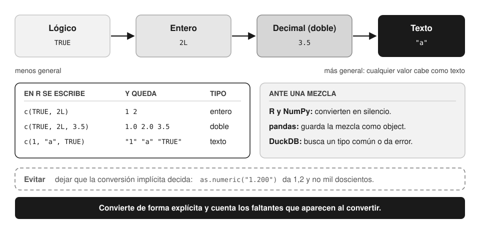
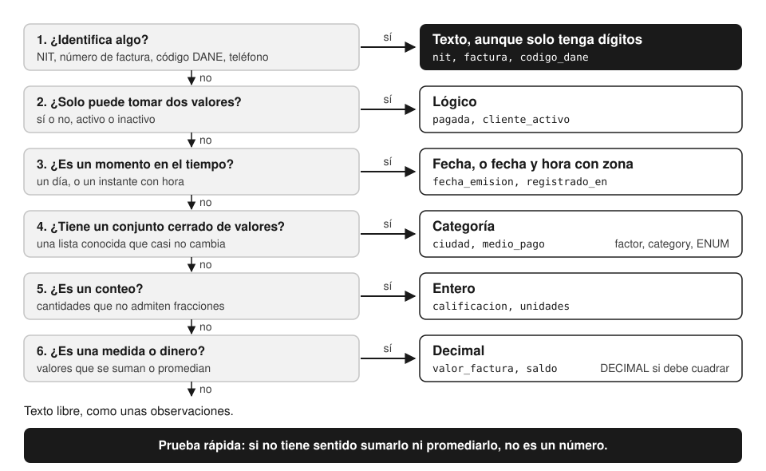
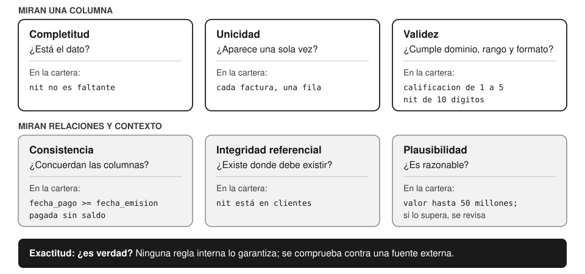
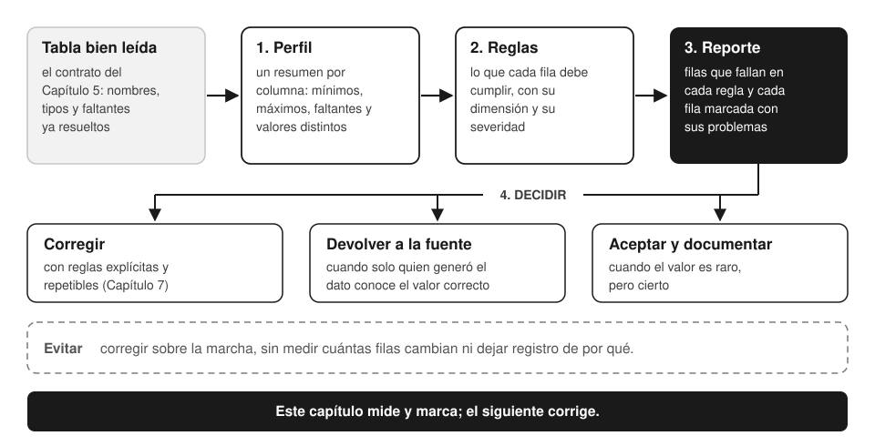

# Tipos de datos y calidad {#sec-tipos-calidad}

Con el @sec-limpieza-temprana terminamos la importación: la cartera de febrero quedó en Parquet con nombres de trabajo, faltantes declarados, booleanos, fechas y números con su tipo. Ninguna persona que abra ese archivo tiene que adivinar cómo se escribió. Pero que una tabla esté bien leída no significa que sus datos sean correctos, y este capítulo se ocupa de esa diferencia.

Lo haremos con dos preguntas. La primera es **qué clase de valor guarda cada columna**: el tipo de dato. Ya elegimos tipos al leer, pero ahora veremos qué consecuencias tiene esa elección: qué pasa cuando se mezclan tipos, por qué un número decimal no siempre es exacto, por qué un NIT no debe ser un número y cuándo conviene una categoría en lugar de un texto. La segunda pregunta es **si lo que dice cada columna es cierto**, o al menos posible: la calidad de los datos. Una fecha de pago anterior a la emisión es una fecha perfectamente válida como tipo y un error como dato.

La regla del capítulo es **medir antes de corregir**. Aquí vamos a perfilar la tabla, escribir reglas de calidad, contar cuántas filas falla cada una y marcar cada fila con sus problemas. Corregir es el tema del @sec-limpiar, después de reunir en el @sec-transformar las herramientas para hacerlo, y se hace mejor cuando se sabe exactamente qué está mal, cuántas veces y con qué gravedad.

Seguimos con la misma red regional de distribución, ahora con la cartera completa del primer trimestre de 2026. Los archivos están en la carpeta `datos/cap06/` del repositorio de materiales. Como los anteriores, el capítulo está pensado para una sesión de unas dos horas.

::: {.callout-tip}
## Antes de empezar

1. Abre la carpeta de materiales en Positron para que las rutas relativas `datos/cap06/...` funcionen.
2. No necesitas paquetes nuevos: usamos los que instalaste al comienzo del @sec-importacion.
3. Si los archivos de `datos/cap06/` no están en tu copia, genéralos desde la terminal, en la carpeta de materiales, con `Rscript scripts/generar_datos_cap06.R`.
:::

Declaramos las funciones de R que usaremos y abrimos una conexión a DuckDB.

```{r}
#| label: paquetes-cap06
#| message: false
use("arrow", c("read_parquet", "write_parquet"))
use("dplyr", c("mutate", "filter", "select", "count", "distinct", "anti_join",
               "left_join", "group_by", "summarise", "na_if", "tribble"))
use("DBI", c("dbConnect", "dbGetQuery", "dbExecute", "dbDisconnect"))
use("duckdb", "duckdb")

con <- dbConnect(duckdb())
ruta_cartera <- "datos/cap06/cartera_2026_t1.parquet"
```

## El archivo del capítulo: la cartera del trimestre {#sec-archivo-cartera-t1}

El archivo `cartera_2026_t1.parquet` reúne las facturas emitidas entre enero y marzo de 2026, con las mismas doce columnas que dejó el contrato de la @sec-contrato-completo: `factura`, `nit`, `fecha_emision`, `fecha_vencimiento`, `fecha_pago`, `valor_factura`, `pagada`, `cliente_activo`, `calificacion`, `ciudad`, `saldo` y `registrado_en`. Lo acompaña `clientes.parquet`, la tabla de los 200 clientes de la red, con su NIT y su ciudad.

Viene en Parquet porque es lo que producen los capítulos de importación: los tipos ya están dentro del archivo. Eso no quiere decir que los datos estén limpios. Esta cartera reúne exportaciones de varias personas y de varios meses, y trae los problemas típicos de una tabla real. No los vamos a enumerar todavía: encontrarlos es el objetivo del capítulo.

## Los tipos de datos {#sec-tipos}

Un **tipo de dato** dice qué clase de valor puede guardar una columna y, con eso, qué se puede hacer con ella. Con una columna de fechas se puede restar y calcular días de mora; con una de texto, no. Con una de números se puede sumar; con una lógica se puede filtrar y contar. Elegir el tipo es decidir qué operaciones tendrán sentido.

Cada herramienta tiene sus propios nombres para tipos que, en el fondo, son los mismos (@tbl-tipos-equivalencias).

| Clase de valor | R | pandas | DuckDB | En la cartera |
|---|---|---|---|---|
| Lógico | `logical` | `bool`, `boolean` (admite faltantes) | `BOOLEAN` | `pagada` |
| Entero | `integer` | `int64`, `Int64` (admite faltantes) | `INTEGER`, `BIGINT` | `calificacion` |
| Decimal | `double` (`numeric`) | `float64` | `DOUBLE` | `valor_factura` |
| Decimal exacto | no tiene en R base | no tiene en NumPy | `DECIMAL(p, s)` | |
| Texto | `character` | `str` (antes `object`) | `VARCHAR` | `nit`, `factura` |
| Categoría | `factor` | `category` | `ENUM` | `ciudad` |
| Fecha | `Date` | `datetime64` a medianoche | `DATE` | `fecha_emision` |
| Fecha y hora con zona | `POSIXct` con `tzone` | `datetime64[us, America/Bogota]` | `TIMESTAMPTZ` | `registrado_en` |

: Los tipos de datos en cada herramienta {#tbl-tipos-equivalencias}

En pandas y en R, los tipos con mayúscula o con la palabra *nullable* existen porque los tipos de NumPy no admiten faltantes: un `int64` con un `NaN` deja de ser entero y se convierte en `float64`. Lo veremos enseguida en la cartera.

### Ejemplo guiado 6.1: los tipos de la cartera en cada herramienta

Parquet guarda el tipo de cada columna dentro del archivo. Leamos la cartera y comprobemos qué entiende cada herramienta.

::: {.panel-tabset}

### R

```{r}
#| label: tipos-r
cartera <- read_parquet(ruta_cartera)

vapply(cartera, \(columna) class(columna)[1], character(1))
```

`class()` dice cómo se comporta una columna; `typeof()` dice cómo se guarda. Una fecha es un número con una regla, como vimos en la @sec-fechas:

```{r}
#| label: tipos-typeof
class(cartera$fecha_emision)
typeof(cartera$fecha_emision)
unclass(cartera$fecha_emision[1])
```

### Python

```python
import pandas as pd

ruta_cartera = "datos/cap06/cartera_2026_t1.parquet"
cartera = pd.read_parquet(ruta_cartera)
print(cartera.dtypes)
```

```text
factura                                         str
nit                                             str
fecha_emision                                object
fecha_vencimiento                            object
fecha_pago                                   object
valor_factura                               float64
pagada                                         bool
cliente_activo                                 bool
calificacion                                float64
ciudad                                          str
saldo                                       float64
registrado_en        datetime64[us, America/Bogota]
dtype: object
```

El archivo es el mismo, pero `pandas` no lo entiende igual. Las fechas llegan como `object`: cada celda es un objeto `datetime.date` de Python, no una columna de fechas de `pandas`, así que no sirven para restar ni filtrar por rango. Y `calificacion`, que en el archivo es un entero, llega como `float64`, porque tiene faltantes y el `int64` de NumPy no los admite. Lo corregimos con conversiones explícitas:

```python
print(type(cartera["fecha_emision"].iloc[0]))

fechas = ["fecha_emision", "fecha_vencimiento", "fecha_pago"]
cartera[fechas] = cartera[fechas].apply(pd.to_datetime)
cartera = cartera.astype({"calificacion": "Int64"})
print(cartera[fechas + ["calificacion"]].dtypes)
```

```text
<class 'datetime.date'>
fecha_emision        datetime64[s]
fecha_vencimiento    datetime64[s]
fecha_pago           datetime64[s]
calificacion                 Int64
dtype: object
```

Otra opción es leer con `pd.read_parquet(ruta_cartera, dtype_backend="pyarrow")`, que conserva los tipos exactos del archivo (`date32`, `int32`) usando las columnas de Arrow dentro de `pandas`. Es más fiel al archivo, pero algunas funciones de `pandas` y de otras librerías todavía esperan los tipos de NumPy, así que en el libro preferimos la conversión explícita.

### DuckDB

```{r}
#| label: tipos-duckdb
dbGetQuery(con, r"(
  DESCRIBE SELECT * FROM 'datos/cap06/cartera_2026_t1.parquet'
)")[, c("column_name", "column_type")]
```

DuckDB lee los tipos tal como están en el archivo: `DATE`, `INTEGER` con sus `NULL` y `TIMESTAMP WITH TIME ZONE`, el nombre largo de `TIMESTAMPTZ`.

:::

### La jerarquía de coerción {#sec-coercion}

Una columna guarda un solo tipo. ¿Qué pasa entonces si se mezclan valores de tipos distintos? En R, todos se convierten al tipo **más general** de la mezcla, siguiendo una jerarquía fija: lógico, entero, decimal y texto (@fig-coercion). Es la **coerción**, y ocurre en silencio.

{#fig-coercion fig-alt="Cuatro cajas de izquierda a derecha, de menos a más general: lógico con TRUE, entero con 2L, decimal con 3.5 y texto con a entre comillas. Abajo, ejemplos en R: c de TRUE y 2L queda 1 2, entero; c de TRUE, 2L y 3.5 queda 1.0 2.0 3.5, doble; c de 1, a y TRUE queda los textos 1, a y TRUE. A la derecha, qué hace cada herramienta ante una mezcla: R y NumPy convierten en silencio, pandas guarda la mezcla como object y DuckDB busca un tipo común o da error. Con trazo discontinuo, Evitar: dejar que la conversión implícita decida, porque as.numeric del texto 1.200 da 1,2 y no mil doscientos."}

La coerción tiene usos legítimos: `sum()` de un vector lógico cuenta los `TRUE` porque los convierte en 1 y 0, algo que aprovechamos en la @sec-booleanos. El problema aparece cuando la conversión cambia el valor sin avisar. Por eso, al convertir texto en otro tipo, la regla es **convertir de forma explícita y contar los faltantes que aparecen**: si había 2 faltantes antes de convertir y hay 5 después, tres valores no se pudieron convertir y hay que mirarlos.

### Ejemplo guiado 6.2: conversiones que rinden cuentas

::: {.panel-tabset}

### R

```{r}
#| label: coercion-r
c(TRUE, 2L, 3.5)
c(1, "a", TRUE)
sum(c(TRUE, FALSE, TRUE))
as.integer("3.7")
```

`as.integer("3.7")` no redondea: trunca, y devuelve 3. Ahora convirtamos un texto con valores escritos de varias formas y contemos lo que se pierde:

```{r}
#| label: coercion-contar
texto <- c("12", "3,5", "1.200", "", NA)
numeros <- suppressWarnings(as.numeric(texto))
numeros
sum(is.na(numeros)) - sum(is.na(texto))   # faltantes nuevos
```

La cuenta detecta dos valores que no se pudieron convertir: `"3,5"`, por la coma decimal, y el texto vacío. Pero no detecta el caso más grave: `"1.200"`, que alguien escribió como mil doscientos, se convirtió en `1.2` sin error y sin faltante. Contar los faltantes es necesario, pero no suficiente; para atrapar valores que se convierten mal hacen falta reglas de rango, como las que veremos en la parte de calidad. Y, desde luego, el remedio de fondo es el del @sec-limpieza-temprana: declarar el formato numérico al leer.

### Python

```python
import numpy as np

print(np.array([True, 2, 3.5]))
print(np.array([1, "a", True]))
print(pd.Series([True, 2, 3.5]).dtype)
```

```text
[1.  2.  3.5]
['1' 'a' 'True']
object
```

NumPy hace la misma coerción que R. `pandas`, en cambio, no convierte: guarda la mezcla como `object`, una columna donde cada celda es un objeto de Python con su propio tipo. No hay error, pero la columna deja de comportarse como números. Para convertir texto en números y contar lo que se pierde:

```python
texto = pd.Series(["12", "3,5", "1.200", "", None])
numeros = pd.to_numeric(texto, errors="coerce")
print(numeros.tolist())
print("Faltantes nuevos:", numeros.isna().sum() - texto.isna().sum())
```

```text
[12.0, nan, 1.2, nan, nan]
Faltantes nuevos: 2
```

`errors="coerce"` convierte en `NaN` lo que no se puede convertir; sin él, `pd.to_numeric()` se detiene con un error en el primer valor problemático. Y, como en R, `"1.200"` se convierte en `1.2` sin aviso.

### DuckDB

```{r}
#| label: coercion-duckdb
dbGetQuery(con, r"(
  SELECT CAST('3.7' AS INTEGER)       AS redondea,
         TRY_CAST('12a' AS INTEGER)   AS sin_error,
         typeof([1, 2.5])             AS lista_mixta
)")
```

DuckDB, a diferencia de R, **redondea** `'3.7'` a 4. Ante una mezcla de entero y decimal busca un tipo común (aquí, una lista de `DECIMAL`). Y cuando la conversión no es posible, prefiere fallar:

```{r}
#| label: coercion-duckdb-error
#| error: true
dbGetQuery(con, "SELECT CAST('12a' AS INTEGER)")
```

`TRY_CAST()` es la versión que no falla: devuelve `NULL`. Con ella se aplica la misma regla de contar los faltantes que aparecen.

:::

### Números: enteros, decimales y dinero {#sec-numeros}

Los números decimales de las tres herramientas (`double`, `float64`, `DOUBLE`) siguen el estándar IEEE 754: se guardan en binario con unos 15 a 17 dígitos significativos. La consecuencia es que muchos números que en decimal son exactos, como `0.1`, en binario no lo son. La suma `0.1 + 0.2` no da exactamente `0.3`, y una comparación con `==` falla.

::: {.panel-tabset}

### R

```{r}
#| label: numeros-r
0.1 + 0.2 == 0.3
print(0.1 + 0.2, digits = 17)
isTRUE(all.equal(0.1 + 0.2, 0.3))
```

`all.equal()` compara con una tolerancia. Para dinero, la práctica habitual es redondear a los centavos con `round(x, 2)` antes de comparar.

### Python

```python
import math

print(0.1 + 0.2 == 0.3)
print(0.1 + 0.2)
print(math.isclose(0.1 + 0.2, 0.3))
```

```text
False
0.30000000000000004
True
```

`math.isclose()`, o `np.isclose()` para columnas enteras, compara con una tolerancia.

### DuckDB

```{r}
#| label: numeros-duckdb
dbGetQuery(con, r"(
  SELECT 0.1 + 0.2 = 0.3                               AS como_decimal,
         0.1::DOUBLE + 0.2::DOUBLE = 0.3::DOUBLE       AS como_doble,
         typeof(0.1)                                   AS tipo_del_literal
)")
```

Una curiosidad: en DuckDB, `0.1 + 0.2 = 0.3` es **verdadero**, porque un número escrito con decimales en la consulta se interpreta como `DECIMAL`, un tipo exacto. Con `DOUBLE` aparece el mismo error de las otras herramientas.

:::

Para el análisis, la diferencia es despreciable: un error en el decimoquinto dígito no cambia un promedio de cartera. Importa en dos situaciones: al **comparar** con `==` y en la **contabilidad**, donde un total tiene que cuadrar al centavo. Para lo segundo, DuckDB ofrece `DECIMAL(15, 2)`, que guarda exactamente dos decimales; en R y en `pandas` lo habitual es redondear al final o guardar los valores en centavos, como enteros.

Los enteros tienen otro límite: su tamaño. El `integer` de R y el `INTEGER` de DuckDB usan 32 bits y llegan hasta 2.147.483.647. Un NIT de diez dígitos como `9001234567` no cabe: R lo convierte en `NA` con un aviso y DuckDB da un error. Esta es una razón más para la regla del @sec-importacion de leer los identificadores como texto. La regla completa es: **si no tiene sentido sumarlo ni promediarlo, no es un número**. El NIT, el código DANE, el número de factura o un teléfono están hechos de dígitos, pero nadie suma dos NIT.

```{r}
#| label: numeros-enteros
.Machine$integer.max
as.integer("9001234567")
```

Y un identificador que pasó alguna vez por un tipo numérico deja huella: pierde los ceros a la izquierda. Contemos cuántos dígitos tienen los NIT de la cartera:

```{r}
#| label: nit-digitos
table(digitos = nchar(cartera$nit), useNA = "ifany")
```

Cuatro NIT tienen nueve dígitos. Volveremos a ellos al revisar la integridad referencial.

### Texto y categorías {#sec-categorias}

Una columna como `ciudad` es texto, pero no cualquier texto: solo puede tomar unos pocos valores conocidos. Para esos casos existe el tipo **categoría**: `factor` en R, `category` en `pandas` y `ENUM` en DuckDB. Una categoría guarda la lista de valores posibles (los **niveles**) una sola vez y, en cada fila, solo un número que apunta a esa lista.

Eso tiene dos ventajas. La primera es la memoria, sobre todo en `pandas`. La segunda es más interesante para este capítulo: si se declara la lista de niveles válidos, **todo valor que no esté en la lista queda señalado**. Una categoría es, también, una regla de calidad.

La @fig-elegir-tipo resume en seis preguntas cómo elegir el tipo de una columna.

{#fig-elegir-tipo fig-alt="Seis preguntas en orden, cada una con su respuesta si es afirmativa. Uno: ¿identifica algo, como un NIT, un número de factura, un código DANE o un teléfono? Texto, aunque solo tenga dígitos. Dos: ¿solo puede tomar dos valores? Lógico, como pagada. Tres: ¿es un momento en el tiempo? Fecha, o fecha y hora con zona. Cuatro: ¿tiene un conjunto cerrado de valores? Categoría, como ciudad: factor, category o ENUM. Cinco: ¿es un conteo? Entero. Seis: ¿es una medida o dinero? Decimal, y DECIMAL si debe cuadrar. Si ninguna se cumple, texto libre. Al pie: prueba rápida, si no tiene sentido sumarlo ni promediarlo, no es un número."}

### Ejemplo guiado 6.3: la ciudad como categoría

::: {.panel-tabset}

### R

Primero, la memoria. Comparamos un millón de ciudades como texto y como factor:

```{r}
#| label: factor-memoria
ciudades <- sample(c("Bogotá", "Cali", "Medellín", "Pasto"), 1e6, replace = TRUE)
format(object.size(ciudades), units = "Mb")
format(object.size(factor(ciudades)), units = "Mb")
```

En R la diferencia es moderada, porque R ya guarda cada texto distinto una sola vez y el vector solo tiene referencias a ellos. Lo valioso es lo segundo: declarar los niveles válidos a partir de la tabla de clientes y ver qué queda por fuera.

```{r}
#| label: factor-validacion
clientes <- read_parquet("datos/cap06/clientes.parquet")
ciudades_validas <- sort(unique(clientes$ciudad))
ciudades_validas

ciudad <- factor(cartera$ciudad, levels = ciudades_validas)
fuera <- is.na(ciudad) & !is.na(cartera$ciudad)
count(cartera[fuera, ], ciudad)
```

`factor()` convierte en `NA`, sin aviso, todo valor que no esté entre los niveles. Por eso comparamos los faltantes antes y después: las 11 filas que eran texto y ahora son `NA` son las que no coinciden con el catálogo. Son variantes de Bogotá y una Cali con un espacio al inicio, el tipo de inconsistencia que se corrige en el @sec-limpiar.

### Python

```python
rng = np.random.default_rng(2026)
ciudades = pd.Series(rng.choice(["Bogotá", "Cali", "Medellín", "Pasto"], 1_000_000))
print(round(ciudades.memory_usage(deep=True) / 1e6, 1))
print(round(ciudades.astype("category").memory_usage(deep=True) / 1e6, 1))
```

```text
14.3
1.0
```

En `pandas` la diferencia es grande: 14,3 MB como texto y 1 MB como categoría. Para validar contra el catálogo usamos `isin()`:

```python
clientes = pd.read_parquet("datos/cap06/clientes.parquet")
catalogo = sorted(clientes["ciudad"].unique())

fuera = cartera["ciudad"].notna() & ~cartera["ciudad"].isin(catalogo)
print(cartera.loc[fuera, "ciudad"].value_counts())
```

```text
ciudad
BOGOTA         6
Bogota D.C.    3
 Cali          2
Name: count, dtype: int64
```

En versiones anteriores, `astype(pd.CategoricalDtype(catalogo))` convertía en silencio en `NaN` los valores fuera del catálogo, como `factor()` en R. Desde `pandas` 3.1 esa conversión emite un aviso de que en el futuro será un error. Por eso conviene validar primero con `isin()` y convertir a categoría después.

### DuckDB

```{r}
#| label: enum-duckdb
dbExecute(con, r"(
  CREATE TYPE ciudad_valida AS ENUM (
    SELECT DISTINCT ciudad FROM 'datos/cap06/clientes.parquet' ORDER BY ciudad
  )
)")

dbGetQuery(con, r"(
  SELECT ciudad, count(*) AS facturas
  FROM 'datos/cap06/cartera_2026_t1.parquet'
  WHERE ciudad IS NOT NULL
    AND TRY_CAST(ciudad AS ciudad_valida) IS NULL
  GROUP BY ciudad
  ORDER BY facturas DESC
)")
```

`CREATE TYPE ... AS ENUM` crea un tipo nuevo cuyos valores salen de una consulta. Convertir `'BOGOTA'` a ese tipo con `CAST` da un error; con `TRY_CAST`, un `NULL` que nos permite encontrar las filas fuera del catálogo.

:::

## La calidad de los datos {#sec-calidad}

Los datos tienen **calidad** cuando sirven para el propósito que se les quiere dar. No existe una tabla perfecta, pero sí una tabla de la que se sabe qué problemas tiene, cuántos y qué tan graves son. Esa es la meta de una auditoría de calidad.

Para no revisar "a ojo", conviene pensar en **dimensiones**, cada una con su pregunta (@fig-dimensiones-calidad). Las tres primeras miran una columna a la vez; las siguientes miran relaciones entre columnas, entre tablas o con el contexto del negocio.

{#fig-dimensiones-calidad fig-alt="Seis tarjetas en dos filas. Fila superior, las que miran una columna: Completitud, ¿está el dato?, por ejemplo nit no es faltante; Unicidad, ¿aparece una sola vez?, cada factura en una fila; Validez, ¿cumple dominio, rango y formato?, calificación de 1 a 5 y nit de 10 dígitos. Fila inferior, las que miran relaciones y contexto: Consistencia, ¿concuerdan las columnas?, fecha de pago mayor o igual que la de emisión y pagada sin saldo; Integridad referencial, ¿existe donde debe existir?, el nit está en clientes; Plausibilidad, ¿es razonable?, valor hasta 50 millones y si lo supera se revisa. Al pie, la exactitud: ¿es verdad? Ninguna regla interna lo garantiza; se comprueba contra una fuente externa."}

| Dimensión | Pregunta | Ejemplo en la cartera |
|---|---|---|
| Completitud | ¿Está el dato? | Toda factura tiene NIT. |
| Unicidad | ¿Aparece una sola vez? | Cada factura ocupa una sola fila. |
| Validez | ¿Cumple el dominio, el rango y el formato? | La calificación va de 1 a 5; el NIT tiene diez dígitos; la ciudad está en el catálogo. |
| Consistencia | ¿Concuerdan las columnas entre sí? | El pago no es anterior a la emisión; una factura pagada no tiene saldo. |
| Integridad referencial | ¿Existe donde debe existir? | El NIT de cada factura está en la tabla de clientes. |
| Plausibilidad | ¿Es razonable? | Una factura de más de 50 millones es posible, pero se revisa. |

: Las dimensiones de la calidad de los datos {#tbl-dimensiones-calidad}

Falta una dimensión, la más importante y la más difícil: la **exactitud**. Que el valor de una factura sea positivo, único, consistente y plausible no garantiza que sea el valor que dice la factura física. La exactitud solo se comprueba contra una fuente externa, y ninguna regla escrita sobre la tabla puede reemplazar esa revisión. Lo que sí pueden hacer las reglas es señalar dónde vale la pena mirar.

El trabajo sigue cuatro pasos (@fig-flujo-auditoria): perfilar la tabla, escribir las reglas, generar el reporte y decidir qué hacer con cada problema.

{#fig-flujo-auditoria fig-alt="Cuatro cajas en fila: la tabla bien leída del contrato del Capítulo 5, el perfil con un resumen por columna, las reglas que cada fila debe cumplir con su dimensión y severidad, y el reporte con las filas que fallan en cada regla y cada fila marcada con sus problemas. Del reporte sale el paso 4, decidir, hacia tres cajas: corregir con reglas explícitas y repetibles en el Capítulo 8, devolver a la fuente cuando solo quien generó el dato conoce el valor correcto, y aceptar y documentar cuando el valor es raro pero cierto. Con trazo discontinuo, Evitar: corregir sobre la marcha, sin medir cuántas filas cambian ni dejar registro de por qué. Al pie: este capítulo mide y marca; el Capítulo 8 corrige."}

### Ejemplo guiado 6.4: el perfil de la tabla {#sec-perfil}

Un **perfil** es un resumen de cada columna: mínimo, máximo, cantidad de faltantes y de valores distintos. No responde ninguna pregunta de negocio, pero en un par de pantallas muestra casi todo lo que está fuera de lugar. Es lo primero que se hace con una tabla nueva.

::: {.panel-tabset}

### R

```{r}
#| label: perfil-r
summary(cartera)
```

### Python

```python
print(cartera.describe().T[["count", "min", "max"]])
print(cartera.select_dtypes(["str", "bool"]).nunique())
```

```text
                   count                  min                  max
fecha_emision        406  2026-01-02 00:00:00  2062-03-21 00:00:00
fecha_vencimiento    406  2026-02-01 00:00:00  2026-04-30 00:00:00
fecha_pago           195  2026-01-06 00:00:00  2026-03-31 00:00:00
valor_factura      406.0          -6226332.66           98500000.0
calificacion       396.0                  0.0                  7.0
saldo              406.0          -6226332.66           98500000.0
factura           400
nit               179
pagada              2
cliente_activo      2
ciudad             11
dtype: int64
```

`describe()` resume las columnas numéricas y de fecha; `nunique()` cuenta los valores distintos de las columnas de texto y lógicas.

### DuckDB

```{r}
#| label: perfil-duckdb
dbExecute(con, r"(CREATE VIEW cartera AS FROM 'datos/cap06/cartera_2026_t1.parquet')")
dbExecute(con, r"(CREATE VIEW clientes AS FROM 'datos/cap06/clientes.parquet')")

dbGetQuery(con, r"(
  SELECT column_name, min, max, approx_unique, null_percentage
  FROM (SUMMARIZE cartera)
)")
```

Una **vista** (`CREATE VIEW`) le da un nombre a una consulta, sin copiar los datos: desde aquí, `cartera` y `clientes` leen los archivos Parquet cada vez que se usan. DuckDB permite empezar una consulta por `FROM` cuando se quieren todas las columnas. `SUMMARIZE` ya lo conocíamos de la @sec-columnas-vacias; `approx_unique` es una estimación rápida del número de valores distintos, no un conteo exacto.

:::

Leamos el perfil como un auditor. Cada línea extraña es una pista:

- **`fecha_emision` llega hasta 2062.** Es un año mal digitado (2062 por 2026). En R, el promedio de las fechas de emisión cae el 21 de marzo, casi al final del trimestre: una sola fecha absurda arrastra la media.
- **`valor_factura` tiene un mínimo negativo y un máximo de 98,5 millones.** Una factura no puede valer menos que cero; una de 98,5 millones puede ser real, pero está muy lejos del resto.
- **`calificacion` va de 0 a 7**, y la escala es de 1 a 5.
- **`factura` tiene 400 valores distintos en 406 filas.** Hay facturas repetidas.
- **`nit` tiene NIT de 9 caracteres** (`Min.nchar` en R; en DuckDB, el máximo es `738702752`, un NIT sin su cero inicial que, como texto, se ordena después de los que empiezan por cero).
- **`ciudad` tiene 11 valores distintos**, y el catálogo tiene 8.
- **Hay 211 fechas de pago faltantes y 213 facturas no pagadas.** Si `fecha_pago` falta exactamente cuando la factura no está pagada, esos números deberían coincidir.

El perfil no dice cuántas filas tienen cada problema ni cuáles son. Para eso escribimos reglas.

### Ejemplo guiado 6.5: completitud y unicidad

La completitud se mide contando faltantes por columna, y ya lo hicimos en el capítulo anterior. Lo que pide criterio es interpretarlos: los 211 faltantes de `fecha_pago` son, en su mayoría, facturas sin pagar ("no aplica", @sec-faltantes), mientras que un NIT faltante impide saber a quién se le cobra.

La unicidad tiene dos niveles. Una **fila repetida** es idéntica a otra en todas sus columnas: casi siempre es una doble carga y no hay nada que decidir. Una **clave repetida** es más delicada: la misma factura aparece en dos filas con contenido distinto, y alguien tiene que decidir cuál versión vale.

::: {.panel-tabset}

### R

```{r}
#| label: unicidad-r
colSums(is.na(cartera))

sum(duplicated(cartera))            # filas idénticas a una anterior
sum(duplicated(cartera$factura))    # facturas que ya habían aparecido

versiones <- cartera |>
  distinct() |>
  filter(duplicated(factura) | duplicated(factura, fromLast = TRUE))
select(versiones, factura, nit, fecha_emision, valor_factura)
```

`duplicated()` marca cada fila que repite una anterior; con `fromLast = TRUE` marca también la primera aparición, así que la combinación de las dos marca **todas** las filas de una clave repetida. Hay 6 facturas sobrantes: 4 son filas idénticas y 2 son facturas con dos valores distintos, una diferencia del 8 % que parece un ajuste de precio.

### Python

```python
print(cartera.isna().sum()[lambda s: s > 0])
print("Filas idénticas repetidas:", cartera.duplicated().sum())
print("Facturas repetidas:", cartera["factura"].duplicated().sum())

sin_copias = cartera.drop_duplicates()
versiones = sin_copias[sin_copias["factura"].duplicated(keep=False)]
print(versiones[["factura", "nit", "fecha_emision", "valor_factura"]])
```

```text
nit               3
fecha_pago      211
calificacion     10
ciudad            4
dtype: int64
Filas idénticas repetidas: 4
Facturas repetidas: 6
      factura         nit fecha_emision  valor_factura
225  FV-20224  0213202814    2026-02-24     9400663.24
226  FV-20224  0213202814    2026-02-24    10152716.30
229  FV-20227  0284871151    2026-02-24     3909520.58
230  FV-20227  0284871151    2026-02-24     4222282.23
```

`duplicated(keep=False)` marca todas las filas de una clave repetida, sin distinguir la primera.

### DuckDB

```{r}
#| label: unicidad-duckdb
dbGetQuery(con, r"(
  SELECT count(*)                           AS filas,
         count(DISTINCT factura)            AS facturas,
         count(*) - count(DISTINCT factura) AS sobrantes
  FROM cartera
)")

dbGetQuery(con, r"(
  SELECT factura,
         count(*)                      AS filas,
         count(DISTINCT valor_factura) AS valores_distintos
  FROM cartera
  GROUP BY factura
  HAVING count(*) > 1
  ORDER BY valores_distintos DESC, factura
)")
```

Las facturas con un solo valor distinto son filas copiadas; las que tienen dos son versiones en conflicto.

:::

### Ejemplo guiado 6.6: validez, consistencia e integridad

Una regla de calidad es una **condición que cada fila debe cumplir**, escrita como una expresión lógica: `TRUE` si la fila cumple, `FALSE` si no. Al escribirlas hay que decidir qué hacer con los faltantes. Si `calificacion` es `NA`, la regla "la calificación va de 1 a 5" no se puede evaluar, y en R la comparación devuelve `NA`. La convención que seguiremos es que **una regla de validez no juzga los faltantes**: los deja pasar de forma explícita (`is.na(x) | ...`), porque de ellos se encarga la regla de completitud. Así cada problema se cuenta en una sola regla.

::: {.panel-tabset}

### R

```{r}
#| label: validez-r
inicio <- as.Date("2026-01-01")
corte  <- as.Date("2026-03-31")

validez <- with(cartera, data.frame(
  valor_positivo     = valor_factura > 0,
  calificacion_1_a_5 = is.na(calificacion) | calificacion %in% 1:5,
  emision_en_periodo = fecha_emision >= inicio & fecha_emision <= corte,
  nit_10_digitos     = is.na(nit) | grepl("^[0-9]{10}$", nit),
  ciudad_en_catalogo = is.na(ciudad) | ciudad %in% ciudades_validas
))
colSums(!validez)
```

`with()` permite escribir los nombres de las columnas sin repetir `cartera$`. `colSums(!validez)` cuenta, para cada regla, las filas que **no** cumplen. `grepl("^[0-9]{10}$", nit)` es una expresión regular: "de principio a fin, exactamente diez dígitos".

Las reglas de **consistencia** comparan columnas de la misma fila:

```{r}
#| label: consistencia-r
consistencia <- with(cartera, data.frame(
  pago_despues_emision = is.na(fecha_pago) | fecha_pago >= fecha_emision,
  pagada_con_fecha     = pagada == !is.na(fecha_pago),
  pagada_sin_saldo     = !pagada | saldo == 0,
  saldo_hasta_valor    = saldo <= valor_factura
))
colSums(!consistencia)
```

`pagada_sin_saldo` se lee "o no está pagada, o su saldo es cero": es la forma de escribir en lógica la frase "si está pagada, entonces no tiene saldo".

La **integridad referencial** compara con otra tabla. `anti_join()` devuelve las filas de la cartera cuyo NIT **no** encuentra pareja en `clientes`:

```{r}
#| label: integridad-r
huerfanas <- cartera |>
  filter(!is.na(nit)) |>
  anti_join(clientes, by = "nit")

count(huerfanas, nit, digitos = nchar(nit))
```

Siete facturas no tienen cliente. Tres tienen NIT de diez dígitos que no existen en la tabla de clientes; las otras cuatro son los NIT de nueve dígitos que encontramos al hablar de los enteros. ¿Será que les falta el cero inicial?

```{r}
#| label: integridad-cero
nueve <- huerfanas$nit[nchar(huerfanas$nit) == 9]
paste0("0", nueve) %in% clientes$nit
```

Los cuatro aparecen al recuperar el cero. El problema de calidad tiene una causa de tipo: en algún punto del camino, esos NIT pasaron por una columna numérica. La corrección es fácil, pero la lección es mejor: la regla del @sec-importacion, leer los identificadores como texto, existe para que esto no pase.

### Python

```python
inicio, corte = pd.Timestamp("2026-01-01"), pd.Timestamp("2026-03-31")

validez = pd.DataFrame({
    "valor_positivo":     cartera["valor_factura"] > 0,
    "calificacion_1_a_5": cartera["calificacion"].isna()
                          | cartera["calificacion"].between(1, 5),
    "emision_en_periodo": cartera["fecha_emision"].between(inicio, corte),
    "nit_10_digitos":     cartera["nit"].isna()
                          | cartera["nit"].str.fullmatch(r"\d{10}"),
    "ciudad_en_catalogo": cartera["ciudad"].isna()
                          | cartera["ciudad"].isin(catalogo),
})
print((~validez).sum())
```

```text
valor_positivo         3
calificacion_1_a_5     3
emision_en_periodo     1
nit_10_digitos         4
ciudad_en_catalogo    11
dtype: Int64
```

`~` es la negación en `pandas` y `|` es el "o". Cada condición va entre paréntesis o en su propia línea, porque `|` tiene más precedencia que las comparaciones. `str.fullmatch(r"\d{10}")` exige que todo el texto sean diez dígitos.

```python
consistencia = pd.DataFrame({
    "pago_despues_emision": cartera["fecha_pago"].isna()
                            | (cartera["fecha_pago"] >= cartera["fecha_emision"]),
    "pagada_con_fecha":     cartera["pagada"] == cartera["fecha_pago"].notna(),
    "pagada_sin_saldo":     ~cartera["pagada"] | (cartera["saldo"] == 0),
    "saldo_hasta_valor":    cartera["saldo"] <= cartera["valor_factura"],
})
print((~consistencia).sum())

huerfanas = cartera[cartera["nit"].notna() & ~cartera["nit"].isin(clientes["nit"])]
print(huerfanas["nit"].value_counts())
```

```text
pago_despues_emision    3
pagada_con_fecha        2
pagada_sin_saldo        3
saldo_hasta_valor       2
dtype: int64
nit
0900123456    2
580691787     1
691181931     1
584524401     1
738702752     1
0811000222    1
Name: count, dtype: int64
```

`~isin()` cumple el papel del `anti_join()` de R: las filas cuyo NIT no está en la lista de clientes.

### DuckDB

```{r}
#| label: reglas-duckdb
dbGetQuery(con, r"(
  SELECT
    count_if(NOT valor_factura > 0)                                AS valor_positivo,
    count_if(NOT calificacion BETWEEN 1 AND 5)                     AS calificacion_1_a_5,
    count_if(NOT fecha_emision BETWEEN '2026-01-01' AND '2026-03-31') AS emision_en_periodo,
    count_if(NOT regexp_full_match(nit, '[0-9]{10}'))              AS nit_10_digitos,
    count_if(NOT ciudad IN (SELECT ciudad FROM clientes))          AS ciudad_en_catalogo,
    count_if(fecha_pago < fecha_emision)                           AS pago_despues_emision,
    count_if(pagada <> (fecha_pago IS NOT NULL))                   AS pagada_con_fecha,
    count_if(pagada AND saldo <> 0)                                AS pagada_sin_saldo,
    count_if(saldo > valor_factura)                                AS saldo_hasta_valor
  FROM cartera
)")

dbGetQuery(con, r"(
  SELECT nit, length(nit) AS digitos, count(*) AS facturas
  FROM cartera ANTI JOIN clientes USING (nit)
  WHERE nit IS NOT NULL
  GROUP BY ALL
  ORDER BY digitos, nit
)")
```

`count_if()` cuenta las filas donde la condición es verdadera. En SQL, una comparación con `NULL` da `NULL`, y `count_if()` no la cuenta: la convención de no juzgar los faltantes viene incluida. `ANTI JOIN` devuelve las filas de la izquierda que no tienen pareja en la derecha, igual que `anti_join()`.

:::

## Ejemplo guiado 6.7: las reglas como datos, el reporte de calidad {#sec-reporte-calidad}

Hasta aquí escribimos las reglas sueltas, en varios bloques. Para que la auditoría se pueda repetir cada mes, conviene reunirlas en un solo lugar y tratarlas como **datos**: una tabla donde cada fila es una regla, con su nombre, su dimensión, su **severidad** y la condición que debe cumplirse. Con esa tabla se generan dos productos:

1. **El reporte**: cuántas filas falla cada regla.
2. **La tabla marcada**: la cartera con una columna nueva, `problemas`, que dice qué reglas falla cada fila.

La severidad separa lo urgente de lo que puede esperar. Una regla que **bloquea** señala un dato que no se puede usar tal como está, como una factura sin NIT o con valor negativo. Una regla que **advierte** señala algo que conviene revisar, pero que no impide el análisis, como una ciudad mal escrita o una factura muy grande.

::: {.panel-tabset}

### R

```{r}
#| label: reporte-r
reglas <- tribble(
  ~regla,                 ~dimension,      ~severidad, ~cumple,
  "nit_presente",         "Completitud",   "bloquea",  \(d) !is.na(d$nit),
  "ciudad_presente",      "Completitud",   "advierte", \(d) !is.na(d$ciudad),
  "factura_unica",        "Unicidad",      "bloquea",  \(d) !(duplicated(d$factura) |
                                                           duplicated(d$factura, fromLast = TRUE)),
  "valor_positivo",       "Validez",       "bloquea",  \(d) d$valor_factura > 0,
  "calificacion_1_a_5",   "Validez",       "advierte", \(d) is.na(d$calificacion) |
                                                           d$calificacion %in% 1:5,
  "emision_en_periodo",   "Validez",       "bloquea",  \(d) d$fecha_emision >= inicio &
                                                           d$fecha_emision <= corte,
  "nit_10_digitos",       "Validez",       "bloquea",  \(d) is.na(d$nit) |
                                                           grepl("^[0-9]{10}$", d$nit),
  "ciudad_en_catalogo",   "Validez",       "advierte", \(d) is.na(d$ciudad) |
                                                           d$ciudad %in% ciudades_validas,
  "pago_despues_emision", "Consistencia",  "bloquea",  \(d) is.na(d$fecha_pago) |
                                                           d$fecha_pago >= d$fecha_emision,
  "pagada_con_fecha",     "Consistencia",  "bloquea",  \(d) d$pagada == !is.na(d$fecha_pago),
  "pagada_sin_saldo",     "Consistencia",  "bloquea",  \(d) !d$pagada | d$saldo == 0,
  "saldo_hasta_valor",    "Consistencia",  "bloquea",  \(d) d$saldo <= d$valor_factura,
  "nit_en_clientes",      "Integridad",    "bloquea",  \(d) is.na(d$nit) |
                                                           d$nit %in% clientes$nit,
  "valor_plausible",      "Plausibilidad", "advierte", \(d) d$valor_factura <= 50e6
)

marcas <- sapply(reglas$cumple, \(cumple) !cumple(cartera))
colnames(marcas) <- reglas$regla
stopifnot(!anyNA(marcas))

reporte <- reglas |>
  select(-cumple) |>
  mutate(filas      = colSums(marcas),
         porcentaje = round(100 * filas / nrow(cartera), 1))
reporte
```

Cada regla es una **función anónima** (`\(d) ...`, la forma corta de `function(d) ...`) que recibe la tabla y devuelve un vector lógico con una posición por fila. `tribble()` permite escribir la tabla de reglas por filas, de modo que se lee como un documento; la columna `cumple` es una lista de funciones. `sapply()` aplica cada función a la cartera y junta los resultados en una **matriz de marcas**: 406 filas por 14 reglas, con `TRUE` donde la fila falla. `stopifnot(!anyNA(marcas))` es un seguro: una regla que devuelve `NA` está mal escrita, porque no dejó pasar los faltantes de forma explícita.

Con la matriz, marcar cada fila es una línea más:

```{r}
#| label: cartera-auditada-r
cartera_auditada <- cartera |>
  mutate(problemas = apply(marcas, 1, \(fila) paste(names(which(fila)), collapse = ", ")),
         problemas = na_if(problemas, ""))

bloquean <- reglas$regla[reglas$severidad == "bloquea"]
c(con_algun_problema = sum(!is.na(cartera_auditada$problemas)),
  con_problema_que_bloquea = sum(rowSums(marcas[, bloquean]) > 0))

cartera_auditada |>
  filter(!is.na(problemas)) |>
  count(problemas, sort = TRUE)

write_parquet(cartera_auditada, "datos/cap06/cartera_2026_t1_auditada.parquet")
```

`apply(marcas, 1, ...)` recorre la matriz fila por fila y junta los nombres de las reglas que fallan. La suma de las fallas del reporte (59) es mayor que las filas con problemas (55): algunas filas fallan más de una regla. Los cuatro NIT de nueve dígitos, por ejemplo, fallan `nit_10_digitos` y `nit_en_clientes`, dos síntomas de la misma causa.

### Python

```python
reglas = [
    # (regla, dimensión, severidad, función que dice qué filas cumplen)
    ("nit_presente", "Completitud", "bloquea",
     lambda d: d["nit"].notna()),
    ("ciudad_presente", "Completitud", "advierte",
     lambda d: d["ciudad"].notna()),
    ("factura_unica", "Unicidad", "bloquea",
     lambda d: ~d["factura"].duplicated(keep=False)),
    ("valor_positivo", "Validez", "bloquea",
     lambda d: d["valor_factura"] > 0),
    ("calificacion_1_a_5", "Validez", "advierte",
     lambda d: d["calificacion"].isna() | d["calificacion"].between(1, 5)),
    ("emision_en_periodo", "Validez", "bloquea",
     lambda d: d["fecha_emision"].between(inicio, corte)),
    ("nit_10_digitos", "Validez", "bloquea",
     lambda d: d["nit"].isna() | d["nit"].str.fullmatch(r"\d{10}")),
    ("ciudad_en_catalogo", "Validez", "advierte",
     lambda d: d["ciudad"].isna() | d["ciudad"].isin(catalogo)),
    ("pago_despues_emision", "Consistencia", "bloquea",
     lambda d: d["fecha_pago"].isna() | (d["fecha_pago"] >= d["fecha_emision"])),
    ("pagada_con_fecha", "Consistencia", "bloquea",
     lambda d: d["pagada"] == d["fecha_pago"].notna()),
    ("pagada_sin_saldo", "Consistencia", "bloquea",
     lambda d: ~d["pagada"] | (d["saldo"] == 0)),
    ("saldo_hasta_valor", "Consistencia", "bloquea",
     lambda d: d["saldo"] <= d["valor_factura"]),
    ("nit_en_clientes", "Integridad", "bloquea",
     lambda d: d["nit"].isna() | d["nit"].isin(clientes["nit"])),
    ("valor_plausible", "Plausibilidad", "advierte",
     lambda d: d["valor_factura"] <= 50_000_000),
]

marcas = pd.DataFrame(
    {regla: ~cumple(cartera).astype(bool) for regla, _, _, cumple in reglas}
)

reporte = pd.DataFrame(
    [r[:3] for r in reglas], columns=["regla", "dimension", "severidad"]
).assign(
    filas=marcas.sum().to_numpy(),
    porcentaje=lambda r: (100 * r["filas"] / len(cartera)).round(1),
)
print(reporte)
```

```text
                   regla      dimension severidad  filas  porcentaje
0           nit_presente    Completitud   bloquea      3         0.7
1        ciudad_presente    Completitud  advierte      4         1.0
2          factura_unica       Unicidad   bloquea     12         3.0
3         valor_positivo        Validez   bloquea      3         0.7
4     calificacion_1_a_5        Validez  advierte      3         0.7
5     emision_en_periodo        Validez   bloquea      1         0.2
6         nit_10_digitos        Validez   bloquea      4         1.0
7     ciudad_en_catalogo        Validez  advierte     11         2.7
8   pago_despues_emision   Consistencia   bloquea      3         0.7
9       pagada_con_fecha   Consistencia   bloquea      2         0.5
10      pagada_sin_saldo   Consistencia   bloquea      3         0.7
11     saldo_hasta_valor   Consistencia   bloquea      2         0.5
12       nit_en_clientes     Integridad   bloquea      7         1.7
13       valor_plausible  Plausibilidad  advierte      1         0.2
```

Cada regla es una tupla con una función `lambda`. La comprensión de diccionario aplica cada función a la cartera y arma el `DataFrame` de marcas, con una columna por regla. `astype(bool)` convierte los booleanos con faltantes (`boolean`) en booleanos simples; si una regla dejara un `NA`, quedaría como `True` y la contaríamos como cumplida, por eso cada regla deja pasar los faltantes de forma explícita. Marcar las filas:

```python
cartera["problemas"] = marcas.apply(
    lambda fila: ", ".join(fila.index[fila]) or None, axis=1
)
bloquean = reporte.loc[reporte["severidad"] == "bloquea", "regla"]

print("Filas con algún problema:", cartera["problemas"].notna().sum())
print("Filas con un problema que bloquea:", marcas[bloquean].any(axis=1).sum())

cartera.to_parquet("datos/cap06/cartera_2026_t1_auditada.parquet", index=False)
```

```text
Filas con algún problema: 55
Filas con un problema que bloquea: 36
```

`", ".join(...) or None` devuelve `None` cuando la fila no falla ninguna regla, porque un texto vacío cuenta como falso en Python.

### DuckDB

```{r}
#| label: reporte-duckdb
dbGetQuery(con, r"(
  UNPIVOT (
    SELECT
      count_if(nit IS NULL)                                         AS nit_presente,
      count_if(ciudad IS NULL)                                      AS ciudad_presente,
      count_if(veces > 1)                                           AS factura_unica,
      count_if(NOT valor_factura > 0)                               AS valor_positivo,
      count_if(NOT calificacion BETWEEN 1 AND 5)                    AS calificacion_1_a_5,
      count_if(NOT fecha_emision BETWEEN '2026-01-01' AND '2026-03-31') AS emision_en_periodo,
      count_if(NOT regexp_full_match(nit, '[0-9]{10}'))             AS nit_10_digitos,
      count_if(NOT ciudad IN (SELECT ciudad FROM clientes))         AS ciudad_en_catalogo,
      count_if(fecha_pago < fecha_emision)                          AS pago_despues_emision,
      count_if(pagada <> (fecha_pago IS NOT NULL))                  AS pagada_con_fecha,
      count_if(pagada AND saldo <> 0)                               AS pagada_sin_saldo,
      count_if(saldo > valor_factura)                               AS saldo_hasta_valor,
      count_if(NOT nit IN (SELECT nit FROM clientes))               AS nit_en_clientes,
      count_if(valor_factura > 50e6)                                AS valor_plausible
    FROM (SELECT *, count(*) OVER (PARTITION BY factura) AS veces FROM cartera)
  )
  ON COLUMNS(*) INTO NAME regla VALUE filas
)")
```

La consulta interna calcula todas las reglas en una sola pasada y devuelve una fila con 14 columnas. `UNPIVOT` la gira: cada columna se convierte en una fila, con el nombre de la regla y su conteo. `count(*) OVER (PARTITION BY factura)` es una **función de ventana**: cuenta cuántas filas tiene cada factura sin agrupar la tabla, de modo que cada fila conserva su detalle y sabe cuántas veces aparece su factura. Las funciones de ventana se tratan con más detalle en el @sec-transformar.

:::

El reporte cuenta una historia clara. Son 55 facturas con algún problema, un 13,5 % de la cartera, y 36 con al menos uno que bloquea su uso. Ninguna regla falla en más del 3 % de las filas: es una cartera usable, con problemas concentrados y conocidos. Y lo más importante: ahora cada problema tiene nombre, conteo y ubicación, y la auditoría se repite el próximo trimestre ejecutando el mismo código.

::: {.callout-note}
## Paquetes de validación

La tabla de reglas de este capítulo es la idea central de varios paquetes especializados. En R, [pointblank](https://rstudio.github.io/pointblank/) genera reportes de validación en HTML y [validate](https://cran.r-project.org/package=validate) trata las reglas como un objeto propio, con su propio lenguaje. En Python, [pandera](https://pandera.readthedocs.io/) declara un esquema con tipos y condiciones por columna y [Great Expectations](https://greatexpectations.io/) está pensado para equipos y flujos de datos grandes. Son útiles cuando las reglas crecen, se comparten entre proyectos o hay que presentar reportes; para empezar, una tabla de reglas como la de este ejemplo enseña lo esencial sin dependencias nuevas.
:::

La @tbl-herramientas-calidad resume con qué se hace cada tarea del capítulo en cada herramienta.

| Tarea | R | pandas | DuckDB |
|---|---|---|---|
| Ver los tipos | `class()`, `typeof()` | `dtypes` | `DESCRIBE` |
| Convertir sin error y contar lo que falla | `as.numeric()` con `suppressWarnings()` | `pd.to_numeric(errors="coerce")` | `TRY_CAST()` |
| Perfil | `summary()` | `describe()`, `nunique()` | `SUMMARIZE` |
| Faltantes | `colSums(is.na())` | `isna().sum()` | `null_percentage`, `count_if(x IS NULL)` |
| Filas y claves repetidas | `duplicated()`, `distinct()` | `duplicated(keep=False)`, `drop_duplicates()` | `GROUP BY ... HAVING`, `count(*) OVER` |
| Dominio y catálogo | `%in%`, `factor(levels = )` | `between()`, `isin()` | `BETWEEN`, `IN`, `ENUM` |
| Integridad referencial | `anti_join()` | `~isin()` | `ANTI JOIN` |
| Contar fallas por regla | `colSums(!marcas)` | `(~marcas).sum()` | `count_if()` y `UNPIVOT` |

: Herramientas para revisar tipos y calidad {#tbl-herramientas-calidad}

## Ejercicio 6.1: auditar los recaudos {#sec-ejercicio-recaudos}

El área de tesorería registra en `datos/cap06/recaudos_2026_t1.parquet` cada pago recibido: `recaudo` (identificador del pago), `factura`, `fecha_recaudo`, `valor_recaudado` y `medio_pago`. Escribe la auditoría de calidad de esta tabla con una tabla de reglas, como en el Ejemplo 6.7, y genera su reporte. Como mínimo, incluye estas reglas:

1. **Completitud**: el medio de pago no es faltante.
2. **Unicidad**: cada `recaudo` aparece una sola vez.
3. **Validez**: el valor recaudado es positivo, y el medio de pago está en el catálogo: `Transferencia`, `PSE`, `Cheque` o `Efectivo`.
4. **Integridad referencial**: la factura existe en la cartera.
5. **Consistencia entre tablas**: el recaudo no es anterior a la emisión de su factura. Para esta regla necesitas traer `fecha_emision` desde la cartera con un `left_join()` (en `pandas`, `merge()`).
6. **Consistencia agregada**: lo recaudado por cada factura no supera su valor. Esta regla no se evalúa fila por fila, sino por factura: primero suma los recaudos de cada factura y después compara.

Para las reglas que usan la cartera, quita antes sus filas idénticas con `distinct()` (o `drop_duplicates()`), para que la unión no duplique recaudos.

::: {.panel-tabset}

### R

```{r}
#| label: ejercicio-6-1
#| eval: false
recaudos <- read_parquet("datos/cap06/recaudos_2026_t1.parquet")
medios_validos <- c("Transferencia", "PSE", "Cheque", "Efectivo")

# 1. Traer la fecha de emisión y el valor de cada factura
facturas <- cartera |> distinct() |> select(factura, fecha_emision, valor_factura)
recaudos_ext <- ...                     # TODO: left_join(recaudos, facturas, ...)

# 2. Tabla de reglas
reglas_recaudos <- tribble(
  ~regla,            ~dimension,    ~severidad, ~cumple,
  "medio_presente",  "Completitud", "advierte", \(d) !is.na(d$medio_pago),
  ...                                   # TODO
)

# 3. Regla agregada: total recaudado por factura frente a su valor
sobrecobro <- ...                       # TODO

# 4. Reporte
```

### Python

```python
recaudos = pd.read_parquet("datos/cap06/recaudos_2026_t1.parquet")
recaudos["fecha_recaudo"] = pd.to_datetime(recaudos["fecha_recaudo"])
medios_validos = ["Transferencia", "PSE", "Cheque", "Efectivo"]

# 1. Traer la fecha de emisión y el valor de cada factura
facturas = cartera.drop_duplicates()[["factura", "fecha_emision", "valor_factura"]]
recaudos_ext = ...                      # TODO: recaudos.merge(facturas, ...)

# 2. Tabla de reglas
reglas_recaudos = [
    ("medio_presente", "Completitud", "advierte",
     lambda d: d["medio_pago"].notna()),
    ...                                 # TODO
]

# 3. Regla agregada: total recaudado por factura frente a su valor
sobrecobro = ...                        # TODO

# 4. Reporte
```

:::

Para comprobar tu resultado: la tabla tiene 183 recaudos. Deberías encontrar 2 sin medio de pago, 5 con un medio fuera del catálogo, 4 filas con un `recaudo` repetido, 2 con valor cero o negativo, 3 de facturas que no existen en la cartera, 2 anteriores a la emisión de su factura y 4 facturas a las que se les recaudó más que su valor. Al revisar esas 4, pregúntate cuántas se explican por los recaudos repetidos: un mismo problema puede hacer fallar varias reglas, y el reporte cuenta síntomas, no causas. De los medios fuera del catálogo, piensa también cuáles son el mismo medio mal escrito y cuál podría ser un medio legítimo que falta en el catálogo.

## Cierre: de medir a corregir {#sec-cierre-tipos-calidad}

En este capítulo separamos dos preguntas que suelen mezclarse. La de los **tipos**: qué clase de valor guarda cada columna, qué pasa cuando se mezclan tipos, por qué un decimal no es exacto, por qué un identificador es texto aunque tenga solo dígitos y cómo una categoría con niveles declarados es, también, una regla de calidad. Y la de la **calidad**: si lo que dicen los datos es completo, único, válido, consistente, íntegro y plausible.

Para la segunda construimos un método que se puede repetir: perfilar la tabla, escribir las reglas como datos, con su dimensión y su severidad, contar las fallas y marcar cada fila con sus problemas. El resultado, `cartera_2026_t1_auditada.parquet`, no tiene un solo dato corregido. Tiene algo más valioso para empezar a corregir: sabemos qué está mal, dónde y con qué gravedad.

Corregir ocupa los dos capítulos siguientes. En el @sec-transformar reunimos las herramientas: elegir, filtrar, crear columnas, resumir, unir y ordenar tablas. En el @sec-limpiar volvemos a esta cartera para quitar las filas repetidas, apartar las versiones en conflicto, unificar las ciudades, recuperar el cero de los NIT y dejar registro de cada cambio, de modo que el reporte de calidad, ejecutado otra vez, muestre que los problemas que debían desaparecer desaparecieron.

```{r}
#| label: cerrar-conexion-cap06
#| include: false
dbDisconnect(con)
```
