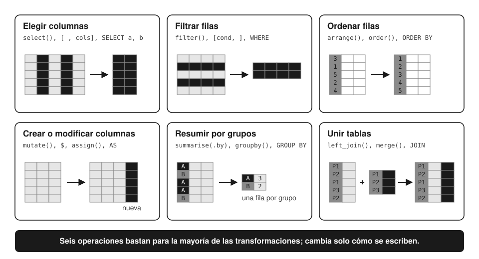
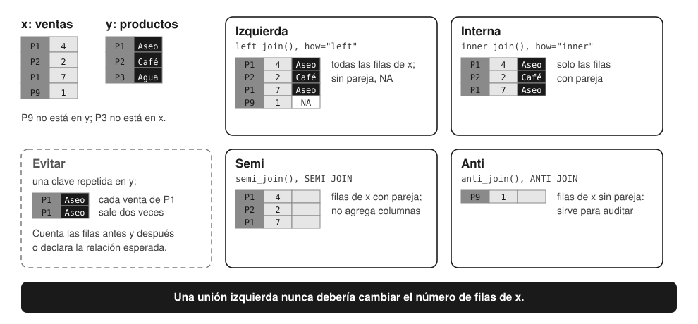
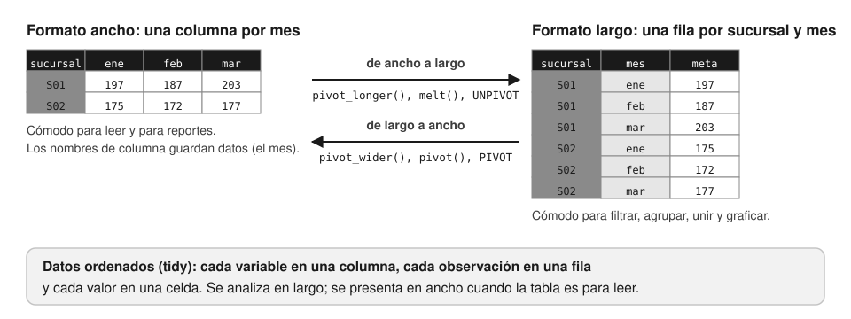
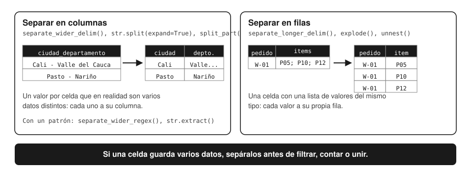
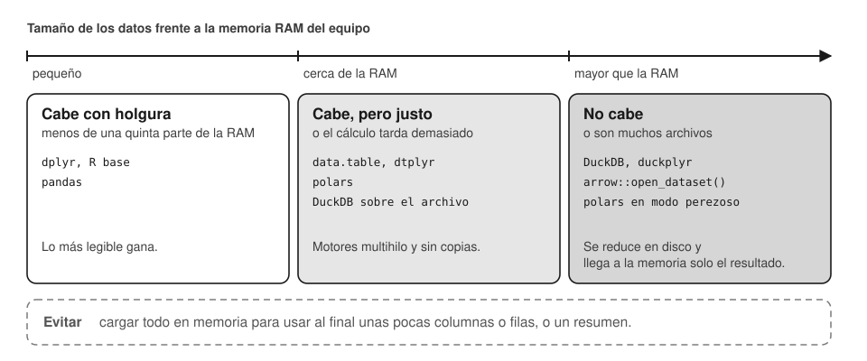

# Transformación y limpieza I: transformar y ordenar {#sec-transformar}

El @sec-tipos-calidad terminó con un reporte de calidad: sabemos qué está mal en la cartera, dónde y con qué gravedad. El paso natural sería corregir. Pero corregir exige saber transformar: crear una columna con el NIT completo, filtrar las filas en cuarentena, unir con la tabla de clientes para completar la ciudad, resumir para comprobar que nada se perdió. Este capítulo reúne esas herramientas, y el siguiente las usa para limpiar.

**Transformar** es cambiar la forma o el contenido de una tabla sin cambiar lo que significa: elegir columnas, filtrar filas, ordenarlas, crear columnas nuevas, resumir por grupos y unir tablas. **Ordenar**, en el sentido de este capítulo, es dar a la tabla una estructura en la que cada variable sea una columna y cada observación una fila: pasar de formato ancho a largo, o separar en varias columnas un valor que en realidad son varios datos. Al final veremos qué hacer cuando el volumen de datos hace que `dplyr` y `pandas` se queden cortos.

En R hay más de una forma de escribir cada operación: con los corchetes y el signo de dólar de R base, con funciones como `transform()` y `subset()`, o con los verbos de `dplyr`. En `pandas` pasa lo mismo: corchetes, `.loc`, la notación de punto, `assign()` y `query()`. Las veremos todas, porque las encontrarás en código ajeno, y diremos cuándo conviene cada una.

Seguimos con la red regional de distribución. Los archivos están en `datos/cap07/` del repositorio de materiales, y el capítulo está pensado para una sesión de unas dos horas.

::: {.callout-tip}
## Antes de empezar

1. Abre la carpeta de materiales en Positron para que las rutas relativas `datos/cap07/...` funcionen.
2. Usamos dos paquetes de R que no habíamos cargado: `tidyr`, para ordenar, y `data.table`, para el volumen. Ambos se instalaron con el `tidyverse` y los paquetes del @sec-importacion. En Python, la última sección usa [polars](https://docs.pola.rs/), que instalaste en el entorno del libro.
3. Si los archivos de `datos/cap07/` no están en tu copia, genéralos desde la terminal, en la carpeta de materiales, con `Rscript scripts/generar_datos_cap07.R`. El archivo grande de la última sección, `ventas_grande.parquet`, pesa unos 120 MB y no está en el repositorio: siempre se genera con ese script.
:::

```{r}
#| label: paquetes-cap07
#| message: false
use("arrow", c("read_parquet", "open_dataset"))
use("readr", "read_csv")
use("dplyr", c("select", "filter", "arrange", "desc", "mutate", "rename", "if_else",
               "case_when", "across", "starts_with", "summarise", "count", "n",
               "group_by", "left_join", "inner_join", "semi_join", "anti_join",
               "distinct", "slice_max", "collect"))
use("tidyr", c("pivot_longer", "pivot_wider", "separate_wider_delim",
               "separate_wider_regex", "separate_longer_delim", "unite"))
use("DBI", c("dbConnect", "dbGetQuery", "dbExecute", "dbDisconnect"))
use("duckdb", "duckdb")

con <- dbConnect(duckdb())
ventas <- read_parquet("datos/cap07/ventas_2026_t1.parquet")
```

## Los archivos del capítulo {#sec-archivos-cap07}

| Archivo | Contenido |
|---|---|
| `ventas_2026_t1.parquet` | 6.000 ventas del primer trimestre de 2026: `id_venta`, `fecha`, `sucursal`, `nit`, `producto`, `unidades`, `precio_unitario` y `descuento` (0, 5 % o 10 %). |
| `productos.csv` | Catálogo de 12 productos con su `nombre`, `categoria` y `precio_lista`. |
| `sucursales.csv` | Las 8 sucursales del @sec-importacion-fuentes, con su `ciudad` y `region`. |
| `metas_2026_ancho.csv` | Metas de venta de 2026, en millones de pesos, con una columna por mes (`meta_ene` a `meta_dic`) y la ciudad y el departamento juntos en una columna. |
| `pedidos_web.csv` | 250 pedidos de la tienda en línea; cada pedido guarda sus productos en una sola celda, como `P05 x1; P10 x6; P12 x1`. |
| `ventas_grande.parquet` | 10 millones de ventas de 2024 a 2026, para la sección sobre volumen. |

: Los archivos del capítulo {#tbl-archivos-cap07}

## Las operaciones básicas {#sec-verbos}

Casi cualquier transformación se arma con seis operaciones (@fig-verbos): elegir columnas, filtrar filas, ordenarlas, crear o modificar columnas, resumir por grupos y unir tablas. Las herramientas cambian los nombres, pero las operaciones son las mismas, y conviene pensar en ellas antes que en la sintaxis: primero "quiero las ventas de Cali con más de 30 unidades, de mayor a menor", después cómo se escribe.

{#fig-verbos fig-alt="Seis paneles con tablas en miniatura. Elegir columnas, con select, corchetes o SELECT: de cinco columnas quedan dos. Filtrar filas, con filter, corchetes o WHERE: de cinco filas quedan dos. Ordenar filas, con arrange, order u ORDER BY: una columna con 3, 1, 5, 2 y 4 queda ordenada de 1 a 5. Crear o modificar columnas, con mutate, el signo de dólar, assign o AS: aparece una columna nueva. Resumir por grupos, con summarise, groupby o GROUP BY: cinco filas de los grupos A y B quedan en una fila por grupo con su conteo. Unir tablas, con left_join, merge o JOIN: una tabla de ventas con códigos de producto recibe una columna de la tabla de productos. Al pie: seis operaciones bastan para la mayoría de las transformaciones; cambia solo cómo se escriben."}

| Operación | `dplyr` | R base | `pandas` | DuckDB |
|---|---|---|---|---|
| Elegir columnas | `select()` | `df[, c("a", "b")]`, `df[c("a", "b")]` | `df[["a", "b"]]`, `df.loc[:, ["a", "b"]]` | `SELECT a, b` |
| Filtrar filas | `filter()` | `df[condicion, ]`, `subset()` | `df[condicion]`, `df.loc[condicion]`, `query()` | `WHERE` |
| Ordenar filas | `arrange()`, `desc()` | `df[order(x), ]` | `sort_values()` | `ORDER BY` |
| Crear o modificar | `mutate()` | `df$x <- ...`, `df[["x"]] <- ...`, `transform()`, `within()` | `df["x"] = ...`, `assign()` | `SELECT *, ... AS x` |
| Renombrar | `rename()` | `names(df)[i] <- ...` | `rename(columns = )` | `AS`, `SELECT * RENAME` |
| Resumir por grupos | `summarise(.by = )` | `aggregate()`, `tapply()` | `groupby().agg()` | `GROUP BY` |
| Calcular dentro del grupo | `mutate(.by = )` | `ave()` | `groupby().transform()` | `OVER (PARTITION BY ...)` |
| Unir | `left_join()` y familia | `merge()` | `merge()` | `JOIN` |
| Apilar | `bind_rows()` | `rbind()` | `pd.concat()` | `UNION ALL BY NAME` |

: Las operaciones de transformación en cada herramienta {#tbl-verbos}

### Ejemplo guiado 7.1: elegir, filtrar y ordenar

Queremos la fecha, el producto y las unidades de las ventas de la sucursal `S03` (Cali) con más de 30 unidades, de mayor a menor.

::: {.panel-tabset}

### R

En R base, los **corchetes** reciben dos posiciones, `[filas, columnas]`. En las filas va un vector lógico, en las columnas un vector de nombres, y `order()` devuelve las posiciones que ordenan la tabla. El **signo de dólar** extrae una columna como vector:

```{r}
#| label: base-filtrar
filtro <- ventas$sucursal == "S03" & ventas$unidades > 30
cali <- ventas[filtro, c("fecha", "producto", "unidades")]
cali <- cali[order(cali$unidades, decreasing = TRUE), ]
head(cali, 3)
nrow(cali)
```

`subset()` hace lo mismo sin repetir el nombre de la tabla, y con `dplyr` cada operación es un verbo, encadenado con el *pipe* `|>`, que se lee "y luego":

```{r}
#| label: dplyr-filtrar
subset(ventas, sucursal == "S03" & unidades > 30,
       select = c(fecha, producto, unidades)) |>
  nrow()

ventas |>
  filter(sucursal == "S03", unidades > 30) |>
  select(fecha, producto, unidades) |>
  arrange(desc(unidades)) |>
  head(3)
```

Las tres formas dan el mismo resultado. `dplyr` es la más legible cuando la transformación tiene varios pasos; los corchetes son la base de todo lo demás y aparecen en cualquier código de R, así que hay que saber leerlos.

### Python

En `pandas`, los **corchetes** reciben una lista de columnas o una serie lógica para filtrar, y `.loc[filas, columnas]` combina ambas cosas, como los corchetes de R:

```python
import pandas as pd

ventas = pd.read_parquet("datos/cap07/ventas_2026_t1.parquet")
ventas["fecha"] = pd.to_datetime(ventas["fecha"])

filtro = (ventas["sucursal"] == "S03") & (ventas["unidades"] > 30)
cali = (ventas.loc[filtro, ["fecha", "producto", "unidades"]]
        .sort_values("unidades", ascending=False, kind="stable"))
print(cali.head(3))
print(len(cali))
```

```text
          fecha producto  unidades
3194 2026-02-18      P09        40
836  2026-01-14      P06        39
1897 2026-01-30      P10        39
55
```

Cada condición va entre paréntesis porque `&` y `|` tienen más precedencia que `==` y `>`. `kind="stable"` conserva el orden original de los empates; sin él, `sort_values()` puede ordenarlos de otra forma y el resultado no coincidiría con el de R.

`query()` recibe la condición como texto, y la **notación de punto** permite escribir `ventas.sucursal` en lugar de `ventas["sucursal"]`:

```python
print(len(ventas.query("sucursal == 'S03' and unidades > 30")))
print(ventas.sucursal.head(2).tolist())
```

```text
55
['S07', 'S08']
```

La notación de punto es cómoda para explorar, pero tiene límites: no funciona con nombres que tienen espacios o tildes, se confunde con los métodos cuando una columna se llama como uno de ellos (`count`, `size`, `values`) y no sirve para crear columnas. En el libro usamos los corchetes.

### DuckDB

```{r}
#| label: duckdb-filtrar
dbGetQuery(con, r"(
  SELECT fecha, producto, unidades
  FROM 'datos/cap07/ventas_2026_t1.parquet'
  WHERE sucursal = 'S03' AND unidades > 30
  ORDER BY unidades DESC
  LIMIT 3
)")
```

En SQL el orden de escritura (`SELECT`, `FROM`, `WHERE`, `ORDER BY`) no es el orden de ejecución: primero se lee la tabla, después se filtra, se eligen las columnas y al final se ordena.

:::

::: {.callout-warning}
## La trampa del `NA` en los corchetes

Si la condición tiene faltantes, los corchetes de R devuelven una fila llena de `NA` por cada faltante, en lugar de descartarla:

```{r}
#| label: trampa-na
df <- data.frame(x = c(1, NA, 3), y = c("a", "b", "c"))
df[df$x > 1, ]
subset(df, x > 1)
```

`filter()` y `subset()` descartan las filas donde la condición es `NA`. Con corchetes, usa `which()`, que solo devuelve las posiciones `TRUE`: `df[which(df$x > 1), ]`. En `pandas` el problema no aparece, porque una comparación con `NaN` da `False`.
:::

### Ejemplo guiado 7.2: crear y modificar columnas

Agreguemos a cada venta su valor bruto (unidades por precio), su valor neto (con el descuento), el mes y un tamaño: grande desde 30 unidades, mediano desde 10 y pequeño por debajo.

::: {.panel-tabset}

### R

En R base, una columna se crea asignándola con el **signo de dólar** o con **doble corchete**. Trabajamos sobre una copia para no alterar `ventas`; en R, modificar la copia no cambia el original:

```{r}
#| label: base-crear
ventas_base <- ventas
ventas_base$valor_bruto <- ventas_base$unidades * ventas_base$precio_unitario
ventas_base[["valor_neto"]] <- ventas_base$valor_bruto * (1 - ventas_base$descuento)
ventas_base$tamano <- ifelse(ventas_base$unidades >= 30, "grande",
                             ifelse(ventas_base$unidades >= 10, "mediano", "pequeño"))
table(ventas_base$tamano)
```

`transform()` permite crear varias columnas sin repetir el nombre de la tabla, pero tiene una limitación: una columna nueva no puede usar otra creada en la misma llamada.

```{r}
#| label: base-transform
#| error: true
transform(ventas,
          valor_bruto = unidades * precio_unitario,
          valor_neto  = valor_bruto * (1 - descuento))
```

`mutate()` no tiene esa limitación: cada columna puede usar las anteriores. Para condiciones con más de dos casos, `case_when()` es más clara que los `ifelse()` anidados; cada caso se escribe `condición ~ valor` y se evalúan en orden:

```{r}
#| label: dplyr-mutate
ventas <- ventas |>
  mutate(
    valor_bruto = unidades * precio_unitario,
    valor_neto  = valor_bruto * (1 - descuento),
    mes         = as.integer(format(fecha, "%m")),
    tamano      = case_when(
      unidades >= 30 ~ "grande",
      unidades >= 10 ~ "mediano",
      .default = "pequeño"
    )
  )

count(ventas, tamano)
```

`across()` aplica la misma función a varias columnas. Por ejemplo, para redondear los dos valores a pesos enteros sin escribir dos líneas: `mutate(across(starts_with("valor"), round))`.

### Python

En `pandas`, una columna se crea asignándola con **corchetes**. La notación de punto no sirve para esto: `ventas.valor_bruto = ...` crea un atributo del objeto, no una columna.

```python
ventas["valor_bruto"] = ventas["unidades"] * ventas["precio_unitario"]
```

`assign()` crea columnas y devuelve una tabla nueva, así que se puede encadenar. Con funciones `lambda`, cada columna puede usar las creadas antes en la misma llamada, como en `mutate()`. Para varios casos, `case_when()` (desde `pandas` 2.2) recibe una lista de pares `(condición, valor)` y se aplica sobre una serie con el valor por defecto:

```python
ventas = ventas.assign(
    valor_neto=lambda d: d["valor_bruto"] * (1 - d["descuento"]),
    mes=lambda d: d["fecha"].dt.month,
    tamano=lambda d: pd.Series("pequeño", index=d.index).case_when([
        (d["unidades"] >= 30, "grande"),
        (d["unidades"] >= 10, "mediano"),
    ]),
)
print(ventas["tamano"].value_counts())
```

```text
tamano
mediano    3203
pequeño    2323
grande      474
Name: count, dtype: int64
```

Para modificar solo algunas filas de una columna se usa `.loc[filas, columna]`. Desde `pandas` 3.0, que trabaja con *Copy-on-Write*, la **asignación encadenada** (dos corchetes seguidos) no modifica nada:

```python
copia = ventas.copy()
copia[copia["sucursal"] == "S03"]["descuento"] = 0      # no cambia nada
copia.loc[copia["sucursal"] == "S03", "descuento"] = 0  # así sí
```

```text
ChainedAssignmentError: A value is being set on a copy of a DataFrame or Series through chained assignment.
```

El primer corchete crea una tabla intermedia, y es a ella a la que se le asigna el cero. `pandas` muestra el aviso, pero el código sigue y `copia` queda igual. En versiones anteriores a la 3.0 esto a veces funcionaba y a veces no, con el famoso `SettingWithCopyWarning`; ahora la regla es simple: para modificar, un solo `.loc`.

### DuckDB

```{r}
#| label: duckdb-crear
dbGetQuery(con, r"(
  SELECT tamano, count(*) AS ventas
  FROM (
    SELECT *,
           unidades * precio_unitario      AS valor_bruto,
           valor_bruto * (1 - descuento)   AS valor_neto,
           month(fecha)                    AS mes,
           CASE WHEN unidades >= 30 THEN 'grande'
                WHEN unidades >= 10 THEN 'mediano'
                ELSE 'pequeño' END         AS tamano
    FROM 'datos/cap07/ventas_2026_t1.parquet'
  )
  GROUP BY tamano
  ORDER BY tamano
)")
```

`SELECT *, ...` conserva todas las columnas y agrega las nuevas. DuckDB, a diferencia del SQL estándar, permite usar en el mismo `SELECT` una columna que se acaba de crear (`valor_bruto` en el cálculo de `valor_neto`). Para modificar columnas existentes sin repetir las demás está `SELECT * REPLACE (round(valor_neto) AS valor_neto)`, y para aplicar una función a varias columnas, el equivalente de `across()`: `SELECT round(COLUMNS('valor_.*'))`.

:::

### Ejemplo guiado 7.3: resumir y calcular dentro de cada grupo

Hay dos operaciones que se parecen y conviene distinguir. **Resumir** reduce cada grupo a una fila: el total vendido por sucursal y mes. **Calcular dentro del grupo** conserva todas las filas y agrega un valor que depende del grupo: la participación de cada producto en las ventas de su sucursal. La segunda es la que en SQL se llama **función de ventana**.

::: {.panel-tabset}

### R

```{r}
#| label: dplyr-resumir
por_mes <- ventas |>
  summarise(ventas     = n(),
            unidades   = sum(unidades),
            valor_neto = sum(valor_neto),
            .by = c(sucursal, mes)) |>
  arrange(sucursal, mes)
head(por_mes, 4)
```

`.by` agrupa solo para esa operación y deja los grupos en el orden en que aparecen; por eso ordenamos al final con `arrange()`. Es la forma recomendada desde `dplyr` 1.1; antes se escribía `group_by(sucursal, mes) |> summarise(...)`, y todavía lo verás en mucho código. En R base, el equivalente es `aggregate(valor_neto ~ sucursal + mes, data = ventas, FUN = sum)`.

Para la participación, primero resumimos por sucursal y producto, y después calculamos dentro de cada sucursal. `slice_max()` toma, en cada sucursal, el producto con mayor participación:

```{r}
#| label: dplyr-ventana
participacion <- ventas |>
  summarise(valor_neto = sum(valor_neto), .by = c(sucursal, producto)) |>
  mutate(participacion = round(100 * valor_neto / sum(valor_neto), 1),
         .by = sucursal)

slice_max(participacion, participacion, n = 1, by = sucursal) |>
  arrange(sucursal) |>
  head(4)
```

La diferencia está en el verbo: `summarise(.by = )` deja una fila por grupo; `mutate(.by = )` deja todas las filas, y `sum(valor_neto)` es la suma de su grupo.

### Python

```python
por_mes = (ventas
           .groupby(["sucursal", "mes"], as_index=False)
           .agg(ventas=("id_venta", "size"),
                unidades=("unidades", "sum"),
                valor_neto=("valor_neto", "sum")))
print(por_mes.head(4))
```

```text
  sucursal  mes  ventas  unidades  valor_neto
0      S01    1     335      4537  73569395.0
1      S01    2     292      4331  65561415.0
2      S01    3     349      4759  73217055.0
3      S02    1     316      4670  65917145.0
```

Cada argumento de `agg()` es `nombre=(columna, función)`. `as_index=False` deja las columnas de agrupación como columnas normales, en lugar de convertirlas en el índice de la tabla.

```python
participacion = (ventas
                 .groupby(["sucursal", "producto"], as_index=False)
                 .agg(valor_neto=("valor_neto", "sum")))
participacion["participacion"] = (
    100 * participacion["valor_neto"]
    / participacion.groupby("sucursal")["valor_neto"].transform("sum")
).round(1)

print(participacion.sort_values("participacion", ascending=False)
      .groupby("sucursal").head(1)
      .sort_values("sucursal").head(4))
```

```text
   sucursal producto  valor_neto  participacion
4       S01      P05  35520875.0           16.7
16      S02      P05  29963375.0           15.7
28      S03      P05  30060875.0           17.7
40      S04      P05  28907125.0           17.7
```

`transform("sum")` es el equivalente de `mutate(.by = )`: devuelve una serie del mismo largo que la tabla, con la suma de cada grupo repetida en sus filas.

### DuckDB

```{r}
#| label: duckdb-ventana
dbGetQuery(con, r"(
  SELECT sucursal, producto, valor_neto,
         round(100 * valor_neto / sum(valor_neto) OVER (PARTITION BY sucursal), 1)
           AS participacion
  FROM (
    SELECT sucursal, producto,
           sum(unidades * precio_unitario * (1 - descuento)) AS valor_neto
    FROM 'datos/cap07/ventas_2026_t1.parquet'
    GROUP BY ALL
  )
  QUALIFY row_number() OVER (PARTITION BY sucursal ORDER BY valor_neto DESC) = 1
  ORDER BY sucursal
  LIMIT 4
)")
```

`GROUP BY ALL` agrupa por todas las columnas que no son resúmenes. `sum(...) OVER (PARTITION BY sucursal)` es la función de ventana: la suma de la sucursal, sin reducir las filas. `QUALIFY` filtra sobre el resultado de una ventana, igual que `WHERE` filtra filas: aquí se queda con la primera fila de cada sucursal.

:::

### Ejemplo guiado 7.4: unir tablas sin multiplicar filas

Para analizar por categoría o por región necesitamos traer información de `productos.csv` y `sucursales.csv`. Una **unión** (*join*) combina dos tablas a partir de una o varias columnas en común, la **clave**. La @fig-uniones muestra los tipos de unión más usados.

{#fig-uniones fig-alt="Una tabla x de ventas con los productos P1, P2, P1 y P9, y una tabla y de productos con P1, P2 y P3 y su categoría. La unión izquierda, con left_join o how igual a left, conserva las cuatro ventas y deja NA en la de P9. La interna conserva solo las tres ventas con pareja. La semi, con semi_join o SEMI JOIN, devuelve las filas de x con pareja sin agregar columnas. La anti, con anti_join o ANTI JOIN, devuelve la venta de P9, sin pareja, y sirve para auditar. Con trazo discontinuo, Evitar: si la clave P1 aparece dos veces en y, cada venta de P1 sale dos veces; hay que contar las filas antes y después o declarar la relación esperada. Al pie: una unión izquierda nunca debería cambiar el número de filas de x."}

La unión más común en análisis es la **izquierda**: conserva todas las filas de la tabla principal y le agrega columnas de la otra. Tiene una propiedad que sirve de control: si cada fila de la principal encuentra como máximo una pareja, el número de filas no cambia. Cuando cambia, la clave está repetida en la segunda tabla, y cada repetición multiplica filas sin ningún error. Es una de las fuentes más comunes de totales inflados.

::: {.panel-tabset}

### R

```{r}
#| label: union-trampa
productos  <- read_csv("datos/cap07/productos.csv", show_col_types = FALSE)
sucursales <- read_csv("datos/cap07/sucursales.csv", show_col_types = FALSE)

nrow(ventas)
nrow(left_join(ventas, productos, by = "producto"))
```

Teníamos 6.000 ventas y la unión devolvió 6.483. `dplyr` avisa que detectó una relación "muchos a muchos": una fila de `productos` coincide con varias ventas, lo normal, pero además una venta coincide con varias filas de `productos`, lo que no debería pasar. Para que el aviso sea un error que detenga el código, se declara la relación esperada, **muchos a uno**:

```{r}
#| label: union-relacion
#| error: true
left_join(ventas, productos, by = "producto", relationship = "many-to-one")
```

La causa está en el catálogo:

```{r}
#| label: union-causa
count(productos, producto) |> filter(n > 1)
```

El producto `P07` está dos veces, con los mismos datos. Es una fila repetida, así que `distinct()` la resuelve. Con el catálogo corregido, la unión conserva las 6.000 filas, y `anti_join()` confirma que todas las ventas encontraron su producto:

```{r}
#| label: union-correcta
productos <- distinct(productos)

ventas_detalle <- ventas |>
  left_join(productos, by = "producto", relationship = "many-to-one") |>
  left_join(sucursales, by = "sucursal", relationship = "many-to-one")

nrow(ventas_detalle)
nrow(anti_join(ventas, productos, by = "producto"))

ventas_detalle |>
  summarise(valor_neto = sum(valor_neto), .by = c(region, categoria)) |>
  arrange(region, desc(valor_neto))
```

En R base, la unión se hace con `merge(ventas, productos, by = "producto", all.x = TRUE)`, que no tiene controles de relación y además reordena las filas por la clave.

### Python

```python
productos = pd.read_csv("datos/cap07/productos.csv")
sucursales = pd.read_csv("datos/cap07/sucursales.csv")

print(len(ventas), len(ventas.merge(productos, on="producto", how="left")))
```

```text
6000 6483
```

`merge()` no avisa nada. El control es el argumento `validate`, que declara la relación esperada y da un error si no se cumple:

```python
ventas.merge(productos, on="producto", how="left", validate="m:1")
```

```text
MergeError: Merge keys are not unique in right dataset; not a many-to-one merge
```

```python
productos = productos.drop_duplicates()

ventas_detalle = (ventas
                  .merge(productos, on="producto", how="left", validate="m:1")
                  .merge(sucursales, on="sucursal", how="left", validate="m:1"))
print(len(ventas_detalle))
```

```text
6000
```

Para el equivalente de `anti_join()`, `merge()` tiene el argumento `indicator=True`, que agrega una columna `_merge` con el origen de cada fila (`both`, `left_only` o `right_only`); las filas `left_only` son las que no encontraron pareja.

### DuckDB

```{r}
#| label: duckdb-union
dbExecute(con, r"(
  CREATE VIEW productos AS FROM read_csv('datos/cap07/productos.csv')
)")

dbGetQuery(con, r"(
  SELECT (SELECT count(*) FROM 'datos/cap07/ventas_2026_t1.parquet') AS ventas,
         (SELECT count(*)
          FROM 'datos/cap07/ventas_2026_t1.parquet' AS v
          LEFT JOIN productos AS p USING (producto)) AS despues_de_unir
)")

dbGetQuery(con, r"(
  SELECT producto, count(*) AS veces
  FROM productos
  GROUP BY producto
  HAVING count(*) > 1
)")
```

SQL tampoco tiene un control de relación: la forma de protegerse es contar. Con `SELECT DISTINCT * FROM productos` en lugar de `productos`, la unión vuelve a 6.000 filas. Las uniones semi y anti se escriben `SEMI JOIN` y `ANTI JOIN`, como en el @sec-tipos-calidad.

:::

## Ordenar los datos: formato largo y ancho {#sec-largo-ancho}

Una misma información puede guardarse en tablas de formas distintas. Las metas de 2026 vienen en **formato ancho**: una fila por sucursal y una columna por mes. Es cómodo para leer, pero los nombres de las columnas guardan un dato, el mes, y eso complica casi todo lo demás: para comparar con las ventas, que tienen el mes en una columna, o para filtrar el primer trimestre, habría que escribir el nombre de cada columna.

El **formato largo** tiene una fila por sucursal y mes, con el mes como columna. Es la forma que Hadley Wickham llamó **datos ordenados** (*tidy data*): cada variable en una columna, cada observación en una fila y cada valor en una celda (@fig-largo-ancho). La regla práctica es analizar en largo y presentar en ancho cuando la tabla es para que la lea una persona. Un costo del formato largo es que repite los identificadores en cada fila: con 8 sucursales y 12 meses no importa, pero con millones de filas conviene guardar esas columnas como categorías, que ocupan mucho menos (@sec-categorias).

{#fig-largo-ancho fig-alt="A la izquierda, una tabla ancha con una columna por mes: sucursal, ene, feb y mar, con las metas de S01 y S02. Es cómoda para leer y para reportes, pero los nombres de columna guardan datos. A la derecha, la misma información en formato largo, con una fila por sucursal y mes y las columnas sucursal, mes y meta; es cómoda para filtrar, agrupar, unir y graficar. Una flecha de ancho a largo con pivot_longer, melt y UNPIVOT, y otra de largo a ancho con pivot_wider, pivot y PIVOT. Abajo, la definición de datos ordenados: cada variable en una columna, cada observación en una fila y cada valor en una celda."}

### Ejemplo guiado 7.5: metas de ancho a largo, y cumplimiento de largo a ancho

Vamos a pasar las metas a formato largo, unirlas con las ventas del trimestre para calcular el cumplimiento de cada sucursal en cada mes y, al final, presentar el resultado en una tabla ancha.

::: {.panel-tabset}

### R

```{r}
#| label: pivot-largo
metas <- read_csv("datos/cap07/metas_2026_ancho.csv", show_col_types = FALSE)
meses <- c("ene", "feb", "mar", "abr", "may", "jun",
           "jul", "ago", "sep", "oct", "nov", "dic")

metas_largo <- metas |>
  pivot_longer(starts_with("meta_"),
               names_to     = "mes_nombre",
               names_prefix = "meta_",
               values_to    = "meta_millones") |>
  mutate(mes = match(mes_nombre, meses))

metas_largo
```

`pivot_longer()` recibe las columnas que se van a "derretir", el nombre de la columna que guardará los antiguos nombres (`names_to`) y el de la columna que guardará los valores (`values_to`). `names_prefix` quita `meta_` de cada nombre. Las 8 filas por 12 meses se convierten en 96 filas. `match()` convierte el nombre del mes en su número, para unir con las ventas.

```{r}
#| label: pivot-ancho
cumplimiento <- por_mes |>
  inner_join(metas_largo, by = c("sucursal", "mes"),
             relationship = "one-to-one") |>
  mutate(cumplimiento = round(100 * valor_neto / (meta_millones * 1e6))) |>
  arrange(sucursal, mes)

cumplimiento |>
  pivot_wider(id_cols = sucursal, names_from = mes_nombre,
              values_from = cumplimiento)
```

`pivot_wider()` hace lo contrario: los valores de `mes_nombre` pasan a ser columnas y cada celda toma el valor de `cumplimiento`. `id_cols` dice qué columnas identifican cada fila de la tabla ancha. Así, la tabla se lee de un vistazo: febrero fue el mes más difícil, sin una sola sucursal en la meta; `S08` la cumplió en enero y en marzo, y `S05` quedó por debajo en los tres meses.

R base tiene `reshape()` para estas dos operaciones, pero su interfaz es difícil de recordar; `tidyr` es la herramienta habitual.

### Python

```python
metas = pd.read_csv("datos/cap07/metas_2026_ancho.csv")
meses = ["ene", "feb", "mar", "abr", "may", "jun",
         "jul", "ago", "sep", "oct", "nov", "dic"]

metas_largo = metas.melt(id_vars=["sucursal", "ciudad_departamento"],
                         var_name="mes_nombre", value_name="meta_millones")
metas_largo["mes_nombre"] = metas_largo["mes_nombre"].str.removeprefix("meta_")
metas_largo["mes"] = metas_largo["mes_nombre"].map(
    {nombre: i for i, nombre in enumerate(meses, start=1)})
print(metas_largo.shape)

cumplimiento = (por_mes
                .merge(metas_largo, on=["sucursal", "mes"], validate="1:1")
                .assign(cumplimiento=lambda d: (100 * d["valor_neto"]
                                                / (d["meta_millones"] * 1e6)).round()))

print(cumplimiento.pivot(index="sucursal", columns="mes_nombre",
                         values="cumplimiento")[["ene", "feb", "mar"]])
```

```text
(96, 5)
mes_nombre    ene   feb    mar
sucursal
S01          98.0  92.0   95.0
S02         100.0  94.0   95.0
S03         108.0  81.0   95.0
S04          87.0  91.0  108.0
S05          89.0  84.0   83.0
S06          87.0  81.0  107.0
S07          93.0  99.0   94.0
S08         106.0  94.0  106.0
```

`melt()` es el `pivot_longer()` de `pandas`: `id_vars` son las columnas que se conservan y todas las demás se derriten. `pivot()` es el `pivot_wider()`. Ordena las columnas alfabéticamente, por eso las pedimos en orden con `[["ene", "feb", "mar"]]`. Si hubiera más de una fila por combinación de índice y columna, `pivot()` daría un error; `pivot_table()` resuelve ese caso con una función de resumen (`aggfunc`).

### DuckDB

```{r}
#| label: duckdb-pivot
dbExecute(con, r"(
  CREATE VIEW metas_largo AS
  UNPIVOT read_csv('datos/cap07/metas_2026_ancho.csv')
  ON COLUMNS('meta_.*')
  INTO NAME mes_nombre VALUE meta_millones
)")

dbGetQuery(con, r"(
  SELECT * FROM metas_largo LIMIT 3
)")

dbGetQuery(con, r"(
  PIVOT (
    SELECT v.sucursal, replace(m.mes_nombre, 'meta_', '') AS mes,
           round(100 * sum(v.unidades * v.precio_unitario * (1 - v.descuento))
                 / (m.meta_millones * 1e6)) AS cumplimiento
    FROM 'datos/cap07/ventas_2026_t1.parquet' AS v
    JOIN metas_largo AS m
      ON m.sucursal = v.sucursal
     AND m.mes_nombre = 'meta_' || ['ene', 'feb', 'mar'][month(v.fecha)]
    GROUP BY v.sucursal, m.mes_nombre, m.meta_millones
  )
  ON mes IN ('ene', 'feb', 'mar')
  USING first(cumplimiento)
  ORDER BY sucursal
)")
```

`UNPIVOT ... ON COLUMNS('meta_.*')` derrite todas las columnas cuyo nombre empieza por `meta_`, y `PIVOT ... ON mes USING first(...)` construye una columna por cada valor de `mes`. `ON mes IN (...)` fija el orden de las columnas. La lista `['ene', 'feb', 'mar'][month(fecha)]` traduce el número del mes a su nombre: en DuckDB las listas se indexan desde 1, como en R.

:::

## Separar valores {#sec-separar}

Otra forma de desorden es guardar varios datos en una sola celda. Hay dos casos, y cada uno pide una solución distinta (@fig-separar):

- **Varios datos distintos en una celda**, como `Cali - Valle del Cauca` (ciudad y departamento) o `Ana Ríos <ana.rios@correo.co>` (nombre y correo). Se separan **en columnas**.
- **Una lista de valores del mismo tipo**, como `P05 x1; P10 x6; P12 x1`, los productos de un pedido. Se separan **en filas**: una fila por producto.

{#fig-separar fig-alt="A la izquierda, separar en columnas: la columna ciudad_departamento, con Cali - Valle del Cauca y Pasto - Nariño, se convierte en dos columnas, ciudad y departamento, con separate_wider_delim, str.split con expand o split_part; con un patrón, separate_wider_regex o str.extract. Es para un valor por celda que en realidad son varios datos distintos. A la derecha, separar en filas: un pedido con la celda P05; P10; P12 se convierte en tres filas, una por producto, con separate_longer_delim, explode o unnest. Es para una celda con una lista de valores del mismo tipo. Al pie: si una celda guarda varios datos, sepáralos antes de filtrar, contar o unir."}

`tidyr` tiene una familia de funciones con nombres que dicen exactamente qué hacen: `separate_wider_*()` separa en columnas (la tabla se hace más ancha) y `separate_longer_*()` separa en filas (la tabla se hace más larga). El final del nombre dice cómo se separa: `_delim()` por un separador, `_regex()` con una expresión regular y `_position()` por posiciones fijas.

### Ejemplo guiado 7.6: ciudades, contactos y pedidos

::: {.panel-tabset}

### R

Ciudad y departamento están separados por `" - "`:

```{r}
#| label: separar-delim
metas |>
  select(sucursal, ciudad_departamento) |>
  separate_wider_delim(ciudad_departamento, delim = " - ",
                       names = c("ciudad", "departamento")) |>
  head(3)
```

En el contacto no hay un separador único, pero sí un patrón: un nombre, un espacio, y un correo entre `<` y `>`. `separate_wider_regex()` recibe el patrón por partes: las partes con nombre se convierten en columnas y las que no tienen nombre se descartan:

```{r}
#| label: separar-regex
pedidos <- read_csv("datos/cap07/pedidos_web.csv", show_col_types = FALSE)

pedidos |>
  select(contacto) |>
  separate_wider_regex(contacto,
                       patterns = c(nombre = ".*?", " <", correo = "[^>]+", ">")) |>
  head(2)
```

`.*?` significa "cualquier texto, lo más corto posible", y `[^>]+` "uno o más caracteres que no sean `>`". Las expresiones regulares se tratan con más calma en el siguiente capítulo.

Los productos de cada pedido necesitan dos pasos: primero separar la lista en filas, por `"; "`, y después separar cada elemento en producto y unidades, por `" x"`:

```{r}
#| label: separar-longer
items <- pedidos |>
  select(pedido, items) |>
  separate_longer_delim(items, delim = "; ") |>
  separate_wider_delim(items, delim = " x", names = c("producto", "unidades")) |>
  mutate(unidades = as.integer(unidades))

head(items, 4)
nrow(items)
```

Los 250 pedidos tienen 525 líneas de producto. Con la tabla en este formato ya se puede unir con `productos`, calcular el valor de cada pedido o contar qué productos se piden juntos. La operación inversa de separar en columnas es `unite()`, que pega varias columnas con un separador.

### Python

```python
print(metas["ciudad_departamento"]
      .str.split(" - ", expand=True)
      .set_axis(["ciudad", "departamento"], axis=1)
      .head(3))
```

```text
     ciudad     departamento
0    Bogotá      Bogotá D.C.
1  Medellín        Antioquia
2      Cali  Valle del Cauca
```

`str.split(..., expand=True)` devuelve una columna por cada parte, con nombres 0, 1, 2; `set_axis()` les da nombre. Con un patrón se usa `str.extract()` y grupos con nombre, `(?P<nombre>...)`, como en el @sec-importacion:

```python
pedidos = pd.read_csv("datos/cap07/pedidos_web.csv", dtype={"nit": str})
print(pedidos["contacto"]
      .str.extract(r"(?P<nombre>.*?) <(?P<correo>[^>]+)>").head(2))
```

```text
        nombre                 correo
0  Juan Ospina  juan.ospina@correo.co
1    Marta Gil   compras@distrigil.co
```

Para separar en filas, `str.split()` sin `expand` convierte cada celda en una lista, y `explode()` crea una fila por cada elemento de la lista:

```python
items = (pedidos[["pedido", "items"]]
         .assign(items=lambda d: d["items"].str.split("; "))
         .explode("items", ignore_index=True))
items[["producto", "unidades"]] = items["items"].str.split(" x", expand=True)
items = items.drop(columns="items").astype({"unidades": int})

print(items.head(4))
print(len(items))
```

```text
          pedido producto  unidades
0  WEB-MED-01201      P05         1
1  WEB-MED-01201      P10         6
2  WEB-MED-01201      P12         1
3  WEB-BOG-01202      P03         5
525
```

`ignore_index=True` numera de nuevo las filas; sin él, las filas de un mismo pedido conservarían el índice original, repetido.

### DuckDB

```{r}
#| label: duckdb-separar
dbGetQuery(con, r"(
  SELECT sucursal,
         split_part(ciudad_departamento, ' - ', 1) AS ciudad,
         split_part(ciudad_departamento, ' - ', 2) AS departamento
  FROM read_csv('datos/cap07/metas_2026_ancho.csv')
  LIMIT 3
)")

dbGetQuery(con, r"(
  SELECT pedido,
         split_part(item, ' x', 1)               AS producto,
         split_part(item, ' x', 2)::INTEGER      AS unidades
  FROM (
    SELECT pedido, unnest(string_split(items, '; ')) AS item
    FROM read_csv('datos/cap07/pedidos_web.csv')
  )
  LIMIT 4
)")
```

`split_part()` devuelve la parte número *n* de un texto. `string_split()` convierte el texto en una lista y `unnest()` crea una fila por elemento, como `explode()`. Para el contacto se usa `regexp_extract()` con una lista de nombres, como en el @sec-importacion.

:::

::: {.callout-note}
## Columnas que contienen listas

Al leer JSON o respuestas de API (@sec-importacion-fuentes) es común que una columna no guarde texto sino listas o registros anidados. `tidyr` tiene `unnest_longer()` y `unnest_wider()`, la versión de `separate_longer_*()` y `separate_wider_*()` para esas columnas; en `pandas`, `explode()` y `pd.json_normalize()`, y en DuckDB, `unnest()`. Es la misma idea de este ejemplo: una lista se separa en filas y un registro, en columnas.
:::

## Cuando los datos no caben: volumen {#sec-volumen}

Todo lo anterior se hizo con 6.000 filas. ¿Qué pasa con 10 millones? `dplyr` y `pandas` trabajan con la tabla completa en la memoria RAM, y eso tiene dos límites. El primero es la memoria: la tabla tiene que caber, y muchas operaciones crean copias temporales. El segundo es la velocidad: `pandas` usa un solo núcleo del procesador para casi todo, y `dplyr` también.

Para esos casos hay herramientas diseñadas con otras reglas. **data.table** (R) modifica las tablas en su lugar, sin copias, y usa varios núcleos. **polars** (Python) usa todos los núcleos y tiene un **modo perezoso**: con `scan_parquet()` describe el cálculo completo y solo lo ejecuta al final, leyendo del archivo únicamente las columnas y filas que necesita. **DuckDB**, como vimos desde el @sec-importacion, trabaja sobre el archivo en disco, y `arrow::open_dataset()` y `duckplyr` llevan esa idea a la sintaxis de `dplyr` (@fig-volumen).

{#fig-volumen fig-alt="Una escala del tamaño de los datos frente a la memoria RAM, con tres cajas. Si los datos caben con holgura, menos de una quinta parte de la RAM: dplyr, R base y pandas; lo más legible gana. Si caben pero justo, o el cálculo tarda demasiado: data.table, dtplyr, polars o DuckDB sobre el archivo; motores multihilo y sin copias. Si no caben o son muchos archivos: DuckDB, duckplyr, arrow open_dataset o polars en modo perezoso; se reduce en disco y llega a la memoria solo el resultado. Con trazo discontinuo, Evitar: cargar todo en memoria para usar al final unas pocas columnas o filas, o un resumen."}

### Ejemplo guiado 7.7: el mismo resumen sobre 10 millones de filas

Calculemos el valor y las unidades por sucursal y producto en `ventas_grande.parquet`, con cada herramienta, y midamos el tiempo. `system.time()` mide en R y `time.perf_counter()` en Python. Los tiempos dependen del equipo: lo que importa son las proporciones.

::: {.panel-tabset}

### R

```{r}
#| label: volumen-r
#| message: false
use("data.table", "as.data.table")
ruta_grande <- "datos/cap07/ventas_grande.parquet"
segundos <- function(expr) round(system.time(expr)[["elapsed"]], 2)

# 1. Cargar todo en memoria
t_leer <- segundos(grande <- read_parquet(ruta_grande))
format(object.size(grande), units = "MB")

# 2. Resumir en memoria: dplyr y data.table
t_dplyr <- segundos(
  r_dplyr <- grande |>
    summarise(valor = sum(valor_venta), unidades = sum(unidades),
              .by = c(sucursal, producto))
)
grande_dt <- as.data.table(grande)
t_dt <- segundos(
  r_dt <- grande_dt[, .(valor = sum(valor_venta), unidades = sum(unidades)),
                    by = .(sucursal, producto)]
)

# 3. Resumir sobre el archivo, sin cargarlo
t_duckdb <- segundos(
  r_duckdb <- dbGetQuery(con, r"(
    SELECT sucursal, producto, sum(valor_venta) AS valor, sum(unidades) AS unidades
    FROM 'datos/cap07/ventas_grande.parquet'
    GROUP BY ALL
  )")
)
t_arrow <- segundos(
  r_arrow <- open_dataset(ruta_grande) |>
    group_by(sucursal, producto) |>
    summarise(valor = sum(valor_venta), unidades = sum(unidades)) |>
    collect()
)

data.frame(
  paso     = c("leer el archivo completo", "resumir con dplyr", "resumir con data.table",
               "leer y resumir con DuckDB", "leer y resumir con arrow"),
  segundos = c(t_leer, t_dplyr, t_dt, t_duckdb, t_arrow)
)
c(nrow(r_dplyr), nrow(r_dt), nrow(r_duckdb), nrow(r_arrow))
```

La sintaxis de `data.table` es `tabla[filas, columnas, by = grupos]`: los corchetes de R base, ampliados. `.()` es una abreviatura de `list()`. Observa los tres órdenes de magnitud. Para `dplyr`, el resumen tarda incluso más que la lectura; `data.table` resume en una fracción de ese tiempo, porque usa varios núcleos y no copia la tabla. Pero ambos necesitan antes leer los 10 millones de filas a la memoria: casi 400 MB para usar al final 96 filas. DuckDB, en cambio, lee del archivo solo las cuatro columnas que necesita, resume por partes en varios núcleos y entrega el resultado en menos tiempo del que los demás tardan solo en leer. `arrow` sigue la misma idea, con un motor algo más lento.

`data.table` tiene, además, asignación **por referencia** con `:=`: `grande_dt[, valor_neto := valor_venta * 0.9]` crea la columna dentro de la misma tabla, sin copiarla. Es la razón de su velocidad y también un cambio de hábito, porque en el resto de R modificar una copia no altera el original. Si prefieres la sintaxis de `dplyr` con el motor de `data.table`, existe [dtplyr](https://dtplyr.tidyverse.org/); con el motor de DuckDB, [duckplyr](https://duckplyr.tidyverse.org/), presentado en el @sec-importacion.

```{r}
#| label: volumen-liberar
#| include: false
rm(grande, grande_dt)
invisible(gc())
```

### Python

```python
import time
import polars as pl
import duckdb

ruta_grande = "datos/cap07/ventas_grande.parquet"

inicio = time.perf_counter()
grande = pd.read_parquet(ruta_grande)
print("leer con pandas:", round(time.perf_counter() - inicio, 2), "s,",
      round(grande.memory_usage(deep=True).sum() / 1e6), "MB")

inicio = time.perf_counter()
r_pandas = (grande.groupby(["sucursal", "producto"], as_index=False)
            .agg(valor=("valor_venta", "sum"), unidades=("unidades", "sum")))
print("resumir con pandas:", round(time.perf_counter() - inicio, 2), "s")

inicio = time.perf_counter()
r_polars = (pl.scan_parquet(ruta_grande)
            .group_by("sucursal", "producto")
            .agg(pl.col("valor_venta").sum().alias("valor"), pl.col("unidades").sum())
            .collect())
print("leer y resumir con polars:", round(time.perf_counter() - inicio, 2), "s")

inicio = time.perf_counter()
r_duckdb = duckdb.sql(f"""
    SELECT sucursal, producto, sum(valor_venta) AS valor, sum(unidades) AS unidades
    FROM '{ruta_grande}'
    GROUP BY ALL
""").df()
print("leer y resumir con DuckDB:", round(time.perf_counter() - inicio, 2), "s")
```

```text
leer con pandas: 2.34 s, 820 MB
resumir con pandas: 2.27 s
leer y resumir con polars: 0.32 s
leer y resumir con DuckDB: 0.49 s
```

La misma tabla ocupa en `pandas` 820 MB, más del doble que en R, sobre todo por las columnas de texto. `polars` en modo perezoso hace todo el trabajo (leer y resumir) en una fracción del tiempo que `pandas` tarda solo en leer. Su sintaxis se parece a la de `dplyr`: expresiones como `pl.col("valor_venta").sum()` describen el cálculo, y `collect()` lo ejecuta.

### DuckDB

DuckDB ya apareció en las otras dos pestañas, porque es la misma consulta desde R o desde Python. Hay un detalle que explica su ventaja: Parquet guarda los datos por columnas, y DuckDB lee solo las columnas que la consulta menciona. Puedes comprobarlo con `EXPLAIN ANALYZE` delante de la consulta, que muestra el plan de ejecución y las columnas leídas.

```{r}
#| label: duckdb-explain
plan <- dbGetQuery(con, r"(
  EXPLAIN ANALYZE
  SELECT sucursal, producto, sum(valor_venta) AS valor
  FROM 'datos/cap07/ventas_grande.parquet'
  GROUP BY ALL
)")
cat(grep("Projections|sucursal|producto|valor_venta|Total Time",
         strsplit(plan[[2]], "\n")[[1]], value = TRUE), sep = "\n")
```

:::

La conclusión no es "usa siempre la herramienta más rápida". Con las 6.000 ventas del trimestre, cualquier herramienta responde al instante y lo que importa es que el código se entienda. La decisión cambia cuando la tabla se acerca al tamaño de la memoria, cuando el cálculo se repite muchas veces o cuando los datos están repartidos en muchos archivos. Entonces conviene llevar el trabajo al motor y traer a R o a Python solo el resultado: el mismo patrón híbrido del @sec-importacion.

### Reducir primero {#sec-reducir-primero}

Hay una regla que vale para cualquier herramienta y cualquier volumen: **elegir las columnas y filtrar las filas antes de calcular**. Si de 10 millones de ventas solo interesan las de Cali, crear primero una columna nueva y filtrar después obliga a calcular 10 millones de valores para quedarse con poco más de un millón. Lo mismo vale para las uniones: unir dos tablas ya filtradas es más barato que unirlas completas y filtrar el resultado. Es la misma idea de la selección temprana de columnas del @sec-importacion, llevada a la transformación.

En `dplyr` y en `pandas` el orden lo decides tú: ejecutan cada paso tal como está escrito. DuckDB y `polars` en modo perezoso, en cambio, tienen un **optimizador** que reordena la consulta antes de ejecutarla y lleva los filtros lo más cerca posible de la lectura, aunque los escribas al final. Se puede comprobar con `EXPLAIN`: en esta consulta el filtro está escrito por fuera, después de crear la columna, pero el plan muestra que DuckDB lo aplica al leer el archivo.

```{r}
#| label: duckdb-filtro-temprano
plan <- dbGetQuery(con, r"(
  EXPLAIN
  SELECT *
  FROM (SELECT *, valor_venta * 1.19 AS valor_con_iva
        FROM 'datos/cap07/ventas_grande.parquet')
  WHERE sucursal = 'S03'
)")
cat(grep("PARQUET_SCAN|Filters", strsplit(plan[[2]], "\n")[[1]], value = TRUE), sep = "\n")
```

La regla tiene una excepción importante: **no se puede filtrar primero cuando el cálculo necesita las filas que se van a quitar**. Es el caso de los cálculos dentro del grupo (participaciones, rankings, diferencias con el mes anterior, cualquier función de ventana). En el Ejemplo 7.3, la participación del producto `P05` en su sucursal se calculó sobre todos los productos; si se filtra `P05` antes de calcular, cada sucursal solo tiene ese producto y su participación es, trivialmente, el 100 %:

```{r}
#| label: filtrar-antes-mal
# Calcular y después filtrar: la participación real
participacion |> filter(producto == "P05") |> head(3)

# Filtrar y después calcular: el resultado cambia
ventas |>
  filter(producto == "P05") |>
  summarise(valor_neto = sum(valor_neto), .by = c(sucursal, producto)) |>
  mutate(participacion = round(100 * valor_neto / sum(valor_neto), 1), .by = sucursal) |>
  head(3)
```

La regla completa, entonces: **reduce primero, salvo que el cálculo dependa de lo que vas a quitar**. Los optimizadores de DuckDB y `polars` conocen esa excepción y no mueven un filtro por encima de una función de ventana; en `dplyr` y `pandas` la responsabilidad es tuya.

## Ejercicio 7.1: el valor de los pedidos en línea {#sec-ejercicio-pedidos}

Con `pedidos_web.csv`, `productos.csv` y lo que aprendiste en el capítulo:

1. Separa los productos de cada pedido en filas, con su `producto` y sus `unidades`.
2. Separa el código del pedido, como `WEB-MED-01201`, en tres columnas: `canal`, `ciudad` y `consecutivo`. Conserva la columna original.
3. Une las líneas con el catálogo de productos para traer la `categoria` y el `precio_lista`. Recuerda el producto repetido y declara la relación esperada.
4. Calcula el valor de cada línea (`unidades * precio_lista`) y el valor total de cada pedido.
5. Construye una tabla ancha con una fila por ciudad del pedido (`BOG`, `MED`, `CAL`, `BAQ`), una columna por categoría y, en cada celda, las unidades pedidas.

::: {.panel-tabset}

### R

```{r}
#| label: ejercicio-7-1
#| eval: false
lineas <- pedidos |>
  separate_wider_delim(pedido, delim = "-", ...,       # TODO
                       cols_remove = FALSE) |>
  separate_longer_delim(...) |>                         # TODO
  separate_wider_delim(...)                             # TODO

lineas_detalle <- lineas |>
  left_join(...)                                        # TODO

valor_pedido <- ...                                     # TODO
unidades_ciudad <- ... |> pivot_wider(...)              # TODO
```

### Python

```python
lineas = pedidos.copy()
lineas[["canal", "ciudad", "consecutivo"]] = ...        # TODO
lineas = ...                                            # TODO: split + explode
lineas_detalle = lineas.merge(..., validate="m:1")      # TODO
valor_pedido = ...                                      # TODO
unidades_ciudad = ....pivot_table(...)                  # TODO
```

:::

Para comprobar tu resultado: hay 525 líneas de producto; el pedido de mayor valor es el `WEB-MED-01395`, con 425.000 pesos, y en la tabla ancha Medellín (`MED`) pidió 240 unidades de productos de aseo y Bogotá (`BOG`), 166.

## Cierre: las herramientas para limpiar {#sec-cierre-transformar}

En este capítulo reunimos las herramientas de transformación. Las seis operaciones básicas, en sus distintas escrituras: corchetes, signo de dólar, `transform()` y `subset()` en R base; los verbos de `dplyr`; corchetes, `.loc`, punto, `assign()` y `query()` en `pandas`, y SQL en DuckDB. Vimos la diferencia entre resumir y calcular dentro del grupo, cómo unir tablas sin multiplicar filas, cómo pasar de ancho a largo y de largo a ancho, cómo separar valores en columnas o en filas y qué hacer cuando el volumen supera lo que `dplyr` y `pandas` manejan con comodidad.

Con estas herramientas volvemos a la cartera auditada del @sec-tipos-calidad. En el siguiente capítulo, Transformación y limpieza II, la limpiaremos: estandarizar textos y categorías con ayuda de los propios datos, recuperar los NIT, resolver duplicados, completar faltantes cuando hay de dónde, decidir qué hacer con los valores imposibles y dejar registro de cada cambio.

```{r}
#| label: cerrar-conexion-cap07
#| include: false
dbDisconnect(con)
```
