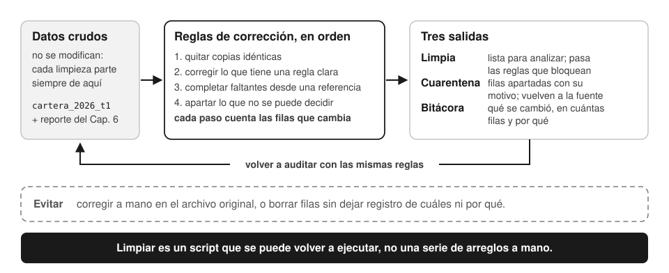
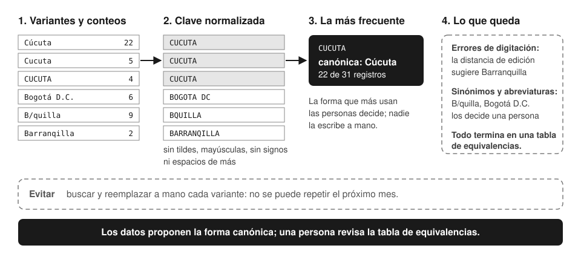

# Transformación y limpieza II: limpiar {#sec-limpiar}

En el @sec-tipos-calidad auditamos la cartera del trimestre y encontramos 55 facturas con algún problema: copias, versiones en conflicto, NIT sin su cero inicial, ciudades escritas de varias formas, valores imposibles, fechas de pago anteriores a la emisión. En el @sec-transformar reunimos las herramientas para transformar tablas. Este capítulo junta las dos cosas: vamos a **limpiar**.

Limpiar no es "arreglar lo que se vea raro". Es aplicar, en un orden conocido, reglas que se pueden explicar y repetir, y dejar constancia de lo que cambió. Por eso empezamos con unos principios, después vemos las técnicas una a una (texto, expresiones regulares, categorías, duplicados, faltantes, valores imposibles y atípicos) y al final las reunimos en una limpieza completa de la cartera que termina como empezó el @sec-tipos-calidad: con un reporte de calidad.

Usaremos dos fuentes. Para las técnicas de texto, una exportación del sistema de gestión de clientes (CRM), `clientes_crm.csv`, con los problemas típicos de un registro hecho a mano por muchas personas. Para la limpieza completa, la cartera del @sec-tipos-calidad.

::: {.callout-tip}
## Antes de empezar

1. Abre la carpeta de materiales en Positron. Este capítulo usa `datos/cap08/` y también la cartera y los clientes de `datos/cap06/`.
2. Usamos `stringr` y `stringi`, que se instalaron con el `tidyverse`.
3. Las reglas de calidad del @sec-tipos-calidad están guardadas en `scripts/auditoria_cartera.R` y `scripts/auditoria_cartera.py`, para volver a auditar después de limpiar.
4. Si `datos/cap08/clientes_crm.csv` no está en tu copia, genéralo con `Rscript scripts/generar_datos_cap08.R`.
:::

```{r}
#| label: paquetes-cap08
#| message: false
use("arrow", c("read_parquet", "write_parquet"))
use("readr", c("read_csv", "write_csv", "cols"))
use(
  "dplyr",
  c(
    "select",
    "filter",
    "arrange",
    "desc",
    "mutate",
    "if_else",
    "case_when",
    "coalesce",
    "across",
    "summarise",
    "count",
    "n",
    "left_join",
    "distinct",
    "tribble"
  )
)
use(
  "stringr",
  c(
    "str_squish",
    "str_trim",
    "str_to_title",
    "str_to_lower",
    "str_to_upper",
    "str_remove",
    "str_remove_all",
    "str_detect",
    "str_pad"
  )
)
use("stringi", "stri_trans_general")
use("DBI", c("dbConnect", "dbGetQuery", "dbExecute", "dbDisconnect"))
use("duckdb", "duckdb")

con <- dbConnect(duckdb())
clientes <- read_parquet("datos/cap06/clientes.parquet")
catalogo_ciudades <- sort(unique(clientes$ciudad))
```

## Principios de una limpieza {#sec-principios-limpieza}

Antes de la primera línea de código, cinco reglas que separan una limpieza confiable de una serie de arreglos (@fig-flujo-limpieza):

1. **Los datos crudos no se tocan.** La limpieza lee el archivo original y escribe uno nuevo. Si algo sale mal, se corrige el script y se vuelve a ejecutar desde el principio.
2. **Cada corrección es una regla.** "Si el NIT tiene nueve dígitos, se completa con un cero a la izquierda" se puede explicar, revisar y repetir el próximo mes. "Arreglé las filas que se veían mal", no.
3. **Se corrige solo lo que tiene una regla clara.** Una ciudad escrita en mayúsculas tiene una corrección obvia; una fecha de pago anterior a la emisión, no: no sabemos cuál de las dos fechas está mal. Esas filas no se borran ni se adivinan: se apartan en una **cuarentena**, con su motivo, para devolverlas a quien las generó.
4. **Cada paso deja constancia.** Una **bitácora** registra qué regla se aplicó y a cuántas filas. Si un mes la regla del NIT corrige 400 filas en lugar de 4, algo cambió en la fuente y conviene saberlo.
5. **Se mide antes y después.** La limpieza termina con el mismo reporte de calidad con que empezó. Si las reglas que bloquean siguen fallando, la limpieza no terminó.

{#fig-flujo-limpieza fig-alt="Los datos crudos, cartera_2026_t1 con el reporte del Capítulo 6, no se modifican: cada limpieza parte siempre de ahí. Pasan por reglas de corrección en orden: quitar copias idénticas, corregir lo que tiene una regla clara, completar faltantes desde una referencia y apartar lo que no se puede decidir; cada paso cuenta las filas que cambia. Salen tres productos: la tabla limpia, lista para analizar y que pasa las reglas que bloquean; la cuarentena, con las filas apartadas y su motivo, que vuelven a la fuente; y la bitácora, con qué se cambió, en cuántas filas y por qué. Una flecha vuelve al inicio: volver a auditar con las mismas reglas. Con trazo discontinuo, Evitar: corregir a mano en el archivo original o borrar filas sin dejar registro. Al pie: limpiar es un script que se puede volver a ejecutar, no una serie de arreglos a mano."}

## Texto: espacios, mayúsculas y tildes {#sec-limpiar-texto}

Los problemas más frecuentes del texto son también los más simples: espacios al inicio o al final, espacios dobles en medio, mayúsculas mezcladas y tildes que unas personas escriben y otras no. Son invisibles a la vista, pero para la computadora `"Cali"`, `" Cali"` y `"CALI"` son tres valores distintos: no se agrupan juntos ni encuentran pareja en una unión.

| Problema | R (`stringr`) | `pandas` | DuckDB |
|---|---|---|---|
| Espacios al inicio y al final | `str_trim()` | `str.strip()` | `trim()` |
| Espacios repetidos en medio | `str_squish()` | `str.split().str.join(" ")` | `regexp_replace(x, '\s+', ' ', 'g')` |
| Mayúsculas y minúsculas | `str_to_upper()`, `str_to_lower()`, `str_to_title()` | `str.upper()`, `str.lower()`, `str.title()` | `upper()`, `lower()` |
| Quitar tildes | `stri_trans_general(x, "Latin-ASCII")` | `str.normalize("NFKD")` y `str.encode("ascii", "ignore")` | `strip_accents()` |

: Funciones para limpiar texto {#tbl-limpiar-texto}

### Ejemplo guiado 8.1: nombres de contacto, razones sociales y correos

Leemos el CRM todo como texto. Con `trim_ws = FALSE` le pedimos a `readr` que no quite los espacios al leer, para ver el problema; en un flujo real, quitarlos en la lectura es limpieza temprana y está bien hacerlo. `N/A` en el teléfono se declara como faltante, como en el @sec-limpieza-temprana.

::: {.panel-tabset group="lenguaje"}

### R

```{r}
#| label: texto-r
crm <- read_csv(
  "datos/cap08/clientes_crm.csv",
  col_types = cols(.default = "c", actualizado = "D"),
  na = c("", "N/A"),
  trim_ws = FALSE
)
nrow(crm)
count(crm, contacto, sort = TRUE) |> head(8)
```

Diez personas aparecen escritas de varias formas. `str_squish()` quita los espacios de los extremos y reduce a uno los repetidos, y `str_to_title()` pone mayúscula inicial en cada palabra:

```{r}
#| label: texto-r-limpio
crm <- crm |>
  mutate(
    contacto = str_to_title(str_squish(contacto)),
    razon_social = str_squish(razon_social),
    correo = str_to_lower(str_trim(correo))
  )

count(crm, contacto, sort = TRUE)
```

Ahora son exactamente diez personas. A la razón social solo le quitamos espacios: `str_to_title()` convertiría `S.A.S.` en `S.a.s.`. Y los correos van en minúsculas, porque en la práctica no distinguen mayúsculas.

### Python

```python
import pandas as pd

crm = pd.read_csv(
    "datos/cap08/clientes_crm.csv",
    dtype=str,
    keep_default_na=False,
    na_values=["", "N/A"],
)
crm["actualizado"] = pd.to_datetime(crm["actualizado"])
print(len(crm))
print(crm["contacto"].value_counts().head(8))
```

```text
255
contacto
Luisa Fernández    18
Natalia Ríos       17
Jorge Ramírez      16
Julián Peña        15
Paula Ortiz        14
Camila Díaz        14
MARÍA PÉREZ        12
Óscar Muñoz        12
Name: count, dtype: int64
```

`keep_default_na=False` desactiva la lista larga de faltantes de `pandas` y `na_values` declara solo las dos marcas que queremos.

```python
crm["contacto"] = crm["contacto"].str.split().str.join(" ").str.title()
crm["razon_social"] = crm["razon_social"].str.split().str.join(" ")
crm["correo"] = crm["correo"].str.strip().str.lower()

print(crm["contacto"].value_counts())
```

```text
contacto
Luisa Fernández    36
Jorge Ramírez      30
Paula Ortiz        27
María Pérez        27
Julián Peña        26
Andrés Gómez       25
Óscar Muñoz        23
Natalia Ríos       22
Camila Díaz        21
Felipe Castaño     18
Name: count, dtype: int64
```

`str.split()` sin argumentos parte por cualquier cantidad de espacios y descarta los de los extremos; `str.join(" ")` vuelve a unir con un solo espacio. Es el `str_squish()` de `pandas`.

### DuckDB

```{r}
#| label: texto-duckdb
dbExecute(
  con,
  r"(
  CREATE VIEW crm AS
  SELECT * FROM read_csv('datos/cap08/clientes_crm.csv',
                         all_varchar = true, nullstr = ['', 'N/A'])
)"
)

dbGetQuery(
  con,
  r"(
  SELECT array_to_string(
           list_transform(string_split(lower(trim(regexp_replace(contacto, '\s+', ' ', 'g'))), ' '),
                          lambda palabra: upper(palabra[1]) || palabra[2:]),
           ' ') AS contacto,
         count(*) AS registros
  FROM crm
  GROUP BY ALL
  ORDER BY registros DESC
)"
)
```

DuckDB no tiene una función para poner mayúscula inicial en cada palabra, pero se puede construir: `string_split()` parte el texto en una lista de palabras, `list_transform()` aplica a cada una la función `lambda palabra: upper(palabra[1]) || palabra[2:]` (la primera letra en mayúscula y el resto igual; la sintaxis `lambda` es la de DuckDB 2.0, que reemplazó a la flecha `palabra -> ...` de versiones anteriores) y `array_to_string()` las vuelve a unir. Es un buen ejemplo de que SQL moderno trabaja también con listas; para presentación, de todas formas, suele ser más sencillo hacerlo en R o en Python.

:::

Una advertencia: limpiar texto no puede recuperar información que no está. `MARÍA PÉREZ` se convierte en `María Pérez` porque las tildes estaban; si alguien escribió `MARIA PEREZ`, quedará `Maria Perez`. Para recuperar la forma correcta hace falta una referencia, como veremos con las ciudades.

## Expresiones regulares para limpiar {#sec-regex}

Una **expresión regular** es un patrón que describe un conjunto de textos. Ya usamos algunas: `[^a-z0-9]+` en el @sec-limpieza-temprana, `^[0-9]{10}$` en el @sec-tipos-calidad. En limpieza sirven para tres cosas: **detectar** si un texto cumple un formato, **extraer** una parte y **reemplazar** lo que sobra. La @tbl-regex reúne la sintaxis que más se usa; con ella se resuelve la gran mayoría de los casos.

| Patrón | Significa | Ejemplo |
|---|---|---|
| `.` | cualquier carácter | `a.c` encuentra `abc` y `a-c` |
| `\d`, `\D` | un dígito; cualquier cosa que no sea dígito | `\d{10}` son diez dígitos |
| `\s` | un espacio, tabulación o salto de línea | `\s+` es uno o más espacios |
| `[abc]`, `[^abc]` | uno de esos caracteres; cualquiera menos esos | `[^A-Z ]` es todo lo que no sea letra mayúscula ni espacio |
| `*`, `+`, `?` | cero o más, uno o más, cero o uno | `\d+` es uno o más dígitos |
| `{n}`, `{n,m}` | exactamente *n*; entre *n* y *m* | `\d{7,10}` |
| `^`, `$` | inicio y final del texto | `^57` solo al inicio |
| `(...)`, `a|b` | un grupo; una alternativa | `(60\d|3\d{2})` |

: Sintaxis básica de las expresiones regulares {#tbl-regex}

| Tarea | R (`stringr`) | R base | `pandas` | DuckDB |
|---|---|---|---|---|
| ¿Cumple el patrón? | `str_detect()` | `grepl()` | `str.contains()`, `str.fullmatch()` | `regexp_matches()`, `regexp_full_match()` |
| Extraer | `str_extract()` | `regmatches()` | `str.extract()` | `regexp_extract()` |
| Reemplazar | `str_replace_all()`, `str_remove_all()` | `gsub()` | `str.replace(regex=True)` | `regexp_replace(..., 'g')` |

: Funciones para trabajar con expresiones regulares {#tbl-regex-funciones}

Hay una diferencia práctica entre lenguajes: en el código de R y Python la barra invertida se escribe doble dentro de un texto normal (`"\\d"`), salvo que se use texto crudo (`r"(\d)"` en R, `r"\d"` en Python). En DuckDB, dentro de comillas simples, se escribe una sola.

### Ejemplo guiado 8.2: NIT, teléfonos y correos

Tres columnas del CRM, tres usos de las expresiones regulares:

- **NIT**: algunos vienen con puntos (`681.787.605`), con un espacio o sin el cero inicial. La regla: quitar todo lo que no sea dígito y completar con ceros a la izquierda hasta diez dígitos.
- **Teléfono**: el mismo número aparece como `6025486494`, `(602) 548 6494`, `602-548-6494` o `+57 6025486494`. La regla: quedarse con los dígitos, quitar el indicativo del país (`57`) si sobra, y aceptar solo números de diez dígitos que empiecen por `60` (fijos) o por `3` (celulares).
- **Correo**: validar que tenga la forma `usuario@dominio.extension`.

::: {.panel-tabset group="lenguaje"}

### R

```{r}
#| label: regex-r
crm <- crm |>
  mutate(nit = str_pad(str_remove_all(nit, "\\D"), width = 10, pad = "0"))
sum(!crm$nit %in% clientes$nit)

digitos <- crm$telefono |>
  str_remove_all("\\D") |>
  str_remove("^57(?=\\d{10}$)")
table(nchar(digitos), useNA = "ifany")
```

Todos los NIT, una vez limpios, existen en la tabla de clientes. En el teléfono, `(?=\\d{10}$)` es una **búsqueda hacia adelante** (*lookahead*): quita el `57` solo si después vienen exactamente diez dígitos, para no dañar un número que empiece por 57 por casualidad. Quedan 210 números de diez dígitos, 26 de siete y 19 faltantes. Los de siete son números fijos en el formato anterior a 2021, sin indicativo de ciudad: no cumplen la regla y se convierten en faltantes.

```{r}
#| label: regex-r-validar
crm <- crm |>
  mutate(
    telefono = if_else(
      str_detect(digitos, "^(60\\d|3\\d{2})\\d{7}$"),
      digitos,
      NA
    ),
    correo = if_else(
      str_detect(correo, "^[a-z0-9._-]+@[a-z0-9-]+(\\.[a-z0-9-]+)+$"),
      correo,
      NA
    )
  )

colSums(is.na(crm[, c("telefono", "correo")]))
```

Diez correos no tenían dominio completo, como `cartera@costena089sas`, y quedaron como faltantes junto con los 30 que ya faltaban. ¿Se perdió información? No: el archivo crudo sigue intacto, y la decisión de no usar un teléfono incompleto quedará en la bitácora. Una alternativa razonable para los números de siete dígitos sería completarlos con el indicativo de la ciudad; es una regla posible, pero supone que la ciudad está bien, y por eso no la aplicamos sin revisarla.

### Python

```python
crm["nit"] = crm["nit"].str.replace(r"\D", "", regex=True).str.zfill(10)

clientes = pd.read_parquet("datos/cap06/clientes.parquet")
print((~crm["nit"].isin(clientes["nit"])).sum())

digitos = (
    crm["telefono"]
    .str.replace(r"\D", "", regex=True)
    .str.replace(r"^57(?=\d{10}$)", "", regex=True)
)
print(digitos.str.len().value_counts(dropna=False))
```

```text
0
telefono
10.0    210
7.0      26
NaN      19
Name: count, dtype: int64
```

`str.zfill(10)` completa con ceros a la izquierda hasta diez caracteres. Con texto crudo (`r"\D"`) la barra invertida se escribe una sola vez.

```python
telefono_ok = digitos.str.fullmatch(r"(60\d|3\d{2})\d{7}")
correo_ok = crm["correo"].str.fullmatch(
    r"[a-z0-9._-]+@[a-z0-9-]+(\.[a-z0-9-]+)+"
)

crm["telefono"] = digitos.where(telefono_ok == True)
crm["correo"] = crm["correo"].where(correo_ok == True)
print(crm[["telefono", "correo"]].isna().sum())
```

```text
telefono    45
correo      40
dtype: int64
```

`where()` conserva el valor donde la condición es verdadera y pone faltante en el resto. Comparamos con `== True` porque `fullmatch()` devuelve faltante cuando el texto es faltante, y `where()` necesita una condición sin faltantes. `fullmatch()` exige que el patrón cubra todo el texto, así que no hacen falta `^` ni `$`.

### DuckDB

```{r}
#| label: regex-duckdb
dbGetQuery(
  con,
  r"(
  WITH limpio AS (
    SELECT lpad(regexp_replace(nit, '\D', '', 'g'), 10, '0') AS nit,
           regexp_replace(telefono, '\D', '', 'g')          AS digitos
    FROM crm
  ),
  telefonos AS (
    SELECT nit,
           CASE WHEN length(digitos) = 12 AND starts_with(digitos, '57')
                THEN digitos[3:] ELSE digitos END AS digitos
    FROM limpio
  )
  SELECT length(digitos) AS longitud,
         count(*) AS registros,
         count_if(regexp_full_match(digitos, '(60\d|3\d{2})\d{7}')) AS validos
  FROM telefonos
  GROUP BY ALL
  ORDER BY longitud
)"
)
```

DuckDB usa la biblioteca de expresiones regulares RE2, que no admite búsquedas hacia adelante como `(?=...)`. Por eso quitamos el `57` con un `CASE`: si el número tiene doce dígitos y empieza por `57`, nos quedamos desde el tercero. `lpad()` completa con ceros a la izquierda, como `str_pad()`.

:::

## Estandarizar categorías con ayuda de los datos {#sec-estandarizar}

La ciudad del CRM es el caso típico de una categoría escrita a mano por muchas personas: `Cúcuta`, `Cucuta` y `CUCUTA`; `Bogotá`, `BOGOTA` y `Bogotá D.C.`; `Barranquilla`, `B/quilla` y algún `Barranqilla`. Corregir cada variante a mano con "buscar y reemplazar" funciona una vez, pero no se puede repetir el mes siguiente ni revisar.

La alternativa es dejar que los datos propongan la forma correcta (@fig-estandarizar):

1. **Contar** cuántas veces aparece cada variante.
2. Construir una **clave normalizada**: sin tildes, en mayúsculas, sin signos y sin espacios de más. Todas las variantes que solo difieren en eso comparten la clave.
3. Dentro de cada clave, elegir como **forma canónica la variante más frecuente**. La forma que más personas usan es, casi siempre, la correcta, y conserva las tildes que la clave quitó.
4. Revisar **lo que queda**: las claves cuya forma canónica no está en el catálogo. Para errores de digitación, una medida de **distancia de edición** sugiere el valor más parecido; los sinónimos y las abreviaturas los decide una persona.

El resultado es una **tabla de equivalencias** (variante y forma canónica) que se guarda como datos, se revisa y se reutiliza en otras tablas.

{#fig-estandarizar fig-alt="Cuatro pasos. Primero, las variantes de la columna con su conteo: Cúcuta 22, Cucuta 5, CUCUTA 4, Bogotá D.C. 6, B/quilla 9 y Barranqilla 2. Segundo, una clave normalizada sin tildes, en mayúsculas, sin signos ni espacios de más: las tres variantes de Cúcuta comparten la clave CUCUTA. Tercero, dentro de cada clave la variante más frecuente es la canónica: Cúcuta, con 22 de 31 registros; la forma que más usan las personas decide y nadie la escribe a mano. Cuarto, lo que queda: para errores de digitación la distancia de edición sugiere Barranquilla; los sinónimos y abreviaturas, como B/quilla y Bogotá D.C., los decide una persona, y todo termina en una tabla de equivalencias. Con trazo discontinuo, Evitar: buscar y reemplazar a mano cada variante, porque no se puede repetir el próximo mes. Al pie: los datos proponen la forma canónica; una persona revisa la tabla de equivalencias."}

### Ejemplo guiado 8.3: la tabla de equivalencias de las ciudades

::: {.panel-tabset group="lenguaje"}

### R

```{r}
#| label: estandarizar-r
clave <- function(x) {
  x |>
    str_squish() |>
    stri_trans_general("Latin-ASCII") |>
    str_to_upper() |>
    str_remove_all("[^A-Z ]")
}

variantes <- crm |>
  filter(!is.na(ciudad)) |>
  count(ciudad, name = "registros") |>
  mutate(clave = clave(ciudad)) |>
  mutate(canonica = ciudad[which.max(registros)], .by = clave) |>
  arrange(clave, desc(registros))

print(variantes, n = Inf)
```

`clave()` es una función pequeña que encadena los pasos de normalización. `which.max(registros)` da la posición de la variante más frecuente dentro de cada clave, y `ciudad[...]` la toma. Las 29 variantes se reducen a 13 claves. Revisemos las que no llegaron a una ciudad del catálogo, con la distancia de edición como ayuda:

```{r}
#| label: estandarizar-distancia
pendientes <- variantes |>
  distinct(clave, canonica) |>
  filter(!canonica %in% catalogo_ciudades)

distancias <- adist(pendientes$clave, clave(catalogo_ciudades))
pendientes |>
  mutate(
    sugerencia = catalogo_ciudades[apply(distancias, 1, which.min)],
    distancia = apply(distancias, 1, min)
  )
```

`adist()`, de R base, calcula la **distancia de Levenshtein**: cuántas letras hay que insertar, borrar o cambiar para pasar de un texto a otro. `BARRANQILLA` está a una letra de `BARRANQUILLA`: es un error de digitación y la sugerencia es buena. `BOGOTA DC` está a tres letras de `BOGOTA`, y la sugerencia también sirve. Pero `B/quilla`, `Cartagena de Indias` y `Santiago de Cali` están lejos de todo: son abreviaturas y nombres oficiales, y la distancia de edición no los reconoce: `BQUILLA` está a cinco letras de Barranquilla, de Bogotá y de Cúcuta por igual, y que la sugerencia sea Barranquilla es solo porque aparece primero en el catálogo. Esos los decide una persona, y la decisión se escribe como datos:

```{r}
#| label: estandarizar-manual
manual <- tribble(
  ~canonica             , ~corregida     ,
  "Barranqilla"         , "Barranquilla" , # error de digitación, distancia 1
  "Bogotá D.C."         , "Bogotá"       , # nombre oficial
  "B/quilla"            , "Barranquilla" , # abreviatura
  "Cartagena de Indias" , "Cartagena"    , # nombre oficial
  "Santiago de Cali"    , "Cali" # nombre oficial
)

equivalencias <- variantes |>
  left_join(manual, by = "canonica") |>
  mutate(canonica = coalesce(corregida, canonica)) |>
  select(variante = ciudad, canonica)

write_csv(equivalencias, "datos/cap08/equivalencias_ciudad.csv")

crm <- crm |>
  left_join(
    equivalencias,
    by = c("ciudad" = "variante"),
    relationship = "many-to-one"
  ) |>
  mutate(ciudad = canonica) |>
  select(-canonica)

count(crm, ciudad, sort = TRUE)
```

`coalesce()` toma el primer valor no faltante: la corrección manual si existe, y si no, la forma canónica que propusieron los datos. Las 255 filas quedan en las 8 ciudades del catálogo y 6 faltantes. La tabla de equivalencias queda guardada en un archivo: la usaremos para limpiar la cartera, y el próximo mes, si aparece una variante nueva, solo habrá que agregar una fila.

Fíjate en dónde se hizo el trabajo costoso: quitar espacios, quitar tildes y aplicar la expresión regular se hizo sobre las 29 variantes distintas, no sobre las 255 filas, y el resultado llegó a cada fila con una unión. Con 255 filas da igual, pero con 10 millones de facturas y unas decenas de ciudades la diferencia es enorme. Es una regla que conviene recordar: **limpiar los valores distintos y unir el resultado**. Sirve para cualquier operación costosa sobre una columna con pocos valores distintos, como convertir fechas escritas como texto o aplicar una expresión regular complicada.

### Python

```python
import difflib


def clave(serie):
    return (
        serie.str.split()
        .str.join(" ")
        .str.normalize("NFKD")
        .str.encode("ascii", "ignore")
        .str.decode("ascii")
        .str.upper()
        .str.replace(r"[^A-Z ]", "", regex=True)
    )


variantes = (
    crm["ciudad"]
    .value_counts()
    .rename("registros")
    .reset_index()
    .assign(clave=lambda d: clave(d["ciudad"]))
)
mas_frecuente = variantes.groupby("clave")["registros"].idxmax()
variantes["canonica"] = variantes["clave"].map(
    variantes.loc[mas_frecuente].set_index("clave")["ciudad"]
)

catalogo = sorted(clientes["ciudad"].unique())
claves_catalogo = dict(zip(clave(pd.Series(catalogo)), catalogo))
pendientes = variantes.loc[
    ~variantes["canonica"].isin(catalogo), ["clave", "canonica"]
].drop_duplicates()
pendientes["sugerencia"] = pendientes["clave"].map(
    lambda c: [
        claves_catalogo[s]
        for s in difflib.get_close_matches(c, claves_catalogo, n=1, cutoff=0.8)
    ]
)
print(pendientes)
```

```text
                  clave             canonica      sugerencia
9               BQUILLA             B/quilla              []
12            BOGOTA DC          Bogotá D.C.        [Bogotá]
14  CARTAGENA DE INDIAS  Cartagena de Indias              []
24     SANTIAGO DE CALI     Santiago de Cali              []
27          BARRANQILLA          Barranqilla  [Barranquilla]
```

`str.normalize("NFKD")` separa cada letra de su tilde y `encode("ascii", "ignore")` descarta las tildes, como en el @sec-limpieza-temprana. `idxmax()` devuelve, para cada clave, la fila con más registros. `difflib.get_close_matches()`, de la biblioteca estándar de Python, sugiere los textos más parecidos por encima de un umbral (`cutoff`): con 0,8 solo propone `Barranquilla` y `Bogotá`, y deja sin sugerencia los casos que necesitan una persona.

```python
manual = {
    "Barranqilla": "Barranquilla",
    "Bogotá D.C.": "Bogotá",
    "B/quilla": "Barranquilla",
    "Cartagena de Indias": "Cartagena",
    "Santiago de Cali": "Cali",
}
variantes["canonica"] = variantes["canonica"].replace(manual)
equivalencias = dict(zip(variantes["ciudad"], variantes["canonica"]))

crm["ciudad"] = crm["ciudad"].map(equivalencias)
print(crm["ciudad"].value_counts(dropna=False))
```

```text
ciudad
Cali            37
Cartagena       36
Barranquilla    36
Bogotá          32
Cúcuta          31
Santa Marta     29
Pasto           26
Medellín        22
NaN              6
Name: count, dtype: int64
```

En `pandas`, la tabla de equivalencias puede ser un diccionario y `map()` la aplica.

### DuckDB

```{r}
#| label: estandarizar-duckdb
dbGetQuery(
  con,
  r"(
  WITH conteo AS (
    SELECT ciudad, count(*) AS registros,
           regexp_replace(upper(strip_accents(trim(regexp_replace(ciudad, '\s+', ' ', 'g')))),
                          '[^A-Z ]', '', 'g') AS clave
    FROM crm
    WHERE ciudad IS NOT NULL
    GROUP BY ciudad
  ),
  canonicas AS (
    SELECT clave, arg_max(ciudad, registros) AS canonica, sum(registros) AS registros
    FROM conteo
    GROUP BY clave
  )
  SELECT c.clave, c.canonica, c.registros,
         min(levenshtein(c.clave, upper(strip_accents(k.ciudad)))) AS distancia_minima,
         arg_min(k.ciudad, levenshtein(c.clave, upper(strip_accents(k.ciudad)))) AS sugerencia
  FROM canonicas AS c
  CROSS JOIN (SELECT DISTINCT ciudad FROM 'datos/cap06/clientes.parquet') AS k
  GROUP BY ALL
  HAVING distancia_minima > 0
  ORDER BY distancia_minima
)"
)
```

`arg_max(ciudad, registros)` devuelve la ciudad del registro con más conteo: la forma canónica en una sola función. `levenshtein()` calcula la distancia de edición, y la unión cruzada (`CROSS JOIN`) compara cada clave con cada ciudad del catálogo. DuckDB tiene también `jaro_winkler_similarity()`, otra medida de parecido que da más peso al inicio del texto.

:::

## Duplicados: consolidar registros {#sec-duplicados}

En el @sec-tipos-calidad distinguimos las filas repetidas (idénticas) de las claves repetidas (la misma clave con contenido distinto). Las primeras se resuelven con `distinct()`. Las segundas exigen una regla para decidir qué valor conservar, y las reglas más comunes son tres:

- **El más reciente**: si los registros tienen fecha de actualización, el último suele ser el vigente.
- **El más completo**: el registro con menos faltantes.
- **La fuente de referencia**: si existe una tabla maestra confiable, el dato se toma de ella.

Con frecuencia se combinan, columna por columna: para cada campo, el valor más reciente que no sea faltante. Y cuando ninguna regla resuelve el conflicto, como las dos versiones de una misma factura con valores distintos, el registro va a la cuarentena.

### Ejemplo guiado 8.4: un registro por cliente

Con los NIT ya limpios, los 255 registros del CRM deberían reducirse a un registro por cliente.

::: {.panel-tabset group="lenguaje"}

### R

```{r}
#| label: duplicados-r
count(crm, nit, name = "registros") |> count(registros, name = "clientes")

consolidado <- crm |>
  arrange(nit, desc(actualizado)) |>
  summarise(
    across(c(ciudad, telefono, correo, contacto), \(x) x[!is.na(x)][1]),
    actualizado = max(actualizado),
    registros = n(),
    .by = nit
  ) |>
  left_join(
    select(clientes, nit, razon_social),
    by = "nit",
    relationship = "one-to-one"
  )

nrow(consolidado)
c(
  sin_correo_con_un_registro_cualquiera = sum(is.na(crm$correo[
    !duplicated(crm$nit)
  ])),
  sin_correo_con_la_regla = sum(is.na(consolidado$correo))
)
```

46 clientes tienen dos o tres registros. Ordenamos de más reciente a más antiguo y, para cada columna, `x[!is.na(x)][1]` toma el primer valor no faltante: el más reciente que exista. Así, si el registro más nuevo no tiene correo pero uno anterior sí, el correo se conserva. La razón social, en cambio, la tomamos de la tabla maestra de clientes, que es la referencia: así no importa cómo la escribió cada asesor.

### Python

```python
print(crm["nit"].value_counts().value_counts().sort_index())

consolidado = (
    crm.sort_values(["nit", "actualizado"], ascending=[True, False])
    .groupby("nit", as_index=False)
    .agg(
        ciudad=("ciudad", "first"),
        telefono=("telefono", "first"),
        correo=("correo", "first"),
        contacto=("contacto", "first"),
        actualizado=("actualizado", "max"),
        registros=("nit", "size"),
    )
    .merge(clientes[["nit", "razon_social"]], on="nit", validate="1:1")
)
print(len(consolidado), consolidado["correo"].isna().sum())
```

```text
count
1    154
2     37
3      9
Name: count, dtype: int64
200 27
```

En `pandas`, `first` dentro de `groupby()` ya devuelve el primer valor **no faltante** de cada grupo, así que la regla "el más reciente que exista" sale directa después de ordenar. Con la regla, 27 clientes quedan sin correo; si nos quedáramos con un registro cualquiera de cada cliente, serían 31.

### DuckDB

```{r}
#| label: duplicados-duckdb
dbGetQuery(
  con,
  r"(
  WITH limpio AS (
    SELECT lpad(regexp_replace(nit, '\D', '', 'g'), 10, '0') AS nit,
           lower(trim(correo)) AS correo, actualizado
    FROM crm
  )
  SELECT count(*) AS clientes, count(correo) AS con_correo
  FROM (
    SELECT nit,
           first(correo ORDER BY actualizado DESC) FILTER (WHERE correo IS NOT NULL) AS correo
    FROM limpio
    GROUP BY nit
  )
)"
)
```

`first(correo ORDER BY actualizado DESC)` toma el correo del registro más reciente, y `FILTER (WHERE correo IS NOT NULL)` descarta antes los faltantes: la misma regla, en una sola expresión. Aquí hay más clientes con correo que en R y en Python porque esta consulta no aplica la validación de formato del Ejemplo 8.2.

:::

::: {.callout-note}
## Duplicados sin una clave confiable

Aquí el NIT, una vez limpio, identificaba a cada cliente. Cuando no existe una clave así (por ejemplo, personas registradas solo con nombre y teléfono), encontrar duplicados es un problema distinto, llamado **vinculación de registros** (*record linkage*): se comparan varias columnas con medidas de parecido y se decide con un umbral. Hay paquetes dedicados, como [reclin2](https://github.com/djvanderlaan/reclin2) en R y [Splink](https://moj-analytical-services.github.io/splink/) en Python, que además funciona sobre DuckDB.
:::

## Faltantes: completar solo cuando hay de dónde {#sec-completar-faltantes}

Ante un faltante hay cuatro caminos, y el orden importa:

1. **Dejarlo como faltante**. Es la opción por defecto, y casi siempre la correcta para un análisis. Las funciones de resumen saben manejarlo.
2. **Completarlo desde una referencia**. Si la ciudad de una factura falta pero el NIT está en la tabla de clientes, la ciudad está en otra parte: completarla no es inventar. Es el caso de `coalesce()`.
3. **Derivarlo de otras columnas**, cuando hay una regla de negocio. En la cartera, el vencimiento es siempre la emisión más 30 días.
4. **Imputarlo con un valor estadístico**, como la mediana. Tiene sentido en algunos modelos, pero en un reporte cambia los resultados sin que se note. Si se hace, se marca con una columna que diga qué valores son imputados.

Lo que nunca se completa es un identificador o una cantidad que alguien tiene que haber registrado: un NIT o un valor de factura faltantes no se adivinan.

::: {.callout-tip}
## Completar hacia abajo

Un caso frecuente en reportes de Excel: una columna que solo tiene valor en la primera fila de cada grupo, porque las celdas estaban combinadas. Ahí el faltante significa "lo mismo que arriba", y hay una función para eso: `tidyr::fill()` en R, `ffill()` en `pandas` y `last_value(x IGNORE NULLS) OVER (ORDER BY ...)` en DuckDB.

```{r}
#| label: fill-ejemplo
data.frame(sucursal = c("S01", NA, NA, "S02", NA), mes = c(1, 2, 3, 1, 2)) |>
  tidyr::fill(sucursal)
```
:::

### Ejemplo guiado 8.5: la ciudad faltante de la cartera

::: {.panel-tabset group="lenguaje"}

### R

```{r}
#| label: faltantes-r
cartera <- read_parquet("datos/cap06/cartera_2026_t1.parquet")

cartera |>
  filter(is.na(ciudad)) |>
  select(factura, nit, ciudad) |>
  left_join(select(clientes, nit, ciudad_cliente = ciudad), by = "nit") |>
  mutate(ciudad = coalesce(ciudad, ciudad_cliente))
```

Las cuatro facturas sin ciudad tienen un NIT que está en la tabla de clientes, así que la ciudad se completa desde allí.

### Python

```python
cartera = pd.read_parquet("datos/cap06/cartera_2026_t1.parquet")
sin_ciudad = cartera.loc[
    cartera["ciudad"].isna(), ["factura", "nit", "ciudad"]
].merge(
    clientes[["nit", "ciudad"]].rename(columns={"ciudad": "ciudad_cliente"}),
    on="nit",
    how="left",
)
sin_ciudad["ciudad"] = sin_ciudad["ciudad"].fillna(
    sin_ciudad["ciudad_cliente"]
)
print(sin_ciudad)
```

```text
    factura         nit       ciudad ciudad_cliente
0  FV-20151  0386563911  Santa Marta    Santa Marta
1  FV-20322  0957136273         Cali           Cali
2  FV-20374  0869228052       Cúcuta         Cúcuta
3  FV-20398  0379203925       Bogotá         Bogotá
```

`fillna()` con una serie es el `coalesce()` de `pandas`: completa cada faltante con el valor de la misma fila en la otra serie.

### DuckDB

```{r}
#| label: faltantes-duckdb
dbGetQuery(
  con,
  r"(
  SELECT f.factura, f.nit, coalesce(f.ciudad, c.ciudad) AS ciudad
  FROM 'datos/cap06/cartera_2026_t1.parquet' AS f
  LEFT JOIN 'datos/cap06/clientes.parquet' AS c USING (nit)
  WHERE f.ciudad IS NULL
)"
)
```

:::

## Valores imposibles y atípicos {#sec-atipicos}

Un valor **imposible** viola una regla que no admite excepciones: una calificación de 7 en una escala de 1 a 5, una factura emitida en 2062. Un valor **atípico** es posible, pero está lejos del resto: una factura de 98,5 millones cuando la mayoría está entre 0,15 y 9,5 millones. Se tratan distinto.

Ante un valor imposible, la pregunta es si hay una regla que diga cuál era el valor correcto. Si la hay, se corrige y se anota. Si no la hay, se convierte en faltante (cuando el resto de la fila sirve) o va a la cuarentena (cuando la fila entera queda en duda).

Ante un atípico, la regla es **no borrarlo ni recortarlo** para que los promedios se vean mejor. Se detecta, se marca y se confirma con la fuente: puede ser un error, o puede ser el cliente más importante del trimestre. Para detectarlo, una regla muy usada es la del **rango intercuartílico** (IQR): se consideran atípicos los valores que están más de 1,5 veces el IQR por encima del tercer cuartil o por debajo del primero. Es la misma regla con la que se dibujan los diagramas de caja que veremos en el capítulo de exploración.

### Ejemplo guiado 8.6: el año mal digitado y la factura grande

::: {.panel-tabset group="lenguaje"}

### R

La factura de 2062 parece un error de digitación (2062 por 2026). ¿Hay una regla que lo confirme? La cartera tiene una regla de negocio: el vencimiento es la emisión más 30 días. Comprobémosla en los datos:

```{r}
#| label: imposibles-r
cartera |>
  count(dias_para_vencer = as.integer(fecha_vencimiento - fecha_emision))
```

Todas las facturas menos una vencen 30 días después de emitirse, y la excepción es precisamente la de 2062. La regla está confirmada por los datos y permite corregir: la emisión es el vencimiento menos 30 días.

```{r}
#| label: atipicos-r
cuartiles <- quantile(cartera$valor_factura, c(0.25, 0.75))
iqr <- IQR(cartera$valor_factura) # tercer cuartil menos el primero
limites <- c(
  inferior = cuartiles[[1]] - 1.5 * iqr,
  superior = cuartiles[[2]] + 1.5 * iqr
)
limites

cartera |>
  filter(
    valor_factura < limites[["inferior"]] |
      valor_factura > limites[["superior"]]
  ) |>
  select(factura, nit, valor_factura)
```

La regla del IQR marca tres facturas. Dos son negativas, valores imposibles que ya conocíamos. La tercera, de 98,5 millones, es posible: la marcaremos para revisión y la dejaremos en la tabla limpia, sin cambiarla.

### Python

```python
cartera[["fecha_emision", "fecha_vencimiento"]] = cartera[
    ["fecha_emision", "fecha_vencimiento"]
].apply(pd.to_datetime)
dias = (cartera["fecha_vencimiento"] - cartera["fecha_emision"]).dt.days
print(dias.value_counts())

q1, q3 = cartera["valor_factura"].quantile([0.25, 0.75])
iqr = q3 - q1
atipicas = ~cartera["valor_factura"].between(q1 - 1.5 * iqr, q3 + 1.5 * iqr)
print(cartera.loc[atipicas, ["factura", "nit", "valor_factura"]])
```

```text
 30       405
-13119      1
Name: count, dtype: int64
      factura         nit  valor_factura
47   FV-20047  0523027606    98500000.00
180  FV-20179  0391295313    -6226332.66
383  FV-20379  0913010509    -5811791.75
```

### DuckDB

```{r}
#| label: atipicos-duckdb
dbGetQuery(
  con,
  r"(
  WITH limites AS (
    SELECT quantile_cont(valor_factura, 0.25) AS q1,
           quantile_cont(valor_factura, 0.75) AS q3
    FROM 'datos/cap06/cartera_2026_t1.parquet'
  )
  SELECT factura, nit, valor_factura
  FROM 'datos/cap06/cartera_2026_t1.parquet', limites
  WHERE valor_factura NOT BETWEEN q1 - 1.5 * (q3 - q1) AND q3 + 1.5 * (q3 - q1)
)"
)
```

`quantile_cont()` calcula el cuantil con interpolación, igual que el método por defecto de R y de `pandas`.

:::

## Ejemplo guiado 8.7: la limpieza completa de la cartera {#sec-limpieza-completa}

Ahora reunimos todo en un solo proceso, en el orden de la @fig-flujo-limpieza. Cada paso guarda cuántas filas cambió, para la bitácora:

1. Quitar las filas idénticas.
2. Corregir lo que tiene una regla clara: el cero de los NIT, las ciudades con la tabla de equivalencias, las ciudades faltantes desde los clientes, el año mal digitado y las calificaciones fuera de escala, que pasan a faltante.
3. Apartar en cuarentena lo que no se puede decidir, con su motivo.
4. Marcar para revisión la factura atípica.
5. Volver a auditar con las reglas del @sec-tipos-calidad.

::: {.panel-tabset group="lenguaje"}

### R

```{r}
#| label: limpieza-completa-r
corte <- as.Date("2026-03-31")
equivalencias <- read_csv(
  "datos/cap08/equivalencias_ciudad.csv",
  show_col_types = FALSE,
  trim_ws = FALSE
)

# 1. Filas idénticas
limpia <- distinct(cartera)
n_copias <- nrow(cartera) - nrow(limpia)

# 2. Correcciones con regla clara
n_nit <- sum(nchar(limpia$nit) == 9, na.rm = TRUE)
n_ciudad <- sum(!limpia$ciudad %in% catalogo_ciudades & !is.na(limpia$ciudad))
n_ciudad_faltante <- sum(is.na(limpia$ciudad))
n_anio <- sum(limpia$fecha_emision > corte)
n_calificacion <- sum(
  !limpia$calificacion %in% 1:5 & !is.na(limpia$calificacion)
)

limpia <- limpia |>
  mutate(nit = if_else(nchar(nit) == 9, str_pad(nit, 10, pad = "0"), nit)) |>
  left_join(
    equivalencias,
    by = c("ciudad" = "variante"),
    relationship = "many-to-one"
  ) |>
  mutate(ciudad = coalesce(canonica, ciudad)) |>
  select(-canonica) |>
  left_join(
    select(clientes, nit, ciudad_cliente = ciudad),
    by = "nit",
    relationship = "many-to-one"
  ) |>
  mutate(
    ciudad = coalesce(ciudad, ciudad_cliente),
    fecha_emision = if_else(
      fecha_emision > corte,
      fecha_vencimiento - 30,
      fecha_emision
    ),
    calificacion = if_else(calificacion %in% 1:5, calificacion, NA)
  ) |>
  select(-ciudad_cliente)

# 3. Cuarentena: lo que no tiene una regla de corrección
limpia <- limpia |>
  mutate(
    motivo = case_when(
      n() > 1 ~ "factura con dos versiones",
      is.na(nit) ~ "NIT faltante",
      !nit %in% clientes$nit ~ "NIT que no está en clientes",
      valor_factura <= 0 ~ "valor cero o negativo",
      fecha_pago < fecha_emision ~ "pago anterior a la emisión",
      pagada != !is.na(fecha_pago) ~ "pagada y fecha de pago no coinciden",
      pagada & saldo != 0 ~ "pagada con saldo pendiente",
      saldo > valor_factura ~ "saldo mayor que el valor"
    ),
    .by = factura
  )

cuarentena <- filter(limpia, !is.na(motivo))
limpia <- limpia |> filter(is.na(motivo)) |> select(-motivo)

# 4. Atípicos: se aceptan y se marcan
limpia <- mutate(limpia, revisar = valor_factura > 50e6)

count(cuarentena, motivo, sort = TRUE)
```

La tabla de equivalencias se lee con `trim_ws = FALSE` por una razón: una de sus variantes es `" Cali"`, con un espacio al inicio. Si `readr` quitara ese espacio al leer, como hace por defecto, la variante se confundiría con `"Cali"` y la unión dejaría de ser muchos a uno; el `relationship` lo detectaría con un error. En `case_when()` las condiciones se evalúan en orden y cada fila toma el primer motivo que cumple, así que cada fila de la cuarentena tiene un solo motivo, el más grave. `n() > 1` con `.by = factura` detecta las facturas que siguen repetidas después de quitar las copias idénticas: las dos versiones en conflicto. Una condición que da `NA`, como `fecha_pago < fecha_emision` en una factura sin pago, cuenta como falsa.

La bitácora reúne los conteos de cada paso, y la auditoría usa las mismas reglas del @sec-tipos-calidad:

```{r}
#| label: bitacora-r
bitacora <- tribble(
  ~paso                              , ~accion                         , ~filas              ,
  "Filas idénticas"                  , "eliminar la copia"             , n_copias            ,
  "NIT de nueve dígitos"             , "completar el cero inicial"     , n_nit               ,
  "Ciudad escrita de otra forma"     , "tabla de equivalencias"        , n_ciudad            ,
  "Ciudad faltante"                  , "completar desde clientes"      , n_ciudad_faltante   ,
  "Emisión posterior al corte"       , "vencimiento menos 30 días"     , n_anio              ,
  "Calificación fuera de 1 a 5"      , "convertir en faltante"         , n_calificacion      ,
  "Problema sin regla de corrección" , "cuarentena"                    , nrow(cuarentena)    ,
  "Valor mayor a 50 millones"        , "aceptar y marcar para revisar" , sum(limpia$revisar)
)
bitacora

source("scripts/auditoria_cartera.R")
auditar(limpia, reglas_cartera(clientes)) |> filter(filas > 0)
c(filas_limpias = nrow(limpia), en_cuarentena = nrow(cuarentena))

write_parquet(limpia, "datos/cap08/cartera_2026_t1_limpia.parquet")
write_parquet(cuarentena, "datos/cap08/cartera_2026_t1_cuarentena.parquet")
write_csv(bitacora, "datos/cap08/bitacora_limpieza_cartera.csv")
```

La auditoría solo encuentra la factura de 98,5 millones, una regla que advierte y que decidimos aceptar. Ninguna regla que bloquea falla. Las cuentas cuadran: 406 filas en el archivo crudo, 4 copias eliminadas, 23 en cuarentena y 379 en la tabla limpia.

`source()` ejecuta otro archivo de R: así las reglas viven en un solo lugar y la limpieza las reutiliza en lugar de copiarlas. Cómo organizar funciones y scripts para reutilizarlos es el tema del capítulo de funciones personalizadas.

### Python

```python
from scripts.auditoria_cartera import reglas_cartera, auditar

equivalencias = pd.read_csv("datos/cap08/equivalencias_ciudad.csv")
cartera["fecha_pago"] = pd.to_datetime(cartera["fecha_pago"])
corte = pd.Timestamp("2026-03-31")

# 1. Filas idénticas
limpia = cartera.drop_duplicates().copy()
n_copias = len(cartera) - len(limpia)

# 2. Correcciones con regla clara
nit_corto = limpia["nit"].str.len() == 9
anio_mal = limpia["fecha_emision"] > corte
calificacion_mal = limpia["calificacion"].notna() & ~limpia[
    "calificacion"
].between(1, 5)
ciudad_por_cliente = (
    limpia["nit"].str.zfill(10).map(clientes.set_index("nit")["ciudad"])
)
bitacora = {
    "NIT de nueve dígitos": int(nit_corto.sum()),
    "Ciudad escrita de otra forma": int(
        (limpia["ciudad"].notna() & ~limpia["ciudad"].isin(catalogo)).sum()
    ),
    "Ciudad faltante": int(limpia["ciudad"].isna().sum()),
    "Emisión posterior al corte": int(anio_mal.sum()),
    "Calificación fuera de 1 a 5": int(calificacion_mal.sum()),
}

limpia.loc[nit_corto, "nit"] = limpia.loc[nit_corto, "nit"].str.zfill(10)
limpia["ciudad"] = (
    limpia["ciudad"]
    .map(dict(zip(equivalencias["variante"], equivalencias["canonica"])))
    .fillna(ciudad_por_cliente)
)
limpia.loc[anio_mal, "fecha_emision"] = limpia.loc[
    anio_mal, "fecha_vencimiento"
] - pd.Timedelta(days=30)
limpia["calificacion"] = (
    limpia["calificacion"].where(~calificacion_mal).astype("Int64")
)

# 3. Cuarentena
motivo = pd.Series(pd.NA, index=limpia.index, dtype="str").case_when(
    [
        (
            limpia["factura"].duplicated(keep=False),
            "factura con dos versiones",
        ),
        (limpia["nit"].isna(), "NIT faltante"),
        (~limpia["nit"].isin(clientes["nit"]), "NIT que no está en clientes"),
        (limpia["valor_factura"] <= 0, "valor cero o negativo"),
        (
            limpia["fecha_pago"] < limpia["fecha_emision"],
            "pago anterior a la emisión",
        ),
        (
            limpia["pagada"] != limpia["fecha_pago"].notna(),
            "pagada y fecha de pago no coinciden",
        ),
        (
            limpia["pagada"] & (limpia["saldo"] != 0),
            "pagada con saldo pendiente",
        ),
        (
            limpia["saldo"] > limpia["valor_factura"],
            "saldo mayor que el valor",
        ),
    ]
)
cuarentena = limpia[motivo.notna()].assign(motivo=motivo)
limpia = limpia[motivo.isna()].assign(
    revisar=lambda d: d["valor_factura"] > 50e6
)

print(cuarentena["motivo"].value_counts())
reporte = auditar(limpia, reglas_cartera(clientes))
print(reporte[reporte["filas"] > 0])
print(len(limpia), len(cuarentena), n_copias, bitacora)
```

```text
motivo
factura con dos versiones              4
pagada con saldo pendiente             3
pago anterior a la emisión             3
NIT que no está en clientes            3
valor cero o negativo                  3
NIT faltante                           3
pagada y fecha de pago no coinciden    2
saldo mayor que el valor               2
Name: count, dtype: int64
              regla      dimension severidad  filas
13  valor_plausible  Plausibilidad  advierte      1
379 23 4 {'NIT de nueve dígitos': 4, 'Ciudad escrita de otra forma': 11, 'Ciudad faltante': 4, 'Emisión posterior al corte': 1, 'Calificación fuera de 1 a 5': 3}
```

La regla "factura con dos versiones" se evalúa después de `drop_duplicates()`, así que `duplicated(keep=False)` solo encuentra las facturas que siguen repetidas con contenido distinto. Para importar las reglas con `from scripts.auditoria_cartera import ...`, Python debe ejecutarse desde la carpeta raíz de los materiales, que es lo que hace Positron al abrir la carpeta.

### DuckDB

En DuckDB, la limpieza completa es una consulta con varios pasos encadenados con `WITH`. Cada paso lee el anterior, igual que el *pipe*:

```{r}
#| label: limpieza-completa-duckdb
dbExecute(
  con,
  r"(
  CREATE OR REPLACE TABLE cartera_revisada AS
  WITH sin_copias AS (
    SELECT DISTINCT * FROM 'datos/cap06/cartera_2026_t1.parquet'
  ),
  corregida AS (
    SELECT s.* REPLACE (
             CASE WHEN length(s.nit) = 9 THEN lpad(s.nit, 10, '0') ELSE s.nit END AS nit,
             coalesce(e.canonica, s.ciudad, c.ciudad)                          AS ciudad,
             CASE WHEN s.fecha_emision > DATE '2026-03-31'
                  THEN s.fecha_vencimiento - 30 ELSE s.fecha_emision END     AS fecha_emision,
             CASE WHEN s.calificacion BETWEEN 1 AND 5 THEN s.calificacion END   AS calificacion
           )
    FROM sin_copias AS s
    LEFT JOIN read_csv('datos/cap08/equivalencias_ciudad.csv') AS e
           ON e.variante = s.ciudad
    LEFT JOIN 'datos/cap06/clientes.parquet' AS c
           ON c.nit = CASE WHEN length(s.nit) = 9 THEN lpad(s.nit, 10, '0') ELSE s.nit END
  )
  SELECT *,
         CASE
           WHEN count(*) OVER (PARTITION BY factura) > 1 THEN 'factura con dos versiones'
           WHEN nit IS NULL                              THEN 'NIT faltante'
           WHEN nit NOT IN (SELECT nit FROM 'datos/cap06/clientes.parquet')
                                                         THEN 'NIT que no está en clientes'
           WHEN valor_factura <= 0                       THEN 'valor cero o negativo'
           WHEN fecha_pago < fecha_emision               THEN 'pago anterior a la emisión'
           WHEN pagada <> (fecha_pago IS NOT NULL)       THEN 'pagada y fecha de pago no coinciden'
           WHEN pagada AND saldo <> 0                    THEN 'pagada con saldo pendiente'
           WHEN saldo > valor_factura                    THEN 'saldo mayor que el valor'
         END AS motivo,
         valor_factura > 50e6 AS revisar
  FROM corregida
)"
)

dbGetQuery(
  con,
  r"(
  SELECT coalesce(motivo, '(limpia)') AS destino, count(*) AS filas
  FROM cartera_revisada
  GROUP BY ALL
  ORDER BY filas DESC
)"
)
```

`SELECT * REPLACE (...)` reemplaza columnas existentes sin repetir las demás, y `EXCLUDE` quita las que trajeron las uniones. La tabla `cartera_revisada` tiene todas las filas con su `motivo`; la limpia y la cuarentena son dos filtros sobre ella. Escrita así, la misma limpieza funciona igual con 400 facturas que con 40 millones: es la forma de limpiar cuando el volumen supera la memoria, como vimos en el @sec-volumen.

:::

## Ejercicio 8.1: limpiar los recaudos {#sec-ejercicio-limpiar-recaudos}

En el Ejercicio 6.1 auditaste `datos/cap06/recaudos_2026_t1.parquet`. Ahora límpialo siguiendo los principios del capítulo:

1. Quita las filas idénticas.
2. Estandariza `medio_pago` con una tabla de equivalencias construida a partir de las frecuencias, como en el Ejemplo 8.3. Decide qué hacer con `Consignacion`: ¿es una variante de un medio del catálogo o un medio nuevo que falta en él? Escribe tu decisión como una fila de la tabla de equivalencias o como un motivo de cuarentena.
3. Aparta en cuarentena, con su motivo, los recaudos de facturas que no existen en la cartera, los anteriores a la emisión de su factura y los de valor cero o negativo.
4. Después de quitar las copias, vuelve a revisar las facturas a las que se les recaudó más que su valor. ¿Cuántas quedan? ¿Qué harías con ellas?
5. Arma la bitácora y vuelve a auditar con tus reglas del Ejercicio 6.1.

Para comprobar tu resultado: después de quitar las 2 filas idénticas quedan 181 recaudos; la cuarentena por factura inexistente, fecha y valor reúne 7; de las 4 facturas cobradas de más, quedan 2 cuando se eliminan las copias, y esas sí son cobros dobles con identificadores distintos.

## Cierre: datos listos para guardar y analizar {#sec-cierre-limpiar}

Con este capítulo termina la preparación de los datos. La cartera pasó por todo el camino: se leyó con un contrato (capítulos 3 a 5), se auditó (@sec-tipos-calidad), y ahora se limpió con reglas explícitas, una cuarentena para lo que no se podía decidir y una bitácora de cada cambio. El reporte de calidad, el mismo del principio, confirma el resultado.

Las técnicas del capítulo sirven para cualquier tabla: normalizar texto, usar expresiones regulares para detectar, extraer y reemplazar, estandarizar categorías con una clave normalizada y la frecuencia de cada variante, consolidar registros duplicados con una regla por columna, completar faltantes solo desde una referencia y tratar distinto un valor imposible de uno atípico. Y el principio que las une: cada corrección es una regla que se puede explicar y repetir.

Hasta aquí, cada técnica se aplicó una vez: a una tabla, a una columna, a una unión. En el siguiente capítulo, Transformación y limpieza III, veremos qué hacer cuando la misma operación se repite sobre muchas columnas, muchas tablas o muchos grupos, cómo unir tablas por rangos de fechas o de valores y cuándo un bucle es la mejor herramienta.

```{r}
#| label: cerrar-conexion-cap08
#| include: false
dbDisconnect(con)
```
