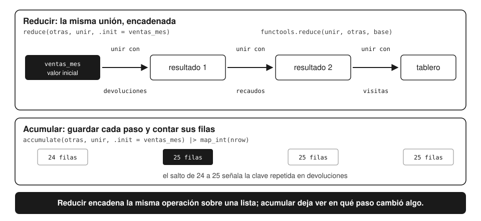
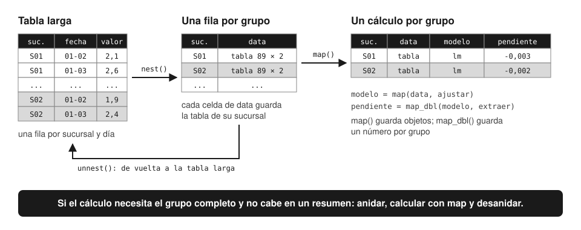
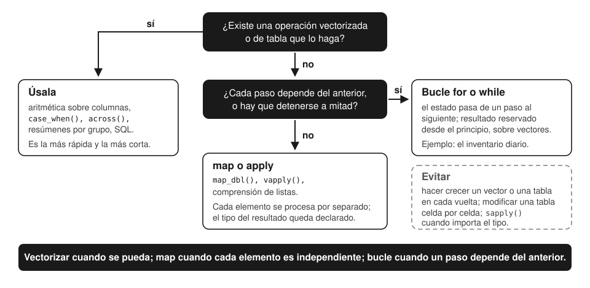

# Transformación y limpieza III: transformar a escala {#sec-escala}

```{r}
#| label: apertura-copiar-pegar
#| eval: false
tablero <- left_join(ventas_mes, recaudos_mes, by = c("sucursal", "mes"))
tablero <- left_join(tablero, visitas_mes, by = c("sucursal", "mes"))
tablero <- left_join(tablero, devoluciones_mes, by = c("sucursal", "mes"))

tablero$valor_ventas <- round(tablero$valor_ventas / 1e6, 1)
tablero$valor_recaudado <- round(tablero$valor_recaudado / 1e6, 1)
```

Este código está bien. Une cuatro indicadores mensuales de las sucursales y pasa los valores a millones. Se lee de arriba abajo y cualquiera lo entiende. El problema llega el mes siguiente, cuando gerencia pide dos indicadores más, y al otro, cuando cambia el nombre de una columna. Cada línea copiada es una línea que hay que recordar cambiar. El error típico de este código no es de sintaxis: es la línea que se quedó sin cambiar.

Los dos capítulos anteriores trabajaron con una tabla a la vez: una operación, un resultado. Este trata de lo que pasa cuando la misma operación se repite. La repetición aparece de cuatro formas, y cada una tiene su herramienta:

| Lo que se repite | Ejemplo | Herramienta |
|---|---|---|
| La misma operación en muchas columnas | Pasar a millones todas las columnas de valor | `across()`, `COLUMNS()` |
| La misma unión con muchas tablas | Juntar los indicadores, uno por archivo | `reduce()` |
| El mismo cálculo en muchos grupos | La tendencia de las ventas de cada sucursal | Columnas-lista, `nest()` |
| Un paso que depende del anterior | El inventario de cada día depende del de ayer | El bucle |

: Las formas de la repetición y sus herramientas {#tbl-repeticion}

En el camino aparecen dos operaciones que los capítulos anteriores dejaron pendientes, porque solo se necesitan cuando las tablas se combinan en serio: **unir por rangos**, como el precio vigente en la fecha de una venta, y **completar la estructura**, porque un día sin ventas no es lo mismo que un día sin fila.

La última parte del capítulo responde una pregunta que suele resolverse por costumbre y no por criterio: ¿cuándo escribir un bucle y cuándo no? La respuesta corta es "casi nunca, salvo cuando sí", y la sección explica las dos mitades.

::: {.callout-tip}
## Antes de empezar

1. Abre la carpeta de materiales en Positron. Este capítulo usa `datos/cap09/` y las ventas y productos de `datos/cap07/`.
2. Usamos `purrr`, que se instaló con el `tidyverse` y que ya apareció en el @sec-importacion para leer varios archivos. En Python, `functools` e `itertools` son parte de la biblioteca estándar.
3. Si los archivos de `datos/cap09/` no están en tu copia, genéralos con `Rscript scripts/generar_datos_cap09.R`. Antes deben existir los del @sec-transformar.
:::

```{r}
#| label: paquetes-cap09
#| message: false
use("arrow", "read_parquet")
use("readr", c("read_csv", "cols"))
use(
  "dplyr",
  c(
    "select",
    "filter",
    "arrange",
    "desc",
    "mutate",
    "summarise",
    "count",
    "n",
    "left_join",
    "full_join",
    "join_by",
    "distinct",
    "case_when",
    "coalesce",
    "across",
    "where",
    "starts_with",
    "rename_with",
    "tibble"
  )
)
use("tidyr", c("complete", "nest", "unnest"))
use(
  "purrr",
  c(
    "map",
    "map_int",
    "map_dbl",
    "map_chr",
    "map_lgl",
    "reduce",
    "accumulate",
    "safely",
    "list_rbind",
    "walk"
  )
)
use("DBI", c("dbConnect", "dbGetQuery", "dbExecute", "dbDisconnect"))
use("duckdb", "duckdb")

con <- dbConnect(duckdb())
segundos <- function(expr) round(system.time(expr)[["elapsed"]], 3)

ventas <- read_parquet("datos/cap07/ventas_2026_t1.parquet") |>
  mutate(
    valor_bruto = unidades * precio_unitario,
    valor_neto = valor_bruto * (1 - descuento),
    mes = as.integer(format(fecha, "%m"))
  )
```

`segundos()` es la función del Ejemplo 7.7 para medir tiempos; la volvemos a usar al comparar formas de iterar.

## Los archivos del capítulo {#sec-archivos-cap09}

| Archivo | Contenido |
|---|---|
| `indicadores/` | Cuatro CSV con un indicador mensual por sucursal en el primer trimestre: `ventas_mes.csv`, `recaudos_mes.csv`, `visitas_mes.csv` y `devoluciones_mes.csv`. Todos tienen `sucursal`, `mes` y una columna de valor. |
| `precios_historial.csv` | La lista de precios con la fecha desde la que rige cada precio (`vigente_desde`). Ocho productos subieron de precio durante el trimestre. |
| `tramos_comision.csv` | Los tramos de comisión según las ventas del mes: `desde`, `hasta` y `comision_pct`. |
| `conteos/` | El conteo físico de inventario del 31 de marzo, un archivo por sucursal. |

: Los archivos del capítulo {#tbl-archivos-cap09}

Además usamos `ventas_2026_t1.parquet` y `productos.csv` del @sec-transformar. A las ventas ya les agregamos el valor bruto, el valor neto y el mes, como en el Ejemplo 7.2.

## Muchas columnas a la vez {#sec-muchas-columnas}

La forma más simple de la repetición es aplicar la misma función a varias columnas. En el @sec-transformar vimos `across()` de pasada; aquí lo usamos en serio, con dos ideas: **elegir las columnas por una regla** (su nombre, su tipo) en lugar de escribirlas una por una, y **aplicar varias funciones** a la vez, con un patrón para nombrar los resultados.

Las columnas se eligen con las mismas funciones de selección de `select()`:

| Regla | `dplyr` | `pandas` | DuckDB |
|---|---|---|---|
| Por nombre exacto | `c(a, b)` | `[["a", "b"]]` | `COLUMNS(['a', 'b'])` |
| Por el inicio del nombre | `starts_with("valor")` | `.filter(like="valor")` | `COLUMNS('^valor')` |
| Por una expresión regular | `matches("_(total\|prom)$")` | `.filter(regex="_(total\|prom)$")` | `COLUMNS('_(total\|prom)$')` |
| Por tipo | `where(is.numeric)` | `.select_dtypes("number")` | `COLUMNS(lambda c: ...)` sobre el nombre |

: Elegir columnas por una regla {#tbl-elegir-columnas}

### Ejemplo guiado 9.1: un resumen de varias columnas y varias funciones

Queremos, por sucursal, el total y el promedio por venta de las unidades, el valor bruto y el valor neto, con los valores en millones.

::: {.panel-tabset group="lenguaje"}

### R

```{r}
#| label: across-resumen
resumen <- ventas |>
  summarise(
    across(
      c(unidades, valor_bruto, valor_neto),
      list(total = sum, prom = mean),
      .names = "{.col}_{.fn}"
    ),
    .by = sucursal
  ) |>
  mutate(
    across(starts_with("valor"), \(x) round(x / 1e6, 2)),
    across(starts_with("unidades"), \(x) round(x, 1))
  ) |>
  arrange(sucursal)

head(resumen, 3)
```

`across()` recibe tres cosas: las columnas, una función o una lista con nombre de funciones, y en `.names` el patrón del nombre de cada resultado, donde `{.col}` es la columna y `{.fn}` el nombre de la función. Tres columnas por dos funciones dan seis resultados, y una línea de código basta para todos. `\(x) round(x / 1e6, 2)` es una **función anónima**: una función de una sola línea que no necesita nombre porque solo se usa ahí. Es la forma corta de `function(x) round(x / 1e6, 2)`, disponible desde R 4.1.

`rename_with()` aplica la misma idea a los nombres: `rename_with(resumen, \(n) paste0(n, "_mill"), starts_with("valor"))` agrega el sufijo a las columnas de valor.

En R base no hay `across()`, pero hay algo más fundamental: **una tabla es una lista de columnas**, y una función que recorre listas, `lapply()`, sirve para recorrer columnas:

```{r}
#| label: across-base
columnas_valor <- grep("^valor", names(resumen), value = TRUE)
columnas_valor

resumen_base <- resumen
resumen_base[columnas_valor] <- lapply(resumen_base[columnas_valor], \(x) {
  x * 1e6
})
resumen_base[1, columnas_valor]

vapply(ventas, is.numeric, logical(1))
```

`lapply()` aplica la función a cada columna y devuelve una lista; al asignarla a `resumen_base[columnas_valor]`, cada elemento vuelve a su columna. `vapply()` hace lo mismo pero declara el tipo del resultado: aquí, un valor lógico por columna. Volveremos sobre esta diferencia en la @sec-iterar.

### Python

```python
import pandas as pd
import numpy as np

ventas = pd.read_parquet("datos/cap07/ventas_2026_t1.parquet")
ventas["fecha"] = pd.to_datetime(ventas["fecha"])
ventas = ventas.assign(
    valor_bruto=lambda d: d["unidades"] * d["precio_unitario"],
    valor_neto=lambda d: d["valor_bruto"] * (1 - d["descuento"]),
    mes=lambda d: d["fecha"].dt.month,
)

resumen = ventas.groupby("sucursal")[
    ["unidades", "valor_bruto", "valor_neto"]
].agg(["sum", "mean"])
print(resumen.columns[:2].tolist())
```

```text
[('unidades', 'sum'), ('unidades', 'mean')]
```

Con una lista de funciones, `agg()` devuelve columnas de dos niveles: la columna y la función. Para trabajar con ellas conviene aplanarlas en un solo nombre, con una **comprensión de listas** que recorre los pares:

```python
nombres = {"sum": "total", "mean": "prom"}
resumen.columns = [f"{col}_{nombres[fun]}" for col, fun in resumen.columns]

valor = resumen.filter(like="valor").columns
resumen[valor] = (resumen[valor] / 1e6).round(2)
resumen = resumen.round(
    {"unidades_total": 1, "unidades_prom": 1}
).reset_index()
print(resumen.head(3).to_string())
```

```text
  sucursal  unidades_total  unidades_prom  valor_bruto_total  valor_bruto_prom  valor_neto_total  valor_neto_prom
0      S01           13627           14.0             219.01              0.22            212.35             0.22
1      S02           13244           14.5             196.95              0.22            190.51             0.21
2      S03           11358           14.2             175.31              0.22            169.56             0.21
```

En `pandas` las operaciones aritméticas ya trabajan sobre varias columnas a la vez: `resumen[valor] / 1e6` divide todas las columnas elegidas. Por eso no hace falta un equivalente de `across()` para casos como este. `select_dtypes("number")` elige las columnas por tipo.

### DuckDB

```{r}
#| label: duckdb-columns
dbGetQuery(
  con,
  r"(
  SELECT sucursal,
         sum(unidades)           AS unidades_total,
         round(avg(unidades), 1) AS unidades_prom,
         round(sum(COLUMNS('^(valor_bruto|valor_neto)$')) / 1e6, 2) AS "\1_total",
         round(avg(COLUMNS('^(valor_bruto|valor_neto)$')) / 1e6, 2) AS "\1_prom"
  FROM (
    SELECT *, unidades * precio_unitario AS valor_bruto,
              valor_bruto * (1 - descuento) AS valor_neto
    FROM 'datos/cap07/ventas_2026_t1.parquet'
  )
  GROUP BY sucursal
  ORDER BY sucursal
  LIMIT 3
)"
)
```

`COLUMNS()` con una expresión regular se expande a todas las columnas cuyo nombre coincide, y la función que lo rodea se aplica a cada una. El grupo de la expresión, entre paréntesis, se puede usar en el alias como `\1`: así `"\1_total"` produce `valor_bruto_total` y `valor_neto_total`. Las unidades van aparte porque no se pasan a millones: cuando dos grupos de columnas llevan un tratamiento distinto, cada grupo tiene su propio `COLUMNS()`, igual que en R cada grupo tiene su propio `across()`.

`COLUMNS()` también acepta una función anónima que recibe el nombre de cada columna, como `COLUMNS(lambda c: c LIKE 'valor%')`. En DuckDB 2.0 las funciones anónimas se escriben con `lambda`, como en Python.

:::

## Muchas tablas: reducir una lista {#sec-reducir}

Volvamos al código del inicio. Las tres uniones repiten un patrón: tomar el resultado anterior y unirle la tabla siguiente. Esa operación tiene nombre: **reducir** una lista. Se parte de un valor inicial y se combina con cada elemento, uno tras otro, hasta que la lista se reduce a un solo resultado (@fig-reducir). La suma es el ejemplo más simple: reducir `c(3, 5, 2)` con `+` es `(3 + 5) + 2`. Con tablas y uniones, la idea es la misma.

{#fig-reducir fig-alt="Arriba, reducir: la tabla de ventas es el valor inicial y se une, una tras otra, con devoluciones, recaudos y visitas; cada unión produce un resultado intermedio y la última, el tablero. Abajo, acumular guarda cada resultado intermedio y deja ver el número de filas: 24, 25, 25 y 25. El salto de 24 a 25 en el primer paso señala la tabla con una clave repetida, devoluciones. Al pie: reducir encadena la misma operación sobre una lista; acumular deja ver en qué paso cambió algo."}

| Operación | `purrr` | R base | Python | DuckDB |
|---|---|---|---|---|
| Reducir | `reduce(lista, f, .init = )` | `Reduce(f, lista, init)` | `functools.reduce(f, lista, inicial)` | Uniones encadenadas en SQL |
| Acumular | `accumulate(lista, f, .init = )` | `Reduce(f, lista, init, accumulate = TRUE)` | `itertools.accumulate(lista, f, initial=)` | No aplica |

: Reducir y acumular en cada herramienta {#tbl-reducir}

### Ejemplo guiado 9.2: el tablero de indicadores por sucursal

Los cuatro indicadores están en `datos/cap09/indicadores/`, un archivo por indicador. Queremos una tabla con una fila por sucursal y mes y una columna por indicador, que funcione igual si mañana llegan seis archivos en lugar de cuatro.

::: {.panel-tabset group="lenguaje"}

### R

Primero leemos todos los archivos en una lista con nombre, como en el @sec-importacion:

```{r}
#| label: reducir-leer
rutas <- list.files(
  "datos/cap09/indicadores",
  pattern = "\\.csv$",
  full.names = TRUE
)
names(rutas) <- tools::file_path_sans_ext(basename(rutas))

indicadores <- map(rutas, read_csv, show_col_types = FALSE)
map_int(indicadores, nrow)
```

Las ventas tienen 24 filas: 8 sucursales por 3 meses. Las ventas definen el universo del tablero, así que serán el **valor inicial** y las demás tablas se le unirán una por una:

```{r}
#| label: reducir-acumular
unir <- \(x, y) left_join(x, y, by = c("sucursal", "mes"))
otras <- indicadores[names(indicadores) != "ventas_mes"]

pasos <- accumulate(otras, unir, .init = indicadores$ventas_mes)
map_int(pasos, nrow)
```

`accumulate()` hace lo mismo que `reduce()`, pero guarda cada resultado intermedio. Por eso sirve para depurar: el número de filas pasa de 24 a 25 al unir las devoluciones, la misma señal del Ejemplo 7.4. Una unión izquierda no debería cambiar el número de filas de la tabla principal. Si en lugar de empezar por las ventas hubiéramos empezado por las devoluciones, el conteo habría empezado en 25 y nunca habría cambiado: la fila repetida habría pasado inadvertida. **El valor inicial no es un detalle: es la tabla que define cuántas filas debe tener el resultado.**

Como en el @sec-transformar, la forma de que el problema detenga el código es declarar la relación esperada:

```{r}
#| label: reducir-relacion
#| error: true
unir <- \(x, y) {
  left_join(x, y, by = c("sucursal", "mes"), relationship = "one-to-one")
}
tablero <- reduce(otras, unir, .init = indicadores$ventas_mes)
```

La causa es una fila repetida, idéntica, como el `P07` del catálogo de productos. Como la misma revisión vale para todas las tablas, también se aplica con `map()`:

```{r}
#| label: reducir-corregir
map_int(indicadores, \(d) sum(duplicated(d)))

indicadores <- map(indicadores, distinct)
otras <- indicadores[names(indicadores) != "ventas_mes"]
tablero <- reduce(otras, unir, .init = indicadores$ventas_mes)

tablero |>
  mutate(across(starts_with("valor"), \(x) round(x / 1e6, 1))) |>
  filter(sucursal %in% c("S06", "S07"))
```

La tabla final tiene una columna por indicador y las 24 filas de las ventas. Un faltante queda a la vista: `S07` no reportó las visitas de marzo. Con `left_join()` partiendo de las ventas, ese hueco aparece como `NA`. Con `inner_join()`, la fila completa de `S07` en marzo habría desaparecido del tablero sin aviso. Si llegan más archivos a la carpeta, este código no cambia.

En R base, la misma reducción es `Reduce(unir, otras, indicadores$ventas_mes)`. Observa que el orden de los argumentos cambia: `Reduce()` recibe primero la función y el valor inicial va de tercero; `reduce()` de `purrr` recibe primero la lista, para usarse con el *pipe*.

### Python

```python
from functools import reduce
from itertools import accumulate
from pathlib import Path

rutas = sorted(Path("datos/cap09/indicadores").glob("*.csv"))
indicadores = {ruta.stem: pd.read_csv(ruta) for ruta in rutas}
print({nombre: len(tabla) for nombre, tabla in indicadores.items()})


def unir(x, y):
    return x.merge(y, on=["sucursal", "mes"], how="left")


base = indicadores["ventas_mes"]
otras = [
    tabla for nombre, tabla in indicadores.items() if nombre != "ventas_mes"
]
print([len(paso) for paso in accumulate(otras, unir, initial=base)])
```

```text
{'devoluciones_mes': 25, 'recaudos_mes': 24, 'ventas_mes': 24, 'visitas_mes': 23}
[24, 25, 25, 25]
```

La **comprensión de diccionarios** `{ruta.stem: ... for ruta in rutas}` arma un diccionario con el nombre del archivo como clave y la tabla como valor: el equivalente de la lista con nombre de R. `accumulate()` de `itertools` recibe la función y el valor inicial en `initial`. Con `validate="1:1"` en `merge()`, la reducción se detiene en la tabla con la clave repetida:

```python
def unir(x, y):
    return x.merge(y, on=["sucursal", "mes"], how="left", validate="1:1")


tablero = reduce(unir, otras, base)
```

```text
MergeError: Merge keys are not unique in right dataset; not a one-to-one merge
```

```python
indicadores = {
    nombre: tabla.drop_duplicates() for nombre, tabla in indicadores.items()
}
base = indicadores["ventas_mes"]
otras = [
    tabla for nombre, tabla in indicadores.items() if nombre != "ventas_mes"
]

tablero = reduce(unir, otras, base)
print(tablero.shape)
print(tablero[tablero["visitas"].isna()])
```

```text
(24, 6)
   sucursal  mes  valor_ventas  devoluciones  valor_recaudado  visitas
20      S07    3      45034850             3         38393000      NaN
```

`functools.reduce()` tiene el mismo orden de argumentos que `Reduce()` de R base: la función, la lista y el valor inicial.

### DuckDB

En SQL las uniones se encadenan en la misma consulta, así que no hace falta una función de reducción. Lo que sí se puede automatizar es el paso previo: crear una vista por archivo. Es un caso de iteración por sus **efectos**, no por su resultado: no nos interesa lo que devuelve `dbExecute()`, sino que la vista quede creada. Para eso `purrr` tiene `walk()`, la versión de `map()` que no guarda resultados:

```{r}
#| label: duckdb-vistas
walk(names(rutas), \(nombre) {
  dbExecute(
    con,
    sprintf(
      "CREATE OR REPLACE VIEW %s AS SELECT DISTINCT * FROM read_csv('%s')",
      nombre,
      rutas[[nombre]]
    )
  )
})

dbGetQuery(
  con,
  r"(
  SELECT count(*) AS filas, count(visitas) AS con_visitas
  FROM ventas_mes
  LEFT JOIN recaudos_mes     USING (sucursal, mes)
  LEFT JOIN devoluciones_mes USING (sucursal, mes)
  LEFT JOIN visitas_mes      USING (sucursal, mes)
)"
)
```

`SELECT DISTINCT *` resuelve la fila repetida al crear la vista. `count(visitas)` cuenta solo los valores no faltantes: 23 de 24. Aquí el texto de la consulta se arma con `sprintf()` porque el nombre de la vista cambia en cada vuelta. Eso es razonable con nombres de archivo que controlamos; con valores que vienen de un usuario no lo es, porque un texto malintencionado podría cambiar la consulta. Para esos casos `DBI` admite consultas con parámetros: `dbGetQuery(con, "SELECT * FROM ventas_mes WHERE sucursal = ?", params = list("S03"))`.

:::

::: {.callout-note}
## Reducir no es solo unir

Cualquier operación que combine dos cosas en una sirve para reducir. Con `bind_rows()` apila tablas, aunque para eso `list_rbind()` es más directo. Con `intersect()` encuentra las columnas comunes a todas las tablas: `reduce(map(indicadores, names), intersect)` devuelve `sucursal` y `mes`. Incluso los pasos de una limpieza pueden guardarse como una lista de funciones y aplicarse en orden con `reduce(pasos, \(datos, paso) paso(datos), .init = crudo)`: la lista de reglas se vuelve un dato que se puede revisar, como las reglas de calidad del @sec-tipos-calidad.
:::

## Uniones por rango y por fecha vigente {#sec-uniones-rango}

Todas las uniones que hemos hecho son **por igualdad**: la venta del producto `P05` se une con la fila del catálogo cuyo producto es `P05`. Hay dos situaciones frecuentes en que eso no alcanza:

- **Fecha vigente.** La lista de precios guarda, para cada producto, la fecha desde la que rige cada precio. El precio que corresponde a una venta es el de la fila más reciente que no sea posterior a la venta. No hay igualdad de fechas: la venta del 14 de febrero toma el precio vigente desde el 1 de febrero.
- **Rangos.** Los tramos de comisión dicen que unas ventas mensuales entre 45 y 60 millones pagan el 1,5 %. El valor de la sucursal no es igual a ningún valor de la tabla de tramos: cae dentro de un intervalo.

Unir por el producto e ignorar la fecha es el error típico, y produce justo lo que vimos en el Ejemplo 7.4: filas multiplicadas.

```{r}
#| label: rango-trampa
precios <- read_csv("datos/cap09/precios_historial.csv", show_col_types = FALSE)
count(precios, producto) |> filter(n > 1) |> nrow()

nrow(left_join(ventas, precios, by = "producto", relationship = "many-to-many"))
```

Ocho productos tienen dos precios, así que cada una de sus ventas se une con ambos.

### Ejemplo guiado 9.3: el precio vigente y el tramo de comisión

Dos preguntas. La primera: ¿se facturaron las ventas al precio vigente en su fecha? La segunda: ¿qué comisión le corresponde a cada sucursal cada mes según sus ventas?

::: {.panel-tabset group="lenguaje"}

### R

Desde `dplyr` 1.1, `join_by()` describe uniones que no son por igualdad. `closest(fecha >= vigente_desde)` significa: entre las filas con `vigente_desde` menor o igual a la fecha de la venta, la más cercana.

```{r}
#| label: rango-vigente
ventas_precio <- ventas |>
  left_join(
    precios,
    by = join_by(producto, closest(fecha >= vigente_desde)),
    relationship = "many-to-one"
  )
nrow(ventas_precio)

ventas_precio |>
  filter(precio_unitario != precio) |>
  summarise(
    ventas = n(),
    diferencia = sum(unidades * (precio - precio_unitario) * (1 - descuento)),
    .by = c(producto, vigente_desde)
  ) |>
  arrange(desc(diferencia))
```

La unión conserva las 6.000 ventas, y `relationship = "many-to-one"` garantiza que cada venta encontró un solo precio. El resultado es un hallazgo de auditoría: el sistema de ventas no aplicó los ajustes de precio del trimestre. Hay 2.166 ventas facturadas con la lista vieja, y la diferencia suma casi 29 millones de pesos. Si la unión hubiera sido solo por producto, este cálculo habría salido inflado y nadie lo habría notado.

Para los tramos, la condición tiene dos partes: el valor es mayor o igual al inicio del tramo y menor que su final. El último tramo no tiene techo (`hasta` está vacío), y lo completamos con infinito para que la comparación funcione:

```{r}
#| label: rango-tramos
tramos <- read_csv("datos/cap09/tramos_comision.csv", show_col_types = FALSE) |>
  mutate(hasta = coalesce(hasta, Inf))
tramos

comisiones <- tablero |>
  select(sucursal, mes, valor_ventas) |>
  left_join(
    tramos,
    by = join_by(valor_ventas >= desde, valor_ventas < hasta),
    relationship = "many-to-one"
  ) |>
  mutate(comision = round(valor_ventas * comision_pct / 100))

count(comisiones, tramo, comision_pct)
filter(comisiones, sucursal == "S01")
```

Los tramos usan `>=` en un extremo y `<` en el otro a propósito. Con `between()`, que incluye los dos extremos, una sucursal que vendiera exactamente 60 millones caería en dos tramos a la vez, y `relationship = "many-to-one"` lo detectaría. Es la misma regla de los intervalos de un histograma: cerrados por un lado, abiertos por el otro.

### Python

En `pandas`, la unión por fecha vigente es `merge_asof()`. Exige que ambas tablas estén ordenadas por la columna de la fecha:

```python
precios = pd.read_csv(
    "datos/cap09/precios_historial.csv", parse_dates=["vigente_desde"]
)
precios["vigente_desde"] = precios["vigente_desde"].astype(
    ventas["fecha"].dtype
)

ventas_precio = pd.merge_asof(
    ventas.sort_values("fecha"),
    precios.sort_values("vigente_desde"),
    left_on="fecha",
    right_on="vigente_desde",
    by="producto",
    direction="backward",
)
print(len(ventas_precio))

desfase = ventas_precio[
    ventas_precio["precio_unitario"] != ventas_precio["precio"]
]
print(
    desfase.assign(
        diferencia=lambda d: (
            d["unidades"]
            * (d["precio"] - d["precio_unitario"])
            * (1 - d["descuento"])
        )
    )
    .groupby(["producto", "vigente_desde"], as_index=False)
    .agg(ventas=("id_venta", "size"), diferencia=("diferencia", "sum"))
    .sort_values("diferencia", ascending=False)
    .head(3)
)
```

```text
6000
  producto vigente_desde  ventas  diferencia
3      P05    2026-02-01     335   8956315.0
2      P04    2026-02-01     337   5871515.0
0      P01    2026-02-01     329   5091350.0
```

`direction="backward"` busca hacia atrás: el precio más reciente que no sea posterior a la venta. `by="producto"` hace la búsqueda dentro de cada producto. Si las tablas no están ordenadas, `merge_asof()` da un error en lugar de un resultado equivocado. También exige que las dos fechas tengan exactamente el mismo tipo, incluida la resolución: en `pandas` 3, la fecha que viene del Parquet queda en microsegundos (`datetime64[us]`) y la que se lee del CSV, en segundos (`datetime64[s]`). Sin la conversión de la segunda línea, `merge_asof()` da el error `incompatible merge keys`.

`pandas` no tiene uniones por rango. Para los tramos, la herramienta es `pd.cut()`, que asigna cada valor a un intervalo; después se une por el nombre del tramo, una unión por igualdad común y corriente:

```python
tramos = pd.read_csv("datos/cap09/tramos_comision.csv")
limites = [*tramos["desde"], np.inf]

comisiones = (
    tablero[["sucursal", "mes", "valor_ventas"]]
    .assign(
        tramo=lambda d: pd.cut(
            d["valor_ventas"],
            bins=limites,
            labels=tramos["tramo"],
            right=False,
        ).astype(str)
    )
    .merge(tramos[["tramo", "comision_pct"]], on="tramo", validate="m:1")
)
print(comisiones["tramo"].value_counts().sort_index())
```

```text
tramo
A     4
B    13
C     5
D     2
Name: count, dtype: int64
```

`right=False` cierra los intervalos por la izquierda y los abre por la derecha, como el `>=` y `<` de R. `[*tramos["desde"], np.inf]` arma la lista de límites: los inicios de cada tramo y, al final, infinito.

### DuckDB

DuckDB tiene las dos uniones. La de fecha vigente es `ASOF JOIN`, y la de rangos es un `JOIN` común con una condición de desigualdad:

```{r}
#| label: duckdb-asof
dbGetQuery(
  con,
  r"(
  SELECT count(*) AS ventas,
         count(*) FILTER (WHERE v.precio_unitario <> p.precio) AS con_precio_viejo
  FROM 'datos/cap07/ventas_2026_t1.parquet' AS v
  ASOF LEFT JOIN 'datos/cap09/precios_historial.csv' AS p
    ON v.producto = p.producto AND v.fecha >= p.vigente_desde
)"
)

dbGetQuery(
  con,
  r"(
  SELECT t.tramo, t.comision_pct, count(*) AS meses
  FROM ventas_mes AS v
  JOIN 'datos/cap09/tramos_comision.csv' AS t
    ON v.valor_ventas >= t.desde
   AND (t.hasta IS NULL OR v.valor_ventas < t.hasta)
  GROUP BY ALL
  ORDER BY tramo
)"
)
```

En `ASOF JOIN`, la condición de igualdad (`producto`) dice dentro de qué grupo buscar y la desigualdad (`>=`) dice en qué dirección. En los tramos, el techo vacío se trata en la condición con `t.hasta IS NULL OR ...`, sin modificar la tabla. `FILTER (WHERE ...)` cuenta solo las filas que cumplen la condición, como `count_if()`.

:::

## Completar la estructura {#sec-completar-estructura}

En el @sec-limpiar completamos valores faltantes: celdas vacías en filas que existen. Hay otro faltante más difícil de ver: **la fila que no existe**. La tabla de ventas registra lo que se vendió; un día en que una sucursal no vendió un producto simplemente no aparece. Para la mayoría de los cálculos eso no importa. Para un promedio por día, sí: si los días sin ventas no tienen fila, el promedio se calcula solo sobre los días con ventas y sale inflado.

Completar la estructura es agregar las filas que faltan, con un valor explícito (casi siempre cero). La decisión importante no es la función, sino **contra qué universo se completa**: todos los días del calendario, los días hábiles, los días en que la red operó. Esa respuesta la da el negocio, no los datos.

### Ejemplo guiado 9.4: la demanda diaria de un producto

Queremos las unidades vendidas por día de `P05` (aceite de 3 litros) en cada sucursal. Esta tabla será la entrada de la simulación de inventario del Ejemplo 9.7. El universo son los días en que la red vendió algo, que tomamos de todas las ventas, no solo de las de `P05`.

::: {.panel-tabset group="lenguaje"}

### R

```{r}
#| label: completar-incompleto
dias <- sort(unique(ventas$fecha))
sucursales <- sort(unique(ventas$sucursal))
length(dias)

demanda_p05 <- ventas |>
  filter(producto == "P05") |>
  summarise(unidades = sum(unidades), .by = c(sucursal, fecha))
nrow(demanda_p05)
```

8 sucursales por 89 días serían 712 filas, pero hay muchas menos: los días sin ventas de `P05` no están. `complete()` agrega las combinaciones que faltan:

```{r}
#| label: completar-complete
demanda_p05 <- demanda_p05 |>
  complete(sucursal = sucursales, fecha = dias, fill = list(unidades = 0)) |>
  arrange(sucursal, fecha)
nrow(demanda_p05)

ventas |>
  filter(producto == "P05") |>
  summarise(unidades = sum(unidades), .by = c(sucursal, fecha)) |>
  summarise(promedio_sin_completar = mean(unidades), .by = sucursal) |>
  left_join(
    summarise(demanda_p05, promedio_completo = mean(unidades), .by = sucursal),
    by = "sucursal"
  ) |>
  arrange(sucursal) |>
  head(4)
```

`complete()` recibe las columnas cuyas combinaciones deben existir, con los valores posibles de cada una, y en `fill` el valor para las filas nuevas. Si se escribe solo `complete(sucursal, fecha)`, el universo sale de los propios datos: las sucursales y las fechas que ya aparecen. Aquí lo declaramos de forma explícita con `sucursales` y `dias`, para que una sucursal sin ninguna venta de `P05`, o un día sin ventas en ninguna sucursal, también aparezca.

La diferencia entre los dos promedios es grande: sin completar, el promedio solo cuenta los días con ventas y casi duplica la demanda real.

### Python

En `pandas` se arma el universo con `MultiIndex.from_product()`, que produce todas las combinaciones, y se reindexa la tabla sobre él:

```python
dias = np.sort(ventas["fecha"].unique())
sucursales = sorted(ventas["sucursal"].unique())

universo = pd.MultiIndex.from_product(
    [sucursales, dias], names=["sucursal", "fecha"]
)
demanda_p05 = (
    ventas[ventas["producto"] == "P05"]
    .groupby(["sucursal", "fecha"])["unidades"]
    .sum()
    .reindex(universo, fill_value=0)
    .reset_index()
)
print(len(demanda_p05))
print(demanda_p05.groupby("sucursal")["unidades"].mean().round(2).head(4))
```

```text
712
sucursal
S01    12.67
S02    10.70
S03    10.85
S04    10.28
Name: unidades, dtype: float64
```

`reindex()` alinea la serie con el nuevo índice: conserva los valores que existen y llena con `fill_value` las combinaciones nuevas.

### DuckDB

En SQL, el universo se construye con un `CROSS JOIN`, que combina cada fila de una tabla con cada fila de la otra, y las ventas se le unen por la izquierda:

```{r}
#| label: duckdb-completar
dbGetQuery(
  con,
  r"(
  WITH v AS (FROM 'datos/cap07/ventas_2026_t1.parquet'),
  universo AS (
    SELECT s.sucursal, d.fecha
    FROM (SELECT DISTINCT sucursal FROM v) AS s
    CROSS JOIN (SELECT DISTINCT fecha FROM v) AS d
  ),
  p05 AS (
    SELECT sucursal, fecha, sum(unidades) AS unidades
    FROM v WHERE producto = 'P05'
    GROUP BY ALL
  )
  SELECT sucursal, count(*) AS dias, round(avg(coalesce(unidades, 0)), 2) AS promedio
  FROM universo
  LEFT JOIN p05 USING (sucursal, fecha)
  GROUP BY sucursal
  ORDER BY sucursal
  LIMIT 4
)"
)
```

`WITH` define consultas con nombre que se usan después como tablas, y evita anidar subconsultas. `coalesce(unidades, 0)` convierte en cero las combinaciones sin ventas.

:::

## Muchos grupos: columnas que guardan tablas {#sec-columnas-lista}

`summarise(.by = )` y `groupby().agg()` aplican a cada grupo funciones que devuelven un solo número: una suma, un promedio. Algunos cálculos no caben ahí. Ajustar una recta a las ventas diarias de cada sucursal, por ejemplo, necesita todas las filas del grupo a la vez y devuelve un objeto (el modelo), del cual después se extraen uno o varios números.

Para eso, en R, existen las **columnas-lista**: columnas en las que cada celda guarda un objeto cualquiera, incluso una tabla completa. `nest()` parte una tabla en una fila por grupo, con los datos del grupo guardados en una columna-lista llamada `data`. Después, `map()` aplica una función a cada celda de esa columna. Es el patrón **anidar, calcular y desanidar** (@fig-anidar).

{#fig-anidar fig-alt="A la izquierda, una tabla larga con las ventas diarias de varias sucursales. nest la convierte en una tabla con una fila por sucursal y una columna data en la que cada celda guarda la tabla de esa sucursal. Con mutate y map se agrega una columna modelo, con un modelo por sucursal, y con map_dbl una columna pendiente, con un número por sucursal. unnest hace el camino inverso y devuelve las filas originales. Al pie: cuando el cálculo necesita el grupo completo y no cabe en un resumen, se anida, se calcula con map y, si hace falta, se desanida."}

### Ejemplo guiado 9.5: la tendencia de las ventas de cada sucursal

Queremos saber si las ventas diarias de cada sucursal crecieron o bajaron durante el trimestre. Para cada sucursal ajustamos una recta a sus ventas por día; la pendiente dice cuánto cambian las ventas, en promedio, de un día al siguiente.

::: {.panel-tabset group="lenguaje"}

### R

```{r}
#| label: anidar
por_sucursal <- ventas |>
  summarise(valor = sum(valor_neto) / 1e6, .by = c(sucursal, fecha)) |>
  arrange(sucursal, fecha) |>
  nest(.by = sucursal)

por_sucursal
por_sucursal$data[[1]] |> head(3)
```

`por_sucursal` tiene 8 filas, una por sucursal, y en la columna `data` cada celda es una tabla con las ventas de cada día. Observa que la de `S07` tiene 88 filas y no 89: hubo un día en que no vendió nada. Es el faltante de la sección anterior; para una tendencia afecta poco, pero para un promedio diario habría que completar antes de anidar. Ahora aplicamos a cada tabla la misma función:

```{r}
#| label: anidar-modelos
tendencias <- por_sucursal |>
  mutate(
    modelo = map(data, \(d) lm(valor ~ fecha, data = d)),
    pendiente = map_dbl(modelo, \(m) coef(m)[["fecha"]]),
    por_mes = round(30 * pendiente, 2),
    dias = map_int(data, nrow)
  )

tendencias |> select(sucursal, dias, por_mes) |> arrange(desc(por_mes))
```

`lm(valor ~ fecha)` ajusta una recta del valor contra la fecha; `coef()` extrae sus coeficientes, y el de `fecha` es la pendiente en millones por día. Multiplicada por 30, es el cambio aproximado en un mes. Los cambios son suaves: la venta diaria de `S06` sube unos 140.000 pesos por mes y la de `S01` baja unos 90.000. Con un solo trimestre de datos, la pendiente describe lo que pasó; no dice si la tendencia es real o ruido, y esa pregunta corresponde al capítulo de estadística. La columna `modelo` guarda los ocho modelos completos, por si después se necesita algo más de ellos, como sus residuos.

La familia de `map()` se distingue por el tipo de lo que devuelve: `map()` devuelve una lista, y por eso sirve para guardar modelos o tablas; `map_dbl()`, `map_int()`, `map_chr()` y `map_lgl()` devuelven un vector del tipo que dicen su nombre, y dan error si la función devuelve otra cosa. Es el mismo contrato de `vapply()`.

`unnest()` hace el camino inverso: `unnest(select(tendencias, sucursal, data), data)` devuelve la tabla larga original. Y el patrón sirve también para archivos: una tabla con una fila por ruta y una columna-lista con el contenido de cada archivo es una forma ordenada de inspeccionar muchos archivos a la vez.

```{r}
#| label: tabla-archivos
tibble(archivo = names(rutas), ruta = rutas) |>
  mutate(
    datos = map(ruta, read_csv, show_col_types = FALSE),
    filas = map_int(datos, nrow),
    columnas = map_chr(datos, \(d) paste(names(d), collapse = ", "))
  ) |>
  select(archivo, filas, columnas)
```

### Python

`pandas` admite columnas con objetos (de tipo `object`), pero no tiene un flujo cómodo para trabajar con ellas. La forma habitual es `groupby().apply()`, que pasa a una función la tabla de cada grupo:

```python
diario = (
    ventas.groupby(["sucursal", "fecha"], as_index=False)["valor_neto"]
    .sum()
    .assign(valor=lambda d: d["valor_neto"] / 1e6)
)


def pendiente(d):
    dias = (d["fecha"] - d["fecha"].min()).dt.days
    return np.polyfit(dias, d["valor"], deg=1)[0]


tendencias = (
    diario.groupby("sucursal")[["fecha", "valor"]]
    .apply(pendiente)
    .mul(30)
    .round(2)
    .sort_values(ascending=False)
)
print(tendencias.head(3))
```

```text
sucursal
S06    0.14
S04    0.13
S08    0.10
dtype: float64
```

`np.polyfit(x, y, deg=1)` ajusta una recta y devuelve sus coeficientes, primero la pendiente. Seleccionar las columnas antes de `apply()` (`[["fecha", "valor"]]`) evita que la función reciba también la columna de agrupación.

### DuckDB

Para una recta, SQL no necesita anidar: `regr_slope()` es una función de resumen como `sum()`, que calcula la pendiente dentro de cada grupo. DuckDB tiene además un tipo de dato `LIST`, el equivalente de una columna-lista, que se construye con la función de resumen `list()`:

```{r}
#| label: duckdb-listas
dbGetQuery(
  con,
  r"(
  WITH diario AS (
    SELECT sucursal, fecha,
           sum(unidades * precio_unitario * (1 - descuento)) / 1e6 AS valor
    FROM 'datos/cap07/ventas_2026_t1.parquet'
    GROUP BY ALL
  )
  SELECT sucursal,
         round(30 * regr_slope(valor, epoch(fecha) / 86400), 2) AS por_mes,
         list(round(valor, 1) ORDER BY fecha)[1:3] AS primeros_dias
  FROM diario
  GROUP BY sucursal
  ORDER BY por_mes DESC
  LIMIT 3
)"
)
```

`epoch(fecha) / 86400` convierte la fecha en días. `list(... ORDER BY fecha)` guarda los valores de cada sucursal en una lista ordenada, y `[1:3]` toma sus tres primeros elementos. Las listas de DuckDB tienen sus propias funciones, como `list_transform(lista, lambda x: x * 2)`, que aplica una función a cada elemento: un `map()` dentro de SQL.

:::

## Iterar con criterio {#sec-iterar}

Hasta aquí hemos iterado sin escribir un solo bucle: `across()` recorre columnas, `reduce()` recorre tablas, `map()` recorre grupos. No es casualidad. En R y en Python, la forma de iterar que menos código pide y menos errores deja es la que no se escribe: una función **vectorizada**, que recibe un vector completo y opera sobre todos sus elementos a la vez. `unidades * precio_unitario` multiplica 6.000 pares de números sin que escribamos ningún ciclo; el ciclo existe, pero está escrito en C, dentro de R o de NumPy, y es mucho más rápido que uno escrito en R o en Python.

Eso no convierte al bucle en un error. Hay problemas para los que es la herramienta correcta, y forzar otra solución los vuelve más difíciles. La @fig-elegir-iteracion resume el criterio.

{#fig-elegir-iteracion fig-alt="Un árbol de decisión. Primera pregunta: ¿existe una operación vectorizada o de tabla que lo haga? Si la respuesta es sí, úsala: aritmética sobre columnas, case_when, across, resúmenes por grupo o SQL. Si es no, segunda pregunta: ¿cada paso depende del resultado del paso anterior, o hay que detenerse a mitad de camino? Si es no, usa map o apply: map_dbl, vapply o una comprensión de listas, porque cada elemento se procesa por separado. Si es sí, usa un bucle, for o while, con el resultado reservado desde el principio. Con trazo discontinuo, Evitar: hacer crecer un vector o una tabla dentro del bucle, modificar una tabla celda por celda, y usar sapply cuando importa el tipo del resultado. Al pie: vectorizar cuando se pueda, map cuando cada elemento es independiente y bucle cuando un paso depende del anterior."}

| Forma | R | Python | Cuándo |
|---|---|---|---|
| Vectorizada | aritmética, `ifelse()`, `case_when()`, `cumsum()` | aritmética de `pandas` y NumPy, `np.where()`, `np.select()` | Siempre que exista |
| Aplicar una función a cada elemento | `map_*()`, `vapply()`, `lapply()` | comprensión de listas, `map()` | Elementos independientes entre sí |
| Bucle | `for`, `while` | `for`, `while` | Un paso depende del anterior, efectos en orden, salida anticipada |

: Las formas de iterar {#tbl-iterar}

### Ejemplo guiado 9.6: la misma clasificación de cuatro formas

Retomamos la clasificación del Ejemplo 7.2 (grande desde 30 unidades, mediano desde 10, pequeño por debajo) y la aplicamos a un millón de valores de cuatro formas.

::: {.panel-tabset group="lenguaje"}

### R

```{r}
#| label: iterar-formas
set.seed(9)
u <- sample(1:40, 1e6, replace = TRUE)

tamano <- function(x) {
  if (x >= 30) {
    "grande"
  } else if (x >= 10) {
    "mediano"
  } else {
    "pequeño"
  }
}

t_vector <- segundos(
  r_vector <- case_when(
    u >= 30 ~ "grande",
    u >= 10 ~ "mediano",
    .default = "pequeño"
  )
)
t_map <- segundos(r_map <- map_chr(u, tamano))
t_vapply <- segundos(r_vapply <- vapply(u, tamano, character(1)))
t_for <- segundos({
  r_for <- character(length(u))
  for (i in seq_along(u)) {
    r_for[i] <- tamano(u[i])
  }
})

data.frame(
  forma = c(
    "case_when()",
    "map_chr()",
    "vapply()",
    "for con resultado reservado"
  ),
  segundos = c(t_vector, t_map, t_vapply, t_for)
)
identical(r_vector, r_for)
```

Los cuatro resultados son idénticos, y la forma vectorizada es unas treinta veces más rápida que las demás. La función `tamano()` usa `if`, que solo entiende un valor a la vez; por eso hay que llamarla un millón de veces, una por elemento. `case_when()` hace las comparaciones sobre el vector completo.

Fíjate en que el bucle `for` tarda lo mismo que `map_chr()` y apenas un poco más que `vapply()`. La idea de que "los bucles en R son lentos" viene de un error concreto: **hacer crecer el resultado** dentro del bucle, con `resultado <- c(resultado, nuevo)`. Cada vez que el vector crece, R lo copia completo a un lugar nuevo de la memoria, y el tiempo total crece con el cuadrado del número de elementos. Reservar el resultado desde el principio, con `character(length(u))`, evita ese problema. Lo que vuelve rápido un cálculo en R es vectorizar, no cambiar `for` por `map()`.

Entre `map()` y `for`, entonces, la razón para preferir `map()` no es la velocidad sino la claridad: dice qué se obtiene (un vector de texto, uno por elemento) sin los detalles de cómo se recorre. Y entre `map_chr()` y `sapply()`, la razón es el tipo. `sapply()` decide el tipo del resultado según lo que encuentre:

```{r}
#| label: iterar-sapply
sapply(c(2, 2), seq_len) # una matriz
sapply(c(1, 2), seq_len) # una lista
sapply(c(), seq_len) # una lista vacía
```

La misma línea devuelve tres tipos distintos según los datos. En un análisis interactivo no importa; dentro de un script que corre cada mes, es un error que aparece el mes en que los datos cambian. `vapply()` y `map_*()` declaran el tipo esperado y dan un error claro cuando no se cumple.

### Python

```python
import time

rng = np.random.default_rng(9)
u = rng.integers(1, 41, size=1_000_000)


def tamano(x):
    return "grande" if x >= 30 else "mediano" if x >= 10 else "pequeño"


def medir(f):
    inicio = time.perf_counter()
    resultado = f()
    return round(time.perf_counter() - inicio, 3), resultado


def con_bucle():
    r = [None] * len(u)
    for i, x in enumerate(u):
        r[i] = tamano(x)
    return r


tiempos = {
    "np.select()": medir(
        lambda: np.select(
            [u >= 30, u >= 10], ["grande", "mediano"], default="pequeño"
        )
    ),
    "comprensión de listas": medir(lambda: [tamano(x) for x in u]),
    "Series.map()": medir(lambda: pd.Series(u).map(tamano)),
    "for": medir(con_bucle),
}
for forma, (segundos, _) in tiempos.items():
    print(f"{forma:<22} {segundos}")
```

```text
np.select()            0.035
comprensión de listas  0.288
Series.map()           0.418
for                    0.424
```

El patrón es el mismo de R: la forma vectorizada gana con claridad, y entre las demás la diferencia es pequeña. En Python la forma idiomática de aplicar una función a cada elemento es la **comprensión de listas**, `[tamano(x) for x in u]`. `apply()` y `map()` de `pandas` también llaman a la función una vez por elemento: son bucles con otra sintaxis, no operaciones vectorizadas.

### DuckDB

SQL no tiene bucles: cada consulta describe un resultado sobre un conjunto de filas, y el motor decide cómo calcularlo. `CASE WHEN` ya es la forma vectorizada, y DuckDB la ejecuta sobre bloques de filas en varios núcleos:

```{r}
#| label: duckdb-iterar
dbGetQuery(
  con,
  r"(
  SELECT CASE WHEN u >= 30 THEN 'grande'
              WHEN u >= 10 THEN 'mediano'
              ELSE 'pequeño' END AS tamano,
         count(*) AS n
  FROM (SELECT 1 + floor(random() * 40) AS u FROM range(1000000))
  GROUP BY ALL
  ORDER BY tamano
)"
)
```

`range(1000000)` genera un millón de filas sin leer ningún archivo. La pregunta "¿bucle o no?" no se plantea en SQL; reaparece cuando un paso depende del anterior, como en el Ejemplo 9.7.

:::

::: {.callout-warning}
## Modificar una tabla celda por celda

En R, modificar un objeto no lo cambia en su lugar: R hace una copia, la modifica y se la asigna al nombre (**copia al modificar**). Con un vector, R suele evitar la copia porque sabe que nadie más lo usa. Con una tabla, cada asignación de una celda puede copiar la columna completa, y dentro de un bucle eso se repite en cada vuelta:

```{r}
#| label: copia-al-modificar
n <- 10000
tabla <- data.frame(x = numeric(n))
vector <- numeric(n)

c(
  celda_de_tabla = segundos(
    for (i in seq_len(n)) {
      tabla[i, "x"] <- i
    }
  ),
  columna = segundos(
    for (i in seq_len(n)) {
      tabla$x[i] <- i
    }
  ),
  vector = segundos(
    for (i in seq_len(n)) {
      vector[i] <- i
    }
  )
)
```

La regla práctica: dentro de un bucle, trabaja sobre vectores y arma la tabla al final. `tracemem(tabla)` muestra un mensaje cada vez que R copia el objeto, y sirve para comprobarlo. `data.table` evita el problema con la asignación por referencia `:=` (Ejemplo 7.7). En `pandas`, con *Copy-on-Write*, asignar una celda con `.loc` dentro de un bucle también es lento por la sobrecarga de cada llamada; la solución es la misma: trabajar con listas o arreglos de NumPy y crear la tabla al final.
:::

### Ejemplo guiado 9.7: el inventario, un paso a la vez

Ahora un problema donde el bucle es la mejor herramienta. Cada sucursal empieza el trimestre con 120 unidades de `P05`. Cada día vende lo que le piden, si tiene. Cuando su inventario cae por debajo de 50 unidades, pide un lote de 100 al centro de distribución, que llega cinco días después; mientras haya un pedido en camino, no pide otro. Lo que no pudo vender por falta de inventario son **ventas perdidas**. Con la demanda diaria completa del Ejemplo 9.4, ¿cuántas unidades perdió cada sucursal en el trimestre?

El inventario de hoy depende del de ayer, y de si ayer se hizo un pedido, que a su vez dependía del inventario de anteayer. No hay una operación vectorizada que lo resuelva. `cumsum()`, la suma acumulada, se acerca, pero no sabe que el inventario no puede ser negativo ni que un pedido depende del nivel del día en que se hizo.

::: {.panel-tabset group="lenguaje"}

### R

```{r}
#| label: inventario-funcion
simular_inventario <- function(
  demanda,
  inicial = 120,
  reorden = 50,
  lote = 100,
  espera = 5
) {
  n <- length(demanda)
  inventario <- numeric(n) # resultados reservados desde el principio
  perdidas <- numeric(n)
  disponible <- inicial
  llegada <- NA # día en que llega el pedido en camino

  for (t in seq_len(n)) {
    if (!is.na(llegada) && t == llegada) {
      disponible <- disponible + lote
      llegada <- NA
    }
    vendido <- min(demanda[t], disponible)
    perdidas[t] <- demanda[t] - vendido
    disponible <- disponible - vendido
    if (disponible < reorden && is.na(llegada)) {
      llegada <- t + espera
    }
    inventario[t] <- disponible
  }
  data.frame(inventario, perdidas)
}
```

El bucle trabaja sobre vectores reservados desde el principio y arma la tabla solo al final. Las variables `disponible` y `llegada` son el **estado**: lo que el día siguiente necesita saber del anterior. Esa es la marca de un problema que pide un bucle.

La simulación se aplica a cada sucursal con el patrón de la sección anterior: anidar la demanda por sucursal y aplicar la función con `map()`. El bucle va por dentro y `map()` por fuera, porque cada sucursal es independiente de las demás:

```{r}
#| label: inventario-sucursales
simulacion <- demanda_p05 |>
  nest(.by = sucursal) |>
  mutate(resultado = map(data, \(d) simular_inventario(d$unidades))) |>
  unnest(c(data, resultado))

simulacion |>
  summarise(
    demanda = sum(unidades),
    perdidas = sum(perdidas),
    dias_sin_inv = sum(inventario == 0),
    .by = sucursal
  ) |>
  mutate(pct_perdido = round(100 * perdidas / demanda, 1)) |>
  arrange(desc(pct_perdido))
```

Con esta política todas las sucursales pierden ventas, y `S01`, la de mayor demanda, pierde casi la sexta parte. El resultado responde a la pregunta, pero sobre todo permite hacer otras: ¿qué pasa con un lote de 150? ¿Y con un punto de reorden de 80? Basta cambiar los argumentos de la función, y eso es lo que pide el ejercicio del capítulo.

### Python

En Python el bucle se escribe igual. Sobre listas o arreglos de NumPy, no sobre la tabla:

```python
def simular_inventario(demanda, inicial=120, reorden=50, lote=100, espera=5):
    inventario, perdidas = [0] * len(demanda), [0] * len(demanda)
    disponible, llegada = inicial, None
    for t, pedido in enumerate(demanda):
        if llegada == t:
            disponible += lote
            llegada = None
        vendido = min(pedido, disponible)
        perdidas[t] = pedido - vendido
        disponible -= vendido
        if disponible < reorden and llegada is None:
            llegada = t + espera
        inventario[t] = disponible
    return pd.DataFrame({"inventario": inventario, "perdidas": perdidas})


partes = []
for sucursal, grupo in demanda_p05.groupby("sucursal"):
    resultado = simular_inventario(grupo["unidades"].to_numpy())
    partes.append(
        resultado.assign(
            sucursal=sucursal, unidades=grupo["unidades"].to_numpy()
        )
    )
simulacion = pd.concat(partes, ignore_index=True)

print(
    simulacion.groupby("sucursal")[["unidades", "perdidas"]]
    .sum()
    .assign(
        pct_perdido=lambda d: (100 * d["perdidas"] / d["unidades"]).round(1)
    )
    .sort_values("pct_perdido", ascending=False)
    .head(3)
)
```

```text
          unidades  perdidas  pct_perdido
sucursal                                 
S01           1128       190         16.8
S03            966       119         12.3
S04            915        95         10.4
```

Aquí hay dos bucles con papeles distintos. El de adentro es necesario: cada día depende del anterior. El de afuera recorre los grupos y guarda cada resultado en una lista que se apila al final con `pd.concat()`; es el equivalente de `map()` seguido de `list_rbind()`. Agregar filas a una tabla dentro del bucle, con `pd.concat()` en cada vuelta, sería el mismo error que hacer crecer un vector en R.

### DuckDB

SQL puede expresar pasos que dependen del anterior con una **consulta recursiva**, `WITH RECURSIVE`: una consulta que se llama a sí misma, una fila a la vez. Con una regla simplificada (sin pedidos, solo un inventario inicial de 400 unidades que no puede bajar de cero), se ve así:

```{r}
#| label: duckdb-recursiva
dbGetQuery(
  con,
  r"(
  WITH RECURSIVE
  demanda AS (
    SELECT row_number() OVER (ORDER BY fecha) AS dia, fecha,
           coalesce(sum(unidades) FILTER (WHERE producto = 'P05'), 0) AS unidades
    FROM 'datos/cap07/ventas_2026_t1.parquet'
    WHERE sucursal = 'S02'
    GROUP BY fecha
  ),
  inventario AS (
    SELECT dia, fecha, unidades, greatest(400 - unidades, 0) AS disponible
    FROM demanda WHERE dia = 1
    UNION ALL
    SELECT d.dia, d.fecha, d.unidades, greatest(i.disponible - d.unidades, 0)
    FROM inventario AS i
    JOIN demanda AS d ON d.dia = i.dia + 1
  )
  SELECT min(fecha) FILTER (WHERE disponible = 0) AS primer_dia_sin_inventario,
         count(*) FILTER (WHERE disponible = 0)   AS dias_sin_inventario
  FROM inventario
)"
)
```

La primera parte de `inventario` es el día 1; la segunda toma la fila del día anterior y calcula la del siguiente, hasta que no hay más días. Funciona, pero agregar los pedidos y la espera haría la consulta mucho más difícil de leer que el bucle de R o de Python. Es un buen ejemplo del patrón híbrido del libro: DuckDB prepara la demanda diaria, que es un trabajo de conjuntos, y R o Python hacen la simulación, que es un trabajo de pasos.

:::

### Ejemplo guiado 9.8: cuando una vuelta falla

Cuando se itera sobre archivos, sucursales o meses, lo normal es que alguna vuelta falle: un archivo con una columna mal escrita, un valor que no es un número. La pregunta no es cómo evitar el error, sino qué hacer con él. Si el proceso se detiene en el archivo 4 de 8, se pierde el trabajo de los otros siete y solo se conoce el primer problema. Casi siempre conviene lo contrario: **procesar todo lo que se pueda y reunir los errores** en una tabla para revisarlos juntos.

Los conteos de inventario del 31 de marzo llegan en un archivo por sucursal. Cada archivo debe tener la columna `unidades_contadas` y todos sus valores deben ser números enteros.

::: {.panel-tabset group="lenguaje"}

### R

```{r}
#| label: errores-funcion
leer_conteo <- function(ruta) {
  conteo <- read_csv(ruta, col_types = cols(.default = "c"))
  if (!"unidades_contadas" %in% names(conteo)) {
    stop("no tiene la columna unidades_contadas")
  }
  unidades <- suppressWarnings(as.integer(conteo$unidades_contadas))
  if (anyNA(unidades)) {
    stop(
      "unidades no numéricas: ",
      paste(unique(conteo$unidades_contadas[is.na(unidades)]), collapse = ", ")
    )
  }
  conteo$unidades_contadas <- unidades
  conteo
}

rutas_conteo <- list.files("datos/cap09/conteos", full.names = TRUE)
names(rutas_conteo) <- basename(rutas_conteo)
```

`leer_conteo()` lee todo como texto, como en el contrato de lectura del @sec-importacion, y valida antes de convertir. `stop()` detiene la función con un mensaje que explica el problema. Si la aplicamos con `map()`, el primer error detiene todo:

```{r}
#| label: errores-map
#| error: true
conteos <- map(rutas_conteo, leer_conteo)
```

`purrr` dice en qué elemento falló, pero no sabemos si hay más archivos con problemas. `safely()` envuelve la función para que nunca se detenga: devuelve una lista con dos partes, `result` y `error`, y una de las dos siempre está vacía.

```{r}
#| label: errores-safely
resultados <- map(rutas_conteo, safely(leer_conteo))
fallaron <- map_lgl(resultados, \(r) !is.null(r$error))

tibble(
  archivo = names(rutas_conteo)[fallaron],
  error = map_chr(resultados[fallaron], \(r) conditionMessage(r$error))
)

conteos <- resultados[!fallaron] |>
  map(\(r) r$result) |>
  list_rbind(names_to = "archivo")
count(conteos, archivo) |> nrow()
```

Seis archivos se leyeron bien y dos tienen problemas distintos, cada uno con su mensaje. Es la misma idea de la cuarentena del @sec-limpiar, aplicada a archivos: lo que no pasa la validación se aparta con su motivo, y el resto sigue. `possibly(leer_conteo, otherwise = NULL)` es la versión más simple: devuelve un valor fijo cuando hay error, sin guardar el mensaje. Sirve cuando el motivo no importa, que es menos frecuente de lo que parece.

### Python

En Python, la estructura natural es un bucle con `try` y `except`: el bloque `try` intenta la lectura y, si algo falla, el bloque `except` guarda el error y el bucle sigue con el siguiente archivo:

```python
def leer_conteo(ruta):
    conteo = pd.read_csv(ruta, dtype=str)
    if "unidades_contadas" not in conteo.columns:
        raise ValueError("no tiene la columna unidades_contadas")
    unidades = pd.to_numeric(conteo["unidades_contadas"], errors="coerce")
    if unidades.isna().any():
        malos = conteo.loc[unidades.isna(), "unidades_contadas"].unique()
        raise ValueError(f"unidades no numéricas: {', '.join(malos)}")
    return conteo.assign(unidades_contadas=unidades.astype(int))


conteos, errores = [], []
for ruta in sorted(Path("datos/cap09/conteos").glob("*.csv")):
    try:
        conteos.append(leer_conteo(ruta).assign(archivo=ruta.name))
    except ValueError as e:
        errores.append({"archivo": ruta.name, "error": str(e)})

print(pd.DataFrame(errores))
print(pd.concat(conteos)["archivo"].nunique())
```

```text
          archivo                                  error
0  conteo_S04.csv             unidades no numéricas: N/D
1  conteo_S07.csv  no tiene la columna unidades_contadas
6
```

`raise` es el `stop()` de Python. `except ValueError` atrapa solo ese tipo de error: si el archivo no existe o está dañado, `pandas` lanza otro tipo de error y el bucle sí se detiene. Atrapar todos los errores con un `except Exception` genérico parece más seguro, pero esconde los problemas que no esperabas.

### DuckDB

DuckDB lee todos los archivos con un patrón en una sola consulta, así que no hay vueltas que puedan fallar por separado. La validación se escribe como en R: leer todo como texto y contar, por archivo, lo que no cumple.

```{r}
#| label: duckdb-rechazos
dbGetQuery(
  con,
  r"(
  SELECT parse_filename(filename) AS archivo,
         count(*) AS filas,
         count(*) FILTER (WHERE unidades_contadas IS NULL) AS sin_columna,
         count(*) FILTER (WHERE unidades_contadas IS NOT NULL
                            AND TRY_CAST(unidades_contadas AS INTEGER) IS NULL) AS no_numericas
  FROM read_csv('datos/cap09/conteos/*.csv',
                union_by_name = true, filename = true, all_varchar = true)
  GROUP BY ALL
  HAVING sin_columna > 0 OR no_numericas > 0
  ORDER BY archivo
)"
)
```

`union_by_name = true` alinea las columnas por nombre, así que el archivo de `S07`, con `cantidad` en lugar de `unidades_contadas`, aparece con esa columna vacía en sus 12 filas. `TRY_CAST()` intenta la conversión y devuelve `NULL` en lugar de un error cuando no puede: así se encuentra el `N/D` de `S04`. Con `HAVING` quedan solo los archivos con problemas, y la tabla resultante es la misma lista de errores de R y Python.

Sin `union_by_name`, DuckDB tomaría las columnas de todos los archivos **por posición**, según el primero, y la columna `cantidad` de `S07` se leería como `unidades_contadas` sin ningún aviso. Con archivos que deben tener el mismo esquema, DuckDB tiene además `store_rejects = true`, que guarda en una tabla de rechazos (`reject_errors`) las filas que no se pudieron convertir al tipo declarado, en lugar de detener la lectura.

:::

## Ejercicio 9.1: ¿cuánto inventario hace falta? {#sec-ejercicio-inventario}

Con la función `simular_inventario()` y la demanda de `P05` del capítulo:

1. Construye la demanda diaria completa de un segundo producto, `P11` (limpiador multiusos), con el mismo universo de días y sucursales del Ejemplo 9.4.
2. Simula el inventario de `P11` en todas las sucursales con la política del Ejemplo 9.7. ¿Qué sucursal pierde el mayor porcentaje de su demanda?
3. Para `P05` en la sucursal `S01`, prueba los puntos de reorden 50, 60, 70, ..., 200, con el resto de la política igual. Usa `map_dbl()` (o una comprensión de listas) para obtener el total de unidades perdidas con cada punto de reorden y arma una tabla con los dos valores. ¿Cuál es el menor punto de reorden con el que no se pierde ninguna venta?
4. Repite el punto anterior, ahora con lotes de 150 unidades. ¿Cómo cambia la respuesta?
5. Explica por qué en el punto 3 usaste `map_dbl()` por fuera y no hizo falta cambiar el bucle de adentro.

::: {.panel-tabset group="lenguaje"}

### R

```{r}
#| label: ejercicio-9-1
#| eval: false
demanda_p11 <- ventas |>
  filter(...) |> # TODO
  summarise(...) |> # TODO
  complete(...) # TODO

demanda_s01 <- demanda_p05 |> filter(sucursal == "S01") |> _$unidades
puntos <- seq(50, 200, by = 10)
perdidas <- map_dbl(puntos, \(r) {
  sum(simular_inventario(demanda_s01, ...)$perdidas)
}) # TODO
tibble(reorden = puntos, perdidas)
```

### Python

```python
demanda_p11 = ...  # TODO: groupby + reindex
demanda_s01 = demanda_p05.loc[
    demanda_p05["sucursal"] == "S01", "unidades"
].to_numpy()
puntos = range(50, 201, 10)
perdidas = [
    simular_inventario(demanda_s01, ...)["perdidas"].sum() for r in puntos
]  # TODO
```

:::

Para comprobar tu resultado: con la política del Ejemplo 9.7, `P11` hace perder la mayor proporción de su demanda en `S02`, con el 19,4 %. Para `P05` en `S01`, con lotes de 100 unidades las pérdidas bajan de 190 unidades (reorden en 50) a cero desde un punto de reorden de 160. Con lotes de 150 se llega a cero desde 110: un lote más grande permite esperar más antes de pedir.

## Cierre: la repetición como señal {#sec-cierre-escala}

Este capítulo empezó con código copiado y pegado, y terminó con un tablero que no cambia cuando llegan más archivos, una auditoría de precios que encontró casi 29 millones de pesos facturados con la lista vieja y una simulación que se puede repetir con cualquier política de inventario. Entre una cosa y otra hay una sola idea: **cuando un código se repite, la repetición tiene una forma, y cada forma tiene su herramienta**. Muchas columnas, `across()` o `COLUMNS()`; muchas tablas, `reduce()`; muchos grupos, columnas-lista con `nest()` y `map()`; pasos que dependen del anterior, el bucle.

Y para elegir cómo iterar, el orden de la @fig-elegir-iteracion: vectorizar cuando se pueda; `map()` cuando cada elemento es independiente, por claridad y por el tipo declarado del resultado, no por velocidad; y el bucle cuando un paso necesita el estado del anterior, con el resultado reservado desde el principio y sobre vectores, no celda por celda en una tabla. Cuando una vuelta falla, se aparta con su motivo y el resto sigue.

Con esto termina la transformación. Los datos ya están leídos, auditados, limpios y combinados, y sabemos repetir el trabajo sin copiarlo. El siguiente capítulo cierra la preparación: cómo guardar las tablas resultantes para que nuestro propio proceso las vuelva a leer sin perder nada, y cómo compartirlas con otras personas y herramientas sin errores silenciosos.

```{r}
#| label: cerrar-conexion-cap09
#| include: false
dbDisconnect(con)
```
