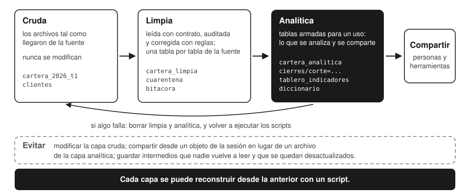
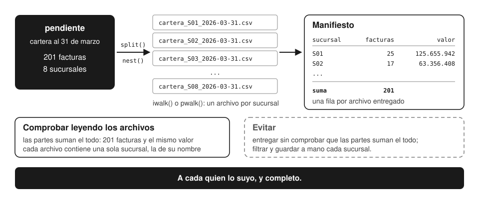

# Guardar y compartir los datos {#sec-guardar-compartir}

Ya leímos los datos con un contrato, los auditamos, los limpiamos y aprendimos a transformarlos a escala. ¿Y ahora qué?

Desde aquí se abren varios caminos. Los datos pueden **viajar a otra persona o a otra herramienta**: el jefe de sucursal que necesita la cartera de sus clientes, el tablero de Power BI que se alimenta cada mes, el sistema contable que espera un CSV con un formato exacto. Hacer eso bien a gran escala es el oficio de un ingeniero de datos, que pide mucho más que este capítulo; aquí veremos lo que necesita un analista para entregar sin sorpresas. Los datos pueden servir para **explorar**: algo de eso hicimos en los capítulos anteriores para decidir cómo transformar, pero un análisis descriptivo y exploratorio completo es otra cosa. Pueden convertirse en **reportes y gráficos** para quien toma decisiones, o en la materia prima para **entrenar un modelo** de aprendizaje automático.

En este libro recorreremos casi todos esos caminos, en orden. En este capítulo guardamos los datos para nuestro propio proceso y los compartimos con quien los necesita. En los siguientes los exploramos y describimos, escribimos nuestras propias funciones y flujos, y al final automatizamos el trabajo y comunicamos los resultados. El aprendizaje automático queda fuera: merece su propio libro, y llegar a él con datos bien preparados es justamente lo que estos capítulos buscan.

Antes de escribir el primer archivo conviene hacerse una pregunta: **¿quién va a leer esto después?** La respuesta separa tres actividades que suelen mezclarse:

| Quién lee | Actividad | Lo que importa | Dónde está en el libro |
|---|---|---|---|
| Tu propio proceso: el paso siguiente, el mes próximo, tú dentro de un año | **Guardar** | Que el dato vuelva idéntico: tipos, claves, historia | Este capítulo, primera parte |
| Otra persona u otra herramienta que trabajará con los datos | **Compartir** | El formato que espera quien recibe, y que reciba solo lo suyo y completo | Este capítulo, segunda parte |
| Alguien que tomará una decisión con los resultados | **Comunicar** | Que el mensaje se entienda: formato, gráficos, conclusiones | Capítulo de reportes |

: Guardar, compartir y comunicar {#tbl-quien-lee}

El formato de los archivos ya lo discutimos en el @sec-importacion-fuentes, con la tabla comparativa de formatos y el experimento de CSV frente a Parquet. Este capítulo no lo repite: trata de **cómo organizar lo que se guarda** para que el trabajo no se repita ni se pierda, y de **cómo entregar** datos a otros sin errores silenciosos.

::: {.callout-tip}
## Antes de empezar

1. Abre la carpeta de materiales en Positron. Este capítulo parte de la cartera limpia del @sec-limpiar (`datos/cap08/`), de las sucursales del @sec-transformar (`datos/cap07/`) y de los clientes del @sec-tipos-calidad (`datos/cap06/`). Si no tienes esos archivos, genéralos con los scripts de esos capítulos.
2. Todo lo que el capítulo escribe queda en `datos/cap10/`. Puedes borrar esa carpeta cuando quieras: el capítulo la vuelve a crear.
3. Para Excel usamos [openxlsx2](https://janmarvin.github.io/openxlsx2/), que ya apareció en el @sec-importacion-fuentes. En Python, `pandas` escribe Excel con `openpyxl`, que instalaste en el entorno del libro.
:::

```{r}
#| label: paquetes-cap10
#| message: false
use("arrow", c("read_parquet", "write_parquet", "write_dataset", "open_dataset",
               "arrow_table"))
use("readr", c("read_csv", "write_csv", "write_excel_csv2", "read_delim", "locale", "cols",
               "col_character", "col_date", "col_integer"))
use("dplyr", c("select", "filter", "arrange", "desc", "mutate", "summarise", "count", "n",
               "left_join", "case_when", "group_by", "tibble", "collect", "pull"))
use("tidyr", c("nest", "pivot_wider"))
use("purrr", c("map", "map_int", "map_dbl", "map_chr", "map_lgl", "walk", "iwalk",
               "pwalk"))
use("openxlsx2", c("write_xlsx", "wb_load"))
use("DBI", c("dbConnect", "dbGetQuery", "dbExecute", "dbDisconnect",
             "dbWithTransaction"))
use("duckdb", c("duckdb", "duckdb_register", "duckdb_unregister"))

con <- dbConnect(duckdb())
dir.create("datos/cap10", showWarnings = FALSE)
```

## Las capas de un proyecto {#sec-capas}

En un proyecto de datos, los archivos no son todos iguales. Algunos son la fuente y no se tocan; otros son pasos intermedios; otros son el producto que se analiza o se entrega. Mezclarlos en una sola carpeta, con nombres como `cartera_final_v2_bueno.parquet`, es la forma más rápida de perder la pista de cuál es la verdad. La organización más extendida separa tres **capas** (@fig-capas):

- **Cruda.** Los datos tal como llegaron de la fuente. Es el primer principio del @sec-limpiar: no se modifican nunca. Si algo sale mal más adelante, siempre se puede volver a empezar desde aquí.
- **Limpia.** Los datos leídos con su contrato, auditados y corregidos con reglas: una tabla por cada tabla de la fuente, con tipos correctos y sin duplicados. Junto a ella viven la cuarentena y la bitácora.
- **Analítica.** Tablas armadas para una pregunta o un uso: la cartera con la sucursal y la región ya unidas, los cierres mensuales, el tablero de indicadores. Es lo que se analiza y lo que se comparte.

{#fig-capas fig-alt="Tres cajas de izquierda a derecha unidas por flechas. Cruda: los archivos tal como llegaron de la fuente; nunca se modifican. Limpia: leída con contrato, auditada y corregida con reglas; una tabla por tabla de la fuente, con la cuarentena y la bitácora al lado. Analítica: tablas armadas para un uso, como la cartera con su sucursal y región, los cierres mensuales o el tablero de indicadores. Desde la capa analítica sale una flecha hacia compartir: archivos para personas y herramientas. Con trazo discontinuo, Evitar: modificar la capa cruda, compartir desde un objeto de la sesión en lugar de un archivo de la capa analítica, y guardar intermedios que nadie vuelve a leer. Al pie: cada capa se puede reconstruir desde la anterior con un script."}

Cada capa se reconstruye desde la anterior con un script. Esa es la prueba de que la organización funciona: si borras la capa limpia y la analítica, y al ejecutar los scripts vuelven a aparecer idénticas, el proyecto es reproducible.

¿Y los pasos intermedios, como la cartera después de quitar duplicados pero antes de estandarizar ciudades? La regla práctica es **guardar un intermedio solo si es caro de recalcular o si otro proceso depende de él**. Cada archivo guardado es un archivo que alguien tiene que mantener al día, y un intermedio desactualizado es peor que uno que no existe: parece la verdad y no lo es.

### Ejemplo guiado 10.1: la tabla analítica de la cartera

Armamos la tabla analítica de la cartera: la cartera limpia del Ejemplo 8.7 con la sucursal y la región de cada factura. Después la guardamos y comprobamos lo que más importa al guardar: que al leerla de nuevo sea **idéntica** a la que escribimos.

::: {.panel-tabset}

### R

```{r}
#| label: analitica-armar
sucursales <- read_csv("datos/cap07/sucursales.csv", show_col_types = FALSE)

cartera <- read_parquet("datos/cap08/cartera_2026_t1_limpia.parquet") |>
  left_join(
    sucursales, 
    by = "ciudad", 
    relationship = "many-to-one"
  ) |>
  select(
    factura,
    nit, 
    sucursal, 
    ciudad,
    region,
    fecha_emision, 
    fecha_vencimiento,
    fecha_pago, 
    valor_factura,
    pagada,
    revisar
  )

nrow(cartera)
count(cartera, sin_sucursal = is.na(sucursal))
```

La unión conserva las 379 facturas y todas encontraron su sucursal: la estandarización de ciudades del @sec-limpiar es lo que permite unir por `ciudad` sin perder filas.

Ahora el viaje de ida y vuelta. Antes de guardar la versión definitiva, hacemos una prueba: escribimos la misma tabla en CSV y en Parquet, la leemos de nuevo y comparamos:

```{r}
#| label: analitica-ida-vuelta
write_csv(cartera, "datos/cap10/prueba_ida_vuelta.csv")
write_parquet(cartera, "datos/cap10/prueba_ida_vuelta.parquet")

desde_parquet <- read_parquet("datos/cap10/prueba_ida_vuelta.parquet")
desde_readr   <- read_csv("datos/cap10/prueba_ida_vuelta.csv", show_col_types = FALSE)
desde_base    <- read.csv("datos/cap10/prueba_ida_vuelta.csv")

all.equal(cartera, desde_parquet)

tibble(
  columna  = names(cartera),
  original = map_chr(cartera, \(x) class(x)[1]),
  readr    = map_chr(desde_readr, \(x) class(x)[1]),
  base     = map_chr(desde_base, \(x) class(x)[1])
) |>
  filter(original != readr | original != base)

head(desde_base$nit, 3)
```

`all.equal()` compara dos objetos y devuelve `TRUE` si son iguales o una descripción de las diferencias. El Parquet vuelve idéntico. Con el CSV, el resultado **depende de quién lo lea**. `read_csv()` adivinó bien esta vez: como todos los NIT empiezan por cero, los dejó como texto, y reconoció las fechas. `read.csv()` de R base, con el mismo archivo, convierte el NIT en número y pierde su cero inicial, y deja las fechas como texto. Ninguna de las dos lecturas es un error: el CSV no guarda los tipos, y cada lector los adivina a su manera. Con un contrato al leer se puede reparar, como en el @sec-importacion, pero para **guardar** datos que nuestro propio proceso volverá a leer no hay razón para correr ese riesgo: el CSV queda para compartir, cuando quien recibe lo pide.

Un archivo guardado también debería explicarse solo. Parquet admite **metadatos**: pares de nombre y valor que viajan dentro del archivo. Los usamos para registrar de dónde salió la tabla y a qué fecha de corte corresponde. Y al lado guardamos un **diccionario de datos**, una tabla que describe cada columna:

```{r}
#| label: analitica-metadatos
tabla <- arrow_table(cartera)
tabla$metadata$fuente <- "datos/cap08/cartera_2026_t1_limpia.parquet"
tabla$metadata$corte  <- "2026-03-31"
tabla$metadata$script <- "10-guardar-y-compartir-datos.qmd"
write_parquet(tabla, "datos/cap10/cartera_analitica.parquet")

metadatos <- read_parquet("datos/cap10/cartera_analitica.parquet", as_data_frame = FALSE)$metadata
unlist(metadatos[c("fuente", "corte", "script")])

diccionario <- tibble(
  columna     = names(cartera),
  tipo        = map_chr(cartera, \(x) class(x)[1]),
  faltantes   = map_int(cartera, \(x) sum(is.na(x))),
  descripcion = c(
    "Número de la factura; clave de la tabla",
    "NIT del cliente, texto de 10 dígitos con ceros iniciales",
    "Código de la sucursal (S01 a S08)",
    "Ciudad de la sucursal, estandarizada en el capítulo 8",
    "Región de la sucursal",
    "Fecha de emisión", "Fecha de vencimiento",
    "Fecha de pago; vacía si la factura no se ha pagado",
    "Valor de la factura en pesos",
    "TRUE si la factura está pagada",
    "TRUE si un valor atípico se aceptó pero debe revisarse"
  )
)
write_csv(diccionario, "datos/cap10/cartera_analitica_diccionario.csv")
head(diccionario, 4)
```

`arrow_table()` convierte la tabla de R en una tabla de Arrow, que tiene un campo `metadata` donde se pueden agregar valores. El diccionario combina lo que se puede calcular (tipo y faltantes, con `map_chr()` y `map_int()` sobre las columnas, como en el @sec-escala) con lo que solo sabe quien hizo el trabajo: qué significa cada columna.

::: {.callout-warning}
## En Windows: el archivo que acabas de leer está ocupado

`read_parquet()` no copia el archivo a la memoria de una vez: lo **mapea**, es decir, lo deja abierto y lee las partes a medida que se necesitan. En Windows, un archivo mapeado no se puede sobrescribir. Si en la misma sesión lees un Parquet y después intentas escribir sobre él, obtendrás un error como `Failed to open local file ... sección asignada a usuario abierta`. Por eso la prueba de ida y vuelta usó archivos de prueba distintos del definitivo. Si te ocurre, borra los objetos que leíste del archivo (`rm()`), ejecuta `gc()` o reinicia la sesión de R. En macOS y Linux este error no aparece.
:::

### Python

```python
import pandas as pd
import pyarrow as pa
import pyarrow.parquet as pq

sucursales = pd.read_csv("datos/cap07/sucursales.csv")
cartera = (pd.read_parquet("datos/cap08/cartera_2026_t1_limpia.parquet")
           .merge(sucursales, on="ciudad", how="left", validate="m:1")
           [["factura", "nit", "sucursal", "ciudad", "region", "fecha_emision",
             "fecha_vencimiento", "fecha_pago", "valor_factura", "pagada", "revisar"]])

cartera.to_csv("datos/cap10/cartera_analitica_py.csv", index=False)
cartera.to_parquet("datos/cap10/cartera_analitica_py.parquet", index=False)

desde_csv = pd.read_csv("datos/cap10/cartera_analitica_py.csv")
desde_parquet = pd.read_parquet("datos/cap10/cartera_analitica_py.parquet")

print(cartera.equals(desde_parquet))
tipos = pd.DataFrame({"original": cartera.dtypes, "csv": desde_csv.dtypes}).astype(str)
print(tipos[tipos["original"] != tipos["csv"]])
```

```text
True
                  original    csv
nit                    str  int64
fecha_emision       object    str
fecha_vencimiento   object    str
fecha_pago          object    str
```

En `pandas` el viaje por CSV es peor que en R: además del NIT, las tres fechas vuelven como texto, porque `read_csv()` no reconoce fechas si no se le pide. El Parquet vuelve idéntico (`equals()` da `True`). Las fechas aparecen como `object` porque `pandas` lee las columnas de tipo fecha de Parquet como objetos `date` de Python, como vimos en el @sec-tipos-calidad.

Los metadatos se escriben con `pyarrow`, la biblioteca sobre la que `pandas` lee y escribe Parquet:

```python
tabla = pa.Table.from_pandas(cartera, preserve_index=False)
tabla = tabla.replace_schema_metadata({
    **tabla.schema.metadata,
    b"fuente": b"datos/cap08/cartera_2026_t1_limpia.parquet",
    b"corte": b"2026-03-31",
})
pq.write_table(tabla, "datos/cap10/cartera_analitica_py.parquet")
print(pq.read_schema("datos/cap10/cartera_analitica_py.parquet").metadata[b"corte"])
```

```text
b'2026-03-31'
```

Los metadatos de Parquet se guardan como bytes, por eso las claves y los valores llevan el prefijo `b`. `**tabla.schema.metadata` conserva los metadatos que `pandas` ya había guardado (los tipos originales de cada columna) y agrega los nuevos.

### DuckDB

```{r}
#| label: duckdb-metadatos
dbExecute(con, r"(
  COPY (
    SELECT c.*, s.sucursal, s.region
    FROM 'datos/cap08/cartera_2026_t1_limpia.parquet' AS c
    LEFT JOIN 'datos/cap07/sucursales.csv' AS s USING (ciudad)
  ) TO 'datos/cap10/cartera_analitica_duckdb.parquet'
  (KV_METADATA {fuente: 'datos/cap08/cartera_2026_t1_limpia.parquet', corte: '2026-03-31'})
)")

dbGetQuery(con, r"(
  SELECT decode(key) AS clave, decode(value) AS valor
  FROM parquet_kv_metadata('datos/cap10/cartera_analitica_duckdb.parquet')
)")
```

`KV_METADATA` agrega los metadatos al escribir, y `parquet_kv_metadata()` los lee sin abrir los datos. `decode()` convierte los bytes en texto. `DESCRIBE SELECT * FROM 'archivo'` muestra los tipos de cada columna, el equivalente de comparar los tipos en R.

:::

## Escribir de forma repetible {#sec-escribir-repetible}

Hay una propiedad que separa un proceso confiable de uno frágil: **ejecutarlo dos veces debe dar el mismo resultado que ejecutarlo una vez**. Se llama **idempotencia**. Parece obvio hasta que se escribe una carga mensual. El cierre de marzo se carga, alguien detecta un error en la fuente, se corrige y se vuelve a cargar marzo. Si la carga **agrega** filas, marzo queda dos veces y todos los totales del trimestre se inflan sin ningún aviso.

Hay tres formas de escribir, y solo dos son repetibles:

| Forma | Qué hace | ¿Repetible? | Cuándo |
|---|---|---|---|
| Sobrescribir todo | Reemplaza el archivo completo | Sí | Tablas pequeñas que se recalculan completas |
| Agregar | Añade filas al final | **No** | Casi nunca para cargas; solo para registros que de verdad se acumulan, como una bitácora |
| Reemplazar una parte | Borra la partición o el periodo y lo escribe de nuevo | Sí | Cargas periódicas: un mes, un día, un lote |

: Formas de escribir {#tbl-formas-escribir}

### Ejemplo guiado 10.2: los cierres mensuales de la cartera

La cartera analítica es la foto de hoy. Para el seguimiento, el área de cartera necesita una **foto de cada cierre**: las facturas pendientes al último día de cada mes, con sus días de vencidas. La armamos para enero, febrero y marzo, y la guardamos de forma que volver a cargar un mes no duplique nada.

Una factura está pendiente en un corte si se emitió antes o en esa fecha y no se había pagado: no tiene fecha de pago, o la pagó después del corte.

::: {.panel-tabset}

### R

```{r}
#| label: cierres-foto
foto_cartera <- function(cartera, corte) {
  cartera |>
    filter(fecha_emision <= corte, is.na(fecha_pago) | fecha_pago > corte) |>
    mutate(corte        = corte,
           dias_vencida = as.integer(corte - fecha_vencimiento),
           edad = case_when(dias_vencida <= 0  ~ "al día",
                            dias_vencida <= 15 ~ "1 a 15",
                            dias_vencida <= 30 ~ "16 a 30",
                            .default = "más de 30")) |>
    select(corte, factura, nit, sucursal, valor_factura, fecha_vencimiento,
           dias_vencida, edad)
}

cortes <- as.Date(c("2026-01-31", "2026-02-28", "2026-03-31"))
fotos <- map(cortes, \(corte) foto_cartera(cartera, corte))
map_int(fotos, nrow)
```

Primero, la forma frágil: agregar cada mes al final de un CSV, y volver a correr marzo:

```{r}
#| label: cierres-agregar
ruta_mal <- "datos/cap10/cierres_agregados.csv"
if (file.exists(ruta_mal)) file.remove(ruta_mal)

walk(fotos, \(foto) write_csv(foto, ruta_mal, append = file.exists(ruta_mal)))
write_csv(fotos[[3]], ruta_mal, append = TRUE)    # se vuelve a cargar marzo

read_csv(ruta_mal, show_col_types = FALSE) |> count(corte)
```

Marzo quedó dos veces, y nada lo advierte. Ahora la forma repetible: un conjunto Parquet **particionado por corte**, como las particiones del @sec-importacion-fuentes, donde cada carga reemplaza solo la carpeta de su mes:

```{r}
#| label: cierres-particion
guardar_cierre <- function(foto, ruta = "datos/cap10/cierres") {
  write_dataset(foto, ruta, partitioning = "corte",
                existing_data_behavior = "delete_matching")
}

walk(fotos, guardar_cierre)
guardar_cierre(fotos[[3]])                         # se vuelve a cargar marzo

list.files("datos/cap10/cierres")
cierres <- open_dataset("datos/cap10/cierres") |> collect()
count(cierres, corte)
class(cierres$corte)
```

`existing_data_behavior = "delete_matching"` borra las carpetas de partición que la escritura va a llenar antes de escribirlas. Volver a cargar marzo reemplaza la carpeta `corte=2026-03-31` y deja enero y febrero intactos. Este bloque se puede ejecutar mil veces y el resultado es el mismo.

Fíjate en la última línea: `corte` volvió como texto, no como fecha. El valor de una columna de partición no se guarda dentro del archivo, sino en el **nombre de la carpeta**, y al leer, `arrow` no sabe que `2026-03-31` es una fecha. Hay que declararlo al leer, con un esquema de la partición, o convertirlo después con `as.Date()`. Es un recordatorio de que el contrato de lectura del @sec-importacion vale también para los datos propios.

### Python

```python
import pyarrow.dataset as ds

def foto_cartera(cartera, corte):
    corte = pd.Timestamp(corte).date()
    pendiente = (cartera["fecha_emision"] <= corte) & (
        cartera["fecha_pago"].isna() | (cartera["fecha_pago"] > corte))
    foto = cartera[pendiente].assign(corte=str(corte))
    foto["dias_vencida"] = [(corte - f).days for f in foto["fecha_vencimiento"]]
    foto["edad"] = pd.cut(foto["dias_vencida"], bins=[-10_000, 0, 15, 30, 10_000],
                          labels=["al día", "1 a 15", "16 a 30", "más de 30"]).astype(str)
    return foto[["corte", "factura", "nit", "sucursal", "valor_factura",
                 "fecha_vencimiento", "dias_vencida", "edad"]]

fotos = [foto_cartera(cartera, c) for c in ["2026-01-31", "2026-02-28", "2026-03-31"]]
print([len(f) for f in fotos])

def guardar_cierre(foto, ruta="datos/cap10/cierres_py"):
    ds.write_dataset(pa.Table.from_pandas(foto, preserve_index=False), ruta,
                     format="parquet", partitioning=["corte"],
                     partitioning_flavor="hive",
                     existing_data_behavior="delete_matching")

for foto in fotos:
    guardar_cierre(foto)
guardar_cierre(fotos[2])                           # se vuelve a cargar marzo

print(pd.read_parquet("datos/cap10/cierres_py")["corte"].value_counts().sort_index())
```

```text
[94, 141, 201]
corte
2026-01-31     94
2026-02-28    141
2026-03-31    201
Name: count, dtype: int64
```

Las fechas de la cartera son objetos `date` de Python (columnas `object`), así que la diferencia de días se calcula con una comprensión de listas sobre cada fecha. `partitioning_flavor="hive"` nombra las carpetas `corte=2026-01-31`, igual que `arrow` en R. Como en R, el valor de la partición vuelve como categoría de texto al leer.

### DuckDB

Con DuckDB, la alternativa a las carpetas es una **base de datos en un archivo**, con una tabla de cierres y una **clave primaria**: la combinación de columnas que identifica cada fila y que no se puede repetir. La clave primaria es la protección que el CSV no tiene:

```{r}
#| label: duckdb-almacen
almacen <- dbConnect(duckdb(), dbdir = "datos/cap10/almacen.duckdb")

dbExecute(almacen, r"(
  CREATE TABLE IF NOT EXISTS cierres (
    corte DATE, factura VARCHAR, nit VARCHAR, sucursal VARCHAR,
    valor_factura DOUBLE, fecha_vencimiento DATE, dias_vencida INTEGER, edad VARCHAR,
    PRIMARY KEY (corte, factura)
  )
)")

cargar_cierre <- function(con, foto) {
  duckdb_register(con, "foto", foto)
  on.exit(duckdb_unregister(con, "foto"))
  dbWithTransaction(con, {
    dbExecute(con, "DELETE FROM cierres WHERE corte IN (SELECT DISTINCT corte FROM foto)")
    dbExecute(con, "INSERT INTO cierres BY NAME SELECT * FROM foto")
  })
}

walk(fotos, \(foto) cargar_cierre(almacen, foto))
cargar_cierre(almacen, fotos[[3]])                 # se vuelve a cargar marzo

dbGetQuery(almacen, "SELECT corte, count(*) AS facturas FROM cierres GROUP BY ALL ORDER BY corte")
```

`cargar_cierre()` hace lo mismo que `delete_matching`: borra el corte que va a cargar y lo inserta de nuevo. Las dos sentencias van dentro de una **transacción** (`dbWithTransaction()`): o se ejecutan las dos, o ninguna. Si la inserción falla, el borrado se deshace y el mes anterior queda como estaba. `duckdb_register()` deja ver la tabla de R desde SQL sin copiarla, e `INSERT ... BY NAME` empareja las columnas por nombre y no por posición.

Si alguien intenta agregar marzo sin borrar antes, la clave primaria lo detiene:

```{r}
#| label: duckdb-clave-primaria
#| error: true
duckdb_register(almacen, "marzo", fotos[[3]])
dbExecute(almacen, "INSERT INTO cierres BY NAME SELECT * FROM marzo")
```

:::

## Guardar la historia {#sec-historia}

La cartera analítica responde preguntas sobre hoy. Los cierres responden preguntas sobre **cualquier fecha de corte**: ¿cuánto estaba vencido a más de 30 días al cierre de febrero? Si solo guardáramos la tabla de hoy, esa pregunta no tendría respuesta exacta: las facturas que estaban vencidas en febrero y se pagaron en marzo ya no aparecen como pendientes. Reconstruir el pasado desde la tabla de hoy funciona solo si la fuente guarda todas las fechas necesarias, como en nuestra cartera; muchas fuentes no lo hacen, y el saldo de ayer se pierde al actualizar el de hoy.

### Ejemplo guiado 10.3: la cartera por edades en cada cierre

::: {.panel-tabset}

### R

```{r}
#| label: historia-edades
open_dataset("datos/cap10/cierres") |>
  group_by(corte, edad) |>
  summarise(valor = sum(valor_factura), .groups = "drop") |>
  collect() |>
  mutate(valor = round(valor / 1e6, 1),
         edad  = factor(edad, levels = c("al día", "1 a 15", "16 a 30", "más de 30"))) |>
  arrange(edad) |>
  pivot_wider(names_from = edad, values_from = valor, values_fill = 0) |>
  arrange(corte)
```

`open_dataset()` lee las tres particiones como una sola tabla y el resumen se calcula antes de traer los datos a la memoria, con `collect()` al final, como en el Ejemplo 7.7. El `factor()` fija el orden de las edades para que las columnas salgan de la más reciente a la más vencida.

La tabla muestra algo que la foto de hoy no deja ver: cómo se fue deteriorando la cartera. Al cierre de enero todo estaba al día; en febrero aparecieron facturas vencidas, y al cierre de marzo había más de 260 millones de pesos con más de 30 días de vencidos.

```{r}
#| label: historia-perdida
vencidas_febrero <- cierres |>
  filter(corte == "2026-02-28", dias_vencida > 0) |>
  left_join(select(cartera, factura, fecha_pago), by = "factura")

c(vencidas_en_febrero = nrow(vencidas_febrero),
  pagadas_en_marzo    = sum(!is.na(vencidas_febrero$fecha_pago)))
```

De las facturas que estaban vencidas al cierre de febrero, una parte se pagó en marzo. En una tabla que se sobrescribe cada mes, a 31 de marzo esas facturas ya no aparecerían como pendientes, y no habría forma de saber que estuvieron vencidas ni cuánto tardaron en pagarse.

### Python

```python
historia = (pd.read_parquet("datos/cap10/cierres_py")
            .pivot_table(index="corte", columns="edad", values="valor_factura",
                         aggfunc="sum", fill_value=0, observed=True)
            .div(1e6).round(1))
print(historia[["al día", "1 a 15", "16 a 30", "más de 30"]])
```

```text
edad        al día  1 a 15  16 a 30  más de 30
corte                                         
2026-01-31   559.3     0.0      0.0        0.0
2026-02-28   479.8   218.2     69.4        0.0
2026-03-31   548.6   145.4    123.5      266.8
```

`pivot_table()` resume y pasa a ancho en un solo paso. `observed=True` evita que aparezcan combinaciones vacías de las categorías, porque la columna de partición se lee como categoría.

### DuckDB

```{r}
#| label: duckdb-historia
dbGetQuery(almacen, r"(
  PIVOT (SELECT corte, edad, valor_factura FROM cierres)
  ON edad IN ('al día', '1 a 15', '16 a 30', 'más de 30')
  USING round(coalesce(sum(valor_factura), 0) / 1e6, 1)
  ORDER BY corte
)")
```

La tabla de cierres de la base es la misma historia, con la ventaja de que la consulta no tiene que recorrer carpetas: todo está en un archivo, `almacen.duckdb`, que también se puede abrir desde Python o desde la terminal de DuckDB.

:::

::: {.callout-note}
## Cuando lo que cambia es una dimensión

Los cierres guardan la historia de los **hechos**: facturas pendientes en cada fecha. A veces lo que cambia es una **dimensión**: un cliente se muda de ciudad, una sucursal cambia de región. Si la tabla de clientes se sobrescribe, las facturas viejas quedan asignadas a la ciudad nueva. La solución habitual es guardar cada versión del cliente con su fecha `vigente_desde`, y unir cada factura con la versión vigente en su fecha de emisión: la unión por fecha vigente del Ejemplo 9.3. En la jerga de los almacenes de datos esto se llama **dimensión lentamente cambiante** (*slowly changing dimension*).
:::

### ¿Carpetas Parquet o una base DuckDB?

Las dos opciones del Ejemplo 10.2 son buenas, y la elección depende de quién más va a leer los datos:

- **Carpetas Parquet.** Cualquier herramienta las lee: R, Python, DuckDB, Power BI, Spark. Son fáciles de copiar y de revisar en el explorador de archivos. No tienen claves ni transacciones: la protección contra duplicados es la disciplina de escribir con `delete_matching`.
- **Una base DuckDB.** Un solo archivo con varias tablas, claves primarias que impiden duplicados y transacciones que impiden cargas a medias. A cambio, la leen DuckDB y lo que se conecte a DuckDB, y un archivo abierto por un proceso no se puede escribir desde otro al mismo tiempo.

Una regla práctica: si los datos son solo para tu proceso, una base DuckDB da más garantías. Si otras herramientas los van a leer directamente, las carpetas Parquet llegan más lejos. Y no son excluyentes: DuckDB puede escribir sus tablas a Parquet con una sola sentencia `COPY`.

```{r}
#| label: cerrar-almacen
#| include: false
dbDisconnect(almacen)
```

## Lo que cambia al compartir {#sec-compartir}

Guardar es para nosotros; compartir es para alguien que no conoce nuestro proceso, que tiene sus propias herramientas y que confiará en lo que reciba. Eso trae tres reglas que no aparecían al guardar:

1. **El formato lo elige quien recibe.** Un jefe de sucursal abre archivos en Excel; un sistema contable espera un CSV con columnas, separador y formatos exactos; un tablero de Power BI lee Parquet. Es la tabla de escenarios del @sec-importacion-fuentes, vista desde el lado de quien escribe.
2. **A cada quien lo suyo, y completo.** Si el archivo de Cali lleva por error filas de Bogotá, no es solo un error: es una fuga de datos de clientes. Y si las partes no suman el total, alguien va a recibir menos de lo que debía.
3. **Se comparte desde la capa analítica.** Lo que sale del proyecto sale de un archivo guardado y reproducible, no de un objeto que quedó en la sesión de R después de varias pruebas. Si mañana preguntan "¿de dónde salió este número?", hay una respuesta.

Para la segunda regla, el control es un **manifiesto**: una tabla pequeña con una fila por archivo entregado, que dice cuántas filas y qué total lleva cada uno. Sirve a quien recibe, que puede comprobar que le llegó lo completo, y a quien entrega, que tiene registro de lo que envió y puede verificar que las partes suman el todo (@fig-repartir).

{#fig-repartir fig-alt="A la izquierda, la cartera pendiente al 31 de marzo, 201 facturas de ocho sucursales. Se reparte por sucursal en ocho archivos, uno por sucursal, cada uno con sus facturas. Debajo, el manifiesto: una fila por archivo con su nombre, el número de facturas y el valor total. Dos comprobaciones: la suma de las facturas del manifiesto es igual a 201, y cada archivo contiene una sola sucursal. Con trazo discontinuo, Evitar: entregar archivos sin comprobar que las partes suman el todo, o filtrar a mano cada sucursal. Al pie: a cada quien lo suyo, y completo."}

## Un archivo por grupo {#sec-archivo-por-grupo}

El caso más frecuente de compartir es repartir: un archivo por sucursal, por vendedor, por región. Hay varias formas de hacerlo, y conviene conocerlas porque sirven para cosas distintas:

| Forma | R | Python | DuckDB | Cuándo |
|---|---|---|---|---|
| Partir y recorrer | `split()` + `iwalk()` | `for` sobre `groupby()` | No aplica | La forma directa; el nombre del grupo arma la ruta |
| Tabla de envíos | `nest()` + `pwalk()` | `for` sobre una tabla de envíos | No aplica | Cuando cada archivo tiene más datos: ruta, responsable, totales |
| Partición | `write_dataset(partitioning = )` | `write_dataset(partitioning = )` | `COPY ... (PARTITION_BY)` | Para herramientas: carpetas `columna=valor` |

: Formas de escribir un archivo por grupo {#tbl-archivo-por-grupo}

### Ejemplo guiado 10.4: la cartera pendiente de cada sucursal

Cada jefe de sucursal debe recibir las facturas pendientes de sus clientes al cierre de marzo, en un archivo que pueda abrir en Excel, con la razón social de cada cliente.

::: {.panel-tabset}

### R

```{r}
#| label: repartir-preparar
clientes <- read_parquet("datos/cap06/clientes.parquet") |> select(nit, razon_social)

pendiente <- fotos[[3]] |>
  left_join(clientes, by = "nit", relationship = "many-to-one") |>
  select(sucursal, factura, nit, razon_social, valor_factura, fecha_vencimiento,
         dias_vencida, edad) |>
  arrange(sucursal, desc(dias_vencida))

nrow(pendiente)
dir.create("datos/cap10/por_sucursal", showWarnings = FALSE)
```

**Primera forma: partir y recorrer.** `split()` parte la tabla en una lista con un elemento por sucursal, con el código de la sucursal como nombre. `iwalk()` recorre la lista y entrega a la función dos cosas: el elemento y su nombre. Es `walk()` con el índice (de ahí la `i`), y el nombre sirve para armar la ruta del archivo:

```{r}
#| label: repartir-split
partes <- split(pendiente, pendiente$sucursal)
names(partes)

iwalk(partes, \(tabla, sucursal) {
  write_excel_csv2(tabla, sprintf("datos/cap10/por_sucursal/cartera_%s_2026-03-31.csv",
                                  sucursal))
})
list.files("datos/cap10/por_sucursal")
```

`write_excel_csv2()` escribe un CSV pensado para el Excel en español: punto y coma como separador, coma decimal y una marca al inicio del archivo (el *BOM*) que le dice a Excel que el texto está en UTF-8. Sin esa marca, Excel muestra `Razón` en lugar de `Razón`. Es un CSV para personas; para un sistema, la marca suele estorbar, como veremos en el Ejemplo 10.6.

**Segunda forma: la tabla de envíos.** A veces cada archivo necesita más que un nombre: el responsable que lo recibe, la ruta, el número de filas y el total para el manifiesto. Una tabla con una fila por envío y una columna-lista con los datos, como en el @sec-columnas-lista, reúne todo en un solo lugar:

```{r}
#| label: repartir-envios
responsables <- tibble(
  sucursal    = sprintf("S%02d", 1:8),
  responsable = c("Laura Gómez", "Andrés Mejía", "Sofía Rincón", "Carlos Peña",
                  "Valentina Ruiz", "Jorge Castro", "Natalia Ortiz", "Felipe Díaz")
)

envios <- pendiente |>
  nest(.by = sucursal) |>
  left_join(responsables, by = "sucursal") |>
  mutate(ruta     = sprintf("datos/cap10/por_sucursal/cartera_%s_2026-03-31.csv", sucursal),
         facturas = map_int(data, nrow),
         valor    = map_dbl(data, \(d) sum(d$valor_factura)))

pwalk(select(envios, sucursal, data, ruta), \(sucursal, data, ruta) {
  write_excel_csv2(mutate(data, sucursal = sucursal, .before = 1), ruta)
})

manifiesto <- select(envios, sucursal, responsable, ruta, facturas, valor)
write_csv(manifiesto, "datos/cap10/por_sucursal/manifiesto_2026-03-31.csv")
manifiesto |> mutate(ruta = basename(ruta))
```

`pwalk()` recorre varias columnas a la vez, fila por fila, y entrega cada una a la función con su nombre: por eso la función recibe `sucursal`, `data` y `ruta`, los nombres de las columnas. La tabla de envíos es, al mismo tiempo, el plan de lo que se va a escribir y el manifiesto de lo que se escribió.

Un detalle de `nest()`: la columna del grupo queda en la tabla de envíos y **sale de cada tabla anidada**. Por eso la función la vuelve a poner con `mutate(..., .before = 1)` antes de escribir. Sin ese paso, el jefe de sucursal recibiría un archivo sin la columna que dice de qué sucursal es.

Ahora las comprobaciones. Que las partes sumen el todo, y que cada archivo, leído de nuevo, tenga solo la sucursal que dice su nombre:

```{r}
#| label: repartir-controles
c(facturas = sum(manifiesto$facturas) == nrow(pendiente),
  valor    = sum(manifiesto$valor) == sum(pendiente$valor_factura))

leer_entrega <- \(ruta) read_delim(ruta, delim = ";", show_col_types = FALSE,
                                   locale = locale(decimal_mark = ","))

solo_su_sucursal <- map_lgl(seq_len(nrow(envios)), \(i) {
  leido <- leer_entrega(envios$ruta[i])
  identical(unique(leido$sucursal), envios$sucursal[i]) &&
    nrow(leido) == envios$facturas[i]
})
all(solo_su_sucursal)
```

Las comprobaciones leen los archivos escritos, no la tabla en memoria: lo que se verifica es lo que va a recibir cada persona. `read_delim()` con `locale(decimal_mark = ",")` lee el formato de `write_excel_csv2()` declarando el separador y la coma decimal, en lugar de dejar que se adivinen.

La comprobación de la sucursal usa `identical(unique(...), ...)` y no `all(leido$sucursal == ...)` por una razón que vale la pena recordar: si la columna no existe, `leido$sucursal` es `NULL`, la comparación da un vector vacío y `all()` de un vector vacío es `TRUE`. La comprobación pasaría sin comprobar nada. Así pasó en la primera versión de este ejemplo, antes de devolver la columna `sucursal` a cada archivo. **Una comprobación que no puede fallar no comprueba nada**: conviene probarla una vez con un caso que debería fallar.

**Tercera forma: la partición.** `write_dataset(pendiente, "...", partitioning = "sucursal", format = "csv")` escribe una carpeta por sucursal en una línea. Pero las carpetas se llaman `sucursal=S01`, los archivos `part-0.csv`, y la columna `sucursal` desaparece del contenido porque queda en el nombre de la carpeta. Es la forma correcta para otra herramienta y la incorrecta para una persona.

### Python

```python
from pathlib import Path

clientes = pd.read_parquet("datos/cap06/clientes.parquet")[["nit", "razon_social"]]
pendiente = (fotos[2]
             .merge(clientes, on="nit", how="left", validate="m:1")
             [["sucursal", "factura", "nit", "razon_social", "valor_factura",
               "fecha_vencimiento", "dias_vencida", "edad"]]
             .sort_values(["sucursal", "dias_vencida"], ascending=[True, False]))

carpeta = Path("datos/cap10/por_sucursal_py")
carpeta.mkdir(exist_ok=True)

manifiesto = []
for sucursal, tabla in pendiente.groupby("sucursal"):
    ruta = carpeta / f"cartera_{sucursal}_2026-03-31.csv"
    tabla.to_csv(ruta, index=False, sep=";", decimal=",", encoding="utf-8-sig")
    manifiesto.append({"sucursal": sucursal, "archivo": ruta.name,
                       "facturas": len(tabla), "valor": tabla["valor_factura"].sum()})

manifiesto = pd.DataFrame(manifiesto)
print(manifiesto.head(3).to_string(float_format="%.0f"))
print(manifiesto["facturas"].sum() == len(pendiente),
      manifiesto["valor"].sum() == pendiente["valor_factura"].sum())
```

```text
  sucursal                     archivo  facturas     valor
0      S01  cartera_S01_2026-03-31.csv        25 125655942
1      S02  cartera_S02_2026-03-31.csv        17  63356408
2      S03  cartera_S03_2026-03-31.csv        29 129715972
True True
```

En Python, el bucle sobre `groupby()` cumple las dos funciones: cada vuelta entrega el nombre del grupo y su tabla, y el manifiesto se arma en el mismo bucle con una lista de diccionarios. `encoding="utf-8-sig"` agrega la marca para Excel, y `sep=";"` con `decimal=","` dan el formato del Excel en español, como `write_excel_csv2()`.

### DuckDB

```{r}
#| label: duckdb-particion
duckdb_register(con, "pendiente", pendiente)

dbExecute(con, r"(
  COPY pendiente TO 'datos/cap10/por_sucursal_duckdb'
  (FORMAT csv, HEADER, DELIMITER ';', PARTITION_BY (sucursal), OVERWRITE_OR_IGNORE)
)")
list.files("datos/cap10/por_sucursal_duckdb", recursive = TRUE) |> head(3)

dbGetQuery(con, r"(
  SELECT sucursal, count(*) AS facturas, sum(valor_factura) AS valor
  FROM read_csv('datos/cap10/por_sucursal_duckdb/*/*.csv', hive_partitioning = true)
  GROUP BY ALL
  ORDER BY sucursal
  LIMIT 3
)")
```

`PARTITION_BY` reparte la tabla en una carpeta por sucursal en una sola sentencia, y `OVERWRITE_OR_IGNORE` permite escribir sobre una carpeta que ya existe. La consulta siguiente es el manifiesto: lee todos los archivos con `hive_partitioning`, que recupera la sucursal desde el nombre de cada carpeta. Como con `write_dataset()`, es una entrega para herramientas, no para personas.

:::

## Un libro de Excel con varias hojas {#sec-excel-hojas}

A veces quien recibe prefiere un solo archivo: el gerente regional quiere la cartera de todas sus sucursales, pero cada una en su hoja. `write_xlsx()` de `openxlsx2` recibe una lista con nombre y crea una hoja por elemento, con el nombre como nombre de la hoja. Es exactamente lo que devuelve `split()`.

Aquí el libro de Excel solo transporta datos: una tabla por hoja, sin formatos. Darle formato (anchos de columna, colores, totales, notas) para presentar resultados es parte del capítulo de reportes.

### Ejemplo guiado 10.5: la cartera pendiente en un libro, una hoja por sucursal

::: {.panel-tabset}

### R

```{r}
#| label: excel-hojas
resumen <- manifiesto |> select(sucursal, responsable, facturas, valor)
hojas <- c(list(resumen = resumen), partes)

ruta_libro <- "datos/cap10/cartera_pendiente_2026-03-31.xlsx"
write_xlsx(hojas, ruta_libro)

wb_load(ruta_libro)$get_sheet_names()
```

`c(list(resumen = resumen), partes)` pone la hoja de resumen al principio y después una hoja por sucursal. `wb_load()` abre el libro escrito y `get_sheet_names()` lista sus hojas, para comprobar el resultado leyendo el archivo y no la lista en memoria.

Excel impone límites que conviene recordar al nombrar las hojas desde los datos: el nombre de una hoja tiene como máximo 31 caracteres y no admite `\ / ? * [ ] :`, y una hoja tiene como máximo 1.048.576 filas. Un nombre de vendedor largo, o una región llamada `Norte/Sur`, rompe la escritura; y si una sucursal tiene más filas que el límite, Excel no es el formato adecuado.

### Python

```python
resumen = manifiesto[["sucursal", "facturas", "valor"]]

with pd.ExcelWriter("datos/cap10/cartera_pendiente_py_2026-03-31.xlsx") as libro:
    resumen.to_excel(libro, sheet_name="resumen", index=False)
    for sucursal, tabla in pendiente.groupby("sucursal"):
        tabla.to_excel(libro, sheet_name=sucursal, index=False)

print(pd.ExcelFile("datos/cap10/cartera_pendiente_py_2026-03-31.xlsx").sheet_names)
```

```text
['resumen', 'S01', 'S02', 'S03', 'S04', 'S05', 'S06', 'S07', 'S08']
```

`pd.ExcelWriter` abre el libro y cada `to_excel()` agrega una hoja. El bloque `with` cierra y guarda el archivo al terminar. `pandas` usa `openpyxl` por debajo; para escribir libros con mucho formato, `XlsxWriter` es la alternativa más completa en Python.

### DuckDB

La extensión `excel` de DuckDB escribe archivos `.xlsx`, pero **una sola hoja por archivo**: escribir una segunda hoja en el mismo archivo lo reemplaza. Sirve para entregar una tabla, no un libro:

```{r}
#| label: duckdb-excel
#| output: false
dbExecute(con, "INSTALL excel")
dbExecute(con, "LOAD excel")
dbExecute(con, r"(
  COPY (SELECT * FROM pendiente WHERE sucursal = 'S01')
  TO 'datos/cap10/cartera_S01_duckdb.xlsx' (FORMAT xlsx, HEADER true, SHEET 'S01')
)")
```

Para un libro con varias hojas, el patrón híbrido del libro: DuckDB prepara las tablas y R o Python escriben el libro.

:::

## Para otras herramientas {#sec-otras-herramientas}

Cuando quien recibe es un programa, las reglas cambian de tono. Una persona tolera un separador distinto o una fecha en otro formato; un sistema, no. El archivo tiene que cumplir un **contrato de escritura**, el espejo del contrato de lectura del @sec-importacion: columnas en un orden fijo, separador, codificación, formato de fechas y de números.

### Ejemplo guiado 10.6: un CSV con contrato para el sistema contable

El sistema contable recibe cada mes la cartera pendiente para provisionar las facturas vencidas. Su especificación dice: columnas `factura`, `nit`, `fecha_vencimiento`, `valor` y `dias_vencida`, en ese orden; separador coma; codificación UTF-8 **sin** marca de Excel; fechas `AAAA-MM-DD`; valores en pesos enteros, sin decimales ni separador de miles; el NIT con sus 10 dígitos.

::: {.panel-tabset}

### R

```{r}
#| label: contrato-escribir
contable <- pendiente |>
  mutate(valor = as.integer(round(valor_factura))) |>
  select(factura, nit, fecha_vencimiento, valor, dias_vencida)

ruta_contable <- "datos/cap10/cartera_contable_2026-03-31.csv"
write_csv(contable, ruta_contable, na = "")
readLines(ruta_contable, n = 3)
```

`write_csv()` cumple casi todo el contrato por defecto: coma, UTF-8 sin marca, fechas ISO y punto decimal. Lo que hay que resolver de forma explícita es el valor: `valor_factura` tiene centavos (la primera factura de la lista vale 8.560.042,83 pesos) y el sistema pide pesos enteros. `as.integer(round())` redondea al peso más cercano. Cómo redondear no es una decisión técnica sino parte del contrato: si el sistema espera truncar los centavos, el total de la provisión cambia, y eso se acuerda con quien recibe el archivo, no se adivina. `na = ""` escribe los faltantes como celdas vacías en lugar de `NA`, que un sistema podría leer como texto.

El contrato se comprueba como se comprobó al guardar: leyendo el archivo **con el contrato** y comparando con lo que se quiso escribir:

```{r}
#| label: contrato-validar
leido <- read_csv(ruta_contable, col_types = cols(
  factura           = col_character(),
  nit               = col_character(),
  fecha_vencimiento = col_date("%Y-%m-%d"),
  valor             = col_integer(),
  dias_vencida      = col_integer()
))
all.equal(contable, leido, check.attributes = FALSE)
names(leido)
```

`check.attributes = FALSE` ignora los atributos que `read_csv()` agrega a la tabla (la especificación de columnas) y compara solo los datos.

### Python

```python
contable = pendiente.assign(valor=lambda d: d["valor_factura"].round().astype("int64"))[
    ["factura", "nit", "fecha_vencimiento", "valor", "dias_vencida"]]
contable.to_csv("datos/cap10/cartera_contable_py_2026-03-31.csv", index=False)

print(pendiente["valor_factura"].head(1).to_csv(index=False))
with open("datos/cap10/cartera_contable_py_2026-03-31.csv", encoding="utf-8") as f:
    print(f.readline() + f.readline())
```

```text
valor_factura
8560042.83

factura,nit,fecha_vencimiento,valor,dias_vencida
FV-20009,0686665203,2026-02-04,8560043,55
```

La primera salida muestra lo que escribiría `pandas` sin la conversión: el valor con sus centavos, `8560042.83`, que un sistema que espera pesos enteros rechazaría. Y aunque una columna decimal no tenga centavos, `pandas` la escribe con `.0` al final (`3818152.0`), con el mismo resultado. Redondear y convertir a entero con `round().astype("int64")` antes de escribir resuelve los dos casos. Las fechas, que son objetos `date`, se escriben en formato ISO.

### DuckDB

```{r}
#| label: duckdb-contrato
dbExecute(con, r"(
  COPY (
    SELECT factura, nit, fecha_vencimiento,
           CAST(round(valor_factura) AS BIGINT) AS valor, dias_vencida
    FROM pendiente
  ) TO 'datos/cap10/cartera_contable_duckdb_2026-03-31.csv'
  (HEADER, DELIMITER ',', DATEFORMAT '%Y-%m-%d')
)")
readLines("datos/cap10/cartera_contable_duckdb_2026-03-31.csv", n = 2)
```

DuckDB, como `pandas`, escribe los `DOUBLE` con `.0`; el `CAST` a `BIGINT` lo evita. `DATEFORMAT` fija el formato de las fechas de forma explícita, aunque coincida con el formato por defecto: en un contrato, lo explícito protege contra cambios de versión.

:::

::: {.callout-note}
## Datos para Power BI

En el @sec-importacion recomendamos dejar a Power BI el modelo y hacer en R o Python las transformaciones pesadas. Lo que se le entrega encaja con este capítulo: una carpeta Parquet por tabla, organizada como **modelo estrella**, con una tabla de **hechos** (los cierres de cartera: una fila por factura y corte, con los valores) y tablas de **dimensiones** (clientes, sucursales, calendario), unidas por claves. Power BI lee carpetas Parquet directamente, conserva los tipos y solo tiene que relacionar las tablas. Si cada carga mensual reemplaza su partición como en el Ejemplo 10.2, el tablero se actualiza sin duplicar meses.
:::

## Ejercicio 10.1: las ventas del trimestre para cada región {#sec-ejercicio-regiones}

Con `datos/cap07/ventas_2026_t1.parquet` y `datos/cap07/sucursales.csv`:

1. Agrega a las ventas el valor neto, el mes y la región de cada sucursal. Guarda el resultado como un conjunto Parquet particionado por mes, de forma que volver a ejecutar tu código no duplique filas. Comprueba que al leerlo hay 6.000 ventas.
2. Agrega a uno de los archivos los metadatos `fuente` y `corte`, y léelos de vuelta.
3. Cada gerente regional quiere un libro de Excel con sus ventas: un libro por región y, dentro de cada libro, una hoja por sucursal. Usa `split()` dos veces: una para las regiones y otra, dentro de cada región, para las sucursales.
4. Arma el manifiesto con una fila por libro y hoja: región, sucursal, ventas y valor neto. Comprueba que suma las 6.000 ventas y el valor neto total del trimestre.
5. ¿Por qué no conviene particionar el conjunto del punto 1 por NIT?

::: {.panel-tabset}

### R

```{r}
#| label: ejercicio-10-1
#| eval: false
ventas <- read_parquet("datos/cap07/ventas_2026_t1.parquet") |>
  mutate(...) |>                                            # TODO
  left_join(...)                                            # TODO

write_dataset(ventas, ..., partitioning = ..., existing_data_behavior = ...)  # TODO

por_region <- split(ventas, ventas$region)
iwalk(por_region, \(tabla, region) {
  hojas <- split(...)                                       # TODO
  write_xlsx(hojas, sprintf("datos/cap10/ventas_%s_2026_t1.xlsx", region))
})
```

### Python

```python
ventas = ...                                                # TODO
ds.write_dataset(..., partitioning=["mes"], partitioning_flavor="hive",
                 existing_data_behavior=...)                # TODO

for region, tabla_region in ventas.groupby("region"):
    with pd.ExcelWriter(f"datos/cap10/ventas_{region}_2026_t1.xlsx") as libro:
        for sucursal, tabla in ...:                         # TODO
            ...
```

:::

Para comprobar tu resultado: se escriben tres libros, `Andina` con 3 hojas (`S01`, `S02` y `S06`), `Caribe` con 3 (`S04`, `S05` y `S08`) y `Pacífico` con 2 (`S03` y `S07`). El valor neto total del trimestre es de 1.285,1 millones de pesos, y la región Andina reúne 2.487 de las 6.000 ventas.

## Cierre: la preparación completa {#sec-cierre-guardar}

Con este capítulo termina la tercera parte del libro. Los datos recorrieron todo el camino de la preparación: se leyeron con un contrato, se auditaron, se limpiaron con reglas y se transformaron. Ahora, además, quedan guardados en capas que se reconstruyen con un script, con cargas que se pueden repetir sin duplicar, con la historia de cada cierre y con metadatos y un diccionario que los explican.

Al compartir, la pregunta fue siempre la misma: ¿quién va a leer esto? Para una persona, un archivo que abra en Excel con solo lo suyo; para varias, una tabla de envíos que es también el manifiesto; para un sistema, un contrato de escritura que se comprueba leyendo el archivo como lo leerá quien lo recibe. Y en todos los casos, la comprobación de que las partes suman el todo.

En la siguiente parte cambiamos de pregunta. Ya no es cómo preparar los datos, sino qué dicen: el próximo capítulo empieza el análisis con la estadística descriptiva, la exploración y los gráficos.

```{r}
#| label: cerrar-conexion-cap10
#| include: false
dbDisconnect(con)
```
