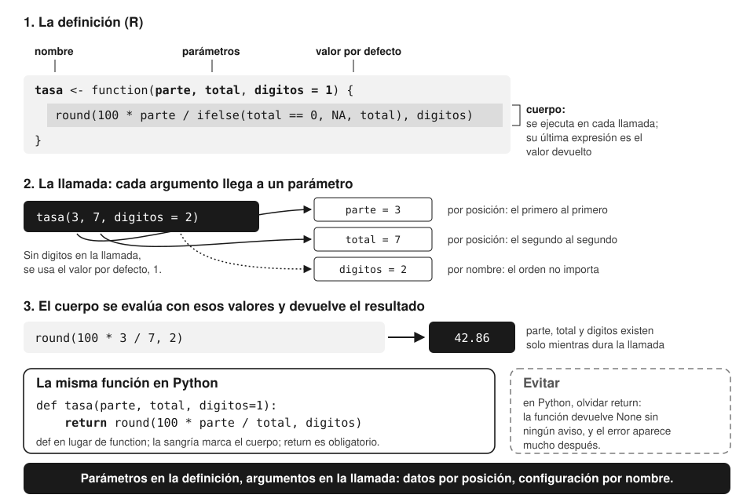
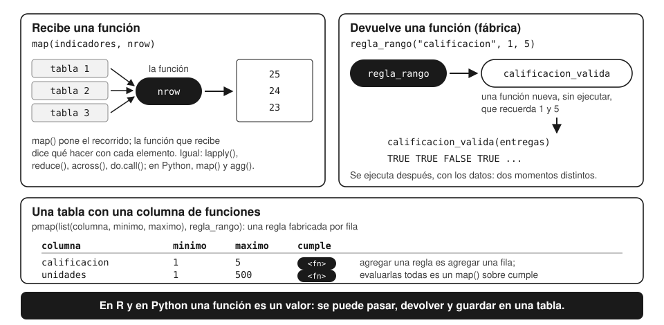
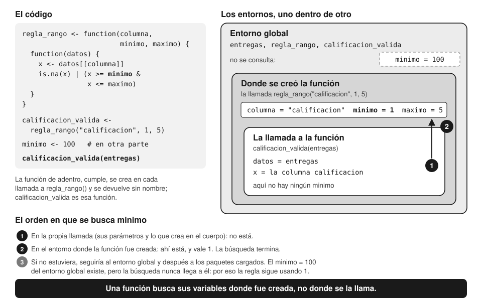

# Funciones propias {#sec-funciones}

En el @sec-tipos-calidad escribimos las reglas de calidad de la cartera, y en el @sec-limpiar las guardamos en `scripts/auditoria_cartera.R` para reutilizarlas. Una de ellas dice:

```r
"emision_en_periodo", "Validez", "bloquea", \(d) d$fecha_emision >= inicio &
                                              d$fecha_emision <= corte,
```

La regla es una función que recibe un solo argumento, `d`, la tabla. Pero usa otras dos cosas, `inicio` y `corte`, que nadie le pasa. Y funciona. ¿De dónde las saca?

Responder esa pregunta es uno de los objetivos de este capítulo. El otro es mostrar algo que tal vez no notaste: **llevamos todo el libro escribiendo funciones**. No como tema, sino como herramienta, cada vez que un problema se repetía:

| Capítulo | Función | Para qué |
|---|---|---|
| @sec-importacion | `leer_encabezado()`, `mapa_columnas()`, `leer_lote()` | Diagnosticar y leer muchos archivos con el mismo contrato |
| @sec-limpieza-temprana | `limpiar_nombres()`, `a_logico()` | Aplicar la misma limpieza a cualquier columna |
| @sec-tipos-calidad | Las reglas de calidad, `auditar()` | Escribir las reglas como datos y evaluarlas todas |
| @sec-transformar | `segundos()` | Medir el tiempo de cualquier expresión |
| @sec-limpiar | `clave()` | Normalizar textos para comparar categorías |
| @sec-escala | `unir()`, `tamano()`, `simular_inventario()`, `leer_conteo()` | Reducir, clasificar, simular y leer con validación |
| @sec-guardar-compartir | `foto_cartera()`, `guardar_cierre()`, `cargar_cierre()` | Repetir cada mes la misma carga, sin duplicar |
| @sec-explorar | `resumen_valor()` | Comparar medidas con y sin los valores extremos |

: Algunas de las funciones que escribimos en los capítulos anteriores {#tbl-funciones-libro}

Además, decenas de funciones anónimas, como `\(x) round(x / 1e6, 1)`, dentro de `across()`, `map()` y `summarise()`. Este capítulo no se sale del hilo del libro: le pone nombre a lo que ya veníamos haciendo, y se detiene en lo que pasamos por alto. Qué partes tiene una función, cómo recibe sus argumentos, cuándo conviene que no tenga nombre, qué significa que una función reciba o devuelva otra función, dónde busca sus variables, cómo debe fallar, cuándo vale la pena una clase y cómo organizar las funciones para que vivan fuera del script donde nacieron.

::: {.callout-tip}
## Antes de empezar

1. Abre la carpeta de materiales en Positron. Este capítulo usa las entregas del @sec-explorar (`datos/cap11/`) y las ventas del @sec-transformar (`datos/cap07/`).
2. Las funciones de inventario del @sec-escala están ahora en `scripts/inventario.R` y `scripts/inventario.py`; al final del capítulo veremos cómo cargarlas desde otro archivo.
3. No hay paquetes nuevos.
:::

```{r}
#| label: paquetes-cap12
#| message: false
use("arrow", "read_parquet")
use("dplyr", c("filter", "mutate", "summarise", "arrange", "n", "tibble", "pull"))
use("tidyr", "complete")
use("purrr", c("map", "map_dbl", "pmap", "pmap_dbl"))
use("DBI", c("dbConnect", "dbGetQuery", "dbExecute", "dbDisconnect"))
use("duckdb", "duckdb")

con <- dbConnect(duckdb())
entregas <- read_parquet("datos/cap11/entregas_2026_t1.parquet")
```

## Anatomía de una función {#sec-anatomia}

Una función es un bloque de código con nombre que recibe datos, hace algo con ellos y devuelve un resultado. Tiene cuatro partes (@fig-anatomia):

- **El nombre**, con el que se la llama. Un verbo o una descripción de lo que devuelve: `leer_conteo()`, `tasa()`.
- **Los parámetros**, los nombres con que la función conoce los datos que recibe. Pueden tener un **valor por defecto**, que se usa si quien llama no da otro.
- **El cuerpo**, el código que se ejecuta cada vez que se llama la función.
- **El valor devuelto**, el resultado. En R es la última expresión que se evalúa en el cuerpo, o lo que se pase a `return()`. En Python es siempre lo que se pase a `return`; sin él, la función devuelve `None`.

Al llamar la función, los valores concretos que se le pasan se llaman **argumentos**. Los parámetros son los nombres en la definición; los argumentos, los valores en la llamada.

{#fig-anatomia fig-alt="Arriba, la definición de la función tasa en R, con etiquetas que señalan el nombre, los parámetros, el valor por defecto y el cuerpo, cuya última expresión es el valor devuelto. En el medio, la llamada tasa(3, 7, digitos = 2): flechas llevan 3 a parte y 7 a total por posición, y 2 a digitos por nombre; sin digitos en la llamada se usaría el valor por defecto, 1. Abajo, el cuerpo se evalúa con esos valores, round(100 * 3 / 7, 2), y devuelve 42.86; los parámetros existen solo mientras dura la llamada. Al final, la misma función en Python, con def, sangría y return, y con trazo discontinuo, Evitar: sin return, Python devuelve None sin aviso."}

### Ejemplo guiado 12.1: una tasa que no divide por cero

Calculamos muchas tasas en el libro: proporción de faltantes, de devoluciones, de pedidos tardíos. Todas son "parte sobre total, por cien", y todas tienen el mismo riesgo: un grupo sin datos, donde el total es cero.

::: {.panel-tabset group="lenguaje"}

### R

```{r}
#| label: anatomia-tasa
tasa <- function(parte, total, digitos = 1) {
  if (total == 0) {
    return(NA_real_)
  }
  round(100 * parte / total, digitos)
}

tasa(3, 7)
tasa(3, 7, digitos = 3)
tasa(1, 0)
```

`function(parte, total, digitos = 1)` define los parámetros, y `digitos` tiene un valor por defecto. El cuerpo va entre llaves. Si el total es cero, `return()` termina la función en ese punto y devuelve un faltante; si no, la última expresión, `round(...)`, es el valor devuelto. `NA_real_` es un faltante de tipo numérico: así la función devuelve siempre un número, aunque sea faltante.

Pero `tasa()` tiene un problema: `if` solo entiende un valor a la vez, y dentro de `summarise()` los argumentos son vectores. Como vimos en el @sec-iterar, la solución es escribir la función con operaciones vectorizadas:

```{r}
#| label: anatomia-tasa-vectorizada
tasa <- function(parte, total, digitos = 1) {
  round(100 * parte / ifelse(total == 0, NA, total), digitos)
}

tasa(c(3, 1, 5), c(7, 0, 10))

entregas |>
  summarise(pedidos = n(), devueltos = sum(devuelto), .by = sucursal) |>
  mutate(pct_devuelto = tasa(devueltos, pedidos)) |>
  arrange(sucursal)
```

`ifelse()` reemplaza los totales en cero por `NA`, y una división entre `NA` da `NA`. Ahora la función recibe vectores y devuelve un vector del mismo largo, y funciona dentro de `mutate()`. Es una regla práctica para las funciones de análisis: **si puede recibir una columna, que funcione con columnas**.

### Python

```python
import numpy as np
import pandas as pd

def tasa(parte, total, digitos=1):
    """Porcentaje de parte sobre total; NaN si el total es cero."""
    total = np.where(np.asarray(total) == 0, np.nan, total)
    return np.round(100 * np.asarray(parte) / total, digitos)

print(tasa(3, 7), tasa(3, 7, digitos=3), tasa(1, 0))

entregas = pd.read_parquet("datos/cap11/entregas_2026_t1.parquet")
resumen = (entregas.groupby("sucursal", as_index=False)
           .agg(pedidos=("pedido", "size"), devueltos=("devuelto", "sum"))
           .assign(pct_devuelto=lambda d: tasa(d["devueltos"], d["pedidos"])))
print(resumen.head(3))
```

```text
42.9 42.857 nan
  sucursal  pedidos  devueltos  pct_devuelto
0      S01      394         14           3.6
1      S02      428         11           2.6
2      S03      355         17           4.8
```

`def` define la función y la sangría delimita el cuerpo. La primera línea del cuerpo, entre comillas triples, es la **cadena de documentación** (*docstring*): `help(tasa)` la muestra. `np.asarray()` convierte lo que llegue (un número, una lista o una columna) en un arreglo de NumPy, para que la misma función sirva con un valor o con muchos.

En Python, una función sin `return` no da error: devuelve `None`. Es uno de los errores más difíciles de ver, porque el código sigue y el `None` aparece mucho después:

```python
def tasa_sin_return(parte, total):
    round(100 * parte / total, 1)

print(tasa_sin_return(3, 7))
```

```text
None
```

### DuckDB

En SQL, el equivalente de una función es una **macro**: una expresión con nombre y parámetros que DuckDB reemplaza en la consulta antes de ejecutarla.

```{r}
#| label: duckdb-macro
dbExecute(con, r"(
  CREATE OR REPLACE MACRO tasa(parte, total, digitos := 1) AS
    CASE WHEN total = 0 THEN NULL ELSE round(100 * parte / total, digitos) END
)")

dbGetQuery(con, r"(
  SELECT sucursal, count(*) AS pedidos,
         tasa(count_if(devuelto), count(*)) AS pct_devuelto
  FROM 'datos/cap11/entregas_2026_t1.parquet'
  GROUP BY ALL
  ORDER BY sucursal
  LIMIT 3
)")
```

`digitos := 1` es el valor por defecto, con la sintaxis de DuckDB. Una macro vive en la conexión donde se creó; si la conexión es a un archivo, como el `almacen.duckdb` del @sec-guardar-compartir, queda guardada en él y cualquiera que lo abra puede usarla.

:::

## Argumentos: posición, nombre y el resto {#sec-argumentos}

Al llamar una función, cada argumento tiene que llegar a su parámetro. Hay dos formas de decir cuál va con cuál:

- **Por posición.** `tasa(3, 7)`: el primer argumento va al primer parámetro y el segundo al segundo.
- **Por nombre.** `tasa(total = 7, parte = 3)`: cada argumento dice a qué parámetro va, y el orden deja de importar.

La convención de casi todas las funciones bien diseñadas es que **los primeros parámetros, los datos, se pasan por posición, y los de configuración, por nombre**. `round(x, digits = 2)`, `mean(x, na.rm = TRUE)`, `read_csv(ruta, show_col_types = FALSE)`. Así la llamada se lee sola, y el *pipe* funciona, porque `|>` pasa el resultado anterior como primer argumento.

R tiene una regla adicional que conviene conocer para no caer en ella: la **coincidencia parcial de nombres**. Si un argumento con nombre no coincide exactamente con ningún parámetro, R busca un parámetro que *empiece* por ese nombre:

```{r}
#| label: argumentos-parcial
tasa(3, 7, dig = 3)
```

`dig` no es un parámetro de `tasa()`, pero R lo completó como `digitos`. Parece cómodo y es frágil: si mañana la función gana un parámetro `digitos_minimos`, `dig` se vuelve ambiguo y la llamada falla. Escribe siempre el nombre completo. Python no tiene coincidencia parcial: un nombre que no existe es un error.

### Cuándo se evalúa un argumento

En R, un argumento no se calcula cuando se llama la función, sino **la primera vez que el cuerpo lo usa**. A eso se le llama **evaluación perezosa** (*lazy evaluation*), y tiene consecuencias que se ven en código real:

```{r}
#| label: argumentos-perezosa
usa_solo_x <- function(x, y) x * 2
usa_solo_x(3, stop("este argumento nunca se evalúa"))

resumen_n <- function(x, n = length(x)) {
  x <- x[!is.na(x)]
  c(n = n, media = mean(x))
}
resumen_n(c(4, NA, 8))
```

En la primera función, `y` nunca se usa, así que el `stop()` nunca se ejecuta y no hay error. En la segunda, el valor por defecto `n = length(x)` depende de otro argumento, algo que Python no permite. Pero se evalúa cuando el cuerpo usa `n` por primera vez, y para ese momento `x` ya perdió su faltante: `n` vale 2 y no 3, aunque la llamada original tenía tres valores. La evaluación perezosa hace que el orden de las líneas del cuerpo cambie el resultado. Si un valor por defecto depende de otro argumento, conviene calcularlo al principio del cuerpo, antes de modificar nada.

En las fábricas de funciones, la evaluación perezosa explica una tercera trampa, que veremos en la @sec-alcance, y su remedio: `force(x)` al principio de la fábrica obliga a evaluar el argumento en ese momento.

Python evalúa todos los argumentos **antes** de entrar a la función, de izquierda a derecha. Y evalúa los valores por defecto **una sola vez**, al definir la función, lo que produce la trampa de los valores por defecto mutables que también veremos en la @sec-alcance.

### Un número variable de argumentos

A veces una función debe aceptar argumentos que no conoce de antemano, para pasarlos a otra. En R se escribe `...` (tres puntos); en Python, `*args` recoge los argumentos extra por posición en una tupla y `**kwargs`, los argumentos extra por nombre en un diccionario.

El caso típico es una función que envuelve a otra y quiere dejarle a quien llama la configuración de la función de adentro:

::: {.panel-tabset group="lenguaje"}

### R

```{r}
#| label: argumentos-puntos
resumen_robusto <- function(x, ..., digitos = 0) {
  c(mediana = median(x, ...),
    media   = mean(x, ...),
    mad     = mad(x, ...)) |>
    round(digitos)
}

resumen_robusto(entregas$valor_pedido)
resumen_robusto(entregas$valor_pedido, na.rm = TRUE)
```

Todo lo que se pase en `...` llega intacto a `median()`, `mean()` y `mad()`. La primera llamada devuelve faltantes, porque `valor_pedido` tiene 22; la segunda les pasa `na.rm = TRUE` a las tres funciones sin que `resumen_robusto()` tenga que declararlo. Por eso `digitos` va **después** de `...`: un parámetro que va después de los puntos solo se puede pasar por nombre, y así no hay riesgo de que un argumento por posición caiga en él por accidente.

La otra cara del problema es tener los argumentos en una lista y querer pasárselos a una función. `do.call()` llama a una función con los elementos de una lista como argumentos:

```{r}
#| label: argumentos-docall
argumentos <- list(3, 7, digitos = 2)
do.call(tasa, argumentos)

politica <- list(reorden = 80, lote = 150)
with(politica, reorden < lote)
```

`do.call(tasa, list(3, 7, digitos = 2))` es lo mismo que `tasa(3, 7, digitos = 2)`, pero la lista se puede construir en el programa, guardar en un archivo o recorrer con `map()`. `with()` hace algo distinto y complementario: evalúa una expresión usando los elementos de la lista como si fueran variables. Lo veremos en acción en el Ejemplo 12.2.

### Python

```python
def resumen_robusto(x, *, digitos=0, **kwargs):
    x = pd.Series(x)
    return pd.Series({"mediana": x.median(**kwargs),
                      "media": x.mean(**kwargs)}).round(digitos)

print(resumen_robusto(entregas["valor_pedido"]).tolist())
print(resumen_robusto(entregas["valor_pedido"], skipna=False).tolist())

argumentos = [3, 7]
opciones = {"digitos": 2}
print(tasa(*argumentos, **opciones))

def tasa_estricta(parte, total, /, digitos=1, *, redondear=True):
    valor = 100 * parte / total
    return round(valor, digitos) if redondear else valor

try:
    tasa_estricta(parte=3, total=7)
except TypeError as e:
    print("TypeError:", e)
```

```text
[175900.0, 276584.0]
[nan, nan]
42.86
TypeError: tasa_estricta() got some positional-only arguments passed as keyword arguments: 'parte, total'
```

`**kwargs` recoge los argumentos por nombre que la función no declara y los pasa a `median()` y `mean()`. A diferencia de R, en `pandas` estas funciones ignoran los faltantes por defecto (`skipna=True`), así que el caso se invierte: la primera llamada da números y la segunda, con `skipna=False`, da faltantes. Al llamar una función, `*` y `**` hacen lo contrario que al definirla: `tasa(*argumentos, **opciones)` **desempaca** una lista en argumentos por posición y un diccionario en argumentos por nombre. Es el `do.call()` de Python.

En la definición de `tasa_estricta()`, la `/` y el `*` marcan reglas: los parámetros antes de `/` solo se pueden pasar **por posición**, y los que van después de `*` solo **por nombre**. Así una función puede obligar a escribir `redondear=False` en lugar de un `False` suelto que nadie sabría leer. En `resumen_robusto()`, el `*` solo, sin nombre, hace que `digitos` sea un parámetro solo por nombre, igual que ponerlo después de `...` en R.

### DuckDB

Las macros de DuckDB aceptan parámetros por posición y, los que tienen valor por defecto, por nombre con `:=`. No tienen un equivalente de `...` ni de `do.call()`: el SQL se escribe con los argumentos explícitos, y cuando hay que variarlos, se arma la consulta desde R o Python.

:::

### Ejemplo guiado 12.2: comparar políticas de inventario

En el @sec-escala, el ejercicio pedía probar varios puntos de reorden con `map_dbl()`. Ahora queremos comparar políticas que cambian en varios parámetros a la vez. Guardamos cada política como una fila de una tabla y llamamos a la función con los argumentos de cada fila.

::: {.panel-tabset group="lenguaje"}

### R

```{r}
#| label: politicas-demanda
source("scripts/inventario.R")

ventas <- read_parquet("datos/cap07/ventas_2026_t1.parquet")
demanda_s01 <- ventas |>
  filter(producto == "P05", sucursal == "S01") |>
  summarise(unidades = sum(unidades), .by = fecha) |>
  complete(fecha = sort(unique(ventas$fecha)), fill = list(unidades = 0)) |>
  arrange(fecha) |>
  pull(unidades)
length(demanda_s01)
```

`source()` carga las funciones de `scripts/inventario.R`, entre ellas `simular_inventario()`, la misma del Ejemplo 9.7. La demanda diaria de `P05` en `S01` se completa con los días sin ventas, como en el Ejemplo 9.4.

```{r}
#| label: politicas-comparar
politicas <- tibble(
  nombre  = c("actual", "reorden alto", "lote grande", "las dos"),
  reorden = c(50, 80, 50, 80),
  lote    = c(100, 100, 150, 150)
)

politicas |>
  mutate(perdidas = pmap_dbl(list(reorden = reorden, lote = lote), \(...) {
    sum(simular_inventario(demanda_s01, ...)$perdidas)
  }))
```

`pmap_dbl()` recorre las columnas de la lista fila por fila y le pasa cada valor a la función **por nombre**: `reorden` y `lote`. La función anónima los recibe en `...` y se los pasa, intactos, a `simular_inventario()`. Si mañana la tabla de políticas gana una columna `espera`, basta agregarla a la lista: ni la función anónima ni `simular_inventario()` cambian.

### Python

```python
from scripts.inventario import simular_inventario

ventas = pd.read_parquet("datos/cap07/ventas_2026_t1.parquet")
dias = sorted(ventas["fecha"].unique())
demanda_s01 = (ventas[(ventas["producto"] == "P05") & (ventas["sucursal"] == "S01")]
               .groupby("fecha")["unidades"].sum()
               .reindex(dias, fill_value=0).to_list())

politicas = [
    {"nombre": "actual", "reorden": 50, "lote": 100},
    {"nombre": "reorden alto", "reorden": 80, "lote": 100},
    {"nombre": "lote grande", "reorden": 50, "lote": 150},
    {"nombre": "las dos", "reorden": 80, "lote": 150},
]
for p in politicas:
    parametros = {k: v for k, v in p.items() if k != "nombre"}
    perdidas = simular_inventario(demanda_s01, **parametros)["perdidas"].sum()
    print(f"{p['nombre']:<13} {perdidas}")
```

```text
actual        190
reorden alto  15
lote grande   101
las dos       65
```

`**parametros` desempaca el diccionario de cada política en argumentos por nombre. La comprensión de diccionarios quita la clave `nombre`, que no es un parámetro de la función.

### DuckDB

La simulación es un bucle con estado, y en el @sec-escala vimos que SQL no es la herramienta para eso. DuckDB no tiene pestaña en este ejemplo.

:::

## Funciones anónimas {#sec-anonimas}

Una función anónima es una función sin nombre, que se escribe donde se usa. Las hemos usado en todo el libro, sobre todo como argumento de otras funciones:

| Forma | Lenguaje | Ejemplo | Comentario |
|---|---|---|---|
| `\(x) ...` | R 4.1 o superior | `\(x) round(x / 1e6, 1)` | La forma corta, la que usamos en el libro |
| `function(x) ...` | R | `function(x) round(x / 1e6, 1)` | La forma larga; necesaria antes de R 4.1 |
| `~ .x` | `purrr` | `~ round(.x / 1e6, 1)` | La forma antigua de `purrr`; la verás en código anterior a 2021 |
| `lambda x: ...` | Python | `lambda x: round(x / 1e6, 1)` | Solo admite una expresión, sin varias líneas |
| `lambda x: ...` | DuckDB 2.0 | `list_transform(l, lambda x: x * 2)` | Dentro de funciones de listas |

: Las formas de escribir una función anónima {#tbl-anonimas}

¿Cuándo una función merece un nombre? Una regla práctica: **si la usas más de una vez, o si no cabe en una línea, ponle nombre**. Un nombre documenta lo que hace la función, permite probarla por separado y evita copiarla. La función anónima es para el caso puntual, donde el nombre estorbaría más de lo que ayuda.

### Llamar una función en el momento

Una función anónima también se puede definir y llamar en el mismo lugar, encerrándola entre paréntesis y agregando otros paréntesis con los argumentos. En JavaScript, donde el patrón es común, se le llama IIFE (*immediately invoked function expression*, una expresión de función invocada de inmediato):

```{r}
#| label: anonimas-iife
(\(x) x^2)(3)

v <- entregas$valor_pedido
limite_atipicos <- (\() {
  cuartiles <- quantile(v, c(0.25, 0.75), na.rm = TRUE)
  cuartiles[[2]] + 1.5 * diff(cuartiles)[[1]]
})()
limite_atipicos
exists("cuartiles")
```

La segunda función no recibe argumentos: `(\() {...})()` ejecuta un bloque de código y devuelve su último valor. Sirve para calcular algo que necesita variables intermedias, como `cuartiles`, **sin dejarlas en el entorno**: después de la llamada, `cuartiles` no existe. Es el límite de los atípicos de Tukey, que vimos en el @sec-limpiar. En R, `local({ ... })` hace exactamente lo mismo con una sintaxis más fácil de leer, y es la forma que recomendamos; la función anónima llamada en el momento vale la pena conocerla porque aparece en código ajeno y porque tiene un uso propio con el *pipe*:

```{r}
#| label: anonimas-pipe
entregas |>
  (\(d) d[!is.na(d$valor_pedido) & d$valor_pedido > 1e7, c("pedido", "valor_pedido")])()
```

El *pipe* `|>` exige que a su derecha haya una llamada a una función. Cuando lo que se quiere hacer no es una función existente, una función anónima entre paréntesis y llamada con `()` resuelve el problema. Con `dplyr` casi nunca hace falta, porque `filter()` y `select()` ya son funciones; con R base, a veces sí.

En Python, `(lambda x: x ** 2)(3)` funciona igual, pero es poco común: como `lambda` solo admite una expresión, no sirve para bloques con variables intermedias. Para eso, Python usa una función con nombre definida justo antes.

## Funciones que reciben y devuelven funciones {#sec-orden-superior}

En R y en Python, una función es un valor como cualquier otro: se puede guardar en una variable, poner en una lista, pasar como argumento y devolver como resultado. Las funciones que reciben o devuelven otras funciones se llaman **de orden superior**, y las hemos usado sin nombrarlas:

- **Reciben una función:** `map()`, `lapply()`, `vapply()`, `reduce()`, `across()`, `do.call()`; en Python, `map()`, `sorted(key=)`, `functools.reduce()` y el `agg()` de `pandas`.
- **Guardan funciones en una estructura:** las reglas de calidad del @sec-tipos-calidad, una tabla con una columna de funciones.
- **Devuelven una función:** las llamadas **fábricas de funciones**, que vemos ahora.

La @fig-orden-superior muestra las dos direcciones: una función que recibe otra para aplicarla a cada elemento, y una función que fabrica otra para usarla después.

{#fig-orden-superior fig-alt="Dos paneles. A la izquierda, map recibe una lista de tres tablas y la función nrow, aplica nrow a cada tabla y devuelve 25, 24 y 23. A la derecha, regla_rango recibe calificacion, 1 y 5, y devuelve una función nueva, calificacion_valida, que todavía no se ha ejecutado y recuerda 1 y 5; después, calificacion_valida recibe entregas y devuelve un vector de TRUE y FALSE. Abajo, una tabla de reglas con las columnas columna, minimo, maximo y cumple, donde cumple guarda una función fabricada con pmap en cada fila. Al pie: en R y en Python una función es un valor; se puede pasar, devolver y guardar en una tabla."}

R base tiene su propia familia, menos conocida que `map()`: `Map()` aplica una función a varios vectores a la vez, `Filter()` se queda con los elementos para los que una función devuelve `TRUE`, `Reduce()` reduce una lista y `Position()` dice en qué posición está el primer elemento que cumple una condición.

### Ejemplo guiado 12.3: una fábrica de reglas de calidad

Las reglas de la cartera se escribieron una por una. Muchas tienen la misma forma: "la columna X debe estar entre A y B", o "la columna X debe tomar uno de estos valores". En lugar de escribir cada regla, escribimos una **función que fabrica reglas**:

::: {.panel-tabset group="lenguaje"}

### R

```{r}
#| label: fabrica-reglas
regla_rango <- function(columna, minimo, maximo) {
  force(columna); force(minimo); force(maximo)
  function(datos) {
    x <- datos[[columna]]
    is.na(x) | (x >= minimo & x <= maximo)
  }
}

calificacion_valida <- regla_rango("calificacion", 1, 5)
calificacion_valida
sum(!calificacion_valida(entregas))
```

`regla_rango()` no devuelve un número ni una tabla: devuelve **una función**. Las llamadas a `force()` evalúan los tres argumentos en el momento de fabricar la regla; la razón la veremos en la @sec-alcance. `calificacion_valida` es esa función, lista para recibir una tabla. Al imprimirla se ve su código, y en él aparecen `columna`, `minimo` y `maximo`, que no son parámetros suyos. Los recuerda del momento en que fue creada.

Con la fábrica, las reglas se escriben como datos, una fila por regla, y se fabrican todas con `pmap()`:

```{r}
#| label: fabrica-tabla
reglas <- tibble(
  columna = c("calificacion", "distancia_km", "tiempo_entrega_h", "unidades"),
  minimo  = c(1, 0, 0, 1),
  maximo  = c(5, 50, 72, 500)
) |>
  mutate(cumple = pmap(list(columna, minimo, maximo), regla_rango))

reglas |>
  mutate(fallan = map_dbl(cumple, \(regla) sum(!regla(entregas))))
```

La tabla de reglas tiene una columna de funciones, como la de la cartera, pero ahora cada función salió de la misma fábrica. Hay una regla que falla: cinco pedidos tienen más de 500 unidades, y todos son pedidos corporativos de los que ya conocemos (el sexto tiene menos de 500 unidades). Agregar una regla nueva es agregar una fila.

### Python

```python
def regla_rango(columna, minimo, maximo):
    def cumple(datos):
        x = datos[columna]
        return x.isna() | x.between(minimo, maximo)
    return cumple

reglas = [("calificacion", 1, 5), ("distancia_km", 0, 50),
          ("tiempo_entrega_h", 0, 72), ("unidades", 1, 500)]
for columna, minimo, maximo in reglas:
    regla = regla_rango(columna, minimo, maximo)
    print(f"{columna:<17} {(~regla(entregas)).sum()}")
```

```text
calificacion      0
distancia_km      0
tiempo_entrega_h  0
unidades          5
```

En Python, una función se puede definir dentro de otra y devolverse con `return`, igual que en R. `between()` es la comparación de rango de `pandas`, con los dos extremos incluidos. `~` niega una serie lógica, como `!` en R. La biblioteca estándar tiene además `functools.partial()`, que fabrica una función nueva fijando algunos argumentos de otra: `partial(tasa, digitos=3)` es una `tasa()` que siempre redondea a tres decimales.

### DuckDB

DuckDB no tiene fábricas de funciones, pero sí funciones que reciben otra función: las de listas. `list_transform()` aplica una función anónima a cada elemento de una lista, y `list_filter()` se queda con los que la cumplen:

```{r}
#| label: duckdb-lambdas
dbGetQuery(con, r"(
  SELECT list_transform([1, 5, 9], lambda x: x * 10) AS por_diez,
         list_filter([3, 12, 25, 40], lambda x: x BETWEEN 1 AND 30) AS en_rango
)")
```

:::

## Dónde busca una función sus variables {#sec-alcance}

Volvamos a la pregunta del principio. La regla `\(d) d$fecha_emision >= inicio & d$fecha_emision <= corte` usa `inicio` y `corte` sin recibirlos. Y `calificacion_valida` recuerda `minimo` y `maximo`. ¿De dónde los saca?

Cuando una función necesita una variable, la busca en este orden: primero entre sus propias variables (sus parámetros y lo que crea en el cuerpo); si no la encuentra, en el lugar **donde fue creada**; si tampoco, en el lugar donde fue creado ese lugar, y así hasta llegar al entorno global y a los paquetes cargados (@fig-alcance). A esa regla se le llama **alcance léxico** (*lexical scoping*): lo que importa es dónde se escribió la función, no desde dónde se la llama.

{#fig-alcance fig-alt="A la izquierda, el código: regla_rango crea y devuelve una función; se guarda como calificacion_valida; después alguien crea minimo igual a 100 en el entorno global, y se llama calificacion_valida con entregas. A la derecha, tres cajas anidadas: el entorno global, con minimo igual a 100; dentro, el entorno donde se creó la función, la llamada a regla_rango, con minimo igual a 1; dentro, la llamada a la función, con datos y x, sin ningún minimo. Dos pasos numerados: primero busca minimo en la llamada y no lo encuentra; después lo busca donde fue creada y lo encuentra, igual a 1. El minimo igual a 100 del entorno global nunca se consulta."}

Las reglas de la cartera se crean dentro de `reglas_cartera(clientes, inicio, corte)`, así que encuentran `inicio` y `corte` en esa llamada. `calificacion_valida` se creó dentro de una llamada a `regla_rango()`, y esa llamada guardó `columna`, `minimo` y `maximo`. Una función que recuerda las variables del lugar donde fue creada se llama **clausura** (*closure*). Las fábricas de funciones funcionan gracias a ellas.

El alcance léxico tiene un riesgo: una función que usa una variable global, sin recibirla como argumento, depende de algo que puede cambiar en cualquier momento:

```{r}
#| label: alcance-global
corte <- as.Date("2026-03-31")
vencida <- function(fecha_vencimiento) fecha_vencimiento < corte

vencida(as.Date("2026-03-15"))
corte <- as.Date("2026-03-01")       # en otra parte del script
vencida(as.Date("2026-03-15"))
```

La misma llamada dio dos resultados, y nada en ella lo explica. **Una función debería recibir como argumento todo lo que necesita**, salvo las funciones de los paquetes y las constantes que nunca cambian. Las clausuras son la excepción deliberada: en una fábrica, la variable vive dentro de la llamada que creó la función, y nadie más puede cambiarla.

::: {.callout-warning}
## Tres trampas del alcance

**Crear funciones dentro de un `for`.** Las funciones guardan el *lugar* donde fueron creadas, no una copia de los valores. En un bucle `for`, todas las vueltas comparten el mismo lugar, y todas las funciones ven el último valor de la variable:

```{r}
#| label: alcance-for
fabricadas <- list()
for (i in 1:3) fabricadas[[i]] <- function() i
sapply(fabricadas, \(f) f())

fabricadas <- lapply(1:3, \(i) function() i)
sapply(fabricadas, \(f) f())
```

Con `lapply()` o `map()`, cada vuelta es una llamada distinta, con su propio lugar, y cada función recuerda su valor. Es una razón más para fabricar funciones con `map()` y no con `for`. Python tiene la misma trampa, más visible todavía, con las `lambda` creadas en una comprensión de listas: `[lambda x: x > c for c in [1, 2, 3]]` crea tres funciones que comparan con 3. Se corrige pasando el valor como argumento por defecto, `lambda x, c=c: x > c`, o con una fábrica como `regla_rango()`.

**Fábricas y evaluación perezosa en R.** Como R evalúa un argumento la primera vez que se usa, una fábrica no guarda el *valor* que recibió, sino la expresión, que se calcula cuando la función fabricada se ejecuta por primera vez. Si la variable cambió entre medio, la función usa el valor nuevo:

```{r}
#| label: alcance-force
fabrica_umbral <- function(umbral) function(x) x > umbral
fabrica_umbral_segura <- function(umbral) {
  force(umbral)
  function(x) x > umbral
}

limite <- 10
sobre_limite        <- fabrica_umbral(limite)
sobre_limite_seguro <- fabrica_umbral_segura(limite)
limite <- 100                        # cambia antes del primer uso

c(sobre_limite(50), sobre_limite_seguro(50))
```

Las dos fábricas recibieron `limite` cuando valía 10. Pero `sobre_limite` no lo evaluó hasta su primer uso, y para entonces valía 100: dice que 50 no supera el límite. `force(umbral)` obliga a evaluar el argumento dentro de la fábrica, en el momento de fabricar, y la función segura conserva el 10. Toda fábrica de funciones debería empezar con `force()` para cada argumento que la función fabricada vaya a usar.

**Valores por defecto mutables en Python.** El valor por defecto de un parámetro se crea **una sola vez**, cuando se define la función, no en cada llamada. Si es una lista, todas las llamadas comparten la misma:

```python
def agregar(x, acumulado=[]):
    acumulado.append(x)
    return acumulado

print(agregar(1), agregar(2))
```

```text
[1, 2] [1, 2]
```

La segunda llamada encontró la lista con el 1 de la primera. La forma correcta es `acumulado=None` y, dentro de la función, `if acumulado is None: acumulado = []`. R no tiene esta trampa, porque evalúa los valores por defecto en cada llamada y no modifica objetos en su lugar.
:::

En Python, el orden de búsqueda se resume con la sigla **LEGB**: *Local* (la función), *Enclosing* (la función que la contiene), *Global* (el módulo) y *Built-in* (lo que trae Python). Para modificar una variable de afuera, Python exige declararlo con `global` o `nonlocal`; R lo permite con `<<-`. En los dos casos, la recomendación es la misma: evitarlo. Una función que modifica variables de afuera es una función cuyo resultado depende del orden en que se ejecuta el script.

## Validar argumentos y fallar con claridad {#sec-validar}

Una función que recibe un argumento equivocado puede hacer tres cosas: dar un error claro, dar un error confuso o, lo peor, devolver un resultado equivocado sin quejarse. En el @sec-escala vimos que en una iteración conviene reunir los errores; aquí la pregunta es anterior: cómo hacer que la función los detecte.

| Herramienta | Lenguaje | Para qué |
|---|---|---|
| `stopifnot("mensaje" = condición)` | R 4.0 o superior | Comprobar condiciones, con un mensaje claro para cada una |
| `match.arg()` | R | Aceptar solo un valor de una lista de opciones |
| `stop("mensaje", call. = FALSE)` | R | Detener la función con un mensaje propio |
| `raise ValueError("mensaje")` | Python | Detener la función con un tipo de error y un mensaje |
| Anotaciones de tipo, `def f(x: float) -> float` | Python | Documentar los tipos esperados; Python **no** los comprueba |
| `error('mensaje')` | DuckDB | Detener una consulta con un mensaje propio |

: Herramientas para validar argumentos {#tbl-validar}

La validación va al principio de la función, antes de hacer cualquier trabajo, y el mensaje debe decir qué está mal en términos de quien usa la función, no de quien la escribió.

### Ejemplo guiado 12.4: una política de inventario que se valida sola

`simular_inventario()` acepta cualquier cosa: un lote negativo, una espera de cero días, un texto en lugar de un número. Algunas de esas entradas dan un error confuso dentro del bucle; otras dan un resultado sin sentido. La solución es una función que **construya** la política y la valide una sola vez.

::: {.panel-tabset group="lenguaje"}

### R

`scripts/inventario.R` tiene esa función, `nueva_politica()`:

```{r}
#| label: validar-politica
#| eval: false
nueva_politica <- function(inicial = 120, reorden = 50, lote = 100, espera = 5) {
  valores <- c(inicial = inicial, reorden = reorden, lote = lote, espera = espera)
  stopifnot(
    "los parámetros deben ser números de un solo valor" =
      is.numeric(valores) && length(valores) == 4,
    "ningún parámetro puede ser negativo" = all(valores >= 0),
    "el lote debe ser mayor que cero" = lote > 0,
    "la espera debe ser de al menos un día" = espera >= 1
  )
  structure(as.list(valores), class = "politica_inventario")
}
```

```{r}
#| label: validar-usar
#| error: true
pol <- nueva_politica(reorden = 80, lote = 150)
pol
sum(simular_con(demanda_s01, pol)$perdidas)

nueva_politica(lote = -10)
nueva_politica(espera = "tres")
```

`stopifnot()` con nombres usa cada nombre como mensaje de error, y se detiene en la primera condición que falla: quien pasa un lote negativo lee "ningún parámetro puede ser negativo", no un error de comparación en la línea 30 de un bucle. Por eso el orden de las condiciones importa: de la más general a la más particular. `structure(..., class = "politica_inventario")` le pone una **clase** a la lista, y eso permite dos cosas. La primera, que `print()` la muestre en una línea legible, gracias a la función `print.politica_inventario()` del mismo archivo. La segunda, que `simular_con()` compruebe con `inherits()` que recibió una política construida con `nueva_politica()`, y por lo tanto ya validada.

Con un texto, el error es el de la primera condición: `c()` convierte todo en texto si un elemento lo es, y `is.numeric()` da `FALSE`.

### Python

En Python, la herramienta natural para un conjunto de parámetros con nombre es una **clase de datos** (*dataclass*), que está en `scripts/inventario.py`:

```python
from dataclasses import dataclass

@dataclass(frozen=True)
class SinValidar:
    reorden: float = 50
    lote: float = 100

print(SinValidar(reorden="mucho"))
```

```text
SinValidar(reorden='mucho', lote=100)
```

Una clase de datos declara sus campos con su tipo y su valor por defecto, y Python escribe por nosotros el código para crearla, compararla e imprimirla. `frozen=True` la hace inmutable: una política no se puede modificar después de creada. Pero **las anotaciones de tipo no se comprueban**: `reorden="mucho"` se aceptó sin queja. Para validar, la clase de datos tiene un método especial, `__post_init__`, que se ejecuta justo después de crearla:

```python
from scripts.inventario import PoliticaInventario, simular_con

pol = PoliticaInventario(reorden=80, lote=150)
print(pol)
print(simular_con(demanda_s01, pol)["perdidas"].sum())

for argumentos in [{"lote": -10}, {"espera": "tres"}]:
    try:
        PoliticaInventario(**argumentos)
    except (ValueError, TypeError) as e:
        print(type(e).__name__, "-", e)
```

```text
PoliticaInventario(inicial=120, reorden=80, lote=150, espera=5)
65
ValueError - lote no puede ser negativo
TypeError - espera debe ser un número, no 'tres'
```

`__post_init__` revisa cada campo y lanza `TypeError` si no es un número y `ValueError` si es negativo. Si necesitas validar muchas estructuras, la biblioteca `pydantic` hace esto de forma automática a partir de las anotaciones de tipo, y es el estándar para validar datos que llegan de afuera, como las respuestas de una API.

### DuckDB

En SQL, la validación se escribe dentro de la consulta, con `error()`:

```{r}
#| label: duckdb-error
#| error: true
dbExecute(con, r"(
  CREATE OR REPLACE MACRO tasa_estricta(parte, total) AS
    CASE WHEN total = 0 THEN error('tasa: el total no puede ser cero')
         ELSE round(100 * parte / total, 1) END
)")
dbGetQuery(con, "SELECT tasa_estricta(1, 0)")
```

:::

### ¿Clases en análisis de datos?

Las clases son el centro de la programación orientada a objetos, y es natural preguntarse si un analista debería crearlas. La respuesta corta es: **pocas veces, y casi siempre pequeñas**. En análisis de datos, la mayor parte del trabajo se resuelve con funciones que reciben tablas y devuelven tablas, y una tabla ya es una estructura muy rica. Hay tres casos en que una clase sí vale la pena:

- **Configuración con reglas.** Un conjunto de parámetros que deben cumplir condiciones entre sí, como la política de inventario o el contrato de lectura de un archivo. La clase garantiza que, si existe, es válida.
- **Un resultado que se imprime o se resume de una forma propia.** Un reporte de calidad que muestra solo las reglas que fallan, un modelo que se imprime con sus coeficientes. En R basta una clase S3, como la de `politica_inventario`: una lista con un atributo `class` y una función `print.` o `summary.` con ese nombre.
- **Un paquete.** Cuando las funciones se comparten con otros, las clases ayudan a darles una interfaz estable.

R tiene varios sistemas de clases: S3, el más simple y el que usan casi todos los paquetes; S4, más formal; R6, con objetos que se modifican en su lugar, y S7, el más reciente, diseñado para reemplazar a S3 y S4. Para análisis, S3 alcanza. En Python, las clases de datos cubren casi todos los casos de un analista; las clases completas, con métodos y herencia, aparecen cuando se escribe una biblioteca.

## Organizar las funciones {#sec-organizar-funciones}

Una función escrita dentro de un script solo existe en ese script. Cuando la necesitas en otro, tienes tres opciones, de menor a mayor esfuerzo:

1. **Copiarla.** Funciona hasta el día en que corriges un error en una copia y no en las otras. Es la versión con funciones del código copiado y pegado del @sec-escala.
2. **Guardarla en un archivo aparte y cargarla.** En R, con `source("scripts/inventario.R")`; en Python, con `from scripts.inventario import simular_inventario`. Es lo que hicimos en el @sec-limpiar con las reglas de calidad y en este capítulo con el inventario. Un archivo de funciones por tema, con un comentario al principio que diga para qué sirve y cómo se usa.
3. **Convertirla en un paquete.** Cuando las funciones se usan en varios proyectos o las usan otras personas.

La diferencia entre `source()` e `import` es importante. `source()` ejecuta el archivo completo en el entorno actual, como si su código estuviera escrito ahí: si el archivo crea una variable `x`, sobrescribe la `x` que ya tenías. `import` de Python carga el archivo como un **módulo**, con su propio espacio de nombres: lo que defina el archivo vive dentro del módulo, y solo entra a tu código lo que importas por nombre. Por eso un archivo de funciones de R debería contener **solo funciones**, sin código que haga trabajo ni variables sueltas. En Python, el código que no debe ejecutarse al importar va dentro de `if __name__ == "__main__":`.

Las funciones de un archivo se documentan con comentarios. En R, la convención son los comentarios que empiezan con `#'`, con etiquetas como `@param` y `@return`: es el formato de `roxygen2`, el paquete que convierte esos comentarios en la ayuda de un paquete. En Python, la cadena de documentación de cada función, que `help()` muestra. Revisa `scripts/inventario.R` y `scripts/inventario.py`: ambos siguen esas convenciones.

Entender las funciones es el primer paso para crear paquetes. Un paquete de R es una carpeta con una estructura fija: las funciones en `R/`, la descripción en el archivo `DESCRIPTION` y la documentación generada desde los comentarios `#'`. `usethis::create_package()` crea esa estructura y `devtools::load_all()` carga las funciones mientras las desarrollas. En Python, un paquete es una carpeta con un archivo `pyproject.toml`; `uv init --package` lo crea y `uv pip install -e .` lo instala de forma que los cambios se vean de inmediato. Los detalles son tema de un libro aparte, pero el paso más difícil ya está dado: tener funciones con un nombre claro, argumentos bien pensados, validación y documentación.

DuckDB también organiza funciones. Las macros creadas en una base guardada en archivo quedan disponibles para cualquiera que la abra, y una **macro de tabla** devuelve una tabla completa, como una vista con parámetros:

```{r}
#| label: duckdb-macro-tabla
dbExecute(con, r"(
  CREATE OR REPLACE MACRO entregas_de(s) AS TABLE
    SELECT * FROM 'datos/cap11/entregas_2026_t1.parquet' WHERE sucursal = s
)")
dbGetQuery(con, "SELECT count(*) AS pedidos, median(tiempo_entrega_h) AS mediana FROM entregas_de('S03')")
```

## Para profundizar {#sec-profundizar-funciones}

Este capítulo cubre lo que un analista necesita para escribir funciones con criterio. Dos libros, gratuitos en línea, van más lejos:

- *R for Data Science* [@wickham2023], en sus capítulos *Functions* e *Iteration*, enseña a escribir funciones para tablas y gráficos con `dplyr` y `ggplot2`, incluido cómo pasar nombres de columnas como argumentos, el tema del primer punto del ejercicio de este capítulo.
- *Advanced R* [@wickham2019] es la referencia para entender cómo funciona R por dentro. Sus capítulos *Functions*, *Environments*, *Functionals* y *Function factories* explican en detalle lo que aquí vimos de paso: el alcance léxico, la evaluación perezosa y las promesas (el mecanismo con que R guarda un argumento sin evaluarlo), los entornos como objetos que se pueden inspeccionar, y por qué las fábricas de funciones necesitan a veces `force()`.

En Python, el [tutorial oficial](https://docs.python.org/es/3/tutorial/controlflow.html#defining-functions), en español, tiene una sección completa sobre definir funciones, con los argumentos por nombre, `*args`, `**kwargs` y los parámetros solo por posición o solo por nombre. Y la [documentación de `dataclasses`](https://docs.python.org/es/3/library/dataclasses.html) explica `__post_init__` y las demás opciones de las clases de datos.

## Ejercicio 12.1: tus propias funciones de exploración {#sec-ejercicio-funciones}

Con las entregas del @sec-explorar:

1. Escribe una función `comparar_grupos(datos, variable, grupo)` que devuelva, para cada grupo, el número de datos no faltantes, la mediana y la MAD de la variable. Pruébala con `tiempo_entrega_h` por `sucursal` y con `valor_pedido` por `canal`. Pista: en `dplyr`, para usar dentro de una función el nombre de una columna que llega como texto, se escribe `.data[[variable]]`.
2. Agrégale un parámetro `minimo = 30` y una columna `pocos_datos` que sea `TRUE` cuando el grupo tenga menos datos que ese mínimo. ¿Qué sucursal queda marcada?
3. Escribe una fábrica `regla_en_catalogo(columna, valores)` que devuelva una regla que se cumple si la columna toma uno de los valores del catálogo, o si es faltante. Úsala para comprobar que `canal` solo toma los tres valores conocidos.
4. Guarda `comparar_grupos()` y `regla_en_catalogo()` en un archivo `scripts/exploracion.R` (o `.py`), con su documentación, y cárgalas desde un script nuevo.
5. ¿Por qué `comparar_grupos()` no debería leer el archivo de entregas dentro de la función?

::: {.panel-tabset group="lenguaje"}

### R

```{r}
#| label: ejercicio-12-1
#| eval: false
comparar_grupos <- function(datos, variable, grupo, minimo = 30) {
  datos |>
    summarise(n       = sum(!is.na(.data[[variable]])),
              mediana = median(...),                     # TODO
              mad     = mad(...),                        # TODO
              .by = all_of(grupo)) |>
    mutate(pocos_datos = ...)                            # TODO
}

regla_en_catalogo <- function(columna, valores) {
  function(datos) ...                                    # TODO
}
```

### Python

```python
def comparar_grupos(datos, variable, grupo, minimo=30):
    return (datos.groupby(grupo)[variable]
            .agg(n="count", mediana="median", mad=...)     # TODO
            .assign(pocos_datos=...))                       # TODO

def regla_en_catalogo(columna, valores):
    def cumple(datos):
        ...                                                 # TODO
    return cumple
```

:::

Para comprobar tu resultado: con `tiempo_entrega_h` por `sucursal`, `S03` tiene la mediana más baja (5,2 horas) y `S07` es la única marcada con `pocos_datos`, con 9 entregas. Con `valor_pedido` por `canal`, las medianas van de 171.800 pesos (retiro) a 181.200 (web): el canal casi no cambia el valor típico de un pedido. La regla de catálogo no encuentra ningún canal fuera de los tres conocidos.

## Cierre: funciones con criterio {#sec-cierre-funciones}

Las funciones nos acompañaron todo el libro. Este capítulo les puso nombre a sus partes y a sus reglas: el nombre, los parámetros, el cuerpo y el valor devuelto; los argumentos por posición para los datos y por nombre para la configuración; `...`, `*args` y `**kwargs` para pasar argumentos que la función no conoce, y `do.call()` y el desempaque con `*` y `**` para llamar a una función con argumentos guardados en una lista. Vimos cuándo una función merece un nombre y cuándo basta una anónima, cómo una función puede recibir y devolver otras funciones, y por qué una regla de calidad encuentra variables que nadie le pasó: el alcance léxico y las clausuras. Y vimos cómo debe fallar una función, cuándo vale la pena una clase y cómo organizar las funciones en archivos que se cargan con `source()` o `import`, el primer paso hacia un paquete.

La idea que une todo es la misma del @sec-escala: **cuando un código se repite, esa repetición pide una función**. Lo que agrega este capítulo es que una buena función no solo evita copiar código: dice con su nombre lo que hace, recibe todo lo que necesita, se defiende de los datos equivocados y se puede usar desde cualquier parte.

El siguiente capítulo junta las funciones en flujos de trabajo completos, y se ocupa de lo que pasa cuando algo falla en medio de ellos: cómo encontrar el error.

```{r}
#| label: cerrar-conexion-cap12
#| include: false
dbDisconnect(con)
```
