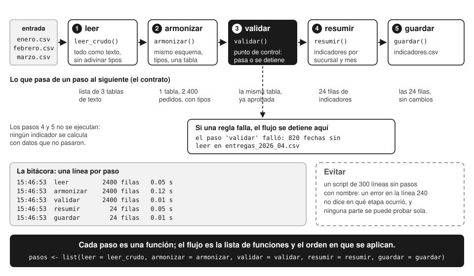
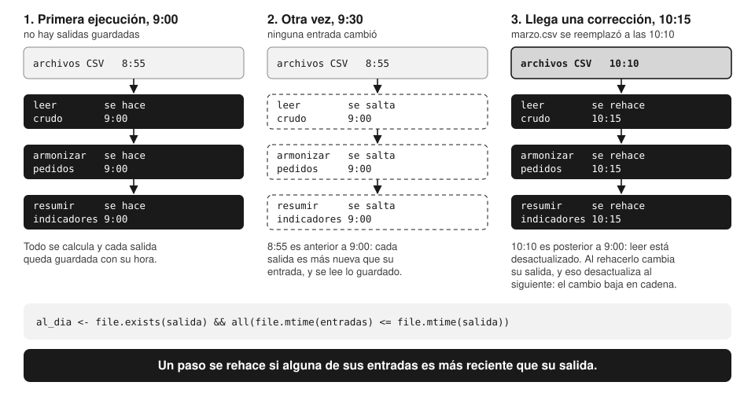
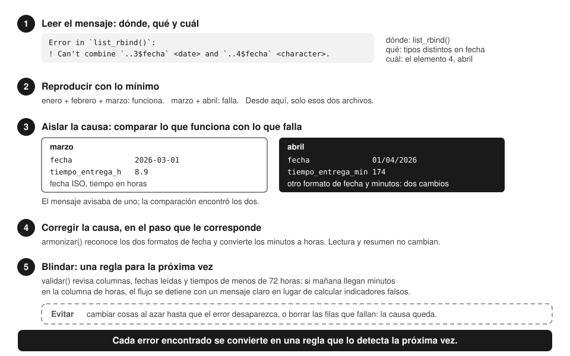
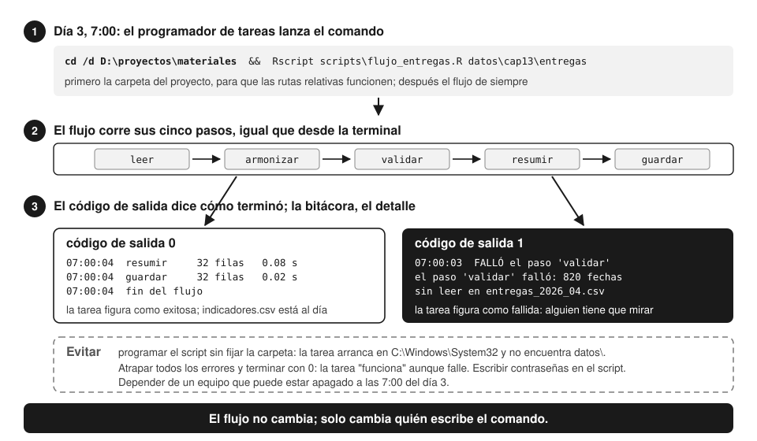

# Flujos reproducibles y depuración {#sec-flujos}

Es el 3 de abril. El script que calcula los indicadores de entregas corrió sin problemas en enero, en febrero y en marzo. Hoy llegó el archivo de abril, lo pusiste en la carpeta con los demás, ejecutaste el script y R respondió:

```
Error in `list_rbind()`:
! Can't combine `..3$fecha` <date> and `..4$fecha` <character>.
```

Nadie cambió el código. Algo cambió en los datos, y el mensaje no dice qué. Mientras tanto, gerencia espera los indicadores del mes.

Este capítulo es sobre ese momento, y sobre cómo prepararse para él antes de que llegue. Tiene dos partes que se necesitan una a la otra. La primera es organizar el trabajo como un **flujo** (en inglés, *pipeline*: tubería): una serie de pasos con nombre, cada uno una función con una entrada y una salida claras, que se ejecuta completo, desde cero, con un solo comando. La segunda es **depurar**: encontrar con método por qué un flujo falla, en lugar de cambiar cosas al azar hasta que el error desaparezca. Al final, cuando el flujo ya es confiable, lo dejamos programado para que se ejecute solo cada mes. Un flujo bien organizado es más fácil de depurar, porque cada paso se puede revisar por separado, y depurar con método termina mejorando el flujo, porque cada error encontrado se convierte en una regla que lo detecta la próxima vez.

Las piezas ya están en el libro: el contrato de lectura del @sec-importacion, las reglas de calidad del @sec-tipos-calidad, la bitácora del @sec-limpiar, las cargas repetibles del @sec-guardar-compartir y las funciones del @sec-funciones. Este capítulo las une.

::: {.callout-tip}
## Antes de empezar

1. Abre la carpeta de materiales en Positron. Este capítulo usa `datos/cap13/`: los pedidos del trimestre en un archivo por mes (`entregas/`) y el archivo de abril (`abril/`), que llega con sorpresas. Si no están en tu copia, genéralos con `Rscript scripts/generar_datos_cap13.R`.
2. El flujo completo está en `scripts/flujo_entregas.R` y `scripts/flujo_entregas.py`. El capítulo lo construye paso a paso; los archivos tienen la versión final.
3. No hay paquetes nuevos. Al final mencionamos `targets`, un paquete de R para flujos, que no es necesario instalar para seguir el capítulo.
:::

```{r}
#| label: paquetes-cap13
#| message: false
use("readr", c("read_csv", "cols"))
use("dplyr", c("filter", "count", "tibble"))
use("purrr", c("map", "map_chr", "list_rbind"))
use("DBI", c("dbConnect", "dbGetQuery", "dbExecute", "dbDisconnect"))
use("duckdb", "duckdb")

con <- dbConnect(duckdb())
trimestre <- list.files(
  "datos/cap13/entregas",
  pattern = "\\.csv$",
  full.names = TRUE
)
abril <- "datos/cap13/abril/entregas_2026_04.csv"
unlink("datos/cap13/salida", recursive = TRUE) # cada ejecución del capítulo parte de cero
```

## Qué hace reproducible un análisis {#sec-reproducible}

Un análisis es **reproducible** cuando otra persona, o tú mismo dentro de seis meses, puede obtener exactamente el mismo resultado a partir de los mismos datos. Parece obvio y es difícil, porque el resultado depende de más cosas de las que se ven en el código:

| Depende de | El riesgo | La práctica |
|---|---|---|
| Los datos de entrada | Alguien editó el archivo a mano | Los datos crudos no se tocan (@sec-limpiar) |
| Las rutas | `C:/Users/ana/Escritorio/datos.csv` no existe en otro equipo | Rutas relativas a la carpeta del proyecto |
| El orden de ejecución | Una celda se ejecutó antes que otra, o dos veces | Un solo script que se ejecuta de principio a fin |
| El estado de la sesión | Un objeto creado a mano, que ningún script crea | Ejecutar en una sesión limpia |
| El azar | `sample()` da otro resultado cada vez | Fijar la semilla con `set.seed()` o `np.random.default_rng(semilla)` |
| Las versiones | Una función cambió de comportamiento en la versión nueva de un paquete | Registrar las versiones: `renv` en R, `uv.lock` en Python |
| Los pasos manuales | "Después de correr el script, abro el Excel y borro las filas vacías" | Todo paso es código |

: De qué depende que un análisis sea reproducible {#tbl-reproducible}

Casi todas las prácticas de la tabla ya aparecieron en el libro. La que falta es la que las une: que el trabajo completo sea **un flujo que se ejecuta con un solo comando**.

## El análisis como una tubería {#sec-pipeline}

Un flujo de datos se parece a una tubería con estaciones: los datos entran por un extremo, pasan por cada estación, que los transforma, y salen por el otro como un producto. Cada estación es una **función**, con un nombre que dice qué hace, una entrada y una salida (@fig-flujo). Entre una estación y la siguiente hay un **contrato**: lo que sale de una es exactamente lo que la siguiente espera recibir.

{#fig-flujo fig-alt="Cinco estaciones en fila, unidas por flechas: leer, armonizar, validar, resumir y guardar. Bajo cada una, lo que entra y lo que sale, con los números del trimestre: tres archivos CSV; una lista de tres tablas como texto; una tabla de 2.400 pedidos con tipos; la misma tabla, aprobada; 24 filas de indicadores; un archivo indicadores.csv. La estación validar está resaltada como punto de control: si una regla falla, el flujo se detiene ahí, dice qué archivo y qué regla, y los indicadores no se calculan con datos malos. Debajo, la bitácora, con una línea por paso: hora, nombre del paso, filas y segundos. Con trazo discontinuo, Evitar: un script largo sin pasos con nombre, donde un error en la línea 240 no dice en qué etapa del trabajo ocurrió. Al pie: cada paso es una función; el flujo es la lista de funciones y el orden en que se aplican."}

Organizar el trabajo así tiene tres ventajas sobre un script largo de principio a fin. Cada paso se puede **probar por separado**, con una entrada pequeña. Cuando algo falla, el flujo dice **en qué paso** falló. Y el flujo completo es **una lista de funciones**, que se puede leer de un vistazo, reordenar o extender, igual que la lista de reglas de calidad.

### Ejemplo guiado 13.1: el flujo de las entregas

El flujo tiene cinco pasos, y cada uno es una función de `scripts/flujo_entregas.R`:

1. **Leer** (`leer_crudo()`): lee cada archivo **como texto**, sin dejar que el lector adivine los tipos, como en el contrato de lectura del @sec-importacion. Devuelve una lista con una tabla por archivo.
2. **Armonizar** (`armonizar()`): lleva todas las tablas al mismo esquema, convierte los tipos y las une en una sola, con una columna que dice de qué archivo vino cada fila.
3. **Validar** (`validar()`): comprueba las reglas que bloquean (columnas esperadas, fechas leídas, pedidos únicos, tiempos plausibles) y, si alguna falla, detiene el flujo con un mensaje que dice cuál y dónde.
4. **Resumir** (`resumir()`): calcula los indicadores mensuales por sucursal.
5. **Guardar** (`guardar()`): escribe los indicadores en un archivo.

::: {.panel-tabset group="lenguaje"}

### R

```{r}
#| label: flujo-cargar
source("scripts/flujo_entregas.R")
names(pasos_entregas)
formals(pasos_entregas$guardar)
```

`pasos_entregas` es una lista con nombre de funciones: el flujo **es** esa lista. `formals()` muestra los parámetros de una función y sus valores por defecto; el código de cada paso está en `scripts/flujo_entregas.R`, documentado como en el @sec-funciones. La función que ejecuta el flujo recorre la lista y le pasa a cada paso la salida del anterior:

```{r}
#| label: flujo-ejecutor
#| eval: false
ejecutar_flujo <- function(
  entrada,
  pasos,
  bitacora = "datos/cap13/salida/bitacora.log"
) {
  # ... anotar() escribe una línea con la hora en la bitácora y en la consola
  datos <- entrada
  for (nombre in names(pasos)) {
    inicio <- Sys.time()
    datos <- tryCatch(
      pasos[[nombre]](datos),
      error = function(e) {
        anotar("FALLÓ el paso '%s'", nombre)
        stop(
          sprintf("el paso '%s' falló: %s", nombre, conditionMessage(e)),
          call. = FALSE
        )
      }
    )
    # ... anotar() el nombre del paso, las filas y los segundos
  }
  datos
}
```

Es una reducción, como las del @sec-escala: `reduce(pasos, \(datos, paso) paso(datos), .init = entrada)` haría lo mismo en una línea. La versión con `for` agrega lo que un flujo real necesita: una **bitácora** con lo que hizo cada paso y, si un paso falla, un error que dice **cuál**. `tryCatch()` atrapa el error del paso, lo anota en la bitácora y lo vuelve a lanzar con el nombre del paso al principio del mensaje.

```{r}
#| label: flujo-trimestre
indicadores <- ejecutar_flujo(trimestre, pasos_entregas)
indicadores |> filter(sucursal == "S03")
```

El flujo leyó los tres archivos y produjo 24 filas de indicadores, una por sucursal y mes. La bitácora, que se muestra en la consola y queda en `datos/cap13/salida/bitacora.log`, dice cuántas filas salieron de cada paso y cuánto tardó. Si mañana el paso de leer tarda diez veces más, o el de armonizar devuelve menos filas que el de leer, la bitácora lo deja ver.

### Python

```{python}
import sys
from pathlib import Path

from scripts.flujo_entregas import ejecutar_flujo, PASOS

trimestre = sorted(str(p) for p in Path("datos/cap13/entregas").glob("*.csv"))
indicadores = ejecutar_flujo(trimestre, PASOS)
print(indicadores[indicadores["sucursal"] == "S03"])
```

El flujo de Python tiene la misma forma: un diccionario de pasos y una función que los recorre. La bitácora usa el módulo `logging` de la biblioteca estándar, que escribe cada línea con su hora en un archivo y en la consola a la vez, y que permite distinguir niveles: `log.info()` para lo normal y `log.error()` para los fallos. `raise RuntimeError(...) from e` lanza un error nuevo con el nombre del paso y conserva el original, que Python muestra debajo como la causa.

### DuckDB

En SQL, un flujo se puede escribir como una cadena de **vistas**, cada una construida sobre la anterior:

```{r}
#| label: duckdb-flujo
dbExecute(
  con,
  r"(
  CREATE OR REPLACE VIEW crudo AS
  SELECT * FROM read_csv('datos/cap13/entregas/*.csv', filename = true)
)"
)
dbExecute(
  con,
  r"(
  CREATE OR REPLACE VIEW indicadores AS
  SELECT strftime(fecha, '%Y-%m') AS mes, sucursal, count(*) AS pedidos,
         median(tiempo_entrega_h) AS mediana_horas
  FROM crudo
  WHERE canal <> 'retiro'
  GROUP BY ALL
)"
)
dbGetQuery(con, "SELECT * FROM indicadores WHERE sucursal = 'S03' ORDER BY mes")
```

Cada vista es una estación con nombre, y consultar la última ejecuta toda la cadena. Es una buena forma de escribir los pasos de transformación cuando los datos son grandes. Lo que SQL no tiene es el resto del flujo: la bitácora, los mensajes de error con el nombre del paso y la validación que detiene todo. Por eso, en el patrón híbrido del libro, DuckDB hace los pasos pesados y R o Python orquestan el flujo.

:::

## Ejecutar desde cero {#sec-ejecutar-desde-cero}

La prueba de que un flujo es reproducible es ejecutarlo en una **sesión limpia**: un proceso de R o de Python recién abierto, sin ningún objeto creado a mano, sin paquetes cargados de antes y sin el historial de lo que hiciste en la mañana. Mientras trabajas en Positron, la sesión acumula estado, y un script puede funcionar solo porque algo que necesita quedó en memoria de una prueba anterior.

### Ejemplo guiado 13.2: el script que solo funcionaba en tu sesión

::: {.panel-tabset group="lenguaje"}

### R

Escribimos un script pequeño que usa la tabla `indicadores`, sin crearla. En la sesión del capítulo funciona, porque `indicadores` existe desde el ejemplo anterior. En una sesión limpia, no:

```{r}
#| label: limpio-estado
script <- tempfile(fileext = ".R")
writeLines('print(nrow(indicadores))', script)

source(script)

rscript <- file.path(R.home("bin"), "Rscript")
salida <- suppressWarnings(system2(
  rscript,
  script,
  stdout = TRUE,
  stderr = TRUE
))
salida
```

`source()` ejecuta el script en la sesión actual y encuentra `indicadores`. `system2()` ejecuta `Rscript`, el programa que corre un script de R en un proceso nuevo, como si lo escribieras en la terminal; ahí `indicadores` no existe y el script falla. **Lo que funciona en tu sesión no está probado hasta que funciona en una sesión limpia.** En Positron, reiniciar la sesión de R (con el botón de reinicio de la consola) y ejecutar el script completo es la versión manual de la misma prueba.

`scripts/flujo_entregas.R` está escrito para ejecutarse así desde la terminal: al final tiene un bloque que solo corre cuando el archivo se ejecuta con `Rscript`, y no cuando se carga con `source()`:

```{r}
#| label: limpio-rscript
salida <- system2(
  rscript,
  c("scripts/flujo_entregas.R", "datos/cap13/entregas"),
  stdout = TRUE,
  stderr = TRUE
)
tail(salida, 3)
```

`sys.nframe() == 0` es la condición que distingue los dos casos: vale `TRUE` cuando el archivo se ejecuta directamente y `FALSE` cuando lo llama `source()`. Es el equivalente del `if __name__ == "__main__":` de Python que vimos en el @sec-funciones.

Para que el resultado sea el mismo en otro equipo, falta registrar las versiones. `renv` guarda en un archivo, `renv.lock`, la versión exacta de cada paquete del proyecto, y `renv::restore()` la reinstala en otro equipo. Como mínimo, la bitácora de un flujo debería registrar la versión de R y de los paquetes principales:

```{r}
#| label: limpio-versiones
c(
  R = R.version$version.string,
  sapply(c("dplyr", "readr", "purrr", "duckdb"), \(p) {
    as.character(packageVersion(p))
  })
)
```

### Python

```{python}
import subprocess

resultado = subprocess.run(
    [sys.executable, "-m", "scripts.flujo_entregas", "datos/cap13/entregas"],
    capture_output=True,
    text=True,
)
print(resultado.stdout.strip().splitlines()[-1])
print("código de salida:", resultado.returncode)
```

`subprocess.run()` ejecuta un programa en un proceso nuevo; `sys.executable` es la ruta del Python que estás usando, y `-m scripts.flujo_entregas` ejecuta el archivo como módulo desde la carpeta del proyecto, lo que activa su bloque `if __name__ == "__main__":`. El **código de salida** es 0 cuando el programa terminó bien y otro número cuando falló; es lo que revisan las herramientas que automatizan tareas, como veremos en la @sec-programar.

En Python, `uv` registra las versiones en `uv.lock` y `uv sync` las reinstala; `uv run python ...` ejecuta un script con exactamente ese entorno. Es el equivalente de `renv`.

### DuckDB

DuckDB también se puede usar desde la terminal, con su programa de línea de comandos: `duckdb -c "SELECT ..."` ejecuta una consulta y termina, y `duckdb < flujo.sql` ejecuta un archivo de SQL completo. Una consulta de SQL no depende del estado de una sesión de la misma forma, pero una base guardada en archivo sí: las vistas y las macros creadas a mano en ella son parte del estado, y conviene que un script las cree con `CREATE OR REPLACE`.

:::

## Rehacer solo lo que cambió {#sec-incremental}

Con tres archivos de 800 filas, el flujo tarda unos segundos y se puede ejecutar completo cada vez. Con cuarenta archivos grandes, un paso que consulta una API o un modelo que tarda una hora en ajustarse, ejecutar todo desde cero cada vez deja de ser práctico. La solución es la misma que usan las herramientas para compilar programas desde los años setenta: **rehacer un paso solo si alguna de sus entradas cambió después de la última vez que se hizo** (@fig-incremental).

{#fig-incremental fig-alt="Tres columnas para tres ejecuciones del mismo flujo de tres pasos: leer, armonizar y resumir, cada uno con su archivo de salida y la hora en que se escribió. En la primera ejecución no hay salidas guardadas y los tres pasos se hacen. En la segunda, ninguna entrada cambió: las salidas son más nuevas que sus entradas y los tres pasos se saltan. En la tercera llegó un archivo nuevo: leer se rehace porque su entrada es más nueva que su salida, y armonizar y resumir se rehacen porque su entrada, la salida del paso anterior, acaba de cambiar. Al pie: un paso se rehace si alguna de sus entradas es más reciente que su salida."}

### Ejemplo guiado 13.3: un paso que se salta si no hace falta

::: {.panel-tabset group="lenguaje"}

### R

```{r}
#| label: incremental-funcion
paso_si_hace_falta <- function(salida, entradas, calcular) {
  al_dia <- file.exists(salida) &&
    all(file.mtime(entradas) <= file.mtime(salida))
  if (al_dia) {
    message("al día, se lee: ", basename(salida))
    return(arrow::read_parquet(salida, mmap = FALSE))
  }
  message("se calcula: ", basename(salida))
  resultado <- calcular()
  arrow::write_parquet(resultado, salida)
  resultado
}

pedidos_de <- function(archivos) {
  paso_si_hace_falta(
    salida = "datos/cap13/salida/pedidos.parquet",
    entradas = archivos,
    calcular = \() armonizar(leer_crudo(archivos)) |> validar()
  )
}

pedidos <- pedidos_de(trimestre) # primera vez: se calcula
pedidos <- pedidos_de(trimestre) # nada cambió: se lee
Sys.setFileTime(trimestre[3], Sys.time())
pedidos <- pedidos_de(trimestre) # marzo cambió: se vuelve a calcular
```

`file.mtime()` devuelve la fecha y hora de la última modificación de un archivo. Si la salida existe y es más reciente que todas sus entradas, el paso está al día y basta leer su resultado guardado. `mmap = FALSE` hace que `read_parquet()` copie el archivo a la memoria y lo suelte, en lugar de dejarlo mapeado: en Windows, un archivo mapeado no se puede volver a escribir en la misma sesión, como vimos en el @sec-guardar-compartir, y este paso escribe sobre su propia salida. `Sys.setFileTime()` simula que el archivo de marzo se modificó, como si la fuente hubiera enviado una corrección, y el paso se rehace. `calcular` es una función sin argumentos que se pasa como argumento: solo se ejecuta si hace falta, una aplicación directa de las funciones de orden superior del @sec-funciones.

Esta función es una versión mínima, para entender la idea. Para un flujo real en R existe [targets](https://docs.ropensci.org/targets/): se declara cada paso con su nombre y la expresión que lo calcula, y `targets` deduce de las propias expresiones qué paso depende de cuál, guarda cada resultado y, al ejecutar `tar_make()`, rehace solo lo que quedó desactualizado. Detecta además los cambios en el **código** de las funciones, no solo en los archivos, y dibuja el flujo como un grafo:

```{r}
#| label: incremental-targets
#| eval: false
# _targets.R, en la carpeta del proyecto
library(targets)
source("scripts/flujo_entregas.R")

list(
  tar_target(
    archivos,
    list.files("datos/cap13/entregas", full.names = TRUE),
    format = "file"
  ),
  tar_target(crudo, leer_crudo(archivos)),
  tar_target(pedidos, validar(armonizar(crudo))),
  tar_target(indicadores, resumir(pedidos))
)
```

`format = "file"` le dice a `targets` que vigile los archivos y no solo sus nombres. `tar_make()` ejecuta el flujo, `tar_outdated()` dice qué pasos están desactualizados y `tar_visnetwork()` dibuja el grafo de dependencias. Como las funciones ya existen, pasar de nuestro flujo a `targets` es escribir esa lista.

### Python

```{python}
import os


def paso_si_hace_falta(salida, entradas, calcular):
    al_dia = os.path.exists(salida) and all(
        os.path.getmtime(e) <= os.path.getmtime(salida) for e in entradas
    )
    if al_dia:
        print("al día, se lee:", os.path.basename(salida))
        return pd.read_parquet(salida)
    print("se calcula:", os.path.basename(salida))
    resultado = calcular()
    resultado.to_parquet(salida)
    return resultado


import pandas as pd
from scripts.flujo_entregas import leer_crudo, armonizar, validar

salida = "datos/cap13/salida/pedidos_py.parquet"
calcular = lambda: validar(armonizar(leer_crudo(trimestre)))
pedidos = paso_si_hace_falta(salida, trimestre, calcular)
pedidos = paso_si_hace_falta(salida, trimestre, calcular)
```

En Python no hay una herramienta tan integrada como `targets`. Las más usadas para flujos de datos son [Snakemake](https://snakemake.readthedocs.io/), muy común en investigación, que declara cada paso con sus archivos de entrada y de salida; y orquestadores como Prefect o Dagster, pensados para flujos que corren en servidores. Y está `make`, la herramienta original de los años setenta, que sigue funcionando para cualquier lenguaje.

### DuckDB

DuckDB no lleva la cuenta de qué cambió. Lo que sí puede hacer es que el paso pesado sea barato: consultar directamente los archivos (`read_csv('datos/cap13/entregas/*.csv')`) en lugar de cargarlos en una tabla evita la pregunta de si la tabla está al día, porque cada consulta lee los archivos tal como están.

:::

## Depurar: encontrar por qué falla {#sec-depurar}

Volvamos al 3 de abril. **Depurar** es encontrar la causa de un error y corregirla. La tentación, con prisa, es cambiar cosas al azar hasta que el mensaje desaparezca: agregar un `as.character()`, borrar una fila, comentar una línea. A veces el error desaparece, pero la causa queda, y vuelve el mes siguiente con otra forma. Depurar con método tiene cinco pasos (@fig-depurar).

{#fig-depurar fig-alt="Cinco pasos numerados en fila, cada uno con lo que se hizo en el caso del archivo de abril. Uno, leer el mensaje: dice qué falló, que no se pueden combinar fecha de tipo date y de tipo character, y dónde, en el elemento 4, el archivo de abril. Dos, reproducir con lo mínimo: leer solo el archivo de marzo y el de abril reproduce el error. Tres, aislar la causa: comparar los dos archivos muestra que abril trae la fecha como día/mes/año y el tiempo en minutos, en una columna con otro nombre. Cuatro, corregir la causa: el paso armonizar convierte los dos formatos de fecha y los minutos a horas. Cinco, blindar: la validación revisa columnas, fechas y tiempos plausibles, y la próxima vez el flujo se detiene con un mensaje claro. Con trazo discontinuo, Evitar: cambiar cosas al azar hasta que el error desaparezca, o borrar las filas que fallan. Al pie: cada error encontrado se convierte en una regla que lo detecta la próxima vez."}

### Ejemplo guiado 13.4: llega el archivo de abril

::: {.panel-tabset group="lenguaje"}

### R

**Paso 1: leer el mensaje.** El error del principio salió de la forma más común de leer varios archivos, la del @sec-importacion, sin contrato:

```{r}
#| label: depurar-ingenuo
#| error: true
map(c(trimestre, abril), \(r) read_csv(r, show_col_types = FALSE)) |>
  list_rbind()
```

Un mensaje de error tiene tres partes que conviene leer en orden. **Dónde**: la función que falló, `list_rbind()`. **Qué**: no se pueden combinar dos tipos, `<date>` y `<character>`, en la columna `fecha`. **Cuál**: los elementos `..3` y `..4` de la lista, el tercer archivo (marzo) y el cuarto (abril). Ya sabemos mucho: la fecha de abril no se leyó como fecha. En una sesión interactiva, `traceback()` (o `rlang::last_trace()`, si el error viene de un paquete del `tidyverse`) muestra la cadena completa de llamadas que llevó al error, de la más externa a la más interna.

**Paso 2: reproducir con lo mínimo.** El error aparece con los cuatro archivos; ¿aparece con menos? Con marzo y abril, sí; con los tres meses del trimestre, no. El problema está en abril, y desde ahora trabajamos solo con esos dos archivos: un caso pequeño es más rápido de ejecutar y más fácil de mirar.

**Paso 3: aislar la causa.** Comparamos los dos archivos leídos como texto, sin que el lector adivine nada:

```{r}
#| label: depurar-aislar
tablas <- map(c(marzo = trimestre[3], abril = abril), \(r) {
  read_csv(r, col_types = cols(.default = "c"))
})

setdiff(names(tablas$marzo), names(tablas$abril))
setdiff(names(tablas$abril), names(tablas$marzo))
map(tablas, \(d) head(d$fecha, 2))
map(tablas, \(d) head(d[[6]], 3))
```

Abril tiene **dos** cambios, y el mensaje de error solo avisaba de uno. La fecha viene como día/mes/año. Y la columna `tiempo_entrega_h` ya no existe: en su lugar llega `tiempo_entrega_min`, con valores en minutos. Si hubiéramos "arreglado" el error convirtiendo la fecha y nada más, el flujo habría seguido con el tiempo de entrega de abril en blanco, o peor, con minutos en una columna de horas si alguien hubiera renombrado la columna para que coincidiera.

Para mirar dentro de una función mientras se ejecuta, R tiene un **depurador**. `browser()`, escrito dentro del código de una función, la detiene en esa línea y abre una consola en la que se pueden inspeccionar sus variables; `debugonce(armonizar)` hace lo mismo con la próxima llamada a `armonizar()`, sin editar el código. En Positron, un clic a la izquierda del número de una línea pone un **punto de interrupción** con el mismo efecto. Dentro del depurador, `n` ejecuta la línea siguiente, `c` continúa hasta el final y `Q` sale. Con un flujo hecho de funciones pequeñas, casi siempre basta con ejecutar el paso sospechoso con una entrada pequeña, como hicimos aquí, sin necesidad del depurador.

**Paso 4: corregir la causa.** Ahora vemos qué habría pasado con nuestro flujo si el paso de armonizar solo supiera del formato de marzo. Esta es la versión que teníamos en marzo:

```{r}
#| label: depurar-marzo
#| error: true
armonizar_marzo <- function(tablas) {
  list_rbind(tablas, names_to = "archivo") |>
    dplyr::mutate(
      fecha = as.Date(fecha, format = "%Y-%m-%d"),
      dplyr::across(
        c(distancia_km, tiempo_entrega_h, unidades, valor_pedido),
        as.numeric
      ),
      calificacion = as.integer(calificacion),
      devuelto = as.logical(devuelto)
    )
}

pasos_marzo <- pasos_entregas
pasos_marzo$armonizar <- armonizar_marzo
ejecutar_flujo(c(trimestre, abril), pasos_marzo)
```

El flujo se detuvo en el paso de **validar**, con un mensaje que dice qué falla, cuántas filas y en qué archivo: 820 fechas sin leer en `entregas_2026_04.csv` y 628 entregas a domicilio sin tiempo de entrega. No es un error técnico de R sobre tipos combinados: es un error en el lenguaje de los datos, que cualquiera del equipo entiende. Esa es la diferencia que hace leer con contrato y validar antes de resumir: **el flujo no evita que lleguen datos raros, pero hace que fallen con un mensaje claro y en el lugar correcto**. Y los indicadores de abril no se calcularon con datos malos.

La corrección va en el paso que le corresponde: `armonizar()` de `scripts/flujo_entregas.R` reconoce los dos formatos de fecha y convierte los minutos a horas. Con ella, el flujo completo pasa:

```{r}
#| label: depurar-corregido
indicadores <- ejecutar_flujo(c(trimestre, abril), pasos_entregas)
indicadores |> count(mes)
```

**Paso 5: blindar.** El error de abril ya no puede volver sin aviso: la validación revisa que estén todas las columnas, que todas las fechas se hayan leído y que ningún tiempo de entrega supere las 72 horas. Esta última regla atraparía el error más peligroso, el que no produce ningún mensaje: si un archivo futuro trae los minutos en la columna `tiempo_entrega_h`, sin cambiarle el nombre, los tiempos de cientos de horas detendrían el flujo. **Cada error encontrado se convierte en una regla que lo detecta la próxima vez**: es el mismo ciclo de la auditoría del @sec-tipos-calidad, aplicado al flujo.

### Python

```{python}
import pandas as pd

ingenuo = pd.concat(
    [
        pd.read_csv(r)
        for r in trimestre + ["datos/cap13/abril/entregas_2026_04.csv"]
    ]
)
print(ingenuo.shape)
print(
    ingenuo["tiempo_entrega_h"].isna().sum(),
    ingenuo["tiempo_entrega_min"].notna().sum(),
)
print(ingenuo["fecha"].iloc[[0, -1]].tolist())
```

En Python, la lectura ingenua **no falla**. `pd.concat()` une las tablas aunque tengan columnas distintas: agrega `tiempo_entrega_min` como una columna nueva, deja `tiempo_entrega_h` vacía en abril y guarda las fechas como texto, con los dos formatos mezclados. Ningún mensaje. Los indicadores calculados con esta tabla tendrían abril con todos los tiempos faltantes, y quizá nadie lo notaría hasta la reunión. Es el caso que la @tbl-guia-explorar llamaba "devolver un resultado equivocado sin quejarse", y es la razón para validar entre pasos aunque el lenguaje no se queje.

Con el flujo y su validación, el mismo archivo produce un error claro, y con la versión corregida de `armonizar()` pasa:

```{python}
from scripts.flujo_entregas import ejecutar_flujo, PASOS


def armonizar_marzo(tablas):
    d = pd.concat(
        [t.assign(archivo=a) for a, t in tablas.items()], ignore_index=True
    )
    d["fecha"] = pd.to_datetime(d["fecha"], format="%Y-%m-%d", errors="coerce")
    for c in ["distancia_km", "tiempo_entrega_h", "unidades", "valor_pedido"]:
        d[c] = pd.to_numeric(d[c])
    return d


todos = trimestre + ["datos/cap13/abril/entregas_2026_04.csv"]
try:
    ejecutar_flujo(todos, {**PASOS, "armonizar": armonizar_marzo})
except RuntimeError as e:
    print(e)

indicadores = ejecutar_flujo(todos, PASOS)
print(indicadores["mes"].value_counts().sort_index().to_dict())
```

`{**PASOS, "armonizar": armonizar_marzo}` crea un diccionario nuevo con todos los pasos y reemplaza uno: el desempaque con `**` del @sec-funciones. `errors="coerce"` convierte en faltante lo que no se puede leer como fecha, en lugar de fallar; la validación es la que se encarga de detenerlo.

Para depurar dentro de una función, Python tiene `breakpoint()`: escrito en una línea del código, detiene la ejecución ahí y abre `pdb`, el depurador de la biblioteca estándar, con los mismos comandos básicos que el de R (`n`, `c`, `q`) más `p variable` para imprimir. Después de un error, `import pdb; pdb.pm()` abre el depurador en el punto donde ocurrió. Positron ofrece los mismos puntos de interrupción con un clic, para R y para Python.

### DuckDB

DuckDB es, de las tres herramientas, la que mejor explica este error:

```{r}
#| label: duckdb-depurar
#| error: true
dbGetQuery(
  con,
  r"(
  SELECT count(*) FROM read_csv(['datos/cap13/entregas/entregas_2026_03.csv',
                                 'datos/cap13/abril/entregas_2026_04.csv'])
)"
)
```

El mensaje dice qué archivo tiene un esquema distinto, qué columna falta y qué se puede hacer: leer con `union_by_name = true`. Pero ese "arreglo" no corrige nada: alinea las columnas por nombre, así que `tiempo_entrega_h` quedaría vacía en abril y `tiempo_entrega_min` vacía en el trimestre. Un buen mensaje de error dice dónde mirar; la decisión de qué hacer sigue siendo nuestra:

```{r}
#| label: duckdb-union
dbGetQuery(
  con,
  r"(
  SELECT parse_filename(filename) AS archivo, count(*) AS filas,
         count(tiempo_entrega_h) AS con_horas, count(tiempo_entrega_min) AS con_minutos
  FROM read_csv(['datos/cap13/entregas/*.csv', 'datos/cap13/abril/*.csv'],
                union_by_name = true, filename = true,
                all_varchar = true)
  GROUP BY ALL
  ORDER BY archivo
)"
)
```

:::

::: {.callout-note}
## Herramientas para depurar

| Para | R | Python |
|---|---|---|
| Ver la cadena de llamadas que llevó al error | `traceback()`, `rlang::last_trace()` | El *traceback* que Python imprime solo, de la llamada más externa (arriba) a la más interna (abajo) |
| Detenerse en una línea | `browser()`, o un punto de interrupción en Positron | `breakpoint()`, o un punto de interrupción en Positron |
| Detenerse al entrar a una función | `debugonce(f)` | `breakpoint()` en la primera línea de `f` |
| Abrir el depurador donde ocurrió el error | `options(error = recover)` | `import pdb; pdb.pm()` |
| Mirar qué pasa sin detenerse | `message()`, la bitácora | `print()`, `logging` |

: Herramientas para depurar {#tbl-depurar}

Y una herramienta que no es de ningún lenguaje: el **ejemplo mínimo reproducible**. Reducir el problema a unas pocas líneas de código y unas pocas filas de datos que muestren el error es, muchas veces, la forma de encontrarlo. Y si no, es lo que hay que preparar para pedir ayuda a un colega, en un foro o a una herramienta de inteligencia artificial: en R, el paquete `reprex` ayuda a prepararlo.
:::

## Que se ejecute solo {#sec-programar}

El flujo ya se ejecuta con un solo comando desde la terminal. El último paso es que nadie tenga que escribir ese comando: que el sistema operativo lo ejecute solo, el día 3 de cada mes a las siete de la mañana, y que deje constancia de cómo le fue. Para eso no hace falta nada nuevo en R ni en Python. Hace falta un **programador de tareas**, que todos los sistemas operativos traen (@fig-programar):

- En **Windows**, el **Programador de tareas**, que se maneja con una ventana o desde la terminal con `schtasks`.
- En **macOS y Linux**, `cron`, que lee una lista de tareas con su horario, una por línea.

{#fig-programar fig-alt="Una línea de tiempo. El día 3 de cada mes a las 7:00, el programador de tareas del sistema operativo lanza un comando que primero entra a la carpeta del proyecto y después ejecuta Rscript con el flujo. El flujo corre sus cinco pasos y termina con un código de salida. Si es 0, la bitácora termina con fin del flujo y los indicadores quedan en su archivo. Si es 1, la bitácora registra en qué paso falló y por qué, y el programador puede marcar la tarea como fallida o avisar. Con trazo discontinuo, Evitar: programar el script sin fijar la carpeta de trabajo, porque las rutas relativas dejan de funcionar; escribir contraseñas dentro del script; y depender de un equipo que puede estar apagado a esa hora. Al pie: el flujo no cambia; solo cambia quién escribe el comando."}

### Ejemplo guiado 13.5: los indicadores, el día 3 de cada mes

**El código de salida.** Un programador de tareas no lee mensajes: solo sabe si el programa terminó bien o mal, por su **código de salida**. `Rscript` devuelve 0 cuando el script termina y 1 cuando se detiene con un error. Nuestro flujo se detiene con `stop()` cuando algo falla, así que el código de salida ya dice la verdad:

```{r}
#| label: programar-salida
sin_archivos <- suppressWarnings(system2(
  rscript,
  c("scripts/flujo_entregas.R", "datos/cap13/no-existe"),
  stdout = TRUE,
  stderr = TRUE
))
tail(sin_archivos, 2)
attr(sin_archivos, "status")
```

Con una carpeta sin archivos, el paso de leer falla, la bitácora lo registra y `Rscript` termina con código 1. Un script que atrapa todos sus errores y termina "bien" aunque algo haya fallado engaña al programador de tareas, que reportará la tarea como exitosa.

**La carpeta de trabajo.** El flujo usa rutas relativas, como `datos/cap13/entregas`, que funcionan porque Positron abre la carpeta del proyecto. Un programador de tareas no sabe cuál es la carpeta del proyecto: en Windows, la tarea arranca por defecto en `C:\Windows\System32`, y ahí `datos/cap13/entregas` no existe. Por eso el comando programado tiene siempre dos partes: **entrar a la carpeta del proyecto** y **ejecutar el script**.

::: {.panel-tabset group="sistema"}

### Windows

```{.powershell}
schtasks /Create /TN "indicadores-entregas" /SC MONTHLY /D 3 /ST 07:00 `
  /TR "cmd /c cd /d D:\proyectos\materiales && ""C:\Program Files\R\R-4.6.2\bin\Rscript.exe"" scripts\flujo_entregas.R datos\cap13\entregas >> datos\cap13\salida\programada.log 2>&1"
```

`/SC MONTHLY /D 3 /ST 07:00` programa la tarea para el día 3 de cada mes a las 7:00. `/TR` es el comando: `cd /d` entra a la carpeta del proyecto (la `/d` permite cambiar también de unidad de disco) y `&&` ejecuta `Rscript` solo si el cambio de carpeta funcionó. `>> ... 2>&1` agrega todo lo que el flujo escriba, mensajes y errores, a un archivo de registro. Las comillas dobles repetidas (`""`) son la forma de escribir una ruta con espacios dentro de otra cadena entre comillas. `schtasks /Run /TN "indicadores-entregas"` ejecuta la tarea en el momento, para probarla, y `schtasks /Query /TN "indicadores-entregas" /V` muestra cuándo corrió por última vez y con qué código de salida.

### macOS y Linux

```{.bash}
# crontab -e abre la lista de tareas; esta línea va en ella
0 7 3 * * cd /Users/ana/materiales && /usr/local/bin/Rscript scripts/flujo_entregas.R datos/cap13/entregas >> datos/cap13/salida/programada.log 2>&1
```

Los cinco primeros campos son el horario: minuto (`0`), hora (`7`), día del mes (`3`), mes (`*`, todos) y día de la semana (`*`, cualquiera). El resto es el comando, con las mismas dos partes que en Windows. `cron` no carga la configuración de tu terminal, así que conviene escribir la ruta completa de `Rscript` (la da `which Rscript`). En macOS, la herramienta recomendada por el sistema es `launchd`, pero `cron` sigue funcionando y es más fácil de leer.

:::

Para Python, el comando programado es el mismo con `uv run --project /ruta/materiales python -m scripts.flujo_entregas datos/cap13/entregas`: `--project` le dice a `uv` qué entorno usar, aunque la tarea arranque en otra carpeta. En R, los paquetes `taskscheduleR` (Windows) y `cronR` (macOS y Linux) crean estas tareas desde la consola de R, sin escribir el comando a mano.

**Saber que falló.** Una tarea programada que falla en silencio es peor que no tenerla: todos creen que los indicadores están al día. Hay tres niveles de aviso, de menor a mayor esfuerzo. El primero ya lo tenemos: la bitácora y el archivo de registro, que alguien revisa cada mes. El segundo es que el programador de tareas muestre la tarea como fallida, lo que funciona solo si el código de salida dice la verdad. El tercero es que el propio flujo envíe un correo o un mensaje cuando falla; para eso necesita credenciales, y las credenciales no se escriben dentro de un script. Cómo guardarlas, y cómo llevar estos flujos a un servidor que no dependa de que tu equipo esté encendido, son temas del último capítulo del libro.

## Ejercicio 13.1: tu propio flujo {#sec-ejercicio-flujo}

Con el flujo de las entregas:

1. Agrega un paso `marcar_atipicos()`, entre validar y resumir, que agregue una columna lógica `corporativo` (valor del pedido de más de 10 millones), y haz que `resumir()` excluya esos pedidos del cálculo. Pruébalo con el trimestre.
2. Agrega a `validar()` una regla que detenga el flujo si alguna sucursal desconocida aparece en los datos (las conocidas son `S01` a `S08`). Comprueba que funciona copiando `entregas_2026_03.csv` a una carpeta temporal, cambiando a mano una sucursal y ejecutando el flujo sobre esa carpeta.
3. Ejecuta el flujo completo desde la terminal, con `Rscript scripts/flujo_entregas.R datos/cap13/entregas` o `uv run python -m scripts.flujo_entregas datos/cap13/entregas`, y revisa la bitácora.
4. En los indicadores de abril, `S07` tiene un solo pedido a domicilio, y su porcentaje de entregas tardías es 0 %. ¿Qué tan confiable es ese número? ¿Qué agregarías a `resumir()` para que una sucursal con muy pocos pedidos no pase desapercibida en los indicadores?

::: {.panel-tabset group="lenguaje"}

### R

```{r}
#| label: ejercicio-13-1
#| eval: false
marcar_atipicos <- function(d) {
  dplyr::mutate(d, corporativo = ...) # TODO
}

pasos <- append(pasos_entregas, list(marcar = marcar_atipicos), after = 3)
names(pasos)
ejecutar_flujo(trimestre, pasos)
```

### Python

```{python}
#| eval: false
def marcar_atipicos(d):
    return d.assign(corporativo=...)  # TODO


nombres = list(PASOS)
pasos = dict(
    list(PASOS.items())[:3]
    + [("marcar", marcar_atipicos)]
    + list(PASOS.items())[3:]
)
ejecutar_flujo(trimestre, pasos)
```

:::

Para comprobar tu resultado: en el trimestre hay 6 pedidos corporativos, y el flujo con el paso nuevo tiene 6 pasos y produce las mismas 24 filas de indicadores. Con la sucursal cambiada a mano, el flujo debe detenerse en el paso de validar y nombrar la sucursal desconocida.

## Cierre: confiar en el proceso, no en la memoria {#sec-cierre-flujos}

Un análisis reproducible no depende de recordar qué se hizo: depende de que todo lo que se hizo esté escrito como código, en un flujo que se ejecuta completo, desde cero, con un solo comando. Organizado como una tubería de funciones con nombre, el flujo dice en qué paso falla, deja una bitácora de lo que hizo y puede rehacer solo lo que cambió. Y entre los pasos, la validación convierte los errores técnicos en mensajes en el lenguaje de los datos.

Cuando algo falla, depurar con método es más rápido que probar al azar: leer el mensaje, reproducir con lo mínimo, aislar la causa, corregirla donde corresponde y blindar el flujo con una regla nueva. El archivo de abril tenía dos cambios y el mensaje de error solo avisaba de uno; el método encontró los dos.

Y un flujo confiable se puede dejar en manos del sistema operativo: un programador de tareas que lo lanza cada mes desde la carpeta del proyecto, un código de salida que dice la verdad y una bitácora que guarda el detalle.

Con este capítulo termina la cuarta parte del libro. Tenemos datos preparados, explorados y convertidos en indicadores por un flujo que corre solo. Falta lo que le da sentido a todo el trabajo: comunicar los resultados a quien tiene que tomar decisiones con ellos. De eso trata la última parte, que empieza por el gráfico, la forma más directa de comunicar un hallazgo.

```{r}
#| label: cerrar-conexion-cap13
#| include: false
dbDisconnect(con)
```
