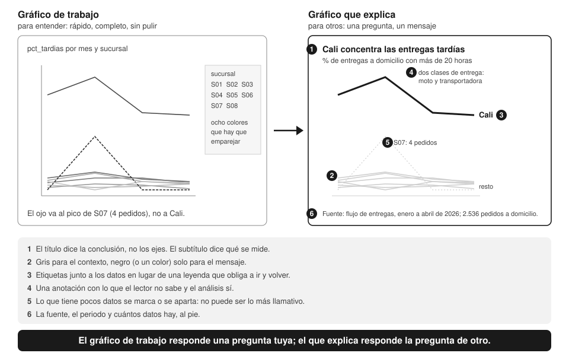

# Comunicar I: gráficos que explican {#sec-graficos-comunicar}

Si le pides a una herramienta de inteligencia artificial "hazme un gráfico bonito con estos datos", en segundos tienes una página HTML con colores, animaciones y un diseño que a ti te tomaría una tarde. Entonces, ¿para qué seguir aprendiendo `ggplot2`, `seaborn` y Quarto?

La pregunta es buena, y la respuesta no es "porque la IA se equivoca", aunque a veces lo hace. Es que un gráfico para comunicar no es una imagen: es **un argumento construido a partir de datos**, y un argumento tiene que poder revisarse, repetirse y defenderse. Cuando el gráfico sale de un script, cada número que muestra se puede rastrear hasta el archivo del que salió, el mes próximo se regenera con un comando y, si alguien pregunta "¿esto incluye los retiros en tienda?", la respuesta está en el código. Cuando el gráfico es una página que alguien pegó con los datos copiados en una conversación, nada de eso es cierto: los números quedaron escritos a mano dentro del HTML, el mes próximo hay que pedirlo de nuevo, y nadie puede comprobar que el 38,7 % de la página es el 38,7 % de los datos.

Eso no significa dejar la IA fuera. Significa usarla donde es fuerte: para **escribir y mejorar el código** que produce el gráfico, no para fabricar el gráfico a mano. "Agrega a este `ggplot` una anotación sobre la línea de Cali" es un buen pedido; el resultado es código que puedes leer, ejecutar y guardar en el flujo. El código sigue siendo la fuente de la verdad. Y para la interactividad que hace atractivas esas páginas, no hace falta salir del flujo: Quarto produce gráficos interactivos a partir de los mismos datos, como veremos al final del capítulo.

Este capítulo abre la última parte del libro, sobre comunicar. Retoma los gráficos de trabajo del @sec-explorar y los convierte en gráficos para otros. La diferencia no es de estética: un gráfico de trabajo responde una pregunta tuya, y puede ser feo, completo y rápido; un gráfico que explica responde la pregunta de otra persona, que no conoce los datos, tiene poco tiempo y va a tomar una decisión con lo que vea.

::: {.callout-tip}
## Antes de empezar

1. Este capítulo usa los pedidos de enero a abril y las funciones del flujo del @sec-flujos (`scripts/flujo_entregas.R` y `.py`), que leen, armonizan, validan y resumen los datos.
2. En R basta `ggplot2` y `scales`. En Python, `matplotlib` y `seaborn`, y `plotly` para el ejemplo interactivo: `uv pip install plotly`.
3. DuckDB no tiene pestaña en este capítulo. Su papel, si los datos son grandes, es el de siempre: calcular la tabla pequeña que se va a graficar.
:::

```{r}
#| label: paquetes-cap14
#| message: false
use("dplyr", c("filter", "mutate", "summarise", "count", "n", "if_else", "tibble",
               "arrange", "desc", "bind_rows"))
use("ggplot2", c("ggplot", "aes", "geom_line", "geom_point", "geom_text", "geom_tile",
                 "geom_segment", "annotate", "facet_wrap", "scale_x_date",
                 "scale_y_continuous", "scale_size_area", "scale_fill_manual",
                 "scale_color_manual", "labs", "theme_minimal", "theme", "theme_set",
                 "element_blank", "element_text", "expansion", "coord_equal",
                 "guides"))
use("scales", "label_percent")

source("scripts/flujo_entregas.R")
rutas <- c(list.files("datos/cap13/entregas", pattern = "\\.csv$", full.names = TRUE),
           "datos/cap13/abril/entregas_2026_04.csv")
pedidos <- leer_crudo(rutas) |> armonizar() |> validar()
a_domicilio <- filter(pedidos, canal != "retiro")
indicadores <- resumir(pedidos) |> mutate(mes = as.Date(paste0(mes, "-01")))

theme_set(
  theme_minimal(base_size = 12) +
    theme(panel.grid.minor = element_blank(),
          plot.title = element_text(face = "bold"),
          plot.title.position = "plot",
          plot.caption = element_text(hjust = 0, color = "grey40"),
          plot.caption.position = "plot")
)
nrow(a_domicilio)
```

Los datos vienen del flujo del capítulo anterior, sin copiar ni pegar nada: si mañana llega mayo, el capítulo entero se regenera con los datos nuevos. El tema común, definido una sola vez con `theme_set()`, es la primera regla de un conjunto de gráficos para comunicar: **todos se ven de la misma familia**. Título en negrita y alineado con el gráfico, la fuente a la izquierda en gris, sin líneas de cuadrícula secundarias.

## Del gráfico de trabajo al gráfico que explica {#sec-de-trabajo-a-explicativo}

Convertir un gráfico de trabajo en uno que explica no es "decorarlo". Es tomar decisiones, y cada decisión tiene una razón (@fig-de-trabajo-a-explicativo).

{#fig-de-trabajo-a-explicativo fig-alt="A la izquierda, un gráfico de trabajo: ocho líneas de tonos distintos, una leyenda con las ocho sucursales y un título que describe los ejes; un pico punteado de S07 llama la atención. A la derecha, el mismo dato como gráfico que explica, con seis marcas numeradas: uno, el título dice la conclusión, Cali concentra las entregas tardías; dos, las líneas de contexto en gris claro y la de Cali en negro; tres, la etiqueta Cali junto a su línea en lugar de una leyenda; cuatro, una anotación sobre las dos clases de entrega; cinco, el pico de S07 marcado como cuatro pedidos; seis, la fuente con el periodo y el número de pedidos al pie. Debajo, la lista de las seis decisiones. Al pie: el gráfico de trabajo responde una pregunta tuya; el que explica responde la pregunta de otro."}

Las seis decisiones tienen un fundamento común: el lector no tiene tiempo para descubrir el mensaje, así que el gráfico tiene que llevarlo hasta él. La percepción humana compara bien posiciones y longitudes, como vimos en el @sec-explorar, y además detecta casi sin esfuerzo lo que es distinto del resto: un color entre grises, una línea gruesa entre delgadas. Los diseñadores llaman a eso **atención preatentiva**, y es la herramienta principal de un gráfico que explica: se usa para el mensaje y para nada más.

### Ejemplo guiado 14.1: las entregas tardías, mes a mes

La pregunta de gerencia es simple: ¿dónde están las entregas tardías? Primero el gráfico de trabajo, el que haríamos para nosotros en el @sec-explorar.

::: {.panel-tabset group="lenguaje"}

### R

```{r}
#| label: fig-trabajo-tardias
#| fig-cap: "El gráfico de trabajo: correcto, completo y difícil de leer para otro."
#| fig-alt: "Ocho líneas de colores, una por sucursal, con el porcentaje de entregas tardías de enero a abril. Una línea está muy por encima, entre 29 y 46 %. Otra tiene un pico de 25 % en febrero. Las demás están amontonadas entre 0 y 8 %. Una leyenda a la derecha empareja colores con sucursales."
#| fig-height: 3.5
ggplot(indicadores, aes(mes, pct_tardias, color = sucursal)) +
  geom_line() +
  geom_point()
```

El gráfico es correcto, y para explorar basta. Pero para otra persona tiene tres problemas. Hay que emparejar ocho colores con una leyenda, ir y volver, para saber cuál línea es cuál. El título no dice nada, porque no hay título. Y lo más llamativo, después de la línea de arriba, es el pico de `S07` en febrero: un 25 % que corresponde a 1 entrega tardía de 4. El ojo va justo a lo que no importa.

Ahora el gráfico que explica. Cada capa del código corresponde a una de las decisiones de la @fig-de-trabajo-a-explicativo:

```{r}
#| label: fig-explica-tardias
#| fig-cap: "El gráfico que explica: un mensaje, el contexto en gris y lo que el lector no sabe."
#| fig-alt: "Siete líneas grises cerca del cero y una línea negra gruesa muy por encima, etiquetada Cali, S03, que va de 39 % en enero a 46 % en febrero y baja a 29 % en abril. Una anotación junto a la línea de Cali explica que tiene dos clases de entrega. Un punto hueco en febrero, a 25 %, tiene la nota S07, 1 de 4 pedidos. El título dice: Cali concentra las entregas tardías de la red."
#| fig-height: 4.2
#| warning: false
meses <- sort(unique(indicadores$mes))
cali  <- filter(indicadores, sucursal == "S03")
resto <- filter(indicadores, sucursal != "S03")
pocos <- filter(indicadores, pedidos < 10)

ggplot(indicadores, aes(mes, pct_tardias, group = sucursal)) +
  geom_line(data = resto, color = "grey80") +
  geom_point(data = pocos, shape = 21, fill = "white", color = "grey55", size = 2) +
  geom_line(data = cali, color = "black", linewidth = 1.3) +
  geom_point(data = cali, color = "black", size = 2) +
  geom_text(data = filter(cali, mes == max(mes)), aes(label = "Cali (S03)"),
            hjust = -0.15, fontface = "bold") +
  geom_text(data = filter(resto, mes == max(mes), sucursal == "S01"),
            aes(label = "las otras\nsiete sucursales"), hjust = -0.15, color = "grey45",
            size = 3.3, lineheight = 0.9) +
  annotate("text", x = meses[2] + 3, y = 51, hjust = 0, size = 3.2, color = "grey25",
           label = "Dos clases de entrega: moto el mismo día\ny transportadora al día siguiente") +
  annotate("text", x = meses[2] + 3, y = 25, hjust = 0, size = 3.2, color = "grey45",
           label = "S07: 1 de 4 pedidos") +
  scale_x_date(breaks = meses, labels = c("enero", "febrero", "marzo", "abril"),
               expand = expansion(mult = c(0.03, 0.22))) +
  scale_y_continuous(labels = label_percent(scale = 1), limits = c(0, 55)) +
  labs(title = "Cali concentra las entregas tardías de la red",
       subtitle = "% de entregas a domicilio que tardaron más de 20 horas",
       x = NULL, y = NULL,
       caption = sprintf("Fuente: flujo de entregas, enero a abril de 2026; %s pedidos a domicilio.",
                         format(nrow(a_domicilio), big.mark = ".")))
```

Lo que cambió, capa por capa:

- **El título dice la conclusión.** "Cali concentra las entregas tardías de la red" es una frase que alguien puede repetir en una reunión. El subtítulo dice qué se mide, con la definición exacta: más de 20 horas.
- **Gris para el contexto, negro para el mensaje.** Las siete sucursales siguen ahí, porque son la comparación que da sentido al mensaje, pero en gris claro y sin puntos. La técnica es dibujar el gráfico en dos capas, primero el contexto y después lo destacado, para que lo destacado quede encima. El paquete `gghighlight` lo automatiza; hacerlo a mano muestra que no hay magia.
- **Etiquetas directas en lugar de leyenda.** `geom_text()` escribe el nombre al final de la línea. `expansion(mult = c(0.03, 0.22))` agranda el margen derecho del eje para que la etiqueta quepa.
- **Una anotación con lo que el lector no sabe.** El lector ve que Cali está arriba; la anotación le dice por qué, con lo que descubrimos en el @sec-explorar.
- **Lo que tiene pocos datos se aparta.** El pico de `S07` sigue en el gráfico, porque esconderlo sería otra forma de engañar, pero como un punto hueco gris, con la nota de cuántos pedidos tiene.
- **La fuente lleva el número de pedidos**, calculado con `nrow()`, no escrito a mano: si los datos cambian, la nota cambia con ellos.

### Python

```python
from pathlib import Path

import matplotlib.pyplot as plt
import pandas as pd

from scripts.flujo_entregas import leer_crudo, armonizar, validar, resumir

rutas = sorted(str(p) for p in Path("datos/cap13/entregas").glob("*.csv")) + [
    "datos/cap13/abril/entregas_2026_04.csv"]
pedidos = validar(armonizar(leer_crudo(rutas)))
a_domicilio = pedidos[pedidos["canal"] != "retiro"]
indicadores = resumir(pedidos)
meses = sorted(indicadores["mes"].unique())

fig, ax = plt.subplots(figsize=(8, 4.2))
for sucursal, d in indicadores.groupby("sucursal"):
    if sucursal == "S03":
        continue
    ax.plot(d["mes"], d["pct_tardias"], color="0.8", lw=1)
pocos = indicadores[indicadores["pedidos"] < 10]
ax.scatter(pocos["mes"], pocos["pct_tardias"], facecolor="white", edgecolor="0.55", zorder=3)
cali = indicadores[indicadores["sucursal"] == "S03"]
ax.plot(cali["mes"], cali["pct_tardias"], color="black", lw=2.5, marker="o")
ax.annotate("Cali (S03)", (meses[-1], cali["pct_tardias"].iloc[-1]),
            xytext=(8, 0), textcoords="offset points", va="center", weight="bold")
ax.annotate("Dos clases de entrega: moto el mismo día\ny transportadora al día siguiente",
            (1.1, 51), fontsize=9, color="0.25")
ax.set_xticks(range(4), ["enero", "febrero", "marzo", "abril"])
ax.set_ylim(0, 55)
ax.yaxis.set_major_formatter(lambda v, _: f"{v:.0f} %")
ax.spines[["top", "right"]].set_visible(False)
ax.set_title("Cali concentra las entregas tardías de la red", loc="left", weight="bold")
fig.text(0.01, 0.01, f"Fuente: flujo de entregas, enero a abril de 2026; "
         f"{len(a_domicilio):,} pedidos a domicilio.".replace(",", "."), color="0.4", fontsize=9)
plt.show()
print(len(a_domicilio), cali["pct_tardias"].tolist())
```

```text
2536 [38.7, 46.2, 30.0, 29.1]
```

En `matplotlib`, el gráfico se construye llamando a métodos de un objeto de ejes (`ax`): `plot()` para las líneas, `scatter()` para los puntos, `annotate()` para los textos. El destacado es el mismo truco de R: primero las líneas grises, después la negra, que queda encima. `spines` son los bordes del área del gráfico; quitar el de arriba y el de la derecha elimina tinta que no informa. Las fechas llegan como texto (`"2026-01"`), así que el eje horizontal es una categoría y las anotaciones usan su posición: 0 para enero, 1 para febrero.

:::

## Elegir la forma según el mensaje {#sec-forma-mensaje}

El mismo dato admite muchos gráficos, y cada uno hace fácil una comparación distinta. La pregunta para elegir no es "¿qué gráfico queda bonito?" sino **"¿qué comparación tiene que hacer el lector para entender el mensaje?"**:

| El mensaje compara | Forma que lo hace fácil | Ejemplo |
|---|---|---|
| Un valor en el tiempo | Línea | Las tardías de Cali mes a mes |
| Dos momentos de muchos grupos | Pendiente o mancuerna (*dumbbell*): dos puntos unidos | Cada sucursal en enero y en abril |
| Dos medidas de cada grupo | Dispersión con etiquetas | Mediana del tiempo frente a % de tardías |
| Una parte frente al todo | Barras apiladas al 100 % o una cuadrícula de unidades (*waffle*) | Qué parte de las tardías viene de Cali |
| Un ranking | Puntos o barras ordenados | Sucursales de más a menos tardías |
| Una distribución | Histograma, violín con puntos | Los tiempos de entrega de Cali |

: Qué forma elegir según la comparación que exige el mensaje {#tbl-forma-mensaje}

### Ejemplo guiado 14.2: la paradoja de Cali

En el @sec-explorar descubrimos que Cali tiene dos clases de entrega. Para quien no estuvo en ese análisis, el hallazgo se puede contar como una paradoja que despierta la curiosidad: **la sucursal con la mediana de entrega más baja de la red es también la que tiene más entregas tardías**.

::: {.panel-tabset group="lenguaje"}

### R

```{r}
#| label: fig-paradoja
#| fig-cap: "Mediana del tiempo de entrega frente al porcentaje de entregas tardías, por sucursal."
#| fig-alt: "Ocho puntos, uno por sucursal, con la mediana de horas en el eje horizontal y el porcentaje de entregas tardías en el vertical. Seis sucursales forman un grupo sin etiquetas individuales, entre 9 y 11 horas de mediana y entre 1 y 5 % de tardías, con la nota las otras seis sucursales. S07 está a la derecha, con 13 horas, y es un punto pequeño porque tiene pocos pedidos. Cali, S03, está sola en la esquina superior izquierda: unas 5 horas de mediana y 37 % de tardías. Una anotación explica que la mitad de sus pedidos llega en menos de 5 horas y más de un tercio después de 20."
#| fig-height: 4.2
por_sucursal <- a_domicilio |>
  summarise(pedidos     = n(),
            mediana     = median(tiempo_entrega_h),
            pct_tardias = 100 * mean(tiempo_entrega_h > 20),
            .by = sucursal) |>
  mutate(es_cali = sucursal == "S03")

ggplot(por_sucursal, aes(mediana, pct_tardias)) +
  geom_point(aes(size = pedidos, color = es_cali)) +
  geom_text(data = filter(por_sucursal, sucursal %in% c("S03", "S07")),
            aes(label = sucursal, color = es_cali), vjust = -1.2, size = 3.3) +
  annotate("text", x = 10, y = 10, size = 3.2, color = "grey45",
           label = "las otras seis sucursales") +
  annotate("text", x = 6.2, y = 33, hjust = 0, size = 3.2, color = "grey25",
           label = paste("La mitad de sus pedidos llega en menos de 5 horas,",
                         "pero más de un tercio tarda más de 20:",
                         "la mediana no ve la segunda mitad.", sep = "\n")) +
  scale_color_manual(values = c("grey60", "black"), guide = "none") +
  scale_size_area(max_size = 6, guide = "none") +
  scale_y_continuous(labels = label_percent(scale = 1), limits = c(0, 45)) +
  labs(title = "La sucursal más rápida es también la más tardía",
       subtitle = "Mediana de horas de entrega y % de entregas de más de 20 horas, por sucursal",
       x = "mediana de horas de entrega", y = NULL,
       caption = "El tamaño de cada punto es proporcional al número de pedidos. Enero a abril de 2026.")
```

Solo dos puntos llevan etiqueta: Cali, que es el mensaje, y `S07`, que es la excepción que el lector preguntaría; las otras seis van juntas, con un solo nombre. Etiquetar todo habría montado los nombres unos sobre otros y le habría dado a cada sucursal la misma importancia. El diagrama de dispersión deja ver la paradoja sin explicarla: Cali está sola, en la esquina donde no debería estar nadie. La anotación da la explicación en una frase, sin las palabras "bimodal" ni "distribución": la mitad de los pedidos llega rápido y otra buena parte llega muy tarde, y la mediana, que es el valor del medio, no ve lo que pasa en la segunda mitad. Es el mismo hallazgo del violín del @sec-explorar, traducido para un lector que no lo necesita ver.

El tamaño de los puntos dice cuántos pedidos tiene cada sucursal, y por eso `S07` aparece pequeña: es la forma de mostrar en el gráfico, sin una nota más, que su posición es poco confiable. `scale_size_area()` hace que el **área** del punto, y no su radio, sea proporcional al número de pedidos; con el radio, un punto con el doble de pedidos se vería cuatro veces más grande.

### Python

```python
por_sucursal = (a_domicilio.groupby("sucursal", as_index=False)
                .agg(pedidos=("pedido", "size"),
                     mediana=("tiempo_entrega_h", "median"),
                     pct_tardias=("tiempo_entrega_h", lambda x: 100 * (x > 20).mean())))
colores = ["black" if s == "S03" else "0.6" for s in por_sucursal["sucursal"]]

fig, ax = plt.subplots(figsize=(8, 4.2))
ax.scatter(por_sucursal["mediana"], por_sucursal["pct_tardias"],
           s=por_sucursal["pedidos"] / 2, c=colores)
for _, fila in por_sucursal.iterrows():
    ax.annotate(fila["sucursal"], (fila["mediana"], fila["pct_tardias"]),
                xytext=(0, 8), textcoords="offset points", ha="center", fontsize=9)
ax.set_title("La sucursal más rápida es también la más tardía", loc="left", weight="bold")
ax.set_xlabel("mediana de horas de entrega")
ax.spines[["top", "right"]].set_visible(False)
plt.show()
print(por_sucursal.round(1).sort_values("pct_tardias", ascending=False).head(3).to_string(index=False))
```

```text
sucursal  pedidos  mediana  pct_tardias
     S03      363      5.1         36.6
     S07       10     13.2         10.0
     S01      438     10.4          5.0
```

En `scatter()`, el argumento `s` es el **área** de cada punto, en puntos tipográficos al cuadrado: ya es proporcional al área, como `scale_size_area()` en R. `iterrows()` recorre las filas para escribir una etiqueta por punto; con ocho filas no importa que sea un bucle.

:::

### Ejemplo guiado 14.3: dos de cada tres

El tercer mensaje es una proporción: de todas las entregas tardías de la red, ¿qué parte viene de Cali? En el @sec-explorar descartamos la torta para comparar categorías. Para una parte frente al todo hay una alternativa que se lee mejor que la torta y que cualquiera entiende: una **cuadrícula de unidades** (*waffle chart*), con cien cuadros en los que cada uno es un 1 %. Y como el mensaje gana fuerza con un contraste, dibujamos dos: la parte de Cali en los pedidos y su parte en las entregas tardías.

::: {.panel-tabset group="lenguaje"}

### R

```{r}
#| label: fig-waffle
#| fig-cap: "La parte de Cali en los pedidos a domicilio y en las entregas tardías, en cuadrículas de cien cuadros."
#| fig-alt: "Dos cuadrículas de diez por diez cuadros. En la primera, De los pedidos a domicilio, 14 cuadros son negros y 86 grises. En la segunda, De las entregas tardías, 65 cuadros son negros y 35 grises. El título dice que Cali hace uno de cada siete pedidos, pero dos de cada tres entregas tardías."
#| fig-height: 3.8
cuadricula <- function(proporcion_cali, panel) {
  negros <- round(100 * proporcion_cali)
  tibble(panel = panel, i = 1:100,
         x = (i - 1) %% 10, y = (i - 1) %/% 10,
         grupo = rep(c("Cali", "resto"), c(negros, 100 - negros)))
}

tardias <- filter(a_domicilio, tiempo_entrega_h > 20)
proporciones <- c(pedidos = mean(a_domicilio$sucursal == "S03"),
                  tardias = mean(tardias$sucursal == "S03"))
round(100 * proporciones)

paneles <- c("De los pedidos a domicilio", "De las entregas tardías")
bind_rows(cuadricula(proporciones[["pedidos"]], paneles[1]),
          cuadricula(proporciones[["tardias"]], paneles[2])) |>
  mutate(panel = factor(panel, levels = paneles)) |>
  ggplot(aes(x, y, fill = grupo)) +
  geom_tile(color = "white", linewidth = 1.2) +
  facet_wrap(~ panel) +
  coord_equal() +
  scale_fill_manual(values = c(Cali = "black", resto = "grey85"), guide = "none") +
  labs(title = "Cali hace uno de cada siete pedidos,\npero dos de cada tres entregas tardías",
       subtitle = "Cada cuadro es el 1 %; en negro, la parte de Cali (S03)",
       x = NULL, y = NULL) +
  theme(axis.text = element_blank(), panel.grid = element_blank())
```

La cuadrícula es una función de diez líneas: cien filas con su posición (`x` es el resto de dividir entre 10, `y` el cociente) y un grupo que se repite tantas veces como el porcentaje. `coord_equal()` hace que los cuadros sean cuadrados. Contar cuadros es una comparación de longitudes y áreas iguales, no de ángulos, así que la cuadrícula conserva la virtud de la torta (se ve de inmediato que es una parte del todo) sin su defecto. Y dos cuadrículas lado a lado cuentan el contraste mejor que dos números: 14 frente a 65. `factor(panel, levels = paneles)` fija el orden de los paneles, para que el lector vaya de los pedidos a las tardías; sin él, `facet_wrap()` los ordenaría alfabéticamente. Los paquetes `waffle` de R y `pywaffle` de Python hacen este gráfico con una función.

### Python

```python
import numpy as np

tardias = a_domicilio[a_domicilio["tiempo_entrega_h"] > 20]
proporciones = {"De los pedidos a domicilio": (a_domicilio["sucursal"] == "S03").mean(),
                "De las entregas tardías": (tardias["sucursal"] == "S03").mean()}

fig, ejes = plt.subplots(1, 2, figsize=(8, 3.8))
for ax, (titulo, p) in zip(ejes, proporciones.items()):
    negros = round(100 * p)
    cuadros = np.array([1] * negros + [0] * (100 - negros)).reshape(10, 10)
    ax.pcolormesh(cuadros, cmap="Greys", vmin=-0.2, vmax=1, edgecolors="white", linewidth=2)
    ax.set_aspect("equal")
    ax.set_axis_off()
    ax.set_title(titulo, fontsize=10)
fig.suptitle("Cali hace uno de cada siete pedidos,\npero dos de cada tres entregas tardías",
             x=0.02, ha="left", weight="bold")
plt.show()
print({k: round(100 * v) for k, v in proporciones.items()})
```

```text
{'De los pedidos a domicilio': 14, 'De las entregas tardías': 65}
```

`reshape(10, 10)` convierte la lista de cien unos y ceros en una matriz de diez por diez, y `pcolormesh()` la dibuja como una cuadrícula de celdas, con un borde blanco entre ellas. `vmin=-0.2` hace que el cero se vea gris claro y no blanco.

:::

## Color, accesibilidad y texto {#sec-color-accesibilidad}

Los gráficos de este capítulo usan casi solo grises y negro. No es una limitación estética: es una forma de forzar la regla más útil del color en un gráfico que explica, **un color para el mensaje y gris para todo lo demás**. Cuando se necesitan más colores, el criterio cambia según lo que representan:

| Lo que codifica el color | Tipo de paleta | Ejemplo en R | Cuidado |
|---|---|---|---|
| El mensaje frente al contexto | Un color destacado y grises | `scale_color_manual(values = c("grey80", "black"))` | Un solo destacado; dos ya compiten |
| Categorías sin orden | Cualitativa | `scale_color_brewer(palette = "Dark2")` | Hasta 6 u 8 colores; más, se confunden |
| Una cantidad que crece | Secuencial | `scale_fill_viridis_c()` | Del claro al oscuro, sin saltos |
| Desviaciones de un centro | Divergente | `scale_fill_gradient2()` | El centro tiene que significar algo, como el cero o la meta |

: Paletas de color según lo que representan {#tbl-paletas}

Una de cada doce personas con ascendencia europea, y una proporción menor en otras poblaciones, tiene alguna forma de daltonismo, casi siempre dificultad para distinguir el rojo del verde. La combinación clásica de los semáforos de indicadores ("rojo malo, verde bueno") es justo la que no ven. Tres reglas lo evitan: usar paletas diseñadas para todos, como `viridis` o las de ColorBrewer marcadas como seguras; **no codificar nada solo con el color**, sino también con la posición, una etiqueta o la forma; y comprobar que el gráfico se entiende impreso en blanco y negro. Los gráficos de este capítulo pasan esa prueba por construcción.

La accesibilidad incluye también a quien no ve el gráfico: un lector de pantalla lee el **texto alternativo**. En Quarto, la opción `fig-alt` de cada bloque lo agrega, y debería decir lo que el gráfico muestra, no lo que es: no "un gráfico de líneas", sino "la línea de Cali está muy por encima de las demás, entre 29 y 46 %". Todos los gráficos de este libro lo tienen. Y el texto del gráfico se tiene que poder leer: el tamaño base de 12 puntos de `theme_minimal(base_size = 12)` es un mínimo razonable para un gráfico que se proyecta en una reunión.

## Gráficos interactivos sin salir del flujo {#sec-interactivos}

Volvamos a la pregunta del principio. Parte de lo que hace atractivas las páginas que fabrica una IA es la interactividad: pasar el ratón sobre un punto y ver su valor, elegir qué serie destacar. Quarto lo hace sin salir del flujo, con **Observable Plot**, una biblioteca de gráficos para el navegador que viene incluida en Quarto. Los datos los calcula R, y el gráfico se dibuja en la página, en el navegador de quien lee.

### Ejemplo guiado 14.4: elegir qué sucursal destacar

::: {.panel-tabset group="lenguaje"}

### R

El primer paso es pasarle los datos al navegador. `ojs_define()` toma una tabla de R y la deja disponible para las celdas de Observable:

```{r}
#| label: interactivo-datos
ojs_define(indicadores = mutate(indicadores, mes = format(mes, "%Y-%m")))
```

El gráfico se escribe en una celda `{ojs}`, en JavaScript. El selector de sucursal y el gráfico se actualizan juntos: al elegir otra sucursal, el gráfico la destaca y deja las demás en gris. Pasa el ratón sobre un punto para ver sus datos.

```{ojs}
//| label: interactivo-plot
//| echo: true
datos = transpose(indicadores)
viewof destacada = Inputs.select(
  ["S01", "S02", "S03", "S04", "S05", "S06", "S07", "S08"],
  {value: "S03", label: "Destacar la sucursal"}
)
Plot.plot({
  marginLeft: 50,
  y: {label: "% de entregas tardías", grid: true, domain: [0, 50]},
  x: {label: null},
  marks: [
    Plot.line(datos, {x: "mes", y: "pct_tardias", z: "sucursal", stroke: "#cccccc"}),
    Plot.line(datos.filter(d => d.sucursal === destacada),
              {x: "mes", y: "pct_tardias", stroke: "black", strokeWidth: 3}),
    Plot.dot(datos, {x: "mes", y: "pct_tardias",
                     fill: d => d.sucursal === destacada ? "black" : "#cccccc",
                     tip: true, channels: {sucursal: "sucursal", pedidos: "pedidos"}})
  ]
})
```

`transpose()` convierte la tabla, que llega columna por columna, en una lista de filas, que es lo que espera Plot. `viewof destacada = Inputs.select(...)` crea el selector y guarda su valor en `destacada`; cada vez que cambia, Quarto vuelve a dibujar las celdas que lo usan. En `Plot.plot()`, las marcas son las capas, en el mismo orden que en `ggplot2`: primero todas las líneas en gris, después la destacada en negro, y encima los puntos, con `tip: true` para mostrar sus datos al pasar el ratón.

Lo importante no es JavaScript: es que los datos del gráfico interactivo son los mismos `indicadores` que calculó el flujo, y que el gráfico se regenera con el resto del documento. En R, los paquetes `ggiraph` y `plotly` hacen interactivo un gráfico de `ggplot2` sin escribir JavaScript; la contrapartida es una dependencia más. Los gráficos interactivos solo funcionan en las salidas HTML: en un PDF o en un documento de Word no hay ratón.

### Python

En Python, la biblioteca más usada para gráficos interactivos es `plotly`:

```python
import plotly.express as px

figura = px.line(indicadores, x="mes", y="pct_tardias", color="sucursal",
                 markers=True, hover_data=["pedidos"],
                 color_discrete_map={s: "black" if s == "S03" else "lightgray"
                                     for s in indicadores["sucursal"].unique()},
                 labels={"pct_tardias": "% de entregas tardías", "mes": ""},
                 title="Cali concentra las entregas tardías de la red")
figura.update_layout(template="simple_white", showlegend=True)
Path("datos/cap13/salida").mkdir(parents=True, exist_ok=True)
figura.write_html("datos/cap13/salida/tardias_interactivo.html", include_plotlyjs="cdn")
print(len(figura.data), "series")
```

```text
8 series
```

`px.line()` dibuja una línea por sucursal y, al pasar el ratón, muestra sus datos, incluidas las columnas de `hover_data`. Con la leyenda visible, un clic en una sucursal la oculta y un doble clic la deja sola: la interactividad reemplaza parte del trabajo de destacar. `write_html()` guarda el gráfico en un archivo HTML que se abre en cualquier navegador; dentro de un documento de Quarto con Python, basta con mostrar la figura.

:::

## Ejercicio 14.1: la calificación y las entregas tardías {#sec-ejercicio-graficos}

En el @sec-explorar vimos que las entregas tardías reciben peor calificación. Conviértelo en un gráfico que explique:

1. Escribe el mensaje en una frase, antes de escribir código. Esa frase será el título.
2. Calcula la calificación promedio y el número de respuestas de las entregas a tiempo y de las tardías, por sucursal.
3. Elige la forma con la @tbl-forma-mensaje. Si comparas dos medidas de cada sucursal, una mancuerna (dos puntos unidos por una línea, con `geom_segment()` y `geom_point()`) es una buena opción.
4. Aplica las seis decisiones de la @fig-de-trabajo-a-explicativo: destaca lo que importa, etiqueta directamente, anota lo que el lector no sabe (¿qué pasa con las respuestas que faltan?, recuerda el faltante informativo del @sec-explorar) y aparta lo que tiene pocos datos.
5. Escribe el texto alternativo del gráfico.

::: {.panel-tabset group="lenguaje"}

### R

```{r}
#| label: ejercicio-14-1
#| eval: false
calificaciones <- a_domicilio |>
  filter(!is.na(calificacion)) |>
  mutate(entrega = if_else(tiempo_entrega_h > 20, "tardía", "a tiempo")) |>
  summarise(calificacion = mean(calificacion), respuestas = n(),
            .by = c(sucursal, entrega))

ggplot(calificaciones, aes(...)) +                       # TODO
  geom_segment(...) +                                    # TODO
  geom_point(...) +                                      # TODO
  labs(title = "...")                                    # TODO: el mensaje
```

### Python

```python
calificaciones = (a_domicilio.dropna(subset=["calificacion"])
                  .assign(entrega=lambda d: np.where(d["tiempo_entrega_h"] > 20, "tardía", "a tiempo"))
                  .groupby(["sucursal", "entrega"], as_index=False)
                  .agg(calificacion=("calificacion", "mean"), respuestas=("pedido", "size")))
# TODO: fig, ax = plt.subplots(); ax.hlines(...); ax.scatter(...)
```

:::

Para comprobar tu resultado: en toda la red, las entregas a tiempo tienen una calificación promedio cercana a 4,3 y las tardías, cercana a 2,8. Con pocas entregas tardías, varias sucursales tienen menos de 10 respuestas en ese grupo: son las que conviene apartar o marcar.

## Cierre: un argumento, no una imagen {#sec-cierre-graficos}

Un gráfico para comunicar es un argumento: tiene una conclusión, que va en el título; una evidencia, que son los datos dibujados con la forma que hace fácil la comparación; y un contexto, que va en gris, en las anotaciones y en la fuente. Las seis decisiones de la @fig-de-trabajo-a-explicativo convierten un gráfico de trabajo en uno que explica, y ninguna es de estética: todas existen para que el lector llegue al mensaje sin esfuerzo y sin ser engañado, ni por un pico con cuatro datos ni por un color que no puede distinguir.

Y la respuesta a la pregunta del principio: la IA puede ayudar mucho a escribir el código de un gráfico, pero el gráfico tiene que salir del código y de los datos, no de una conversación. Así se puede revisar, repetir el mes próximo y defender cuando alguien pregunte de dónde salió cada número.

Un gráfico casi nunca viaja solo. Va dentro de un reporte, con texto, tablas y otros gráficos, y ese reporte también tiene que regenerarse cada mes sin copiar y pegar. De eso trata el siguiente capítulo.
