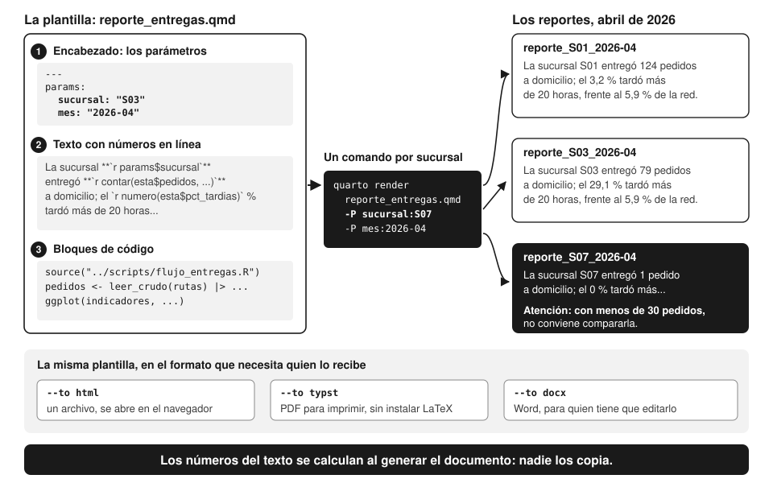
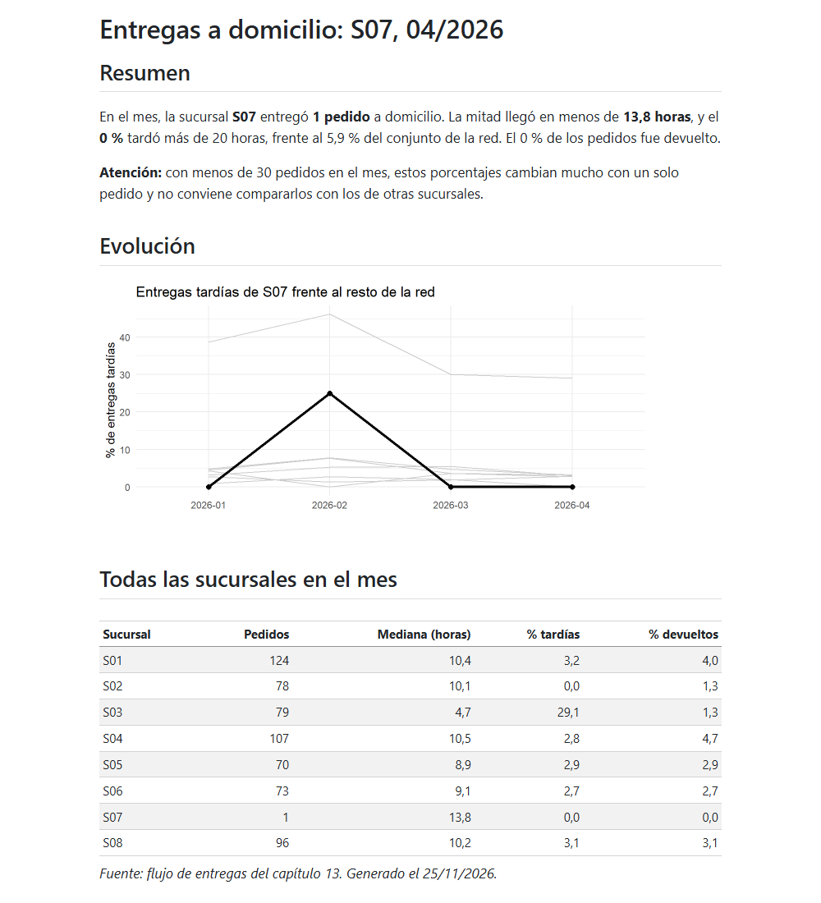

# Comunicar II: reportes con Quarto {#sec-reportes}

El porcentaje de entregas tardías de Cali en abril apareció esta semana en tres lugares. En el correo que el analista envió el lunes decía 29,1 %. En la presentación del comité del miércoles, 30 %. En el informe en Word que circuló el viernes, 28,7 %. Nadie se equivocó del todo: el correo se escribió con los datos del lunes; la presentación, con una cifra redondeada a mano de un archivo de marzo, y el informe, con un archivo de abril que después se corrigió. Tres documentos, tres copias de un número, tres valores.

El problema no es de cuidado, es de método: **cada vez que un número se copia a mano, nace una versión que ya no está conectada con los datos**. Un reporte reproducible resuelve el problema de raíz. Es un documento en el que el texto, las tablas y los gráficos se calculan a partir de los datos en el momento de generarlo. No hay números copiados: si los datos cambian, el reporte se vuelve a generar y todos los números cambian juntos, en el texto, en la tabla y en el gráfico.

Este libro está escrito así. Cada número de sus capítulos sale de un bloque de código que se ejecutó al generar el libro, y por eso, cuando un dato cambiaba, el texto que lo comentaba se revisaba contra la salida real. La herramienta es **Quarto**, la misma que usamos para los gráficos interactivos del @sec-graficos-comunicar. En este capítulo la usamos para lo más frecuente que pide un trabajo de datos: un reporte mensual, uno por sucursal, que se genera solo.

::: {.callout-tip}
## Antes de empezar

1. Quarto viene con Positron. Para comprobar que está disponible desde la terminal: `quarto --version`.
2. Las plantillas del capítulo están en la carpeta `reportes/`, que tiene su propio `_quarto.yml`: es un proyecto de Quarto aparte, para que los reportes no hereden la configuración de este libro. Los reportes generados quedan en `reportes/salida/`.
3. Para reportes en Python, Quarto usa Jupyter, y para pasarles parámetros necesita `papermill`; los dos quedaron instalados en la @sec-instalar-paquetes. Si Quarto no encuentra el Python del proyecto, se le indica con la variable de entorno `QUARTO_PYTHON`.
:::

```{r}
#| label: paquetes-cap15
#| message: false
use("purrr", c("map_chr", "map_lgl"))
quarto <- Sys.which("quarto")

mostrar_archivo <- function(ruta) {
  cat("````{.markdown filename=\"", ruta, "\"}\n", sep = "")
  cat(readLines(ruta, encoding = "UTF-8"), sep = "\n")
  cat("\n````\n")
}
```

`mostrar_archivo()` imprime un archivo dentro de un bloque de código del documento. La usamos para mostrar las plantillas: así el código que se lee en este capítulo es exactamente el del archivo que se ejecuta, sin una copia que se pueda desactualizar. Es el mismo principio del capítulo aplicado a sí mismo.

## Un documento que se calcula {#sec-documento-quarto}

Un documento de Quarto es un archivo de texto con extensión `.qmd` que tiene tres partes (@fig-reporte-parametrizado):

1. Un **encabezado** entre dos líneas de `---`, escrito en YAML, con el título, el formato de salida y, si los tiene, los **parámetros**: valores que se pueden cambiar al generar el documento sin tocar el archivo.
2. **Texto** en Markdown: párrafos, títulos, listas, negritas. Dentro del texto, los **números en línea**: una expresión de código entre comillas invertidas, como <code>&#96;r nrow(pedidos)&#96;</code>, que se reemplaza por su resultado al generar el documento.
3. **Bloques de código** que leen los datos, calculan, dibujan gráficos y arman tablas. Con `echo: false` en el encabezado, el código se ejecuta pero no se muestra: quien lee el reporte ve los resultados, no el código.

El comando `quarto render` ejecuta el código, reemplaza los números en línea y produce el documento final en el formato pedido: una página HTML, un PDF o un documento de Word.

{#fig-reporte-parametrizado fig-alt="A la izquierda, la plantilla reporte_entregas.qmd con tres partes numeradas: el encabezado con los parámetros sucursal y mes; el texto con números en línea; y los bloques de código que leen, calculan y grafican. En el medio, el comando quarto render con el parámetro de la sucursal. A la derecha, tres reportes de abril con la frase real de cada uno: S01 entregó 124 pedidos y el 3,2 % tardó más de 20 horas; S03 entregó 79 pedidos y el 29,1 %; S07 entregó 1 pedido, con una advertencia de pocos datos que solo aparece en ese reporte. Abajo, la misma plantilla sale como HTML, PDF con Typst o Word. Al pie: los números del texto se calculan al generar el documento; nadie los copia."}

### Ejemplo guiado 15.1: el reporte mensual de una sucursal

Cada jefe de sucursal debe recibir, a principios de mes, un reporte con los indicadores de entregas de su sucursal en el mes anterior, comparados con el resto de la red. Esta es la plantilla, `reportes/reporte_entregas.qmd`, completa:

```{r}
#| label: plantilla-r
#| echo: false
#| output: asis
mostrar_archivo("reportes/reporte_entregas.qmd")
```

Vale la pena leerla por partes, porque cada una resuelve un problema distinto.

**Los parámetros.** El encabezado declara `params` con dos valores por defecto. Dentro del documento, `params$sucursal` y `params$mes` se usan como cualquier variable, y el título mismo los incluye. Al generar el reporte, `-P sucursal:S07` reemplaza el valor por defecto, sin editar el archivo.

**Los datos vienen del flujo.** El primer bloque carga las funciones del @sec-flujos y las aplica a los archivos mensuales. El reporte no tiene una copia de los datos ni de los indicadores: los calcula. La única regla nueva es la ruta: el código de un documento se ejecuta en la carpeta del documento, así que las rutas empiezan con `../` para subir a la carpeta del proyecto, y `source(..., chdir = TRUE)` carga el archivo de funciones desde su propia carpeta.

**Los números en línea, con formato.** Cada número del texto es una expresión: <code>&#96;r esta$pedidos&#96;</code>. La función `numero()` les da el formato colombiano, con punto para los miles y coma para los decimales, y `contar()` resuelve un detalle que solo aparece cuando el texto sale de los datos: con un pedido, la frase debe decir "1 pedido" y no "1 pedidos". **El texto también se programa**, con sus casos borde: el singular, el cero, el faltante.

**El texto condicional.** La línea que empieza con <code>&#96;r if (esta$pedidos &lt; 30) ...&#96;</code> solo produce texto cuando la sucursal tuvo menos de 30 pedidos. Es la versión para reportes del punto hueco de `S07` en el @sec-graficos-comunicar: la advertencia aparece justo donde hace falta, sin que nadie tenga que acordarse de escribirla.

**La tabla.** `knitr::kable()` convierte una tabla de R en una tabla de Markdown, que Quarto presenta en el formato de salida. Para tablas con más formato (colores, grupos de columnas, notas al pie), los paquetes `gt` en R y `great_tables` en Python son la referencia.

Así se ve el reporte de `S07` en abril, con su advertencia:

{#fig-captura-reporte fig-alt="Captura de un reporte HTML titulado Entregas a domicilio: S07, 04/2026. Un resumen dice que la sucursal S07 entregó 1 pedido a domicilio y que el 0 % tardó más de 20 horas, frente al 5,9 % de la red, seguido de una advertencia en negrita sobre los pocos pedidos. Debajo, un gráfico de líneas con S07 en negro y las demás sucursales en gris, y una tabla con los pedidos, la mediana de horas y los porcentajes de las ocho sucursales." width="75%"}

### Ejemplo guiado 15.2: un reporte por sucursal

Con la plantilla lista, generar los reportes de todas las sucursales es un problema de iteración, como los del @sec-escala: la misma operación, con un valor distinto cada vez.

::: {.panel-tabset group="lenguaje"}

### R

```{r}
#| label: reportes-generar
generar_reporte <- function(sucursal, mes = "2026-04", formato = "html") {
  extension <- c(html = "html", typst = "pdf", docx = "docx")[[formato]]
  salida <- sprintf("reporte_%s_%s.%s", sucursal, mes, extension)
  anterior <- setwd("reportes")
  on.exit(setwd(anterior))
  estado <- system2(
    quarto,
    c(
      "render",
      "reporte_entregas.qmd",
      "-P",
      paste0("sucursal:", sucursal),
      "-P",
      paste0("mes:", mes),
      "--to",
      formato,
      "--output",
      salida
    ),
    stdout = FALSE,
    stderr = FALSE
  )
  if (estado != 0) {
    stop("no se pudo generar el reporte de ", sucursal, call. = FALSE)
  }
  file.path("reportes", "salida", salida)
}

generados <- map_chr(c("S01", "S03", "S07"), generar_reporte)
generados
round(file.size(generados) / 1e6, 2)
map_lgl(generados, \(archivo) {
  any(grepl("Atención", readLines(archivo, warn = FALSE)))
})
```

`generar_reporte()` arma el comando de Quarto con los parámetros y lo ejecuta con `system2()`, como el flujo del @sec-flujos. Antes entra a la carpeta `reportes/`, porque Quarto debe ejecutarse desde la carpeta del proyecto del reporte: desde otra carpeta, con `embed-resources`, busca los archivos de apoyo en el lugar equivocado y falla. `setwd()` cambia la carpeta de trabajo y devuelve la anterior, y `on.exit()` la restablece al salir de la función, aunque haya un error: una función no debería dejar cambiado el estado de la sesión. Con `stdout = FALSE`, `system2()` devuelve el código de salida, y la función se detiene si el reporte no se generó: el mismo principio del código de salida que dice la verdad. `map_chr()` la aplica a cada sucursal y devuelve las rutas de los archivos generados. Aquí son tres para no alargar el capítulo; para todas, basta con `sort(unique(pedidos$sucursal))`.

Las dos últimas líneas son la comprobación, leyendo los archivos generados y no la plantilla: cada reporte pesa alrededor de un megabyte, porque `embed-resources: true` mete dentro del HTML las imágenes y los estilos, de modo que el archivo se puede enviar por correo y se abre sin conexión. Y la advertencia de pocos datos solo aparece en el de `S07`.

### Python

```{python}
import os
import subprocess
import sys

os.environ["QUARTO_PYTHON"] = sys.executable


def generar_reporte(sucursal, mes="2026-04"):
    salida = f"reporte_py_{sucursal}_{mes}.html"
    resultado = subprocess.run(
        [
            "quarto",
            "render",
            "reporte_entregas_py.qmd",
            "-P",
            f"sucursal:{sucursal}",
            "-P",
            f"mes:{mes}",
            "--output",
            salida,
        ],
        capture_output=True,
        text=True,
        cwd="reportes",
    )
    if resultado.returncode != 0:
        raise RuntimeError(f"no se pudo generar el reporte de {sucursal}")
    return os.path.join("reportes", "salida", salida)


generados = [generar_reporte(s) for s in ["S01", "S03"]]
print(generados)
```

`cwd="reportes"` ejecuta Quarto desde la carpeta del proyecto de reportes, como `setwd()` en R, pero solo para ese proceso: la carpeta de trabajo de Python no cambia. `os.environ["QUARTO_PYTHON"] = sys.executable` le dice a Quarto que use el mismo Python que está ejecutando este código, con sus bibliotecas; sin esa línea, Quarto puede encontrar otro Python del sistema. La variable de entorno pasa a los procesos que se lanzan después, como el de Quarto.

La plantilla de Python, `reportes/reporte_entregas_py.qmd`, tiene la misma estructura con tres diferencias:

```{r}
#| label: plantilla-py
#| echo: false
#| output: asis
mostrar_archivo("reportes/reporte_entregas_py.qmd")
```

Los parámetros no van en el encabezado, sino en un bloque de código marcado con `tags: [parameters]`, que define sus valores por defecto; Quarto le pasa los valores de `-P` a `papermill`, que los inserta justo después de ese bloque. Los números en línea se escriben <code>&#96;{python} expresion&#96;</code>. Y la tabla se presenta con `Markdown(tabla.to_markdown())`, que necesita la biblioteca `tabulate`.

Una advertencia práctica: Quarto mantiene en segundo plano un proceso de Jupyter para no arrancar Python en cada reporte. Si instalas una biblioteca mientras ese proceso está activo, no la verá. `quarto render ... --execute-daemon-restart` lo reinicia.

### DuckDB

Un reporte puede usar DuckDB como cualquier otro código del documento: un bloque de R o de Python que se conecta y consulta. Es la forma de que un reporte sobre millones de filas se genere rápido: DuckDB calcula los indicadores sobre los archivos y el reporte solo recibe la tabla pequeña. Quarto no ejecuta SQL directamente, pero `knitr` sí admite bloques `{sql}` con una conexión de `DBI`, con la opción `connection: con`.

:::

## El formato según quién lo recibe {#sec-formatos-salida}

La misma plantilla produce documentos distintos según el formato que se pida. La elección no es técnica: depende de **quién recibe el reporte y qué va a hacer con él**.

| Quien recibe | Qué hace con el reporte | Formato | Comando |
|---|---|---|---|
| Un jefe que lo lee en el computador o el celular | Lo lee y lo reenvía | HTML autocontenido | `--to html` con `embed-resources: true` |
| Un comité que lo imprime o lo archiva | Lo lee en papel y lo firma | PDF | `--to typst` (o `--to pdf`, con LaTeX) |
| Alguien que tiene que agregar comentarios o adaptarlo | Lo edita | Word | `--to docx` |
| Muchas personas, todos los meses | Lo consulta cuando necesita | Un sitio web con todos los reportes | Un proyecto de Quarto de tipo `website` |

: Formatos de salida según quién recibe el reporte {#tbl-formatos-reporte}

Para PDF, Quarto tiene dos caminos. El clásico usa LaTeX, un sistema de composición de textos potente pero pesado de instalar. El moderno usa **Typst**, que viene incluido en Quarto: no hay que instalar nada y genera el PDF en segundos.

```{r}
#| label: reportes-formatos
otros <- c(
  generar_reporte("S03", formato = "typst"),
  generar_reporte("S03", formato = "docx")
)
data.frame(archivo = basename(otros), kb = round(file.size(otros) / 1e3))
```

El mismo código produjo un PDF y un documento de Word. El de Word se puede abrir, editar y comentar como cualquier otro, y con la opción `reference-doc` del encabezado toma los estilos de una plantilla de la empresa: tipografía, colores y logotipo. Lo que se pierde en Word es la conexión con los datos: en cuanto alguien edita un número a mano, ese documento vuelve a ser una copia. Por eso, cuando se entrega en Word, conviene que el documento diga en el pie de qué datos y en qué fecha se generó, como hace esta plantilla.

## Reportes que tardan {#sec-reportes-tardan}

Este reporte se genera en unos segundos. Uno que ajusta un modelo, consulta una API o lee millones de filas puede tardar minutos, y cuando se trabaja en el texto no tiene sentido volver a calcular todo en cada cambio de una coma. Quarto tiene dos herramientas para eso:

- **`cache: true`** en las opciones de un bloque, o en `execute:` del encabezado, guarda el resultado de cada bloque y no lo vuelve a ejecutar mientras su código no cambie. Es la misma idea del @sec-incremental, aplicada a los bloques de un documento. Su riesgo es el mismo: si el bloque lee un archivo que cambió, la caché no se entera, salvo que se declare la dependencia con la opción `cache.extra`, por ejemplo `cache.extra = file.mtime("datos.csv")`.
- **`freeze`**, en los proyectos de Quarto como este libro, guarda los resultados de cada documento y no lo vuelve a ejecutar mientras su archivo no cambie. Es lo que permite publicar el libro sin volver a correr el código de cada capítulo.

Para un reporte mensual que se genera una vez, ninguna hace falta: es mejor que tarde un minuto más y esté seguro de usar los datos del mes.

## Ejercicio 15.1: el reporte del trimestre {#sec-ejercicio-reportes}

1. Copia `reportes/reporte_entregas.qmd` como `reportes/reporte_trimestre.qmd` y cámbialo para que el parámetro sea un trimestre (por ejemplo, `"2026-T1"`) en lugar de un mes. Pista: crea una columna de trimestre a partir de la fecha.
2. Agrega un párrafo condicional que, si la sucursal tiene más del doble de entregas tardías que la red, lo diga en negrita y recomiende revisar la operación de entregas.
3. Agrega al final una sección "Calificación de los clientes" con la calificación promedio, y declara en el texto cuántos pedidos no tienen calificación. ¿Por qué es importante decirlo? Recuerda el faltante informativo del @sec-explorar.
4. Genera el reporte del primer trimestre para todas las sucursales en HTML y el de Cali, además, en PDF.
5. Escribe una función que compruebe, para cada reporte generado, que el archivo existe y que su tamaño es mayor que cero, y úsala después de generarlos.

Para comprobar tu resultado: en el primer trimestre, Cali tiene 284 entregas a domicilio y el 38,7 % tardó más de 20 horas, frente al 8,8 % de la red, más del cuádruple. Es la única sucursal en la que debe aparecer el párrafo del punto 2.

## Cierre: el número no se copia {#sec-cierre-reportes}

Un reporte reproducible no se escribe una vez y se actualiza a mano: se genera. El texto, las tablas y los gráficos se calculan a partir de los datos en el momento de producir el documento, y por eso un mismo número no puede tener tres versiones. Con parámetros, una plantilla produce un reporte por sucursal, por mes o por cliente; con los números en línea y el texto condicional, el documento dice lo que corresponde a cada caso, incluidas las advertencias que nadie tendría que acordarse de escribir; y con un comando distinto, la misma plantilla sale en el formato que necesita quien lo recibe.

El reporte es el formato para leer. Pero no todo se comunica leyendo: hay quien necesita filtrar y calcular en una hoja de cálculo, quien necesita presentarle a un comité en diez minutos y quien necesita mirar los indicadores todos los días. De esos tres formatos trata el siguiente capítulo.
