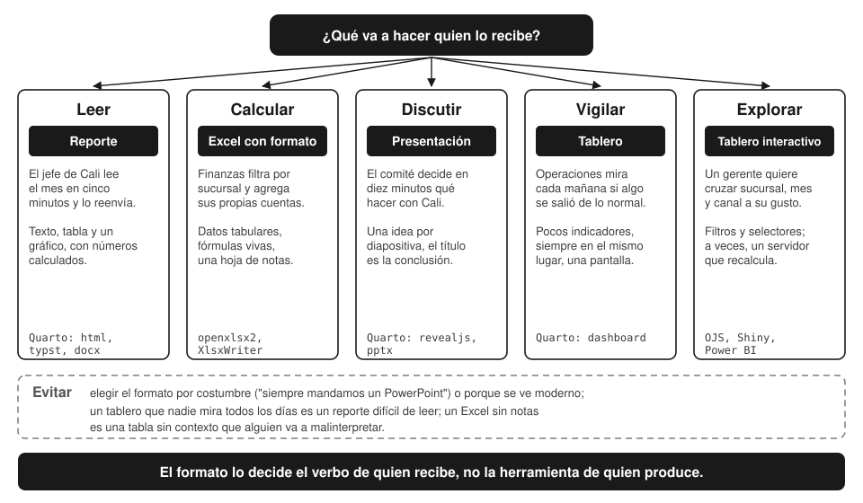
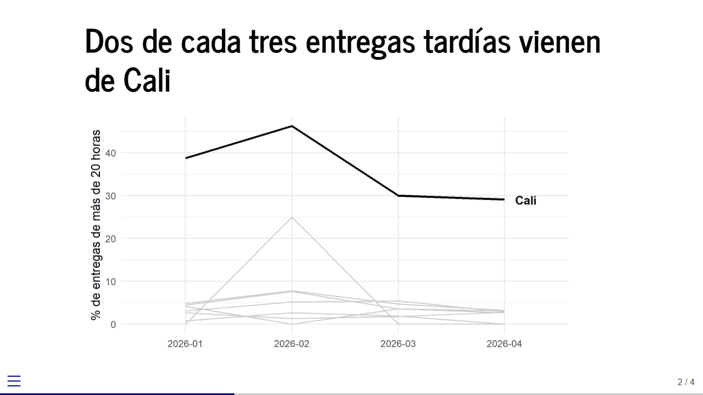
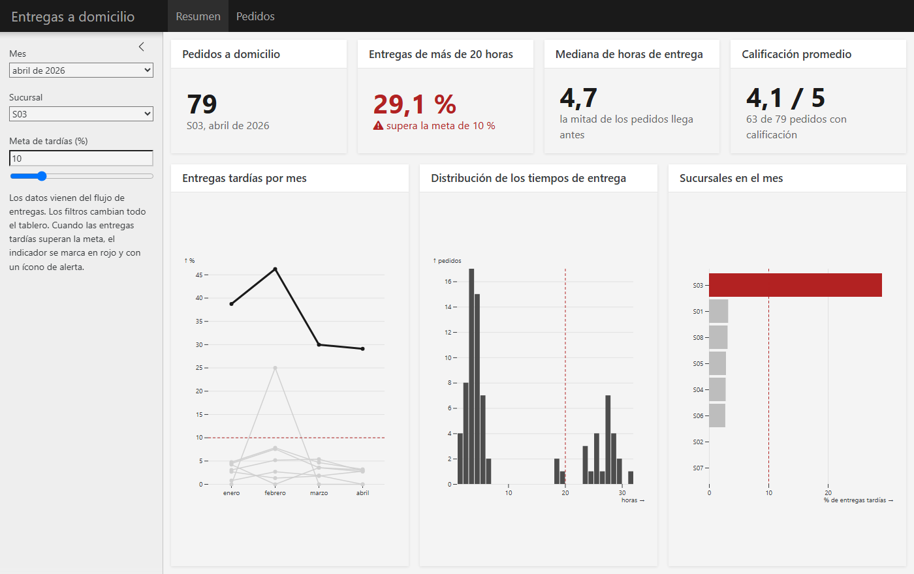
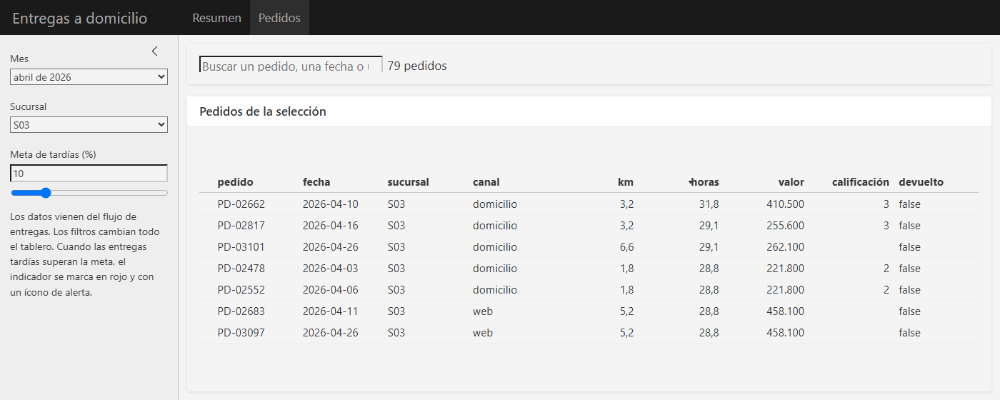

# Comunicar III: Excel, presentaciones y tableros {#sec-formatos-comunicar}

¿Qué es una presentación y qué es un tablero? La pregunta parece obvia hasta que se intenta responder sin nombrar un programa. Una presentación no es "un PowerPoint", y un tablero no es "un Power BI". Son formatos para **hacer cosas distintas con los mismos datos**: una presentación sirve para que un grupo de personas discuta y decida algo en una reunión, con una idea por diapositiva; un tablero (*dashboard*) sirve para que alguien vigile unos pocos indicadores con frecuencia, en una sola pantalla, siempre en el mismo lugar. Y el Excel con formato que tanto se pide sirve para algo que ni el reporte ni la presentación permiten: que quien lo recibe **calcule por su cuenta**.

Este capítulo cierra la comunicación con esos tres formatos. Los tres salen de los mismos datos y las mismas funciones del flujo del @sec-flujos, y la pregunta que los ordena es la del @sec-guardar-compartir, un paso más allá: no solo quién va a recibir el resultado, sino **qué va a hacer con él** (@fig-elegir-formato).

{#fig-elegir-formato fig-alt="Una pregunta arriba: qué va a hacer quien lo recibe. Cinco respuestas, cada una con su formato y un ejemplo. Leer: un reporte; el jefe de Cali lee el mes en cinco minutos y lo reenvía; se hace con Quarto en HTML, Typst o Word. Calcular: un Excel con formato; finanzas filtra por sucursal y agrega sus cuentas; se hace con openxlsx2 o XlsxWriter. Discutir: una presentación; el comité decide en diez minutos qué hacer con Cali; se hace con Quarto en revealjs o pptx. Vigilar: un tablero; operaciones mira cada mañana si algo se salió de lo normal; se hace con Quarto dashboard. Explorar: un tablero interactivo; un gerente cruza sucursal, mes y canal a su gusto; se hace con OJS, Shiny o Power BI. Con trazo discontinuo, Evitar: elegir el formato por costumbre o porque se ve moderno; un tablero que nadie mira todos los días es un reporte difícil de leer, y un Excel sin notas es una tabla sin contexto. Al pie: el formato lo decide el verbo de quien recibe, no la herramienta de quien produce."}

::: {.callout-tip}
## Antes de empezar

1. Este capítulo usa el flujo de entregas del @sec-flujos y la carpeta `reportes/` del @sec-reportes, donde están la presentación y el tablero.
2. Para Excel, en R usamos `openxlsx2`, que ya conoces del @sec-importacion-fuentes. En Python, `XlsxWriter`: `uv pip install xlsxwriter`.
3. DuckDB no tiene pestaña: los tres formatos reciben tablas pequeñas, ya calculadas.
:::

```{r}
#| label: paquetes-cap16
#| message: false
use("openxlsx2", c("wb_workbook", "wb_add_worksheet", "wb_add_data", "wb_add_font",
                   "wb_add_fill", "wb_add_numfmt", "wb_add_formula", "wb_set_col_widths",
                   "wb_freeze_pane", "wb_add_dxfs_style", "wb_add_conditional_formatting",
                   "wb_color", "wb_save", "wb_load", "wb_to_df"))
use("dplyr", c("filter", "select"))

source("scripts/flujo_entregas.R")
rutas <- c(list.files("datos/cap13/entregas", pattern = "\\.csv$", full.names = TRUE),
           "datos/cap13/abril/entregas_2026_04.csv")
indicadores <- leer_crudo(rutas) |> armonizar() |> validar() |> resumir()
quarto <- Sys.which("quarto")
dir.create("reportes/salida", showWarnings = FALSE)
```

## Excel con formato: para quien va a calcular {#sec-excel-formato}

En el @sec-guardar-compartir entregamos Excel sin formato, como transporte de datos: una tabla por hoja, para que otra persona o herramienta trabajara con ellos. Aquí el Excel es para una persona que lo va a **leer y usar**, y el formato es parte del mensaje. Un Excel bien entregado tiene cinco cosas que una tabla volcada no tiene:

1. **Un título y una fecha de corte** en la parte de arriba, para que nadie tenga que adivinar de qué mes son los datos.
2. **Encabezados que se distinguen** de los datos y que **quedan fijos** al bajar por la hoja.
3. **Números con su formato**: decimales con coma, porcentajes como porcentajes, miles con punto. El formato se aplica a la celda, no se escribe como texto: `29,1` debe seguir siendo un número con el que se puede calcular.
4. **Fórmulas vivas** donde quien recibe va a querer ajustar algo: un total que se recalcula si filtra o corrige una fila.
5. **Una hoja de notas** con la fuente, la fecha en que se generó y la definición de cada columna. Es el diccionario de datos del @sec-guardar-compartir, para el lector.

Y un sexto elemento, cuando ayuda: **formato condicional**, que resalta las celdas que cumplen una condición, como las sucursales con más de 10 % de entregas tardías. Es el destacado del @sec-graficos-comunicar aplicado a una tabla.

### Ejemplo guiado 16.1: los indicadores de abril para finanzas

::: {.panel-tabset group="lenguaje"}

### R

```{r}
#| label: excel-formato
abril <- indicadores |>
  filter(mes == "2026-04") |>
  select(sucursal, pedidos, mediana_horas, pct_tardias, pct_devueltos)
ultima <- 3 + nrow(abril)                         # fila de la última sucursal

notas <- data.frame(
  campo = c("Fuente", "Generado", "pedidos", "mediana_horas", "pct_tardias", "pct_devueltos"),
  descripcion = c("Flujo de entregas (capítulo 13), pedidos a domicilio de abril de 2026",
                  format(Sys.Date(), "%d/%m/%Y"),
                  "Pedidos a domicilio del mes; no incluye retiros en tienda",
                  "Mediana de horas entre el pedido y la entrega",
                  "% de entregas que tardaron más de 20 horas",
                  "% de pedidos devueltos")
)

libro <- wb_workbook() |>
  wb_add_worksheet("Indicadores", grid_lines = FALSE) |>
  wb_add_data(x = "Indicadores de entregas, abril de 2026", dims = "A1") |>
  wb_add_font(dims = "A1", bold = TRUE, size = 14) |>
  wb_add_data(x = abril, start_row = 3) |>
  wb_add_fill(dims = "A3:E3", color = wb_color("1A1A1A")) |>
  wb_add_font(dims = "A3:E3", color = wb_color("FFFFFF"), bold = TRUE) |>
  wb_add_numfmt(dims = sprintf("C4:E%d", ultima), numfmt = "0.0") |>
  wb_add_data(x = "Total", dims = sprintf("A%d", ultima + 1)) |>
  wb_add_formula(x = sprintf("SUM(B4:B%d)", ultima), dims = sprintf("B%d", ultima + 1)) |>
  wb_add_font(dims = sprintf("A%d:B%d", ultima + 1, ultima + 1), bold = TRUE) |>
  wb_set_col_widths(cols = 1:5, widths = c(11, 10, 15, 13, 14)) |>
  wb_freeze_pane(first_active_row = 4) |>
  wb_add_dxfs_style(name = "alto", bg_fill = wb_color("BFBFBF"), text_bold = TRUE) |>
  wb_add_conditional_formatting(dims = sprintf("D4:D%d", ultima), rule = ">10",
                                style = "alto") |>
  wb_add_worksheet("Notas") |>
  wb_add_data(x = notas) |>
  wb_set_col_widths(cols = 1:2, widths = c(16, 70))

ruta_excel <- "reportes/salida/indicadores_entregas_2026-04.xlsx"
wb_save(libro, ruta_excel)

revisado <- wb_load(ruta_excel)
revisado$get_sheet_names()
wb_to_df(revisado, sheet = "Indicadores", start_row = 3, show_formula = TRUE) |> tail(3)
```

`openxlsx2` construye el libro con una cadena de funciones `wb_*()`, cada una sobre un rango de celdas que se indica con `dims`, en la notación de Excel (`"A3:E3"`). Las piezas más importantes:

- `wb_add_numfmt(numfmt = "0.0")` aplica un formato de número con un decimal. Excel lo muestra con coma o con punto según la configuración regional de quien lo abre: el archivo guarda el número y el formato, no el texto.
- `wb_add_formula()` escribe una **fórmula**, no un valor. Al leer el libro con `wb_to_df(show_formula = TRUE)`, la fila del total muestra `SUM(B4:B11)`: el total lo calcula Excel al abrir el archivo, y se recalcula si alguien corrige una fila. Leído desde R sin esa opción, el total aparecería vacío, porque `openxlsx2` no calcula fórmulas.
- `wb_freeze_pane(first_active_row = 4)` deja fijas las filas de arriba al bajar por la hoja.
- El formato condicional se arma en dos pasos: `wb_add_dxfs_style()` define un estilo (fondo gris, negrita) y `wb_add_conditional_formatting()` lo aplica a las celdas que cumplen la regla, `>10`. Si mañana Cali baja a 8 %, la celda deja de resaltarse sola.

La comprobación lee el archivo escrito, como en el @sec-guardar-compartir: tiene las dos hojas y la fórmula del total.

### Python

```python
from pathlib import Path

import pandas as pd
from openpyxl import load_workbook

from scripts.flujo_entregas import leer_crudo, armonizar, validar, resumir

rutas = sorted(str(p) for p in Path("datos/cap13/entregas").glob("*.csv")) + [
    "datos/cap13/abril/entregas_2026_04.csv"]
indicadores = resumir(validar(armonizar(leer_crudo(rutas))))

abril = indicadores[indicadores["mes"] == "2026-04"].drop(columns="mes")
ultima = 3 + len(abril)
ruta = "reportes/salida/indicadores_entregas_py_2026-04.xlsx"

with pd.ExcelWriter(ruta, engine="xlsxwriter") as escritor:
    abril.to_excel(escritor, sheet_name="Indicadores", startrow=2, index=False)
    libro = escritor.book
    hoja = escritor.sheets["Indicadores"]
    titulo = libro.add_format({"bold": True, "font_size": 14})
    encabezado = libro.add_format({"bold": True, "font_color": "white", "bg_color": "#1A1A1A"})
    decimal = libro.add_format({"num_format": "0.0"})
    alto = libro.add_format({"bg_color": "#BFBFBF", "bold": True})

    hoja.write("A1", "Indicadores de entregas, abril de 2026", titulo)
    for col, nombre in enumerate(abril.columns):
        hoja.write(2, col, nombre, encabezado)
    hoja.set_column("A:A", 11)
    hoja.set_column("B:B", 10)
    hoja.set_column("C:E", 14, decimal)
    hoja.write(ultima, 0, "Total", libro.add_format({"bold": True}))
    hoja.write_formula(ultima, 1, f"=SUM(B4:B{ultima})", libro.add_format({"bold": True}))
    hoja.freeze_panes(3, 0)
    hoja.conditional_format(f"D4:D{ultima}", {"type": "cell", "criteria": ">",
                                              "value": 10, "format": alto})
    hoja.hide_gridlines(2)

    notas = pd.DataFrame({
        "campo": ["Fuente", "pct_tardias"],
        "descripcion": ["Flujo de entregas (capítulo 13), pedidos a domicilio de abril de 2026",
                        "% de entregas que tardaron más de 20 horas"]})
    notas.to_excel(escritor, sheet_name="Notas", index=False)
    escritor.sheets["Notas"].set_column("B:B", 70)

revisado = load_workbook(ruta)
print(revisado.sheetnames, revisado["Indicadores"][f"B{ultima + 1}"].value)
```

```text
['Indicadores', 'Notas'] =SUM(B4:B11)
```

Con `engine="xlsxwriter"`, `pandas` escribe la tabla y deja disponibles el libro y la hoja de `XlsxWriter` para darles formato. Una diferencia con R: en `XlsxWriter` las filas y columnas se cuentan **desde cero** cuando se usan números (`write(2, col, ...)` es la fila 3 de Excel), pero los rangos en texto, como `"D4:D11"`, usan la notación de Excel. Mezclar las dos es la fuente de errores más común. Y como `XlsxWriter` solo escribe, la comprobación usa `openpyxl`, que lee el archivo y muestra la fórmula del total tal como quedó guardada.

:::

## Presentaciones: para decidir en una reunión {#sec-presentaciones}

Una presentación es el formato con menos texto y más consecuencias: en diez minutos, un grupo de personas tiene que entender un problema y decidir algo. Las reglas del @sec-graficos-comunicar se vuelven más estrictas: **una idea por diapositiva**, y el título de cada diapositiva es esa idea, escrita como una frase completa. "Entregas tardías por sucursal" es una etiqueta; "Dos de cada tres entregas tardías vienen de Cali" es una idea que el comité puede discutir.

Con Quarto, una presentación es un documento como el reporte del @sec-reportes, con `format: revealjs`: cada título de nivel 2 (`##`) empieza una diapositiva nueva, y el código que la acompaña calcula los gráficos con los datos del flujo. Así, la presentación del mes próximo se genera con el mismo comando, sin rehacer las diapositivas a mano. Esta es la presentación de las entregas, `reportes/presentacion_entregas.qmd`:

```{r}
#| label: presentacion-archivo
#| echo: false
#| output: asis
cat("````{.markdown filename=\"reportes/presentacion_entregas.qmd\"}\n")
cat(readLines("reportes/presentacion_entregas.qmd", encoding = "UTF-8"), sep = "\n")
cat("\n````\n")
```

Tiene tres diapositivas de contenido, cada una con una idea. Tres herramientas de `revealjs` que vale la pena conocer: `::: {.columns}` divide una diapositiva en columnas, para poner el texto al lado del gráfico; `::: {.notes}` agrega **notas del presentador**, que no se ven en la pantalla del público sino en la vista del presentador (tecla `S`), y que también pueden calcularse con los datos; y `embed-resources: true` produce un solo archivo HTML que se abre en cualquier navegador, sin conexión.

```{r}
#| label: presentacion-generar
generar <- function(archivo, ...) {
  anterior <- setwd("reportes")
  on.exit(setwd(anterior))
  estado <- system2(quarto, c("render", archivo, ...), stdout = FALSE, stderr = FALSE)
  if (estado != 0) stop("no se pudo generar ", archivo, call. = FALSE)
  invisible(estado)
}

generar("presentacion_entregas.qmd")
generar("presentacion_entregas.qmd", "--to", "pptx")
file.exists(c("reportes/salida/presentacion_entregas.html",
              "reportes/salida/presentacion_entregas.pptx"))
```

La misma fuente produce dos presentaciones. La de `revealjs` es una página web: se proyecta desde el navegador, se avanza con las flechas y se envía como un archivo. La de `--to pptx` es un PowerPoint editable, para cuando la presentación tiene que terminar dentro de la plantilla de la empresa o alguien más la va a completar. Como con el Word del @sec-reportes, en cuanto alguien la edita a mano deja de estar conectada con los datos.

{#fig-diapositiva fig-alt="Una diapositiva con el título Dos de cada tres entregas tardías vienen de Cali y un gráfico de líneas del porcentaje de entregas tardías por mes, con Cali en negro, muy por encima de las demás sucursales en gris. Abajo a la derecha, el número de diapositiva, 2 de 4." width="80%"}

## Tableros: para vigilar y explorar {#sec-tableros}

Un tablero responde una pregunta que se hace todos los días: ¿todo va bien? Y cuando algo no va bien, permite buscar dónde. Por eso tiene reglas propias, distintas de las del reporte:

- **Pocos indicadores, siempre en el mismo lugar.** El valor de un tablero está en que quien lo mira cada mañana sabe dónde está cada número y nota cuándo cambia. Un tablero con treinta gráficos es un reporte difícil de leer.
- **Los números más importantes, grandes y arriba**, cada uno con su contexto: un 29,1 % de entregas tardías no dice nada solo; dice algo al lado de una meta.
- **Filtros que cambian todo a la vez.** Elegir otra sucursal o otro mes actualiza los indicadores, los gráficos y la tabla. Es lo que convierte un tablero de "mirar" en uno de "explorar".
- **Alertas que no dependen solo del color**, como en el @sec-graficos-comunicar: el indicador que supera la meta cambia de color, pero también muestra un ícono y una frase.
- **Se actualiza solo.** Un tablero que hay que regenerar a mano deja de mirarse. Con el flujo programado del @sec-programar, el tablero se genera después de cada carga.

Quarto tiene un formato para tableros, `format: dashboard`. Las páginas se definen con títulos de nivel 1, las filas con títulos de nivel 2 y cada bloque de código es una tarjeta. Y con las celdas de Observable del @sec-graficos-comunicar, el tablero se vuelve interactivo sin servidor: los filtros, los indicadores, los gráficos y la tabla reaccionan en el navegador de quien lo mira. Este es el tablero de las entregas, `reportes/tablero_entregas.qmd`:

```{r}
#| label: tablero-archivo
#| echo: false
#| output: asis
cat("````{.markdown filename=\"reportes/tablero_entregas.qmd\"}\n")
cat(readLines("reportes/tablero_entregas.qmd", encoding = "UTF-8"), sep = "\n")
cat("\n````\n")
```

```{r}
#| label: tablero-generar
generar("tablero_entregas.qmd")
file.exists("reportes/salida/tablero_entregas.html")
```

{#fig-tablero fig-alt="Un tablero con una barra de navegación negra con dos páginas, Resumen y Pedidos. A la izquierda, una barra lateral con tres filtros: el mes, abril de 2026; la sucursal, S03; y un control deslizante con la meta de tardías, 10 %. Arriba, cuatro tarjetas: 79 pedidos a domicilio; 29,1 % de entregas de más de 20 horas, en rojo, con un ícono de alerta y la frase supera la meta de 10 %; una mediana de 4,7 horas; y una calificación promedio de 4,1 sobre 5, con 63 de 79 pedidos calificados. Abajo, tres gráficos: las entregas tardías por mes con Cali en negro y una línea roja discontinua en la meta; la distribución de los tiempos de entrega de Cali, con dos grupos separados antes y después de la línea de 20 horas; y las sucursales ordenadas por su porcentaje de tardías, con Cali en rojo por superar la meta."}

{#fig-tablero-pedidos fig-alt="La segunda página del tablero, Pedidos, con la misma barra lateral. Arriba, un campo de búsqueda con el texto 79 pedidos. Debajo, una tabla con los pedidos de Cali en abril, ordenados del más lento al más rápido, con columnas para el pedido, la fecha, la sucursal, el canal, los kilómetros, las horas, el valor, la calificación y si fue devuelto. Los números usan coma decimal y punto de miles."}

El tablero tiene las piezas de un tablero de una herramienta de inteligencia de negocios:

- **Una barra lateral global** (`# {.sidebar}`), con tres controles de `Inputs`: dos listas (`Inputs.select()`) y un control deslizante (`Inputs.range()`) para la meta. Al ser global, filtra las dos páginas.
- **Tarjetas de indicadores** hechas con una función propia, `tarjeta()`, que escribe el valor en grande y una nota debajo; si se supera la meta, el valor se pone rojo y la nota agrega un ícono de alerta. Quarto tiene cajas de valor (*value boxes*) incorporadas, pero no permiten cambiar el color según los datos; escribir la tarjeta como una función de pocas líneas da ese control.
- **Gráficos que reaccionan a los filtros**, con Observable Plot: la línea de la meta se mueve cuando se mueve el control, la sucursal elegida se destaca, y al pasar el ratón cada punto o barra muestra sus datos (`tip: true`). La distribución de los tiempos deja ver, para Cali, las dos clases de entrega, y para cualquier otra sucursal, una sola.
- **Una segunda página con la tabla de pedidos**, con búsqueda (`Inputs.search()`) y orden por cualquier columna con un clic (`Inputs.table()`), con números en formato colombiano (`locale: "es-CO"`).
- **Un tema propio**, en el archivo `reportes/tablero.scss`: los colores, la tipografía y el estilo de las tarjetas. Es el equivalente del tema de `ggplot2`, para todo el tablero.

Las celdas de Observable se escriben en JavaScript, pero el patrón es el de siempre: R calcula los datos con el flujo y los entrega con `ojs_define()`, y cada celda define **una sola** cosa, un valor o un gráfico, que se recalcula cuando cambia algo de lo que depende. Un detalle que costó encontrar: los faltantes de R llegan a JavaScript como el texto `"NA"`, no como un valor vacío, y la comprobación de las calificaciones tiene que preguntar si el valor es un número (`typeof d.calificacion === "number"`). Es el mismo problema de tipos del @sec-tipos-calidad, en otro lenguaje.

::: {.callout-warning}
## Un tablero interactivo necesita un servidor web

Las celdas de Observable no funcionan si el archivo HTML se abre con doble clic desde una carpeta: el navegador bloquea, por seguridad, las funciones de JavaScript que necesitan, y el tablero muestra un mensaje de error en cada tarjeta. El tablero tiene que **servirse** desde una dirección web: publicado con `quarto publish` (@sec-publicar) en GitHub Pages o en un servidor de la organización, o en el propio equipo con `quarto preview reportes/tablero_entregas.qmd`, que lo abre en el navegador a través de un servidor local. El reporte del @sec-reportes y un tablero sin celdas de Observable no tienen esta limitación: son archivos que se pueden enviar por correo.
:::

¿Le tiene algo que envidiar este tablero a uno de Power BI o de Tableau? En lo que se ve y en la interacción para las preguntas que se diseñaron, poco: filtros, indicadores con alertas, gráficos con información al pasar el ratón, varias páginas y una tabla con búsqueda. Y tiene ventajas que esas herramientas no tienen: es código que se versiona, se revisa y se regenera con el flujo, sale de los mismos datos validados que el reporte y el Excel, y no necesita licencias. Lo que sí ofrecen esas herramientas, y conviene saberlo antes de elegir, es otra cosa: conectores a cientos de fuentes, actualización programada en un servicio en la nube, seguridad por filas (cada usuario ve solo sus datos), y sobre todo que una persona sin conocimientos de programación pueda armar sus propias vistas arrastrando campos. Si la organización necesita eso, la herramienta de inteligencia de negocios es la respuesta, y el consejo del @sec-importacion sigue en pie: que reciba tablas preparadas por el flujo, como el modelo estrella del @sec-guardar-compartir, y no que repita la limpieza.

::: {.callout-note}
## Fuera del alcance de este libro, pero a considerar

Dos herramientas merecen un lugar en la caja de herramientas de cualquier analista que comunique resultados, aunque este libro no las desarrolle:

- **Shiny**, para R y para Python, construye aplicaciones web interactivas en las que un servidor recalcula con cada acción del usuario. Es el paso siguiente cuando un tablero necesita consultar datos que no caben en el navegador, actualizarse en vivo, permitir que el usuario cargue un archivo o ejecutar un modelo con los parámetros que elige. A cambio, necesita un servidor encendido y alguien que lo mantenga. Quarto puede incluir componentes de Shiny en sus tableros (`server: shiny`), así que el paso desde lo que vimos aquí es corto. Su documentación oficial, para [R](https://shiny.posit.co/r/getstarted/) y para [Python](https://shiny.posit.co/py/), es el mejor punto de partida.
- **gt** en R y **great_tables** en Python construyen tablas para comunicar con el mismo cuidado que `ggplot2` pone en los gráficos: títulos y notas al pie, grupos de filas y de columnas, formato de números y fechas por columna, colores según los valores y pequeños gráficos dentro de las celdas. Son la respuesta cuando una tabla, y no un gráfico, es el centro de un reporte. Comparten diseño y autores, así que lo que se aprende en un lenguaje sirve en el otro.
:::

## Ejercicio 16.1: el paquete del comité {#sec-ejercicio-formatos}

El comité de operaciones se reúne el primer martes de cada mes. Prepara, con un solo script, lo que necesita:

1. Un Excel con dos hojas de indicadores (abril y el primer trimestre) y una hoja de notas. Resalta con formato condicional las sucursales con más de 10 % de entregas tardías y agrega una fila de total con fórmulas.
2. Una presentación de cuatro diapositivas como máximo, con una idea por diapositiva. Agrega una con la recomendación y, en las notas del presentador, los números que la respaldan, calculados con los datos.
3. Un tablero con una caja nueva: el número de sucursales que superan el 10 % de entregas tardías en el mes.
4. Al final del script, una comprobación que verifique que los tres archivos existen, que el Excel tiene las tres hojas y que la fórmula del total está en su lugar.
5. Escribe en dos líneas por qué cada formato es el adecuado para lo que hará quien lo recibe.

Para comprobar tu resultado: en abril, solo Cali supera el 10 % de entregas tardías (29,1 %), y la caja nueva del tablero debe mostrar 1. En el primer trimestre lo superan dos: Cali, con 38,7 %, y `S07`, con 11,1 %, calculado sobre apenas 9 entregas. Decide si el formato condicional debe resaltar a `S07` y, si no, cómo lo dirías en la hoja de notas.

## Cierre: el verbo de quien recibe {#sec-cierre-formatos}

Con este capítulo termina la comunicación. Los cuatro formatos (el reporte, el Excel con formato, la presentación y el tablero) salen de los mismos datos y las mismas funciones, y se generan con un comando. Lo que cambia es para qué sirven: el reporte se lee, el Excel se usa para calcular, la presentación se discute en una reunión y el tablero se vigila. Elegir por el verbo de quien recibe, y no por la costumbre o por la herramienta que uno sabe usar, es la última decisión de criterio del camino que empezó leyendo un CSV en el @sec-importacion.

Queda una pregunta que no es de comunicación, sino de confianza: ¿cómo saber que todo esto sigue funcionando el mes próximo, cuando cambie un paquete, llegue un archivo distinto o alguien más tome el proyecto? De eso trata el último capítulo.
