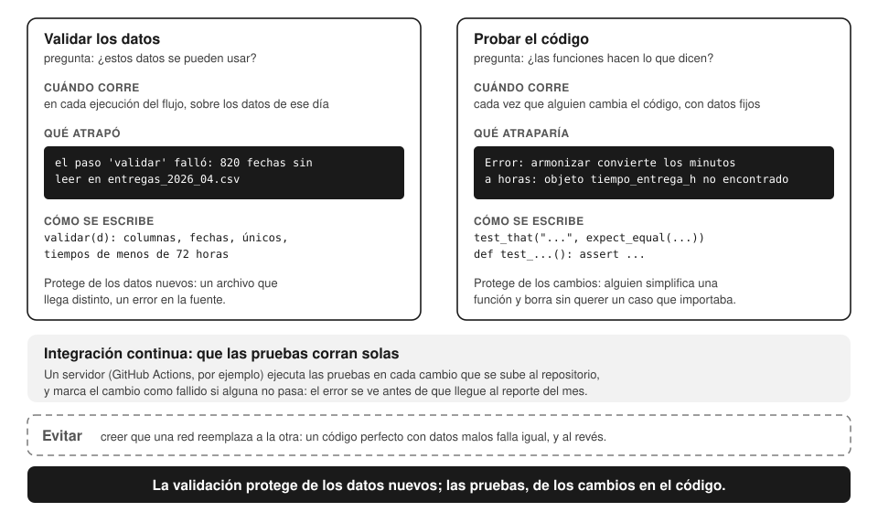

# Probar, proteger, publicar y mantener {#sec-mantener}

Mientras escribíamos este libro, el código se rompió varias veces. No por descuido: porque el mundo alrededor del código cambia.

- `pandas` 3 empezó a leer las columnas de fecha de los archivos Parquet como objetos de Python y no como fechas (@sec-tipos-calidad).
- En Windows, un archivo Parquet recién leído no se podía volver a escribir en la misma sesión (@sec-guardar-compartir).
- La correlación de Spearman de `pandas` necesitaba una biblioteca que no estaba instalada (@sec-explorar).
- Un gráfico salía distinto cada vez que se generaba el libro, porque el azar no tenía semilla (@sec-explorar).
- DuckDB rechazó una combinación de opciones de lectura que la documentación no prohibía de forma evidente (@sec-escala).
- Quarto no encontraba una biblioteca de Python recién instalada, porque un proceso en segundo plano se había iniciado antes (@sec-reportes).

Cada uno de esos problemas apareció al **ejecutar** el código, y ninguno al leerlo. Esa es la idea de este último capítulo: un análisis que funciona hoy no está terminado, porque el mes próximo llegarán datos distintos, se actualizará un paquete, alguien más tomará el proyecto o habrá que mostrarlo fuera de la organización. Lo que queda es preparar el trabajo para durar, en cuatro frentes: **probar** que el código hace lo que dice, **proteger** las claves y los datos de las personas, **publicar** el resultado de forma reproducible y **mantener** el proyecto vivo cuando cambian sus dependencias y las personas.

::: {.callout-tip}
## Antes de empezar

1. Las pruebas del capítulo están en `tests/`: `tests/testthat/test-flujo.R` para R y `tests/test_flujo.py` para Python. Prueban las funciones del flujo del @sec-flujos.
2. En R usamos `testthat`; en Python, `pytest`. Los dos quedaron instalados en la @sec-instalar-paquetes.
3. Ningún paso del capítulo necesita una cuenta en un servicio externo. Los ejemplos de publicación muestran los archivos y los comandos, sin ejecutarlos.
:::

```{r}
#| label: paquetes-cap17
#| message: false
use("testthat")
use("DBI", c("dbConnect", "dbGetQuery", "dbDisconnect"))
use("duckdb", "duckdb")
source("scripts/flujo_entregas.R")
con <- dbConnect(duckdb())
```

Esta vez `use("testthat")` va sin lista de funciones, a diferencia del resto del libro. La razón es una trampa que encontramos al escribir el capítulo: `use()` con una lista registra el paquete en la ruta de búsqueda con **solo** esas funciones, y después `library(testthat)`, que los archivos de prueba usan, cree que el paquete ya está cargado y no agrega las demás. Las pruebas fallaban con "no se pudo encontrar la función `expect_false`". Para un paquete del que se usan muchas funciones, como uno de pruebas, conviene cargarlo completo.

## Probar el código {#sec-probar}

En el @sec-flujos el flujo aprendió a defenderse de los datos: `validar()` revisa cada archivo que llega y detiene todo si algo no cuadra. Pero hay otro tipo de error que la validación no ve. Supón que alguien, meses después, decide "simplificar" `armonizar()` y borra las líneas que convierten los minutos en horas, porque ningún archivo reciente los trae. El flujo seguirá funcionando hasta el día en que vuelva a llegar un archivo en minutos. La validación de ese día lo detendrá, si tenemos suerte, o los indicadores saldrán mal, si la regla de las 72 horas no alcanza a verlo.

Para eso existen las **pruebas** (*tests*): pequeños programas que llaman a las funciones con datos fijos, escritos a mano, y comprueban que el resultado es el esperado. La validación pregunta "¿estos datos se pueden usar?"; las pruebas preguntan "¿estas funciones hacen lo que dicen?" (@fig-dos-redes).

{#fig-dos-redes fig-alt="Dos columnas. A la izquierda, validar los datos: pregunta si estos datos se pueden usar; corre en cada ejecución del flujo; atrapó el archivo de abril, con el mensaje de 820 fechas sin leer en entregas_2026_04.csv; se escribe con validar(); protege de los datos nuevos. A la derecha, probar el código: pregunta si las funciones hacen lo que dicen; corre cada vez que alguien cambia el código, con datos fijos; atraparía a quien borra sin querer la conversión de minutos de armonizar(), con el mensaje objeto tiempo_entrega_h no encontrado; se escribe con test_that o con funciones test_ de pytest; protege de los cambios. Abajo, la integración continua: un servidor ejecuta las pruebas en cada cambio que se sube al repositorio. Con trazo discontinuo, Evitar: creer que una red reemplaza a la otra. Al pie: la validación protege de los datos nuevos; las pruebas, de los cambios en el código."}

### Ejemplo guiado 17.1: las pruebas del flujo

Una buena prueba tiene tres partes: prepara una entrada **mínima**, con lo justo para el caso que prueba; llama a la función; y comprueba el resultado con una **expectativa**. Las tablas de prueba se escriben a mano, con dos filas, para que cualquiera pueda calcular de memoria el resultado esperado.

::: {.panel-tabset group="lenguaje"}

### R

Esta es una de las pruebas de `tests/testthat/test-flujo.R`, la que blinda el error de abril:

```{r}
#| label: probar-una
#| eval: false
test_that("armonizar convierte los minutos a horas", {
  abril <- tabla_minima()
  abril$tiempo_entrega_min <- c("600", "1800")
  abril$tiempo_entrega_h <- NULL
  resultado <- armonizar(list(abril = abril))
  expect_equal(resultado$tiempo_entrega_h, c(10, 30))
  expect_false("tiempo_entrega_min" %in% names(resultado))
})
```

`test_that()` agrupa las comprobaciones de un caso bajo un nombre que dice qué se espera. `tabla_minima()`, definida al principio del archivo, construye una tabla de dos pedidos, y la prueba la modifica para imitar el archivo de abril: 600 y 1.800 minutos, que deben convertirse en 10 y 30 horas. `expect_equal()` y `expect_false()` son las expectativas; si alguna falla, la prueba falla y dice cuál y por qué. A esta prueba se le llama **de regresión**: existe porque ese error ya pasó una vez, y su trabajo es que no vuelva a pasar sin que nadie se entere.

El archivo tiene cinco pruebas: la conversión de minutos, las fechas en los dos formatos, la validación de fechas sin leer, la de minutos en la columna de horas y los porcentajes del resumen. Se ejecutan todas con una línea:

```{r}
#| label: probar-todas
test_dir("tests/testthat", reporter = "summary")
```

Cada punto es una expectativa que se cumplió. Ahora veamos qué pasa si alguien simplifica `armonizar()` y borra la conversión de minutos:

```{r}
#| label: probar-falla
#| error: true
armonizar_simplificada <- function(tablas) {
  purrr::list_rbind(tablas, names_to = "archivo") |>
    dplyr::mutate(tiempo_entrega_h = as.numeric(tiempo_entrega_h))
}

test_that("armonizar convierte los minutos a horas", {
  abril <- data.frame(
    pedido = c("P1", "P2"),
    tiempo_entrega_min = c("600", "1800")
  )
  resultado <- armonizar_simplificada(list(abril = abril))
  expect_equal(resultado$tiempo_entrega_h, c(10, 30))
})
```

La versión simplificada ni siquiera tiene la columna de horas cuando el archivo trae minutos, y la prueba lo dice de inmediato, con el nombre del caso que falló. La prueba no sabe nada de abril ni de los meses que vendrán: solo sabe que, con 600 y 1.800 minutos, el resultado debe ser 10 y 30 horas. Por eso sirve para siempre.

¿Qué probar? No todo: lo que es fácil de romper sin darse cuenta y caro de descubrir tarde. En un flujo de datos, casi siempre son las conversiones (unidades, formatos de fecha, tipos), las reglas de validación (que detengan lo que deben detener) y los cálculos de los indicadores que alguien va a reportar. Y cada vez que aparece un error nuevo, la primera tarea es escribir la prueba que lo reproduce; la segunda, corregirlo.

### Python

```{python}
import subprocess
import sys

resultado = subprocess.run(
    [sys.executable, "-m", "pytest", "tests", "-q", "-p", "no:cacheprovider"],
    capture_output=True,
    text=True,
)
print(resultado.stdout.strip().splitlines()[-1])
```

En `pytest`, cada prueba es una función cuyo nombre empieza por `test_`, en un archivo cuyo nombre empieza por `test_`, y la expectativa es un simple `assert`: si la condición es falsa, la prueba falla. Para comprobar que una función lanza un error, `pytest.raises(ValueError, match="fechas sin leer")` funciona como `expect_error()` de R. Desde la terminal, `uv run pytest tests` las ejecuta todas y muestra un resumen; `-q` lo hace más breve.

### DuckDB

En SQL, una prueba es una consulta que debe devolver cero filas: las que violan una regla. Es la misma idea de las reglas de calidad del @sec-tipos-calidad, y se puede usar para probar una macro o una vista con datos fijos:

```{r}
#| label: duckdb-prueba
dbGetQuery(
  con,
  r"(
  WITH casos(parte, total, esperado) AS (VALUES (1, 4, 25.0), (0, 10, 0.0), (3, 3, 100.0))
  SELECT * FROM casos WHERE round(100 * parte / total, 1) <> esperado
)"
)
```

Cero filas: todos los casos se cumplen. Herramientas como `dbt`, muy usadas en equipos de ingeniería de datos, organizan este tipo de pruebas para proyectos completos en SQL.

:::

## Proteger: claves y datos de personas {#sec-proteger}

Un proyecto de datos guarda dos tipos de cosas que no pueden terminar en el lugar equivocado: las **credenciales** (claves de una API, contraseñas de una base de datos) y los **datos de personas** (nombres, documentos de identidad, NIT de personas naturales, correos).

### Las claves no van en el código

La regla es absoluta: **una clave nunca se escribe dentro de un script**. Un script se comparte, se sube a un repositorio, se copia en un correo, y la clave viaja con él. Si alguna vez una clave llega a un repositorio, aunque se borre después, sigue en el historial y hay que considerarla comprometida: se cambia. GitHub tiene la función *push protection*, que detecta claves conocidas antes de que se suban y bloquea el envío; vale la pena activarla en todo repositorio.

El lugar de las claves son las **variables de entorno**, que el sistema operativo le pasa a cada programa. En R se guardan en un archivo `.Renviron` en la carpeta del proyecto, con una línea por variable, y se leen con `Sys.getenv()`. En Python, en un archivo `.env` que lee la biblioteca `python-dotenv`, o directamente en las variables del sistema, con `os.environ`. Los dos archivos van en `.gitignore`, para que Git nunca los suba:

::: {.panel-tabset group="lenguaje"}

### R

```{r}
#| label: proteger-clave
clave_api <- function(nombre = "CLAVE_API_TRM") {
  clave <- Sys.getenv(nombre)
  if (clave == "") {
    stop(
      "falta la variable de entorno ",
      nombre,
      "; agrégala al archivo .Renviron del proyecto y reinicia R",
      call. = FALSE
    )
  }
  clave
}

tryCatch(clave_api(), error = conditionMessage)
```

La función no muestra la clave ni la devuelve impresa; la entrega a quien la necesita, por ejemplo a la función que llama a la API. Si falta, el mensaje dice cuál falta y dónde ponerla. El archivo `.Renviron` contendría una línea como `CLAVE_API_TRM=abc123`, y R lo lee al arrancar la sesión, por eso hay que reiniciarla después de editarlo. `usethis::edit_r_environ("project")` lo abre en el editor.

### Python

```{python}
import os


def clave_api(nombre="CLAVE_API_TRM"):
    clave = os.environ.get(nombre)
    if not clave:
        raise RuntimeError(
            f"falta la variable de entorno {nombre}; agrégala al archivo .env"
        )
    return clave


try:
    clave_api()
except RuntimeError as e:
    print(e)
```

`os.environ.get()` devuelve `None` si la variable no existe, en lugar de fallar. Con `python-dotenv`, una línea al principio del programa, `load_dotenv()`, lee el archivo `.env` y agrega sus variables a `os.environ`.

### DuckDB

DuckDB guarda credenciales con `CREATE SECRET`, por ejemplo para leer archivos de un almacenamiento en la nube. Un secreto creado así vive solo en la sesión; con `CREATE PERSISTENT SECRET` queda guardado en la carpeta de DuckDB del usuario, fuera del proyecto. En los dos casos, el valor se puede tomar de una variable de entorno en lugar de escribirlo en el SQL.

:::

### Los datos de las personas

Los datos de este libro son sintéticos, pero la cartera tiene NIT y razones sociales, y los datos reales de una empresa tienen nombres, teléfonos y documentos de identidad de personas. En Colombia, la Ley 1581 de 2012 regula el tratamiento de los datos personales (@sec-habeas-data), y casi todos los países tienen una norma equivalente. Para un analista, se traduce en tres hábitos:

- **Usar solo lo necesario.** Si el análisis es por sucursal, el nombre del cliente no tiene que salir de la capa limpia. Es la selección temprana de columnas del @sec-importacion, por una razón distinta a la memoria.
- **Compartir a cada quien lo suyo**, como en el @sec-guardar-compartir: el archivo de Cali no lleva clientes de Bogotá.
- **Seudonimizar** cuando hace falta conservar la identidad de una fila sin revelarla: reemplazar el NIT por un código que se calcula siempre igual para el mismo NIT, pero del que no se puede volver al NIT.

```{r}
#| label: proteger-seudonimo
Sys.setenv(SAL_SEUDONIMOS = "sal-de-ejemplo") # en un proyecto real, en .Renviron

dbGetQuery(
  con,
  r"(
  SELECT nit, left(sha256(concat(?, nit)), 12) AS seudonimo
  FROM (VALUES ('0726262541'), ('0971663263'), ('0726262541')) AS t(nit)
)",
  params = list(Sys.getenv("SAL_SEUDONIMOS"))
)
```

`sha256()` es una **función de resumen** (*hash*): convierte cualquier texto en una cadena fija de la que no se puede volver al original, y el mismo texto produce siempre el mismo resultado. Por eso el primer y el tercer NIT, que son iguales, tienen el mismo seudónimo, y se pueden seguir uniendo y contando. La **sal** es un texto secreto que se agrega antes de calcular el resumen; sin ella, cualquiera podría calcular el resumen de todos los NIT posibles y descubrir cuál es cuál. Como es secreta, R la lee de una variable de entorno y se la pasa a la consulta como **parámetro**: el `?` del SQL se reemplaza por el valor de `params`, sin que la sal quede escrita en el código ni en la consulta. En el ejemplo la definimos con `Sys.setenv()` para que el capítulo se pueda ejecutar; en un proyecto real va en `.Renviron`. En Python, `hashlib.sha256()` hace lo mismo. Un detalle de criterio: seudonimizar no es anonimizar. Quien tenga la sal, o combine el seudónimo con la ciudad y la fecha, puede volver a identificar a una persona. Los datos seudonimizados siguen siendo datos personales y se tratan como tales.

### Lo que pide la ley en Colombia {#sec-habeas-data}

La Ley 1581 de 2012 desarrolla el derecho de *habeas data*: el derecho de cada persona a conocer, actualizar y rectificar la información que se tiene sobre ella. Para la ley, un **dato personal** es cualquier información vinculada o que pueda asociarse a una persona natural determinada o determinable, y **tratamiento** es cualquier operación sobre esos datos, incluidos recogerlos, guardarlos, usarlos y hacerlos circular. Un análisis de datos es tratamiento. La vigilancia está a cargo de la Superintendencia de Industria y Comercio, a través de su Delegatura para la Protección de Datos Personales.

No hace falta ser abogado para trabajar dentro de la ley, pero sí conocer los principios de su artículo 4 que tocan el trabajo diario. Cuatro de ellos se traducen directamente en decisiones de análisis:

| Principio | Lo que dice, en resumen | Lo que significa al analizar |
|---|---|---|
| Finalidad | El tratamiento debe tener un propósito legítimo, informado al titular. | Los datos recogidos para facturar no se reutilizan para cualquier otro fin sin revisar si ese uso está cubierto. |
| Libertad | Se requiere autorización previa, expresa e informada del titular, salvo mandato legal o judicial. | Antes de cruzar una base con otra, preguntar si la autorización cubre ese cruce. |
| Acceso y circulación restringida | Solo acceden las personas autorizadas. | Cada archivo compartido lleva solo lo que su destinatario puede ver, como en el @sec-guardar-compartir. |
| Seguridad | Se toman medidas que eviten la pérdida, la consulta o el uso no autorizado. | Claves fuera del código, datos personales fuera de los repositorios, seudónimos con sal secreta. |

: Principios de la Ley 1581 de 2012 que afectan el análisis de datos {#tbl-principios-1581}

Dos puntos merecen atención especial:

- **Los datos sensibles** (artículo 5) son los que afectan la intimidad de la persona o cuyo uso indebido puede generar discriminación: origen racial o étnico, orientación política, convicciones religiosas, pertenencia a sindicatos, datos de salud, de vida sexual y biométricos. Su tratamiento está prohibido salvo excepciones, como la autorización explícita del titular o los fines estadísticos con supresión de la identidad (artículo 6). Si una base los contiene, la regla de usar solo lo necesario se vuelve estricta.
- **Enviar datos fuera del país.** El artículo 26 prohíbe transferir datos personales a países que no ofrezcan un nivel adecuado de protección, salvo excepciones. Muchos servicios en la nube y de inteligencia artificial procesan los datos en otros países. Antes de enviar a uno de ellos textos de clientes, como los reclamos del Ejemplo guiado 8.8, la pregunta no es técnica sino jurídica: si el envío está permitido y bajo qué contrato. Por eso, en ese ejemplo, los datos personales se ocultaron antes de enviar el texto: lo que no sale no hay que justificarlo.

Este resumen orienta las decisiones de análisis; no reemplaza la asesoría jurídica de la organización, que es quien responde por el tratamiento. El texto completo de la ley está publicado en el [Régimen Legal de Bogotá](https://www.alcaldiabogota.gov.co/sisjur/normas/Norma1.jsp?i=49981).

## Publicar {#sec-publicar}

Publicar es llevar el resultado fuera del equipo donde se produjo: un reporte en una página web interna, el tablero del @sec-formatos-comunicar en un servidor, este mismo libro en internet. La regla del capítulo anterior se mantiene: lo que se publica se genera con un comando, no se arma a mano.

Para los documentos de Quarto, `quarto publish` hace el trabajo. `quarto publish gh-pages` genera el documento o el libro y lo publica en **GitHub Pages**, el servicio gratuito de páginas de GitHub; `quarto publish netlify` y `quarto publish connect` lo publican en otros servicios. Este libro se publica así.

Y para que el flujo, las pruebas y la publicación no dependan de que un computador esté encendido, se pueden ejecutar en un servidor con **integración continua**. GitHub Actions es el servicio de GitHub para eso: un archivo YAML en la carpeta `.github/workflows/` del repositorio describe qué hacer y cuándo.

```{.yaml filename=".github/workflows/flujo.yml"}
name: flujo-entregas

on:
  push:                       # en cada cambio que se sube al repositorio
  schedule:
    - cron: "0 12 3 * *"      # y el día 3 de cada mes, a las 7:00 de Colombia (12:00 UTC)

jobs:
  flujo:
    runs-on: ubuntu-latest
    steps:
      - uses: actions/checkout@v4
      - uses: r-lib/actions/setup-r@v2
      - uses: r-lib/actions/setup-r-dependencies@v2
        with:
          packages: any::testthat, any::dplyr, any::purrr, any::readr
      - name: Pruebas
        run: Rscript -e 'testthat::test_dir("tests/testthat", stop_on_failure = TRUE)'
      - name: Flujo
        run: Rscript scripts/flujo_entregas.R datos/cap13/entregas
        env:
          CLAVE_API_TRM: ${{ secrets.CLAVE_API_TRM }}
```

El archivo dice cuándo correr (`on`): en cada cambio y el día 3 de cada mes, con la misma sintaxis de `cron` del @sec-programar, pero en hora universal. Y qué hacer (`steps`): descargar el repositorio, instalar R y los paquetes, ejecutar las pruebas y, solo si pasan, el flujo. Si un paso termina con un código de salida distinto de cero, GitHub marca la ejecución como fallida y avisa por correo. Las claves no van en el archivo: se guardan en la configuración del repositorio, como **secretos**, y el flujo las recibe como variables de entorno con `${{ secrets.NOMBRE }}`. Así se cierra el círculo del @sec-programar: el flujo corre solo, en un servidor que no se apaga, con las pruebas como condición para ejecutarlo.

## Mantener {#sec-mantener-proyecto}

Un proyecto se mantiene vivo cuando alguien que no lo escribió puede entenderlo, ejecutarlo y cambiarlo sin romperlo. Eso depende menos de la técnica que de unos pocos hábitos:

| Frente | Riesgo | Práctica |
|---|---|---|
| Dependencias | Una actualización cambia el resultado o rompe una función | Versiones registradas (`renv`, `uv.lock`); actualizar a propósito, con las pruebas como red |
| Datos de entrada | La fuente cambia sin aviso, como el archivo de abril | Validación en cada ejecución y bitácora (@sec-flujos) |
| Código | Un cambio rompe un caso que nadie recordaba | Pruebas, sobre todo de regresión, ejecutadas en cada cambio |
| Conocimiento | Solo una persona sabe cómo correr el proyecto | Un `README` que diga qué hace, cómo se ejecuta, de dónde vienen los datos y a quién preguntar |
| Historia | Nadie sabe por qué se tomó una decisión | Mensajes de *commit* que explican el porqué; un archivo de decisiones, como el que acompaña a este libro |
| Personas | La persona responsable cambia de trabajo | Que el proyecto pase el "día después": que otra persona lo ejecute desde cero con el `README` |

: Qué mantener en un proyecto de datos y cómo {#tbl-mantener}

Sobre las dependencias vale la pena detenerse, porque es donde más tienta el atajo. Hay dos errores opuestos: no actualizar nunca, y quedarse con versiones que dejan de recibir correcciones de seguridad y que un día ya no se pueden instalar; o actualizar todo sin mirar, y descubrir en la reunión del comité que un indicador cambió. La práctica es actualizar **a propósito**, de vez en cuando, en una rama aparte: actualizar las versiones registradas, ejecutar las pruebas y el flujo, comparar los indicadores con los anteriores y, si todo coincide, guardar las versiones nuevas. Las pruebas convierten una actualización de un salto al vacío en un trámite.

Y sobre el conocimiento: el último ejercicio de este libro es el más simple y el más revelador. Pídele a alguien que no conoce el proyecto que lo ejecute desde cero, solo con el `README`. Todo lo que tenga que preguntarte es algo que falta escribir.

## Ejercicio 17.1: el día después {#sec-ejercicio-mantener}

1. Agrega a `tests/testthat/test-flujo.R` (o a `tests/test_flujo.py`) una prueba para la regla del ejercicio del @sec-flujos que detiene el flujo con una sucursal desconocida. Comprueba que falla con una sucursal `S99` y pasa con las conocidas.
2. Escribe una prueba para `resumir()` con una tabla mínima en la que una sucursal no tenga entregas tardías. ¿Qué porcentaje esperas? ¿Y si una sucursal no tiene ningún pedido a domicilio, solo retiros?
3. Seudonimiza el NIT de la cartera del @sec-guardar-compartir con una sal guardada en una variable de entorno, y comprueba que el número de clientes distintos es el mismo antes y después.
4. Escribe el `README` de la carpeta de materiales para alguien que llega nuevo: qué contiene, cómo se instalan las herramientas, cómo se generan los datos, cómo se ejecuta el flujo y las pruebas, y a quién preguntar.
5. Dale el `README` a otra persona y pídele que ejecute el flujo y las pruebas desde cero. Anota cada pregunta que te haga.

Para comprobar tu resultado: las pruebas existentes deben seguir pasando después de agregar las nuevas (5 pruebas en R y 4 en Python, más las tuyas). Una sucursal sin entregas tardías debe tener 0 % y no un faltante; una sin pedidos a domicilio no aparece en los indicadores, porque `resumir()` filtra los retiros antes de agrupar. Decide si eso es lo correcto para tu reporte y escribe la prueba que lo fije.

## Cierre: criterio {#sec-cierre-libro}

Este capítulo cierra el libro, y vale la pena mirar el camino completo. Empezamos leyendo un CSV con un contrato y terminamos con un flujo que se prueba, se protege, se publica y se mantiene. En el medio auditamos y limpiamos datos con reglas, los transformamos a escala, los guardamos para no repetir el trabajo, los exploramos con preguntas, escribimos funciones, armamos flujos que fallan con mensajes claros y comunicamos los resultados en el formato que necesitaba quien los recibía.

Las herramientas van a cambiar. Algunas de las que usamos tendrán otra versión cuando leas esto, y otras habrán sido reemplazadas por algo que todavía no existe; varias cambiaron mientras escribíamos. Lo que no cambia es el tipo de preguntas que este libro intentó enseñar a hacer, una y otra vez: ¿qué representa cada fila? ¿Qué falta y por qué? ¿De dónde salió este número? ¿Qué pasa el mes próximo, cuando llegue un archivo distinto? ¿Quién va a leer esto y qué va a hacer con ello? ¿Cómo sé que sigue funcionando?

Eso es lo que el título llama **criterio**: no saber todas las funciones, sino saber qué preguntar antes de confiar en un resultado. El código lo ejecuta la máquina, y cada vez más lo escribe con ayuda de una inteligencia artificial. Los datos llegan como llegan. El criterio sigue siendo tuyo.

```{r}
#| label: cerrar-conexion-cap17
#| include: false
dbDisconnect(con)
```
