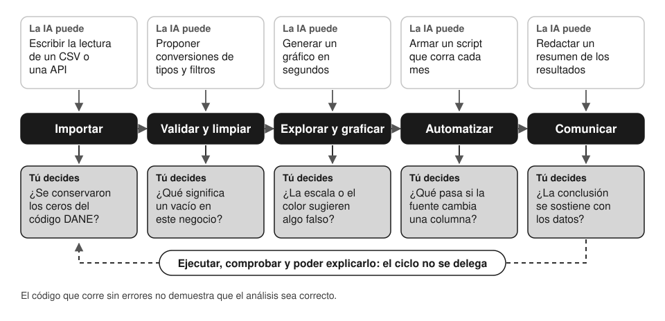

# Bienvenida {.unnumbered}

Este libro trata de cómo trabajar con datos de principio a fin: importarlos, organizarlos, analizarlos y comunicar lo que encontramos. R será el lenguaje principal de los ejemplos, y Python aparecerá en pestañas para comparar soluciones.

La idea es aprender los conceptos antes que memorizar funciones. Cada capítulo combina explicaciones, ejemplos, alternativas, consideraciones de rendimiento y ejercicios para practicar.

# ¿Por qué leer este libro en plena era de la inteligencia artificial? {.unnumbered}

Hoy basta con describir un problema para que una herramienta de inteligencia artificial devuelva código en segundos. Esa velocidad es real y vale la pena aprovecharla. Pero cambia la pregunta de fondo: si escribir código cuesta cada vez menos, ¿qué es lo que sigue teniendo valor?

El título de este libro propone una respuesta. **Código, datos y criterio** son tres cosas distintas. La inteligencia artificial es muy buena con la primera. Las otras dos, entender los datos y decidir si un resultado tiene sentido, siguen dependiendo de quien hace el análisis.

## Un ejemplo de este mismo libro {.unnumbered}

Imagina que le pides a un asistente que lea un archivo de ventas separado por punto y coma. Te entrega una línea razonable con `pandas`, la ejecutas, ajustas la codificación cuando aparece un error y la tabla se carga. Nada falla. Sin embargo, el código de municipio `05001` (Medellín) se convirtió en el número `5001`, y desde ese momento las ventas de Medellín ya no coinciden con el catálogo de sucursales. El total por región sale mal y ningún mensaje lo advierte.

Detectar ese problema no exige memorizar funciones. Exige saber qué preguntar: ¿cómo está escrito el archivo?, ¿qué tipo debería tener cada columna?, ¿qué columnas necesito? Ese es justamente el tema del capítulo de importación (@sec-importacion), y la misma lógica se repite en cada etapa del libro.

## Lo que la IA acelera y lo que sigue siendo tuyo {.unnumbered}

La @fig-ia-criterio resume la idea. En cada etapa del análisis hay una parte que se puede delegar y una pregunta que no.

{#fig-ia-criterio fig-alt="Cinco etapas en fila: importar, validar y limpiar, explorar y graficar, automatizar y comunicar. Sobre cada una, lo que la IA puede hacer, como escribir la lectura de un CSV o generar un gráfico. Debajo, en recuadros sombreados, la pregunta que decides tú, como si se conservaron los ceros del código DANE o si la conclusión se sostiene con los datos. Una línea punteada une el final con el inicio: ejecutar, comprobar y poder explicarlo."}

- **Que el código se ejecute no demuestra que el análisis sea correcto.** Puede leer mal una fecha, excluir registros, aplicar una fórmula inadecuada o producir una gráfica que lleve a una conclusión equivocada.
- **Hay que elegir entre soluciones.** Una respuesta puede ser técnicamente válida y, aun así, difícil de mantener, demasiado lenta para el volumen de datos o inadecuada para el contexto.
- **El contexto no está en el código.** Una herramienta de IA no sabe cómo se recopilaron los datos, qué significan para el negocio ni qué restricciones de privacidad aplican. Tampoco debería recibir información sensible sin autorización.

Por eso este libro no compite con la inteligencia artificial: te prepara para usarla bien. Cada capítulo explica el porqué de las decisiones, muestra qué sale mal con la configuración por defecto y compara alternativas, para que puedas reconocer una buena respuesta cuando la veas.

::: {.callout-tip}
## Cómo usar la IA mientras lees

1. **Intenta primero.** Resuelve cada ejercicio por tu cuenta antes de pedir ayuda.
2. **Pide explicaciones, no solo soluciones.** Una buena pregunta es «¿por qué esta opción y no otra?».
3. **Ejecuta y compara.** Predice el resultado, ejecuta el código y revisa si coincide.
4. **Protege los datos.** No pegues datos personales, credenciales ni información confidencial en un asistente.
5. **Si no puedes explicarlo, no lo uses.** Todavía.
:::

La inteligencia artificial puede escribir el código. El conocimiento y el criterio te permiten decidir si ese código es correcto, seguro y útil.

# Para quién es este libro {.unnumbered}

Está dirigido a quienes quieren aprender análisis de datos de forma práctica y reproducible. No es necesario conocer R o Python en profundidad; los requisitos y la preparación del entorno se explicarán al comienzo.

# Cómo usarlo {.unnumbered}

Puedes leer los capítulos en orden o consultar un tema puntual. Para aprovechar los ejercicios, intenta resolverlos antes de mirar las soluciones y modifica los ejemplos para responder tus propias preguntas.

Los archivos de práctica, los datos de ejemplo y otros materiales complementarios estarán en el [repositorio de materiales](https://github.com/romu545/codigo-datos-criterio-material). El texto del libro está en el [repositorio del libro](https://github.com/romu545/codigo-datos-criterio). Si encuentras un error o tienes una pregunta, puedes abrir un *issue* en el repositorio del libro.

# Licencia {.unnumbered}

El texto de este libro se publica bajo licencia [CC BY-NC-SA 4.0](https://creativecommons.org/licenses/by-nc-sa/4.0/deed.es): puedes compartirlo y adaptarlo con fines no comerciales, dando crédito al autor y manteniendo la misma licencia.

El código de los materiales se publica bajo licencia MIT. Los datos conservan la licencia de su fuente original, indicada en el repositorio de materiales.
